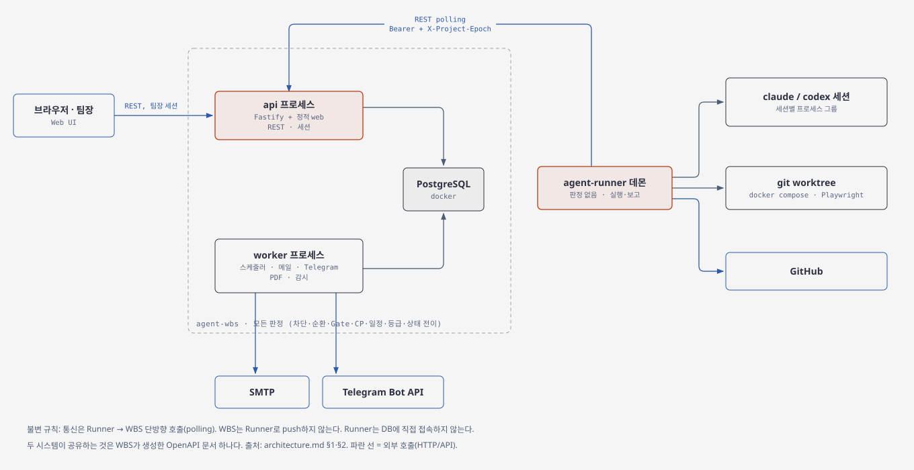

# Agent WBS 문서 안내

## 이 프로젝트는 무엇인가

Agent WBS는 팀장이 일(Task)을 계획하고 승인하면, AI(인공지능) Agent(Claude·Codex)가 그 일을 개발·검증해 GitHub(git 저장소를 호스팅하는 서비스)에 병합하기까지를 관리하는 시스템이다.
팀장이 보는 웹 화면·서버·DB인 **Agent WBS**가 모든 판정을 하고, 개발 PC(개인용 컴퓨터)에서 Agent를 실제로 실행하는 **Agent Runner**는 시킨 일을 하고 결과를 보고한다.
`docs/plan/`의 문서들은 원본 설계(가이드와 프로토타입)를 바탕으로 「무엇을, 어떤 규칙으로, 어떤 순서로 만들지」 정한 구현 기준선이다.

## 문서 읽는 순서

처음 합류했다면 아래 순서로 읽기를 권한다. 모르는 말이 나오면 [용어집](glossary.md)을 펼쳐 둔다.

1. [architecture.md](plan/architecture.md) — 전체 그림을 먼저 잡는다.
2. [data-model.md](plan/data-model.md) — 무엇을 저장하고 상태가 어떻게 바뀌는지 본다.
3. [contracts.md](plan/contracts.md) — 두 시스템이 주고받는 API 규칙을 본다.
4. [milestones.md](plan/milestones.md) — 무엇을 어떤 순서로 만들고 어떻게 완료를 확인하는지 본다.
5. [open-questions.md](plan/open-questions.md) — owner가 정한 것과 아직 답이 없는 것을 확인한다.

## 각 문서가 답하는 질문

- **[architecture.md](plan/architecture.md)**
  - 두 시스템(Agent WBS, Agent Runner)은 각각 무엇을 맡고, 어떻게 이야기하나?
  - 어떤 기술로, 어떤 폴더 구조로, 어떤 포트에서 돌리나?
  - 가이드가 애매하거나 서로 부딪치는 곳을 우리는 어떻게 정했나(해석 결정 D-01~D-35)?
- **[data-model.md](plan/data-model.md)**
  - DB에 어떤 테이블이 있고, 각 테이블은 무엇을 담나?
  - Task·시도·변경 제안 같은 것들의 상태는 어떤 순서로 바뀌나?
  - 초기화는 어떻게 안전하게 하나?
- **[contracts.md](plan/contracts.md)**
  - 화면(팀장)과 Runner는 서버의 어떤 API를, 어떤 규칙으로 부르나?
  - 오류가 나면 어떤 코드가 오고, 받은 쪽은 무엇을 해야 하나?
  - 시도 1회는 claim부터 병합까지 어떤 순서로 흘러가나?
- **[milestones.md](plan/milestones.md)**
  - 무엇을 어떤 순서로 만드나(M0~M8)?
  - 작업 하나가 끝났다는 것은 어떤 명령으로 확인하나?
  - 가이드의 어느 절을 어느 작업이 맡나?
- **[open-questions.md](plan/open-questions.md)**
  - owner가 이미 정해 준 것은 무엇인가(Q-01~Q-06, Q-10~Q-12 등)?
  - 아직 답을 받지 못한 질문은 무엇이고, 답이 없을 때 어디까지 만들어도 되나?
- **[glossary.md](glossary.md)**
  - 문서에 나오는 용어와 약어는 무슨 뜻인가?

## 핵심 그림

그림의 내용은 문서와 같다. 그림과 문서가 다르게 보이면 문서가 기준이다.

- [두 시스템의 구성](plan/diagrams/system-overview.svg) — architecture.md §1·§2
- [Task 상태 흐름](plan/diagrams/task-states.svg) — open-questions.md §0.1의 승인된 Q-05 표
- [시도 1회의 흐름](plan/diagrams/attempt-flow.svg) — contracts.md §4.1 (claim → 실행 → 검사 → QA → Gate → 병합)

각 SVG(선과 글자로 그린 벡터 그림 형식) 옆의 같은 이름 `.html` 파일이 그림의 원본이다. 그림을 고치려면 `.html`을 고친 뒤 SVG로 다시 내보낸다.

## 원본 자료의 위치

계획 문서는 아래 원본을 근거로 한다. 원본끼리 부딪치면 가이드가 우선한다.

- **가이드(G)**: `prototype/docs/Agent-WBS-설계의도-및-구현가이드.md` — 설계 의도와 구현 방법. 문서에서 `G L123`은 이 파일의 123번째 줄이다.
- **프로토타입(P)**: `prototype/uiux/Main.dc.html` — 클릭해 볼 수 있는 화면 시안. 문서에서 `P L456`은 이 파일의 456번째 줄이다.
- 화면 전수 목록과 화면별 근거 자료는 `docs/ui/`에 있다.
