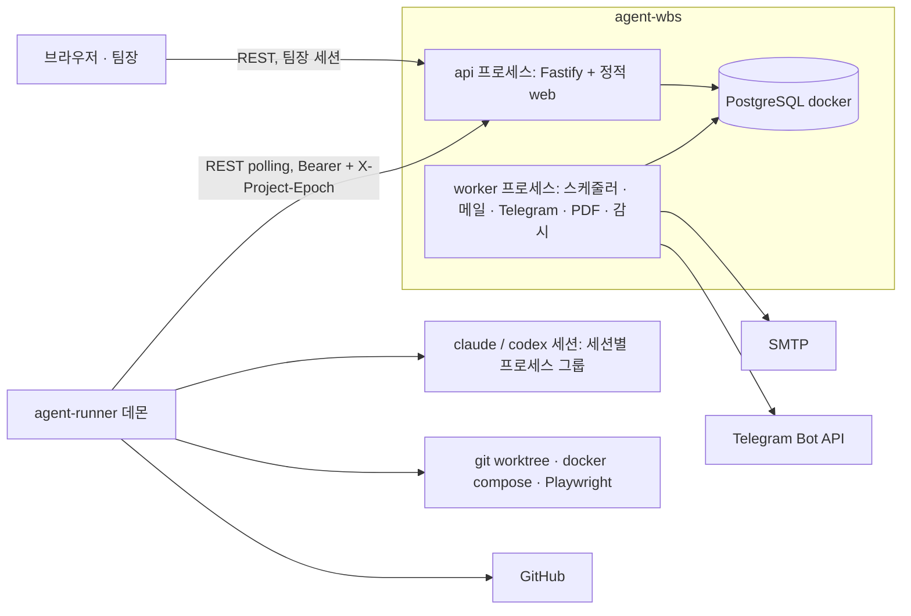

# Agent WBS 구현 기준선 — 아키텍처

> **이 문서가 답하는 질문**
> - 두 시스템(Agent WBS, Agent Runner)은 각각 무엇을 맡고, 어떻게 이야기하나?
> - 어떤 기술로, 어떤 폴더 구조로, 어떤 포트에서 돌리나?
> - 가이드가 애매하거나 서로 부딪치는 곳을 우리는 어떻게 정했나(D-01~D-35)?
>
> 처음 읽는다면 [docs/README.md](../README.md)부터 보세요. 낯선 용어는 [용어집](../glossary.md)에 있습니다.

**기준 문서와 표기**

- 기준: `prototype/docs/Agent-WBS-설계의도-및-구현가이드.md`(이하 **G**, 1,210줄 전체) · `prototype/uiux/Main.dc.html`(이하 **P**).
  - G는 가이드(설계 의도와 구현 방법을 적은 원본 문서)다.
  - P는 프로토타입(실제로 클릭해 볼 수 있는 화면 시안 HTML)이다.
    - 용어 풀이: HTML = 웹 페이지를 만드는 문서 형식.
- 충돌하면 G가 우선한다(G L5).
  - 왜: P는 화면을 보여 주려고 만든 Mock(가짜 데이터로 움직이는 시안)이라, 실제 동작 규칙은 G가 더 정확하다.
- 표기: `G§4.2` = 가이드 절, `L255` = 가이드 줄, `P L3063` = 프로토타입 줄.
- 근거 구분:
  - **[G]** 가이드가 정함
  - **[결정]** 가이드가 정하지 않아 이 문서가 정함
  - **[추정]** 실측·확인이 필요한 값
- 관련 문서: [data-model.md](data-model.md) · [contracts.md](contracts.md) · [milestones.md](milestones.md) · [open-questions.md](open-questions.md)

## 1. 책임 경계

이 제품은 두 시스템으로 나뉜다.

- **Agent WBS** (`agent-wbs/`): 팀장이 보는 웹 화면과 서버, 데이터베이스다. 모든 「판정」을 한다.
- **Agent Runner** (`agent-runner/`): 개발 PC(개인용 컴퓨터)에서 AI(인공지능) Agent(Codex/Claude)를 실제로 실행하는 프로그램이다. 판정은 하지 않고 시킨 일을 하고 결과를 보고한다.

왜 나누나: 「무엇이 맞는지 정하는 쪽」과 「실제로 일하는 쪽」을 분리하면, 일하는 쪽이 실수하거나 고장 나도 판정 기준이 흔들리지 않는다.

그림으로 보기: [두 시스템의 구성](diagrams/system-overview.svg)

아래는 항목별로 두 시스템이 맡는 일이다.

- **역할** [G§2.1]
  - Agent WBS: Web UI(팀장) · REST(HTTP의 GET·POST 같은 요청으로 데이터를 주고받는 방식) API · PostgreSQL(관계형 데이터베이스)
  - Agent Runner: 개발 PC(WSL)에서 Codex/Claude 세션 실행, Planning Agent 포함
- **판정** [G§2.3, §9.1-2]
  - Agent WBS: **모든 판정**: 차단·순환·Gate·CP 시뮬레이션·일정·등급 정책·상태 전이
  - Agent Runner: 판정 없음. `run-grade` 등 서버 정책을 받아 실행하고 결과 보고 (§9.3-3)
- **실행** [G§4.13, §6.6]
  - Agent WBS: 실행하지 않음. 저장·표시
  - Agent Runner: CLI 세션, 빌드·테스트·기동·E2E, git/GitHub(push·PR·status·병합)
- **자원** [G§6.6, §6.7]
  - Agent WBS: 상한 계산(PC 사양 기반/직접 지정)
  - Agent Runner: 상한 이내 적응형 조절, 프로세스 그룹/cgroup 관측·회수
- **저장** [G§4.13 L485]
  - Agent WBS: DB 원본, Evidence 업로드 파일, 보고서 PDF(인쇄용 문서 파일 형식)
  - Agent Runner: worktree, 입력 checkout(저장소의 특정 커밋 내용을 폴더에 꺼낸 것), 실행 로그 원문·스크린샷(`~/.agentwbs/runs/<id>/`, 기본 30일)
- **외부 발송**
  - Agent WBS: 메일(§4.11), Telegram(메신저. 알림을 봇으로 보낸다, §4.14)
  - Agent Runner: GitHub(git 저장소를 호스팅하는 서비스, §9.6-2-6)
- **화면**
  - Agent WBS: 12개 메뉴(P `NAV` L3063)
  - Agent Runner: 없음 — CLI와 로그뿐 (§2.1 L143, §11)

**불변 규칙** (어떤 경우에도 지키는 규칙)

1. 통신은 **Runner → WBS 단방향 호출(polling)**. WBS는 Runner로 push하지 않는다 [G§2.1].
   - polling은 Runner가 일정 간격으로 「할 일 있나요?」 하고 서버에 묻는 방식이다.
   - 왜: 서버가 Runner를 찾아갈 필요가 없어 연결 구조가 단순하다.
2. Runner는 DB에 직접 접속하지 않는다 [결정: 판정 우회 방지].
   - 왜: Runner가 DB를 직접 고치면 서버의 판정 규칙을 거치지 않게 된다.
3. Agent 세션은 worktree 안에서만 일한다. push·PR·WBS API 호출은 Runner 프로세스가 한다 [G§9.5-4-1].
   - worktree는 같은 저장소를 작업마다 따로 꺼내 둔 작업 폴더다.
   - 왜: Agent가 GitHub 토큰이나 서버 토큰을 만지지 못하게 하기 위해서다.
4. 두 시스템은 소스를 공유하지 않는다. 공유물은 WBS가 생성한 **OpenAPI 문서** 하나다(§3.3).
   - OpenAPI 문서는 API의 경로·요청·응답 모양을 기계가 읽을 수 있게 적은 파일이다.
5. 정본: Task·이력은 DB, 제품 계약은 관리 대상 저장소의 `contracts/`, 파이프라인은 `.agentwbs/pipeline.yaml`(main) [G§4.12, §4.13].
   - 정본은 「여러 사본이 다르면 이것이 맞다」고 정한 원본이다.

## 2. 런타임 구성

런타임 구성은 「프로그램이 실제로 돌 때 어떤 프로세스들이 떠 있고 서로 어떻게 연결되는가」다. 아래 그림은 원본 그대로 둔 Mermaid(글로 그림을 그리는 문법) 그림이고, 같은 내용을 [SVG 그림](diagrams/system-overview.svg)으로도 그렸다.



**프로세스별 역할**

- `api`
  - 내용: REST, 세션, 정적 web 서빙(운영)
  - 근거: §2.1
- `worker`
  - 내용: 보고서 정기 생성·누락 보충, 메일 큐, 알림 outbox, heartbeat 감시, PDF, 파일 삭제 재시도, 무결성 점검(저장된 데이터끼리 모순이 없는지 검사).
  - 일감은 PostgreSQL 작업 테이블을 `FOR UPDATE SKIP LOCKED`(다른 worker가 잡은 행은 건너뛰고 잠그는 SQL)로 소비한다. (이미 다른 worker가 잡은 행은 건너뛰고 남은 행을 가져가는 SQL 방식이다.)
    - 용어 풀이: SQL = DB에 묻고 고치는 언어.
  - 근거: §4.11 §4.14 §8.5 §9.6-6. 별도 메시지 브로커는 두지 않는다(§2.2 주의)
  - outbox는 「보낼 것」을 먼저 DB에 적어 두고 나중에 보내는 대기함이다.
- `postgres`
  - 내용: 단일 인스턴스
  - 근거: §2.2
- `runner`
  - 내용: 단일 데몬(단일 실행 PC)
  - 근거: §6.6

**`worker`를 API와 분리하는 이유** [결정]

- Chromium(PDF를 만들 때 쓰는 브라우저 엔진) PDF와 발송 지연이 API 응답을 막지 않게 한다.
- 워커 정지가 상태 저장을 실패시키지 않는다(§9.6-3-7).
- 정기 작업의 유일성은 프로세스 수가 아니라 DB 고유키로 보장한다.
  - 예: 같은 날 보고서가 두 번 만들어지는 것은 「worker를 하나만 띄워서」가 아니라 DB의 unique 키로 막는다.

### 2.1 화면 갱신

- 가이드 근거: §2.2 주의(L155)는 Mock의 SSE·WebSocket을 도입 근거로 삼지 말라고 하고, 스택은 REST다.
  - SSE·WebSocket은 서버가 화면으로 바로 밀어 주는 실시간 통신 방식이다.
- 그래서 **REST 변경 커서 polling**을 쓴다 [결정].
  - `GET /api/changes?after=<seq>`를 화면이 보일 때 3초, 숨김 시 30초 간격으로 호출한다.
  - 응답에 나온 해당 query만 무효화한다(다시 불러온다).
  - 커서(`seq`)는 「어디까지 읽었는지」를 나타내는 번호다.
- 왜 충분한가: 같은 PC에서 동작하므로 충분하다. 나중에 SSE로 바꿔도 이벤트 형식은 같다.
- 상세는 [contracts.md §7](contracts.md#7-변경-이벤트).

### 2.2 요청·작업 분배

- 빈 곳: G§2.1은 Runner가 「작업을 가져간다」고 하지만 G§8에는 작업 획득·시도 생성·검증 결과·관측 보고 API가 없다.
- 그래서 `runner_jobs` 임대(lease) 방식을 보강한다 [결정].
  - 임대(lease)는 「이 일은 정해진 시간 동안 이 Runner가 맡는다」는 표시다. 시간이 지나면 다시 확인한다.
- 팀장 요청(저장소 확인, 초기 분석, 차이 분석, CI 재실행, 배포 확인)과 시도 실행이 모두 같은 대기열을 쓴다.
  - 왜: 대기열이 하나면 Runner가 일을 받는 방법도 하나로 단순해진다.
- 정리 명령만 `GET /api/runner/commands`로 가장 먼저 받는다(§8.4).
  - 왜: 초기화 뒤 남은 찌꺼기를 치우기 전에 새 일을 하면 옛 데이터와 섞일 수 있다.

## 3. 기술 스택

### 3.1 가이드 확정 [G§2.2]

가이드가 이미 정한 기술이다. 바꾸지 않는다.

- 화면: React(화면을 부품 단위로 만드는 라이브러리) + TypeScript(타입을 붙인 JavaScript) + Vite(화면 코드 개발 서버·빌드 도구) + Mantine(React 화면 부품 라이브러리)
- 서버: Node.js(서버에서 JavaScript를 실행하는 환경) + Fastify(Node.js 웹 서버 프레임워크) + TypeScript
- DB: PostgreSQL + Drizzle ORM(TypeScript로 DB 테이블을 다루는 라이브러리)
- 저장소 구성: pnpm workspace(`apps/web`, `apps/api`, `packages/shared`, `packages/db`)
- 통신: REST
- 그 외 확정: 보고서 PDF = Playwright(브라우저를 자동 조작하는 테스트 도구) Chromium(§4.11), 글꼴 = Pretendard GOV(제품에 쓰는 한글 글꼴) 1.3.9(§9.7), `tabular-nums`(숫자 폭을 같게 맞추는 글꼴 설정).

### 3.2 추천 1안 [결정]

**버전 고정 원칙**

- 정확한 패키지 버전은 M0에서 설치 시점의 안정판으로 고정하고 lockfile을 커밋한다.
- 왜: 가이드에 없는 버전을 문서에 지어내지 않는다.
- TypeScript는 6.0.3이다 — 최신 7.0.2는 typescript-eslint(TypeScript용 코드 규칙 검사 도구) 8.74.0의 지원 범위(`<6.1.0`) 밖이다.

**항목별 선택과 이유**

- Node
  - 선택: 26 계열(설치본 v26.13.0), `engines`와 `.nvmrc`로 고정
  - 이유: 개발 PC 설치본. P TASK-0001의 「20 LTS(오래 지원하는 안정 버전)」는 Mock
- 패키지 관리
  - 선택: pnpm(설치본 12.16.1), `packageManager` 고정
  - 이유: §2.2
- PostgreSQL
  - 선택: `postgres:16-alpine`(digest 고정)
  - 이유: P TASK-0002가 사용한 값, G§4.2의 예와 일치
- 스키마/계약
  - 선택: TypeBox → Fastify 검증 + OpenAPI 3.1 생성
  - 이유: 한 정의에서 검증·타입·문서
- 서버 상태(FE)
  - 선택: TanStack Query(서버 데이터를 불러오고 캐시하는 화면 라이브러리)
  - 이유: 이전 화면 유지·배경 갱신 규칙(§0.3)에 맞음
- 라우팅
  - 선택: React Router
  - 이유: `/wbs/TASK-0007`, `/settings/report` URL(웹 주소) 요구(§4.3, §4.9)
- 가상 스크롤(화면에 보이는 행만 그려 긴 목록을 빠르게 보여 주는 기법)
  - 선택: `@tanstack/react-virtual`(화면에 보이는 행만 그리는 가상 스크롤 라이브러리)
  - 이유: §9.2-5. P MSG-002도 이 라이브러리를 언급
- Gantt(막대로 일정을 보여 주는 차트)
  - 선택: 자체 SVG(선과 글자로 그린 벡터 그림 형식)
  - 이유: 가로 스크롤 없는 전폭·범위선·빗금 요구가 특수함(§4.3)
- 테스트
  - 선택: Vitest(TypeScript 단위 테스트 도구), Fastify inject(실제 네트워크 없이 서버에 요청을 넣어 보는 테스트) + 실제 PostgreSQL, Playwright
  - 이유: P 정의(§4.13)와 동일 도구
- 메일
  - 선택: nodemailer(Node.js 메일 발송 라이브러리)
  - 이유: G§10 L1119 예시
- 로그
  - 선택: pino(Node.js 로그 라이브러리) + redact
  - 이유: 토큰 마스킹 필수(§9.6-3-1)
- Runner
  - 선택: Node.js + TypeScript 단일 pnpm 패키지, 로컬 상태는 파일(JSON, 원자적 rename) + 보고 outbox
    - 용어 풀이: JSON = 중괄호·대괄호로 데이터를 적는 텍스트 형식.
  - 이유: G가 미정. 같은 언어로 검토·운영 단순화. 추가 DB 없음
  - 원자적 rename: 새 파일을 다 쓴 뒤 이름만 바꿔 끼워, 쓰다 죽어도 반쯤 쓴 파일이 남지 않게 하는 방법이다.
- 계약 해석
  - 선택: YAML(들여쓰기로 구조를 적는 설정 파일 형식) parser(문서를 읽어 구조로 바꾸는 프로그램) + OpenAPI parser, AsyncAPI parser, SQL은 **임시 DB에 적용 후 catalog 조회(DB가 스스로 기록한 테이블·열 목록을 읽는 것)**
  - 이유: 직접 SQL 파서를 쓰지 않음(§4.12 L430 「자주 쓰는 형식만」)

### 3.3 디렉토리

```
agent-wbs/
  package.json pnpm-workspace.yaml compose.yaml .env.example
  apps/api/        # routes → services → repositories, worker 진입점 포함
  apps/web/        # features/<menu>, shared/ui
  packages/shared/ # 순수 함수(Sel 이식) · enum · 상태 전이 표 · API 스키마(TypeBox)
  packages/db/     # drizzle schema · migrations · seed/fixtures
  contracts/openapi.json   # 생성물(커밋). CI에서 drift 검사
  e2e/             # Playwright 시나리오(G§12)
agent-runner/
  package.json
  src/{api,state,jobs,exec,cli,git,github,cli-update,ci,design,planning,readiness,resources,security}/
  src/api/generated/       # openapi.json에서 생성(커밋)
  test/fakes/{claude,codex,github}/  # 실제 과금 없이 검증하는 가짜 실행기
```

**코드 나누기 규칙**

- API는 Route(검증·DTO) / Service(규칙) / Repository(쿼리만)로 나눈다(P TASK-0005 `resp`).
  - 왜: 요청 모양 검사, 업무 규칙, DB 쿼리를 섞지 않아야 각각 따로 테스트하고 고칠 수 있다.
- `packages/shared`의 판정 함수는 I/O(파일·DB·네트워크를 읽고 쓰는 일)와 현재 시각 접근이 없는 순수 함수다(시각은 인자).
  - 순수 함수는 같은 입력이면 언제나 같은 결과를 내는 함수다.
  - 왜: 테스트가 쉽고, 서버와 화면이 같은 함수를 믿고 쓸 수 있다.
- FE(화면 쪽 코드, 프론트엔드)는 같은 함수를 미리보기에만 쓴다. 저장 결과는 서버 응답으로 교체한다(§2.3).
  - 왜: 최종 판정은 언제나 서버가 한다(§1 책임 경계).

## 4. 인증 · 보안

주제마다 「무엇을 어떻게 하는지」와 근거를 적었다.

- **팀장 세션**
  - 서버 세션(DB) + `HttpOnly; SameSite=Strict` 쿠키를 쓴다.
  - 변경 요청은 `Origin` 일치 + CSRF 헤더가 있어야 한다. (CSRF: 다른 사이트가 몰래 팀장 대신 요청을 보내는 공격)
  - 이 PC(loopback)는 CLI가 발급한 짧은 수명의 1회용 링크로 로그인한다. loopback은 같은 PC 안에서 자기 자신에게 접속하는 연결이다.
  - LAN은 비밀번호(로그인 화면 1개)로 로그인한다.
  - 링크 토큰은 hash 저장·1회 소비, URL에서 즉시 제거한다.
  - 비밀번호는 CLI로 설정하고 scrypt(비밀번호 해시 계산 방식) hash 저장, 시도 횟수 제한을 둔다.
  - 근거: owner Q-01, §8 L877
- **Runner 토큰**
  - 난수 32바이트 Bearer(토큰을 가진 쪽을 인증하는 방식), DB에는 SHA-256(내용 지문을 만드는 해시 방식)만 저장한다.
  - `pnpm runner-token:create`로 1회 출력·폐기 가능.
  - 왜 hash만 저장하나: DB가 새어 나가도 원래 토큰을 알 수 없다.
  - 근거: §8
- **권한 분리**
  - 라우트별 principal 선언(`lead`/`runner`)이 없으면 서버 기동 실패. (principal: 요청한 주체가 팀장인지 Runner인지)
  - 등록·초기화·승인은 Runner 토큰으로 403.
  - 왜: 새 API를 만들 때 권한 선언을 빠뜨리는 실수를 서버가 켜질 때 바로 잡는다.
  - 근거: §9.5-5
- **바인딩**
  - 기본 `127.0.0.1`.
  - LAN은 명시 설정 + 비밀번호 설정 없으면 기동 거부.
  - 1회용 링크는 loopback 연결에서만 소비.
  - 평문 HTTP(웹 요청·응답 규약) LAN에서 비밀번호·세션이 노출될 수 있음을 운영 문서에 알림.
  - 근거: §4.14 L543
- **비밀값**
  - `secrets` 테이블에 AES-256-GCM(널리 쓰는 대칭 암호화 방식)으로 암호화해 둔다. 키는 `AWBS_SECRET_KEY`(파일 권한 0600의 env).
    - 용어 풀이: env = 프로그램에 넘기는 설정 값.
  - API는 `tokenSet`/`last4`만 보여 준다(설정됐는지와 끝 4자리).
  - 근거: §8.7, §9.6-7, §9.5-4-1
- **GitHub 토큰 전달** [결정]
  - `gh` 로그인 방식은 서버에 비밀값 없음.
  - 토큰 방식은 Runner 공개키로 암호화한 **봉인 값만** Runner에 전달하고 Runner 메모리에서만 복호.
  - 왜: 평문을 API 응답에 싣지 않아 §9.5-4-1을 지킨다.
- **Agent 환경 변수**
  - allowlist 방식 env로 시작. (허용 목록에 있는 변수만 넘긴다.)
  - GitHub·Runner 토큰, SSH(원격 PC에 안전하게 접속하는 방식) agent, `AWBS_*` 제거.
  - 근거: §9.5-4-1
- **실행 격리** (owner Q-08 B, 2026-11-27 아이템 15)
  - 세션별 worktree, CLI sandbox/권한 모드.
  - Agent뿐 아니라 **CI 명령·계약 추출·임시 SQL**도 같은 자격 증명 경계에서 실행.
  - OS(운영체제) 수준 격리는 **Agent 전용 OS 계정**이다.
    - Agent는 `awbs-agent` 계정으로 돈다. 이 계정은 로그인 셸과 sudo 권한이 없다.
    - Runner(사람 계정)는 root 소유 실행 래퍼 하나만 이 계정으로 실행할 수 있다(sudoers 한 줄).
    - Agent 작업 폴더·입력 사본·CLI는 Runner 홈 밖의 `/srv/agentwbs`에 둔다. Runner 홈(`~/.agentwbs`, `~/.config/gh`, `~/.ssh`)은 Agent가 읽지 못한다.
    - WSL에서는 Windows 드라이브(`/mnt`)와 Windows 프로그램 실행 통로(`/run/WSL`)도 Agent 계정만 막는다. 실행 전마다 래퍼가 다시 확인한다.
    - 왜: 같은 계정이면 CLI sandbox가 하나라도 뚫리는 순간 Runner의 비밀값을 모두 읽는다. 계정을 나누면 커널의 파일 권한이 경계가 된다.
    - 같은 사용자 권한에서 생기는 TOCTOU(확인한 뒤 쓰기 전에 상태가 바뀌는 틈) 한계도 이 전용 계정 실행으로 막는다(M7-03 결정 10).
  - 설계와 설치 절차: `agent-runner/docs/isolation.md`, owner 실행 순서: `agent-runner/docs/OWNER-RUNBOOK.md`.
  - **지금 상태**(main 023ac8f): 설치 스크립트와 작업 영역 배치·CLI 설치·로그인 확인은 연결됐다. exec 계층이 전용 계정 실행을 아직 부르지 않아, Runner는 실제 Agent 세션과 실제 CI 명령을 띄우지 않는다(fake 실행만).
  - 남은 위험(세션끼리의 접근, 같은 PC의 네트워크 서비스, 공용 `/tmp`)은 `agent-runner/docs/isolation.md` §11.
  - 근거: §6.7
- **입력 자료**
  - 실행 금지, submodule(저장소 안에 다른 저장소를 끼워 넣은 것) 미추적, 읽기 전용, realpath(링크를 모두 따라간 실제 경로)·symlink 검사, HTML 응답으로 서빙하지 않음.
  - 근거: §9.5-3
- **외부 쓰기 관문** (M5·M7 통합, 독립 리뷰 반영)
  - Runner의 모든 외부 쓰기(GitHub REST 호출·Git push)는 **같은 M4 쓰기 관문**(권한·host·세대, deploy key 점검)을 지난다.
    - 왜: 쓰기 경로마다 확인을 따로 두면 한 곳이 빠지는 순간 PC 변경 격리(contracts §3.4-5)가 깨진다.
  - job에서 나온 쓰기(시도 job의 push·PR, 통합 job의 상태 기록·H′ push·병합)는 그 앞에 **소유 확인**(이 job을 아직 맡고 있는가: 임대·중단)이 더 붙는다.
    - 소유 확인은 전송 **바로 앞**에서 하고, 그 사이에 다른 대기를 두지 않는다. 중단 신호는 진행 중인 요청과 push도 끊는다.
    - 예외: 초기화 정리(PR 닫기·브랜치 삭제·시스템 push)는 job 임대가 없다. 서버의 초기화 세대(epoch)로 묶인 정리 명령이라 M4 관문만 지난다(`agent-runner/src/github/write-gate.ts` `WRITE_CALLERS`).
  - GitHub가 연결되지 않았으면 push하지 않는다. 호출 횟수 제한 403은 권한 부족이 아니다.
  - 응답을 잃은 것은 「실행 안 됨」이 아니다. 읽기로 대조하고, 확인하지 못하면 「모름」으로 둔다.
  - push는 자기 프로세스 그룹으로 띄운다. 중단하면 그룹이 비었음을 확인한 뒤에만 「중단됨」이다.
    - 그룹을 정리할 때는 신호를 보내기 직전마다 그룹 대표(leader)의 pid·시작 시각을 대조한다. 다르면 아무것도 죽이지 않는다.
    - `/proc/<pid>/stat`의 상태 X(끝나서 회수되는 중)는 「없는 프로세스」로 본다. 그룹이 비었는지는 따로 확인한다.
  - 중단하거나 결과를 모르는 push는 중단 기록에 남긴다. 다음 push 전에 원격 head를 다시 읽어 대조한다.
    - 중단 기록은 잠금 아래 한 곳에서 원자적으로 고친다. 손상된 기록은 지우지 않고 보존한다.
    - 기록마다 고유 번호를 붙이고, 대조 뒤에는 읽은 기록과 번호가 같을 때만 지운다.
  - 「중단됨」은 원격이 바뀌지 않았다는 증거가 아니다. 원격에 이미 접수된 쓰기는 되돌리지 않는다.
  - GitHub 쪽 조건(병합 head SHA, 브랜치 기준 PR 조회, 일반 push)은 소유 확인을 대신하지 않는다. 남는 아주 짧은 틈을 좁히는 추가 조건일 뿐이다.
  - 중단된 뒤에는 외부 쓰기를 하지 않는다. 그래서 통합 대기열은 중단 뒤 GitHub 상태(commit status)도 기록하지 않는다. 통합 대기열의 H′ push와 초기화 시스템 push도 같은 M4 관문을 지난다(초기화는 소유 확인 없음, 위 예외).
  - 메일(SMTP)·Telegram 발송은 이 관문의 「외부 쓰기」(Git·GitHub 쓰기)에 들지 않는다(contracts §4.4).
- **명령 실행**
  - shell(명령어를 해석해 실행하는 프로그램) 문자열 조합 금지(argv). (명령과 인자를 배열로 따로 넘겨, 입력값이 명령으로 해석되지 않게 한다.)
  - `pipeline.yaml`은 **main 커밋** 것만 실행.
  - 왜: Agent가 자기 브랜치에서 파이프라인 정의를 바꿔 검사를 피하지 못하게 한다.
  - 근거: §4.13
- **경로**
  - 변경 파일·Evidence 경로는 저장소 상대, `..`·절대·symlink 이탈 거부.
  - 근거: P TASK-0012
- **로그**
  - `authorization`, `cookie`, `botToken`, `password`, `/bot<token>/` 마스킹. 오류 본문에도 적용.
  - 근거: §9.6-3-1
- **보안 HTTP** [결정]
  - CSP, `X-Content-Type-Options`, body 크기 제한, 업로드 형식 제한.
- **DB 역할**
  - migration 소유자와 앱 역할 분리.
  - 추가 전용 테이블은 UPDATE/DELETE 권한 회수 + 트리거. 초기화만 전용 함수로 허용.
  - 왜: 이력처럼 「한 번 쓰면 바뀌면 안 되는」 기록을 앱 버그가 고치지 못하게 한다.
  - 근거: §9.1-3 §4.11 L375

**Git 규칙**

- 강제 push 금지.
- 보호 경로(`prototype/`·`.agentwbs/`)와 빌드 결과물은 Task 검사 첫 단계에서 거부(§9.5-4).
- 보호 경로 비교는 rename을 포함한 merge-base(두 브랜치가 갈라진 공통 조상 커밋) diff로 한다.
  - 왜: 파일 이름만 바꿔서 보호 경로를 건드리는 경우도 잡기 위해서다.
- ① 검사 사본에서는 기준 커밋과 대상 커밋의 symlink(파일 모드 `120000`)를 거부한다(M7-01).
  - 저장소 안을 가리키는 정상 상대 링크도 지금은 허용하지 않는다.
  - 왜: 링크 연결 전체와 실행 중 목표 파일 변경을 검증하는 격리가 아직 없다. 링크를 따라가면 고정한 커밋 밖의 파일을 읽을 수 있다.
  - 기준 사본에서 거부되면 `failScope: 'baseline'`, 대상 사본에서 거부되면 `failScope: 'task'`다. 기준 실패는 Task 재작업으로 보내지 않고 기준 문제 경보로 처리한다.
  - symlink 허용 범위는 Q-08의 격리 검증 뒤 따로 정한다.

## 5. Runner 내부

Runner 안의 모듈(코드 묶음)별 책임이다.

- `api`
  - 책임: 생성된 client, epoch 헤더, 재시도, **영속 outbox**(재전송)
  - 근거: §9.1-6
- `jobs`
  - 책임: 정리 명령 우선 → 작업 임대 → 준비 → 시작 확정 → 실행 → 보고·보유 해제
  - 개발 결과는 push한 뒤 PR을 열거나 기존 PR을 쓰고, 그 커밋으로 ①을 돌린다(contracts §3.6-1). push·PR은 외부 쓰기 관문(§4)을 지난다.
  - 근거: §4.2, §8.4
- `resources`
  - 책임: host·readiness·usage·models·concurrency 보고, 적응형 한도, 무거운 작업 semaphore(CI와 공유)
  - semaphore는 동시에 몇 개까지만 실행하게 막는 번호표 장치다.
  - 근거: §6.6, §7.4, §9.6-2-2
- `exec`
  - 책임: 세션마다 새 프로세스 그룹/cgroup.
  - **시도 종료와 자원 반환은 별개**: 같은 PC에서는 그룹이 빈 것을 확인하거나 boot ID가 바뀐 경우에만 슬롯·충돌 묶음을 반환([contracts §3.4](contracts.md#34-실행-보유와-복구)).
  - 강제 종료는 그룹 단위.
  - 왜: Agent가 띄운 자식 프로세스가 남아 있으면 실제로는 아직 PC 자원을 쓰고 파일을 고치고 있을 수 있다.
  - 임대 끝 5초 전을 자기 마감으로 보고, claim 뒤 자원이 모자라면 최대 20초 기다린다(contracts §3.4-10·11). 시각 비교는 단조 시계(뒤로 가지 않는 시계)로 한다.
  - 전용 계정(Q-08)에서는 Runner가 다른 계정의 프로세스에 신호를 보낼 수 없다. 그래서 cgroup 일괄 종료(`cgroup.kill`)를 먼저 쓰고, 안 되면 래퍼의 `kill-group`·`kill-all`을 Agent 계정으로 실행한다(`agent-runner/docs/isolation.md` §9).
  - 근거: §6.7
- `cli`
  - 책임: Claude `stream-json` / Codex `exec --json` 어댑터. 모르는 이벤트는 보존하고 추정하지 않음. **hook(이벤트가 날 때 자동으로 부르는 사용자 스크립트) 미사용**
  - 근거: §6.7
- `planning`
  - 책임: 독립 분석 → 교차 검토 → 이견 조정 → 초안/CP. 출력은 JSON Schema 검증, 실패 시 실패 단계부터 재시도
  - 근거: §4.2 §4.5
- `git`
  - 책임: 로컬 저장소 — clone(원격 저장소를 통째로 복사해 오는 것)·worktree(ext4)·브랜치·초기화 되돌림
  - 근거: §4.2 §6.6 §9.6-2
- `github`
  - 책임: GitHub — PR·status·병합·봉인 자격 증명(M4-04, 실증 M4-06)
  - 근거: §4.2 §6.6 §9.6-2
- `cli-update`
  - 책임: Codex·Claude CLI 최신 유지(§5.1, M4-05)
  - 근거: §6.7
- `design`
  - 책임: 관리 대상 저장소의 계약 해석·추출·대조(M6-06)
  - 근거: §4.12
- `ci`
  - 책임: 4단계 실행기(엔진이 아니라 순차 실행·기록)
  - ①은 main에 고정한 `pipeline.yaml`로 Runner 소유의 새 검사 사본에서 돈다. Agent 작업 폴더에서 돌리지 않는다(`agent-runner/src/ci/README.md`).
  - Runner가 붙이는 단계 이름은 `runner:`로 시작하고, 실패 결과에 `failScope`(`baseline`·`task`)를 넣는다(contracts §3.6-2).
  - **설정 지문이 다르면 시작하지 않는다**: Runner에 등록된 저장소 하나라도 `config` 파일 지문이 등록 때와 다르면 앱 전체가 멈춘다. 서버에 보고하기 전에 끝나므로 Runner 로그로 확인한다.
    - 왜: 설정이 바뀌었다는 것은 누군가 Runner 소유 저장소를 건드렸다는 뜻이다(예: `core.hooksPath` 추가로 git 명령마다 임의 프로그램 실행). 다른 저장소만 골라 계속 돌리면 변조를 놓칠 수 있다.
    - 복구 순서는 `agent-runner/src/ci/README.md` 「실행과 근거」 끝에 있다.
  - ④는 job의 `commit`(요청 시점의 main) 자신의 `pipeline.yaml`을 읽는다(`deployPipelineAt`). main에 들어가지 않은 커밋은 배포 확인하지 않는다.
  - ③④는 단계 결과 보고서(`AWBS_REPORT`)와 nonce로 이번 시도의 결과만 읽는다. ④는 이 PC의 compose만 대상으로 하고, 실패하면 마지막 정상 커밋으로 되돌린다(contracts §3.6-2·3, Q-15 A).
  - 근거: §4.13
- `readiness`
  - 책임: 시작 시 + 매일: CLI·git·node·pnpm·pg·repo·disk·subs·obs·git-lfs
  - 준비 점검의 `codex`·`claude`와 CLI 업데이트(§5.1)는 같은 전용 설치 `AWBS_HOME/cli/<agent>/current/bin/<agent>`를 기준으로 보고한다(M4 통합, M4-05 리뷰 M-1).
    - 두 보고는 보고기 하나에서 key별로 합쳐진다.
    - 왜: 준비 점검과 CLI 업데이트가 서로 다른 실행 파일을 보면, 「준비됨」이라고 보고한 CLI와 실제로 실행하는 CLI가 달라진다.
  - 야간 화면 비교용 `font`(고정 글꼴)와 `render`(렌더러 네트워크 차단 방식), 보고 거부 기록 `reports`도 보고한다(contracts §3.1).
  - `repo` 항목은 git 안전 계층이 쓰는 `/proc`와 `flock`(Linux 파일 잠금 명령)을 확인한다.
    - `/proc`를 읽을 수 없으면 fail이다. 작업 폴더 잠금을 확인할 수 없기 때문이다.
    - `flock`이 없으면 warn이다. 강제 종료로 남은 잠금을 자동으로 회수하지 못할 뿐, 잠금 자체는 보존된다.
  - 근거: §7.4 §6.7-8 §9.5-3

**이 PC 관측(2026-11-25, 읽기만 함)**

- WSL2, PID(프로세스 번호) 1 = systemd(리눅스에서 서비스를 띄우고 관리하는 프로그램), cgroup v2 마운트, 사용자 slice(systemd가 프로세스 묶음에 자원을 나눠 주는 단위) controller(cgroup에서 CPU·메모리 등 자원별로 재고 제한하는 기능) `cpu memory pids`.
  - 용어 풀이: CPU = 계산을 하는 처리 장치.
- 세션 scope 생성·측정은 M5-03에서 실측했다(2026-11-27).
  - 사용자 scope(`systemd-run --user --scope`)로 cgroup을 만들고 `cgroup.kill`로 자손까지 한 번에 끝낼 수 있었다. 측정값은 milestones M5-03 「검증 기록」.
  - 직접 만들기(위임)는 `EACCES`로 안 됐다. 그래서 사용자 scope를 쓴다. 안 되면 프로세스 그룹 + `/proc` 합산을 쓴다(§6.7-6).
  - 사용자 systemd는 로그인 세션이나 linger(`loginctl enable-linger <계정>`)가 있어야 뜬다. 운영 요구사항이다(§6.3).
- 설치본은 Codex 0.172.0, Claude 2.1.332(같은 날 2.1.330에서 자동 갱신됨)이다.
  - G의 검증 조합(Codex 0.167.0)과 다르므로 「미검증」에서 시작한다.
- `gh` 2.45.0과 `git-lfs`는 `/usr/bin`에 설치되어 있다(로그인 상태는 확인하지 않음).

### 5.1 CLI 최신 유지 (owner Q-12)

owner는 Codex·Claude CLI를 항상 최신으로 쓰라고 정했다. 그런데 일하는 도중 CLI를 바꾸면 실행 중인 세션이 깨질 수 있다. 그래서 「언제, 어떻게 바꾸는지」를 아래처럼 정한다.

- **대상**
  - Runner가 쓰는 Codex·Claude Code CLI.
  - 사용자 전역 설치를 건드리지 않고 `~/.agentwbs/cli/<agent>/<version>/`에 설치해 `current` 링크를 쓴다.
  - 전용 계정(Q-08)을 쓰면 설치 위치는 Agent 작업 영역 `/srv/agentwbs/cli`다. 로그인 상태 확인은 Agent 계정으로 한다. 로그인 정보는 Agent 계정 홈에 있다.
  - 공식 최신 채널의 정확한 설치 방법은 M4-05에서 확인한다.
- **확인 시점**
  - Runner 시작과 매일 준비 점검.
  - 새 버전이면 로컬에 `update_pending`만 기록한다.
- **적용 시점**
  - **현재 host·boot·Runner**가 소유한 자식 프로세스와 미해제 보유가 모두 0일 때(그 CLI 설치를 공유하는 범위).
  - 과거 host의 `unconfirmed` 보유는 그 host의 정리·감사 상태로만 남고 업데이트를 막지 않는다.
  - 업데이트 잠금을 잡아 새 claim을 멈추고 **다시 0을 확인**한 뒤 적용한다.
    - 왜 다시 확인하나: 처음 확인한 뒤 잠금을 잡기 전 사이에 새 일이 시작됐을 수 있다.
  - 실행 중 세션을 끊지 않는다.
  - 세션 시작 시 CLI 자체 자동 업데이트는 끈다(방법은 M4-05에서 검증).
  - 유휴 시간이 없으면 다음 유휴까지 대기하고 readiness 경고에 대기 버전을 적는다.
- **적용 절차**
  1. 새 버전 폴더에 설치
  2. 무과금 점검(실행 가능·버전·로그인 상태·필수 옵션)
  3. 링크 원자적 교체
  4. readiness/관측 등급 보고
  5. 잠금 해제
  - 하나의 CLI 실패가 다른 CLI를 막지 않는다.
- **실패 처리**
  - 다운로드·설치·점검 실패는 링크를 바꾸지 않는다.
  - 실행 중이던 기존 버전이 정상이면 계속 쓰되 readiness `warn`, 다음 확인 때 최신을 다시 시도한다.
  - 현재 CLI가 실행 불능이면 readiness `fail`로 해당 Agent만 멈춘다(§7.4).
  - 구버전으로 자동 하향하지 않는다.
  - 중단된 설치 폴더는 다음 시작 때 지운다.
- **버전 변경 뒤**
  - 같은 버전·모델·옵션 조합의 등록된 검증이 없으면 「미검증」, 보수 계산(확인되지 않은 값을 넉넉하게 잡는 계산, 1+예산), 재검증 대기.
  - 실행은 계속한다(§6.7).
  - 유료 재검증은 owner Q-12-잔여 결정(2026-11-27 아이템 15) 안에서만 한다: 검증 단계 전체 30회, 1회 최대 Effort high, 상한에 닿으면 멈추고 owner에게 묻는다. 실검증은 M8-04다.
- **화면**
  - 기존 readiness·관측 등급·경고만 쓴다.
  - 업데이트 버튼이나 설정을 추가하지 않는다.

## 6. 로컬 실행 · 배포

### 6.1 이름 · 포트 · 볼륨

이 PC에는 다른 프로젝트 컨테이너도 돌고 있다. 그래서 이름·포트·볼륨을 겹치지 않게 미리 정한다.

| 대상 | 값 |
|---|---|
| compose project | `awbs` |
| 컨테이너 | `awbs-postgres` |
| PostgreSQL | `127.0.0.1:25442 → 5432` |
| 볼륨 / 네트워크 | `awbs-pgdata` / `awbs-net` |
| API / web(dev) | `127.0.0.1:3100` / `127.0.0.1:5173` |
| 운영 | 아래 목록 참고 |
| 데이터 파일 | `~/.agentwbs/wbs/<epoch>/{evidence,pdf}` — epoch별 분리(초기화 경합 차단) |
| Runner 데이터 | `~/.agentwbs/{repos,worktrees,inputs,runs,state}` |
| Agent 작업 영역(Q-08 전용 계정) | `/srv/agentwbs/{cli,worktrees,inputs}` — 전용 계정을 쓰면 작업 폴더·입력 사본·CLI가 여기로 옮겨진다 |
| 관리 대상 프로젝트 CI compose | project `awbs-ci-<repo>` · 포트는 Runner 할당 |

- 운영: API가 web을 함께 서빙, 호스트 `5173`(G§4.14 기본 접속 주소와 같음). 개발과 동시 기동 시 `AWBS_PORT` 변경.
- 데이터 파일을 epoch별로 나누는 이유: 초기화 직후 옛 작업이 늦게 쓴 파일이 새 프로젝트 파일과 섞이지 않게 한다.

**다른 컨테이너와 부딪치지 않기**

- 기존 `verum-*` 컨테이너(25432)는 이름·포트·볼륨·네트워크 모두 겹치지 않는다.
- 명령은 반드시 `docker compose -p awbs -f agent-wbs/compose.yaml`로 한정한다.
- `docker system/volume prune`을 쓰지 않는다.
  - 왜: prune(쓰지 않는 docker 자원을 한꺼번에 지우는 명령)은 다른 프로젝트의 볼륨까지 지울 수 있다.
- 2026-11-25 확인 시 3000·3100·5173·8080·25442는 비어 있었다.

### 6.2 개발 DB

- 한 컨테이너에 `awbs_dev`, `awbs_test_<worktree slug>` DB를 둔다.
- 병렬 개발자는 서로 다른 test DB를 쓴다(§6.6 L777 원칙을 개발에도 적용).
  - 왜: 두 작업의 테스트가 같은 DB를 지우고 채우면 서로 결과를 망친다.
- 테스트는 `awbs_test_` 접두어가 아니면 시작을 거부한다(파괴적 초기화 방지).
  - 왜: 테스트는 DB를 비우고 시작하므로, 실수로 개발 DB를 가리키면 데이터가 날아간다.
- DB 이미지는 Debian 기반 `postgres:16`이고 `track_commit_timestamp=on`으로 띄운다. 시험 DB는 C.UTF-8 정렬로 만든다. 자세한 이유는 data-model §6 「DB 서버 요구사항」과 `agent-wbs/packages/db/TESTING.md`.

### 6.3 실행 명령(M0에서 제공)

```
pnpm -C agent-wbs env:init         # 최초 1회. .env와 PC 단위 DB 비밀번호 생성(커밋하지 않음)
docker compose -p awbs -f agent-wbs/compose.yaml up -d --wait postgres   # 저장소 루트에서 실행
pnpm -C agent-wbs install --frozen-lockfile && pnpm -C agent-wbs db:migrate && pnpm -C agent-wbs dev
pnpm -C agent-runner start          # 토큰 발급 후
```

**운영 배포**

- Dockerfile(기반 이미지 digest 고정, Pretendard GOV + Chromium 포함) → compose `api`·`worker`·`postgres`.
  - 용어 풀이: Dockerfile = 컨테이너 이미지를 만드는 설명서; docker compose = 여러 컨테이너를 설정 파일 하나로 띄우는 도구.
- `GET /health`, `GET /health/db`(P TASK-0001/0002).
- Runner는 호스트 CLI·worktree를 다루므로 **컨테이너가 아니라** 사용자 systemd 서비스로 실행한다 [결정].
  - Runner 계정에 linger를 켠다(`loginctl enable-linger <계정>`). 왜: 재시작 뒤 아무도 로그인하지 않으면 사용자 systemd가 없어 Runner와 cgroup scope가 뜨지 않는다.
- 배포 확인(④) 대상은 이 PC의 docker compose다(owner Q-15 A, 2026-11-27 아이템 19). 원격 서버·SSH 대상은 넣지 않는다.
- 서버 계약 변경 배포는 관리 CLI `jobs open`·`jobs reissue`로 대기 중인 옛 job을 확인·재발급한다. 종료·대조 미확인 작업이 남으면 배포하지 않는다([절차](../ops/jobs-reissue.md)).
- 되돌리기는 커밋 해시로 다시 빌드한다(§4.13 L489).
- DB는 배포 전 `pg_dump`로 백업한다 [결정].

### 6.4 시간

- 저장 UTC `timestamptz`(시간대를 반영해 UTC의 한 시점으로 저장하는 타입. 원래 시간대 정보는 보관하지 않는다), 표시·하루 경계·스케줄은 `Asia/Seoul`(§9.2-2, §9.6-2).
- 프로세스 TZ(시간대 설정)에 의존하지 않고 명시적 변환을 쓴다.
  - 왜: 서버를 띄운 환경의 시간대 설정이 바뀌어도 「하루」의 경계가 흔들리지 않게 한다.
- **벽시계는 뒤로 갈 수 있다고 본다** (2026-11-27 확인)
  - 이 PC(WSL)의 시계는 약 32초마다 약 2.3초 뒤로 가는 것이 재현됐다.
  - 그래서 순서 판단은 벽시계 대신 뒤로 가지 않는 값으로 한다.
    - DB: 「최신 하나」는 저장 순번(`record_no`·`run_no`·`queue_no`)으로 고른다(data-model §1).
    - 보고서: 커밋 시계(`log_clock`)로 「그 시점 전」을 가른다(data-model §2.7 「보고서 상태 이력」).
    - Runner: 시간 간격은 단조 시계로 재고, 임대 끝 5초 전을 마감으로 본다(contracts §3.4-10).
    - 웹: 초안 보관의 로그인·로그아웃·보관 순서는 모든 탭이 공유하는 단조 세션 번호(벽시계 값과 「마지막 번호 + 1」 중 큰 값)로 비교한다(`apps/web/src/shared/state/sessionDrafts.ts`).

## 7. 해석 결정 기록

- 가이드 모순·Mock 잔재 중 **스스로 정한 것**이다.
- owner가 바꾸려면 이 번호로 지시하면 된다.
- owner만 정할 수 있는 것은 [open-questions.md](open-questions.md)에 있다.

**읽는 법**: 각 결정은 「출처 → 문제 → 결정」 순서다. 출처의 `↔`는 「서로 부딪치는 두 근거」를 뜻한다. 「owner 결정」이라고 적힌 것은 owner가 직접 답한 것이다.

- **D-01**
  - 출처: §2.1 L133-135 ↔ owner 직접 지시
  - 문제: Runner는 「별도 개발」
  - 결정: **owner가 Agent WBS와 Agent Runner를 둘 다 구현하라고 직접 지시했다**(근거: 2026-11-25 coordinator Task `task_75bfa5470ead`의 확정 사항, 원 Task `task_cc20c579318b`의 구현 대상 2개). 시스템 경계(REST만)는 유지
- **D-02**
  - 출처: §2.2 L155 ↔ P `DS_MOCK`
  - 문제: WebSocket·SSE·Kafka(메시지를 중계·보관하는 메시지 브로커)·Redis 등
  - 결정: 제품 런타임에 도입하지 않음. 「설계」 메뉴의 표시 형식으로만 지원
- **D-03**
  - 출처: §8.2 ↔ §2.1
  - 문제: 작업 획득·시도 시작·검증·관측 API 없음
  - 결정: contracts.md에 보강 API(「보강」 표시)
- **D-04**
  - 출처: §4.2 L261, §8.4 L932-935
  - 문제: 모든 요청이 epoch 일치 필요 → 초기화된 Runner가 정리 명령을 못 받는 교착
    - epoch는 「프로젝트 세대 번호」다. 초기화할 때마다 1 오른다.
    - 교착: 정리 명령을 받으려면 새 epoch가 필요하고, 새 epoch로 가려면 정리를 끝내야 해서 서로 기다리는 상태.
  - 결정:
    - `commands` 조회·결과와 heartbeat만 이전 epoch 허용.
    - heartbeat는 204를 유지하고 현재 epoch를 `X-Current-Epoch` 헤더로 준다.
    - 명령 결과는 명령 ID와 그 명령의 epoch가 일치해야 한다.
    - 그 외 변경 API는 트랜잭션 잠금 안에서 epoch를 다시 확인해 409(data-model §5.1)
- **D-05**
  - 출처: §0.3 L34·L65, §12-17·18·20·21 ↔ §4.2 L217, §3 L190
  - 문제: 경로 변환·zip(여러 파일을 하나로 묶은 압축 파일)·해시 시나리오 잔재
  - 결정: GitHub 방식 확정. 17·18은 30·31로 대체하고 경로 UI는 만들지 않음
- **D-06**
  - 출처: §12-20 「8개」 ↔ P L6648 9개(+`techwait`)
  - 문제: 화면 상태 수
  - 결정: P의 9개 전부 구현
- **D-07**
  - 출처: §12-21 「26종」 ↔ §0.3 표 22행 ↔ P L6650 21개
  - 문제: 오류 상태 수
  - 결정: 표와 P의 합집합(P에만 있는 하위 Agent 설치 실패·Runner 준비 안 됨 포함). 개수는 고정하지 않음
- **D-08**
  - 출처: §5.4 L655 「선행 Task가 있는 Task 삭제 거부」 ↔ §8.1 L888, 코드명 `TASK_HAS_SUCCESSORS`
  - 문제: 문구 반대
  - 결정: **후속**이 있으면 거부
- **D-09**
  - 출처: §0.1 L15 「9개 메뉴」, §3 L183 ↔ P NAV 12개
  - 문제: 메뉴 수
  - 결정: 대시보드~설정 12개(§4 본문에 모두 존재)
- **D-10**
  - 출처: §6.4 L714 ↔ §8.3 L915
  - 문제: 자동 재조정 끔: 버전 안 만듦 / 202 검토 대기
  - 결정: 202 + `pending` 재조정 기록, 기준 버전 없음. Planning의 「재조정 실행」(P L1620)으로 다시 계산해 확정
- **D-11**
  - 출처: §6.7-5 「여유분(전체×0.75)」 ↔ §6.6 L737
  - 문제: 0.75는 Agent별 상한
  - 결정: §6.6 공식만 구현, 별도 여유분 없음. 하위 Agent의 순간 초과는 막지 못하므로(§6.7-5) 상한을 **물리적 절대 상한으로 표현하지 않는다**
- **D-12**
  - 출처: P TASK-0012 `subagents[].used`, 「Agent가 시작·종료를 알림」 ↔ §6.7
  - 문제: hook형 보고
  - 결정: §6.7. 실제 사용은 사후 확정 필드로 분리
- **D-13**
  - 출처: §8.5-1 L967 「파일 저장소」 ↔ §4.13 L488
  - 문제: 로그 위치
  - 결정: Runner PC. 서버는 발췌·위치만
- **D-14**
  - 출처: §8.1 `/projects/:projectId` ↔ §8.4 `/project` ↔ §8.6 `/boot/`
  - 문제: 경로 혼용
  - 결정: 가이드 경로 그대로. `:projectId`는 현재 프로젝트 ID와 다르면 404
- **D-15**
  - 출처: §8 L924 `updatedAt`
  - 문제: 동시성 토큰
  - 결정: `updatedAt`은 마이크로초 ISO 문자열로 비교, 갱신 트리거가 단조 증가 보장. PATCH/PUT뿐 아니라 DELETE·승인·관계 변경 등 모든 팀장 수정에 적용(contracts §1.3)
- **D-16**
  - 출처: §5.6 ↔ P `simulate` L4304
  - 문제: 실행 이력이 있는 Task 취소 규칙이 G에 없음
  - 결정: P를 따라 반영 보류. 남은 일은 후속 Task로(§5.2-1 L619)
- **D-17**
  - 출처: §4.9 ↔ P 점검 탭
  - 문제: 구현 현황·미리보기
  - 결정: 실서비스 제외, 정합성 점검만(§0.4, §4.9)
- **D-18**
  - 출처: §4.13 ↔ P 실행 흐름(즉시 QA)
  - 문제: ①이 상태 전이에 없음
  - 결정: ① 통과 전까지 시도·Task `running`. ① 통과 후 QA 시도 생성
- **D-19**
  - 출처: §4.2 L235
  - 문제: 최초 `.agentwbs/pipeline.yaml` 내용 주체 미정
  - 결정: Runner 내장 템플릿으로 생성, 초기 분석 결과에 표시. 템플릿은 최초 파일 생성만 뜻하며 기술 선택이나 파이프라인 변경 승인을 대신하지 않는다. 이후 변경은 예외 없이 팀장 승인
- **D-20**
  - 출처: §4.8 L332, §4.2 L249
  - 문제: 완료 Task 보존
  - 결정: CP `modify/remove`가 완료 Task면 보류하고 수정 Task 제안
- **D-21**
  - 출처: §8.2 heartbeat 60초 ↔ P Mock WS(WebSocket의 줄임말) 10/30초
  - 문제: 주기
  - 결정: 60초, 3회 누락(설정값, §9.2-3)
- **D-22**
  - 출처: §6.6 L777 ↔ §4.13 L481
  - 문제: DB 분리 단위
  - 결정: 엔진 한 벌 공유, worktree별 DB
- **D-23**
  - 출처: §0.4 L93, §10
  - 문제: Mock 버튼
  - 결정: 제품에 없음. 시나리오는 fake Runner로 재현
- **D-24**
  - 출처: §7.4 Mock 정의 10개
  - 문제: 실제 정의
  - 결정: P `SUB_MOCK`은 **demo fixture로만** 사용. 실제 v1은 제품 제약·정책에 맞춰 작성하고 교차 검토(M5-06). 관리 대상 스택이나 Runner 계약 전용 지시를 일반 정의에 고정하지 않으며 외부 모음은 설치하지 않음
- **D-25**
  - 출처: §9.2-4
  - 문제: 진행률 원천
  - 결정: 1차는 상태 가중치 방식, Runner 진행 정보는 표시만. 값은 owner Q-03에 따라 P `STAGE_PCT`
- **D-26**
  - 출처: owner Q-12 ↔ §0.3 L58 「검증 버전으로 고정」, §12-26 「0.167.0 복귀」
  - 문제: CLI 고정 조치
  - 결정: owner 결정 우선. 같은 화면·경고는 유지하되 조치는 「재검증 후 등록」만 안내하고 고정/하향 조치를 제공하지 않음. 시나리오 26의 복귀 단계는 재검증 등록으로 대체
- **D-27**
  - 출처: §5.4 ↔ P `depMet` L3677·`simulate` L4329
  - 문제: SS 선행이 취소되면 충족인지 미정
  - 결정 (owner 결정):
    - 시작 전 취소된 선행의 SS 관계를 취소 반영과 같은 트랜잭션에서 제거.
    - `cancelled`를 「시작됨」으로 세지 않음.
    - 다른 선행이 남으면 후속은 계속 차단.
    - FS 관계 처리는 P `simulate`(관계 제거) 그대로
- **D-28**
  - 출처: §4.3 L273(1,280px·컬럼 끄기), §13 L1206(반응형), §4.14(휴대폰 링크)
  - 문제: 좁은 화면 지원 범위
  - 결정 (owner 결정):
    - 1280 이상은 전체 지원·가로 스크롤 없음(§4.3).
    - 1280 미만은 표 영역만 가로 스크롤 열람(컬럼 설정은 유지).
    - 휴대폰은 Task·CI·변경 제안 상세 열람만 보장하고 편집·승인 조작 최적화는 하지 않음
- **D-29**
  - 출처: §6.5 L719·§7.3 L847(재개는 항상 같은 등급) ↔ §7.2 L832(허용 해제 시 재판단)
  - 문제: 두 규칙이 겹침
  - 결정 (owner 결정):
    - 중단 시도의 모델이 **허용 해제**되었으면 재판단한 새 유효 등급으로 재개하고 이전→이후 등급·사유를 이력에 기록.
    - 재판단 전에는 재개하지 않음.
    - 다른 이유로는 등급을 바꾸지 않음
- **D-30**
  - 출처: §7.3 L845 ↔ Q-06(모델별로 없는 단계)
  - 문제: 다음 단계가 현재 모델에 없을 때 상향 순서 미정
  - 결정 (owner 결정):
    - 목표 = 직전 공통 단계+1.
    - 현재 모델이 지원하면 그대로, 아니면 rank 순으로 **목표 단계를 지원하는 다음 허용 모델**의 그 단계로 상향.
    - 지원하지 않는 모델은 건너뛰고 단계를 건너뛰어 올리지 않음.
    - 예: gpt-5.5 xhigh(4) → 5를 지원하는 다음 허용 모델의 5.
    - 대상이 없으면 같은 등급 재시도·알림 횟수 계산(L845).
    - 이미 공통 5단계면 기존 규칙(한 단계 위 허용 모델)
- **D-31**
  - 출처: §6.2·§6.3-3 ↔ P `eToDn` L4227(M1-04에서 확인)
  - 문제: P는 미착수 Task 시작일을 용량 0인 날로 둘 수 있음
  - 결정: **그날 용량이 0이면 다음 가용일에 시작**(일반 규칙, demo의 특정 Task 예외가 아님). 작업 불가일인 오늘도 같다. P 대조 테스트에 의도한 차이로 명시
- **D-32**
  - 출처: §6.3-4 ↔ P `capacity` L4215(M1-04 리뷰에서 확인)
  - 문제: P는 `rLo`가 `rate`보다 커져 비관이 중간값보다 빨라질 수 있음
  - 결정: 비관 가동률은 **`rLo ≤ rate`**로 제한. P 대조 테스트에 의도한 차이로 명시
- **D-33**
  - 출처: §5.2-1 L607·609·611·614 ↔ P `splitCheck`(기록 없이 합의 문구 표시)
  - 문제: 불충족·미기록 처리 없음
  - 결정 (owner 결정):
    - 규칙 5 `revert`·7 `contract`·9 `refactor`는 결과·합의 주체·근거를 기록(data-model §2.3-1).
    - 미기록·불충족은 승인 보류.
    - 적용 범위 [결정]: CP 승인·자동 반영, 초기 WBS 승인, Task 착수 승인.
    - 설정에서 끈 규칙은 제외.
    - 초기 승인에서 다른 자동 규칙 위반의 처리는 §5.2-1 L620 그대로
- **D-34**
  - 출처: §5.2-1 L618
  - 문제: 일부 선후행이 빠진 분할의 처리 없음
  - 결정 (owner 결정):
    - 원래 순서가 보장되지 않으면 보류, 동등한 간접 경로 허용. 판정은 data-model §2.3-2.
    - AC 의미·계층 순서·테스트 포함은 CP의 `split_judgements`로 Planning이 확인.
    - 이 기록도 없거나 불충족이면 보류 [결정]
- **D-35**
  - 출처: P `simulate` L4330(허용) ↔ P 정합성 점검 L4387(결함)
  - 문제: 진행 중 Task에 미충족 선행 추가
  - 결정 (owner 결정): 변경 전 차단이 아니고 변경 후 차단되는 `running/qa/verifying` Task가 있으면 보류. CP는 `held`, 직접 의존성 추가는 409

## 8. 품질 기준

- **성능 측정**
  - 데이터 200 Task·1,000행 기준 목록 응답·렌더를 측정한다.
  - G§1.2-6은 200건 이상을 요구하고 P TASK-0007의 「1,000행 펼치기 100ms」는 Mock Task의 기준이므로 **[추정] 목표치**로만 쓴다.
- **로딩·오류 규칙**(§0.3)
  - 0.2초 이내 생략, 스켈레톤(로딩 중에 보여 주는 회색 자리 표시) 최소 0.3초, 10초 후 실패 전환, 저장 실패 시 입력 유지.
  - 왜 0.2초 이내는 생략하나: 아주 짧은 로딩 표시는 깜빡임으로만 보여 오히려 거슬린다.
- **접근성**
  - 상태는 색+텍스트, 키보드 J/K(키보드 단축키)·↑↓·Esc, `prefers-reduced-motion`(움직임을 줄여 달라는 사용자 설정).
  - 왜 색+텍스트인가: 색을 구분하기 어려운 사람도 상태를 읽을 수 있어야 한다.
- **화면 폭**(D-28)
  - 1280·1920에서 전체 기능, 가로 스크롤 없음.
  - 1280 미만은 페이지가 아니라 표 컨테이너만 가로 스크롤.
  - 휴대폰(검증 폭 390px [결정])은 알림 링크로 연 Task·CI·변경 제안 상세를 페이지 가로 스크롤 없이 읽을 수 있고, 상세 안의 표는 자체 가로 스크롤.
