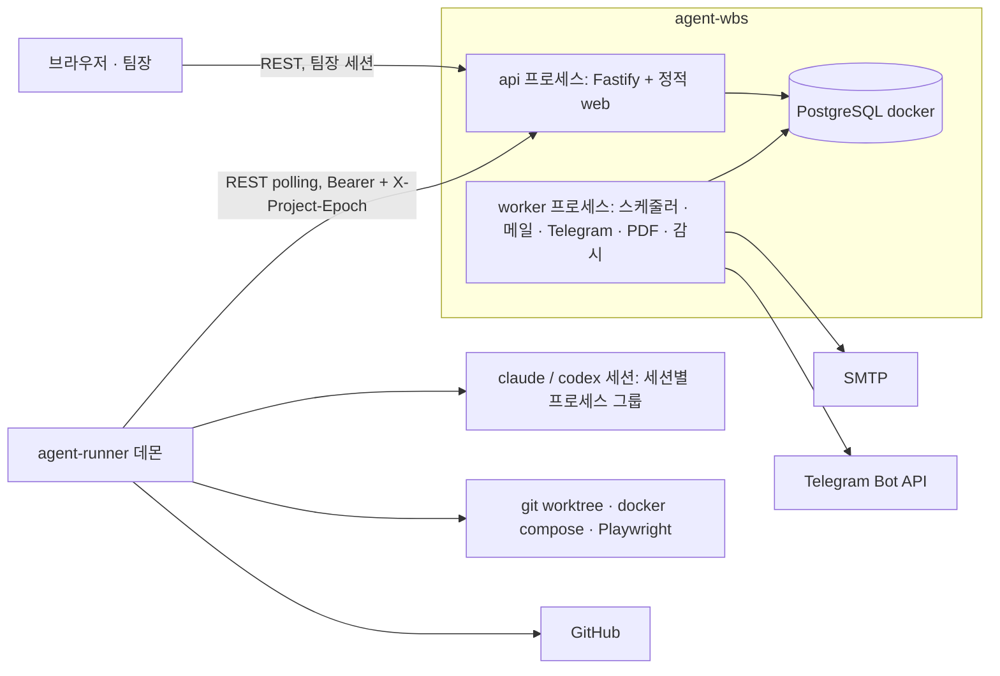

# Agent WBS 구현 기준선 — 아키텍처

- 기준: `prototype/docs/Agent-WBS-설계의도-및-구현가이드.md`(이하 **G**, 1,210줄 전체) · `prototype/uiux/Main.dc.html`(이하 **P**). 충돌하면 G가 우선한다(G L5).
- 표기: `G§4.2` = 가이드 절, `L255` = 가이드 줄, `P L3063` = 프로토타입 줄.
- 근거 구분: **[G]** 가이드가 정함 · **[결정]** 가이드가 정하지 않아 이 문서가 정함 · **[추정]** 실측·확인이 필요한 값.
- 관련 문서: [data-model.md](data-model.md) · [contracts.md](contracts.md) · [milestones.md](milestones.md) · [open-questions.md](open-questions.md)

## 1. 책임 경계

| | Agent WBS (`agent-wbs/`) | Agent Runner (`agent-runner/`) |
|---|---|---|
| 역할 [G§2.1] | Web UI(팀장) · REST API · PostgreSQL | 개발 PC(WSL)에서 Codex/Claude 세션 실행, Planning Agent 포함 |
| 판정 [G§2.3, §9.1-2] | **모든 판정**: 차단·순환·Gate·CP 시뮬레이션·일정·등급 정책·상태 전이 | 판정 없음. `run-grade` 등 서버 정책을 받아 실행하고 결과 보고 (§9.3-3) |
| 실행 [G§4.13, §6.6] | 실행하지 않음. 저장·표시 | CLI 세션, 빌드·테스트·기동·E2E, git/GitHub(push·PR·status·병합) |
| 자원 [G§6.6, §6.7] | 상한 계산(PC 사양 기반/직접 지정) | 상한 이내 적응형 조절, 프로세스 그룹/cgroup 관측·회수 |
| 저장 [G§4.13 L485] | DB 원본, Evidence 업로드 파일, 보고서 PDF | worktree, 입력 checkout, 실행 로그 원문·스크린샷(`~/.agentwbs/runs/<id>/`, 기본 30일) |
| 외부 발송 | 메일(§4.11), Telegram(§4.14) | GitHub(§9.6-2-6) |
| 화면 | 12개 메뉴(P `NAV` L3063) | 없음 — CLI와 로그뿐 (§2.1 L143, §11) |

불변 규칙:

1. 통신은 **Runner → WBS 단방향 호출(polling)**. WBS는 Runner로 push하지 않는다 [G§2.1].
2. Runner는 DB에 직접 접속하지 않는다 [결정: 판정 우회 방지].
3. Agent 세션은 worktree 안에서만 일한다. push·PR·WBS API 호출은 Runner 프로세스가 한다 [G§9.5-4-1].
4. 두 시스템은 소스를 공유하지 않는다. 공유물은 WBS가 생성한 **OpenAPI 문서** 하나다(§3.3).
5. 정본: Task·이력은 DB, 제품 계약은 관리 대상 저장소의 `contracts/`, 파이프라인은 `.agentwbs/pipeline.yaml`(main) [G§4.12, §4.13].

## 2. 런타임 구성



| 프로세스 | 내용 | 근거 |
|---|---|---|
| `api` | REST, 세션, 정적 web 서빙(운영) | §2.1 |
| `worker` | 보고서 정기 생성·누락 보충, 메일 큐, 알림 outbox, heartbeat 감시, PDF, 파일 삭제 재시도, 무결성 점검. PostgreSQL 작업 테이블을 `FOR UPDATE SKIP LOCKED`로 소비 | §4.11 §4.14 §8.5 §9.6-6. 별도 메시지 브로커는 두지 않는다(§2.2 주의) |
| `postgres` | 단일 인스턴스 | §2.2 |
| `runner` | 단일 데몬(단일 실행 PC) | §6.6 |

`worker`를 API와 분리하는 이유 [결정]: Chromium PDF와 발송 지연이 API 응답을 막지 않게 한다. 워커 정지가 상태 저장을 실패시키지 않는다(§9.6-3-7). 정기 작업의 유일성은 프로세스 수가 아니라 DB 고유키로 보장한다.

### 2.1 화면 갱신

§2.2 주의(L155)는 Mock의 SSE·WebSocket을 도입 근거로 삼지 말라고 하고, 스택은 REST다. 따라서 **REST 변경 커서 polling**을 쓴다 [결정]: `GET /api/changes?after=<seq>`를 화면이 보일 때 3초, 숨김 시 30초 간격으로 호출하고 해당 query만 무효화한다. 같은 PC에서 동작하므로 충분하며, 나중에 SSE로 바꿔도 이벤트 형식은 같다. 상세는 [contracts.md §7](contracts.md#7-변경-이벤트).

### 2.2 요청·작업 분배

G§2.1은 Runner가 「작업을 가져간다」고 하지만 G§8에는 작업 획득·시도 생성·검증 결과·관측 보고 API가 없다. `runner_jobs` 임대(lease) 방식을 보강한다 [결정]. 팀장 요청(저장소 확인, 초기 분석, 차이 분석, CI 재실행, 배포 확인)과 시도 실행이 모두 같은 대기열을 쓴다. 정리 명령만 `GET /api/runner/commands`로 가장 먼저 받는다(§8.4).

## 3. 기술 스택

### 3.1 가이드 확정 [G§2.2]

React + TypeScript + Vite + Mantine / Node.js + Fastify + TypeScript / PostgreSQL + Drizzle ORM / pnpm workspace(`apps/web`, `apps/api`, `packages/shared`, `packages/db`) / REST.
그 외 확정: 보고서 PDF = Playwright Chromium(§4.11), 글꼴 = Pretendard GOV 1.3.9(§9.7), `tabular-nums`.

### 3.2 추천 1안 [결정]

정확한 패키지 버전은 M0에서 설치 시점의 안정판으로 고정하고 lockfile을 커밋한다(가이드에 없는 버전을 문서에 지어내지 않는다).

| 항목 | 선택 | 이유 |
|---|---|---|
| Node | 26 계열(설치본 v26.13.0), `engines`와 `.nvmrc`로 고정 | 개발 PC 설치본. P TASK-0001의 「20 LTS」는 Mock |
| 패키지 관리 | pnpm(설치본 12.16.1), `packageManager` 고정 | §2.2 |
| PostgreSQL | `postgres:16-alpine`(digest 고정) | P TASK-0002가 사용한 값, G§4.2의 예와 일치 |
| 스키마/계약 | TypeBox → Fastify 검증 + OpenAPI 3.1 생성 | 한 정의에서 검증·타입·문서 |
| 서버 상태(FE) | TanStack Query | 이전 화면 유지·배경 갱신 규칙(§0.3)에 맞음 |
| 라우팅 | React Router | `/wbs/TASK-0007`, `/settings/report` URL 요구(§4.3, §4.9) |
| 가상 스크롤 | `@tanstack/react-virtual` | §9.2-5. P MSG-002도 이 라이브러리를 언급 |
| Gantt | 자체 SVG | 가로 스크롤 없는 전폭·범위선·빗금 요구가 특수함(§4.3) |
| 테스트 | Vitest, Fastify inject + 실제 PostgreSQL, Playwright | P 정의(§4.13)와 동일 도구 |
| 메일 | nodemailer | G§10 L1119 예시 |
| 로그 | pino + redact | 토큰 마스킹 필수(§9.6-3-1) |
| Runner | Node.js + TypeScript 단일 pnpm 패키지, 로컬 상태는 파일(JSON, 원자적 rename) + 보고 outbox | G가 미정. 같은 언어로 검토·운영 단순화. 추가 DB 없음 |
| 계약 해석 | YAML parser + OpenAPI parser, AsyncAPI parser, SQL은 **임시 DB에 적용 후 catalog 조회** | 직접 SQL 파서를 쓰지 않음(§4.12 L430 「자주 쓰는 형식만」) |

### 3.3 디렉토리

```
agent-wbs/
  package.json pnpm-workspace.yaml compose.yaml .env.example
  apps/api/        # routes → services → repositories, worker 진입점 포함
  apps/web/        # features/<menu>, shared/ui
  packages/shared/ # 순수 함수(Sel 이식) · enum · 상태 전이 표 · API 스키마(TypeBox)
  packages/db/     # drizzle schema · migrations · seed/fixtures
  contracts/openapi.json   # 생성물(커밋). CI에서 drift 검사
  e2e/             # Playwright 시나리오(G§12)
agent-runner/
  package.json
  src/{api,state,jobs,exec,cli,git,ci,planning,readiness,resources,security}/
  src/api/generated/       # openapi.json에서 생성(커밋)
  test/fakes/{claude,codex,github}/  # 실제 과금 없이 검증하는 가짜 실행기
```

- API는 Route(검증·DTO) / Service(규칙) / Repository(쿼리만)로 나눈다(P TASK-0005 `resp`).
- `packages/shared`의 판정 함수는 I/O와 현재 시각 접근이 없는 순수 함수다(시각은 인자).
- FE는 같은 함수를 미리보기에만 쓴다. 저장 결과는 서버 응답으로 교체한다(§2.3).

## 4. 인증 · 보안

| 주제 | 설계 | 근거 |
|---|---|---|
| 팀장 세션 | 서버 세션(DB) + `HttpOnly; SameSite=Strict` 쿠키. 변경 요청은 `Origin` 일치 + CSRF 헤더. 이 PC(loopback)는 CLI가 발급한 짧은 수명의 1회용 링크, LAN은 비밀번호(로그인 화면 1개). 링크 토큰은 hash 저장·1회 소비, URL에서 즉시 제거. 비밀번호는 CLI로 설정하고 scrypt hash 저장, 시도 횟수 제한 | owner Q-01, §8 L877 |
| Runner 토큰 | 난수 32바이트 Bearer, DB에는 SHA-256만. `pnpm runner-token:create`로 1회 출력·폐기 가능 | §8 |
| 권한 분리 | 라우트별 principal 선언(`lead`/`runner`)이 없으면 서버 기동 실패. 등록·초기화·승인은 Runner 토큰으로 403 | §9.5-5 |
| 바인딩 | 기본 `127.0.0.1`. LAN은 명시 설정 + 비밀번호 설정 없으면 기동 거부. 1회용 링크는 loopback 연결에서만 소비. 평문 HTTP LAN에서 비밀번호·세션이 노출될 수 있음을 운영 문서에 알림 | §4.14 L543 |
| 비밀값 | `secrets` 테이블에 AES-256-GCM, 키는 `AWBS_SECRET_KEY`(파일 권한 0600의 env). API는 `tokenSet`/`last4`만 | §8.7, §9.6-7, §9.5-4-1 |
| GitHub 토큰 전달 | `gh` 로그인 방식은 서버에 비밀값 없음. 토큰 방식은 Runner 공개키로 암호화한 **봉인 값만** Runner에 전달하고 Runner 메모리에서만 복호. 평문을 API 응답에 싣지 않아 §9.5-4-1을 지킨다 | [결정] |
| Agent 환경 변수 | allowlist 방식 env로 시작. GitHub·Runner 토큰, SSH agent, `AWBS_*` 제거 | §9.5-4-1 |
| 실행 격리 | 세션별 worktree, CLI sandbox/권한 모드. Agent뿐 아니라 **CI 명령·계약 추출·임시 SQL**도 같은 자격 증명 경계에서 실행. OS 수준 격리는 **Q-08**, 확정 전에는 fake 실행만 | §6.7 |
| 입력 자료 | 실행 금지, submodule 미추적, 읽기 전용, realpath·symlink 검사, HTML 응답으로 서빙하지 않음 | §9.5-3 |
| 명령 실행 | shell 문자열 조합 금지(argv). `pipeline.yaml`은 **main 커밋** 것만 실행 | §4.13 |
| 경로 | 변경 파일·Evidence 경로는 저장소 상대, `..`·절대·symlink 이탈 거부 | P TASK-0012 |
| 로그 | `authorization`, `cookie`, `botToken`, `password`, `/bot<token>/` 마스킹. 오류 본문에도 적용 | §9.6-3-1 |
| 보안 HTTP | CSP, `X-Content-Type-Options`, body 크기 제한, 업로드 형식 제한 | [결정] |
| DB 역할 | migration 소유자와 앱 역할 분리. 추가 전용 테이블은 UPDATE/DELETE 권한 회수 + 트리거. 초기화만 전용 함수로 허용 | §9.1-3 §4.11 L375 |

Git 규칙: 강제 push 금지, 보호 경로(`prototype/`·`.agentwbs/`)와 빌드 결과물은 Task 검사 첫 단계에서 거부(§9.5-4). 보호 경로 비교는 rename을 포함한 merge-base diff로 한다.

## 5. Runner 내부

| 모듈 | 책임 | 근거 |
|---|---|---|
| `api` | 생성된 client, epoch 헤더, 재시도, **영속 outbox**(재전송) | §9.1-6 |
| `jobs` | 정리 명령 우선 → 작업 임대 → 준비 → 시작 확정 → 실행 → 보고·보유 해제 | §4.2, §8.4 |
| `resources` | host·readiness·usage·models·concurrency 보고, 적응형 한도, 무거운 작업 semaphore(CI와 공유) | §6.6, §7.4, §9.6-2-2 |
| `exec` | 세션마다 새 프로세스 그룹/cgroup. **시도 종료와 자원 반환은 별개**: 같은 PC에서는 그룹이 빈 것을 확인하거나 boot ID가 바뀐 경우에만 슬롯·충돌 묶음을 반환([contracts §3.4](contracts.md#34-실행-보유와-복구)). 강제 종료는 그룹 단위 | §6.7 |
| `cli` | Claude `stream-json` / Codex `exec --json` 어댑터. 모르는 이벤트는 보존하고 추정하지 않음. **hook 미사용** | §6.7 |
| `planning` | 독립 분석 → 교차 검토 → 이견 조정 → 초안/CP. 출력은 JSON Schema 검증, 실패 시 실패 단계부터 재시도 | §4.2 §4.5 |
| `git` | clone·worktree(ext4)·브랜치·PR·status·병합·초기화 되돌림 | §4.2 §6.6 §9.6-2 |
| `ci` | 4단계 실행기(엔진이 아니라 순차 실행·기록) | §4.13 |
| `readiness` | 시작 시 + 매일: CLI·git·node·pnpm·pg·repo·disk·subs·obs·git-lfs | §7.4 §6.7-8 §9.5-3 |

이 PC 관측(2026-11-25, 읽기만 함): WSL2, PID 1 = systemd, cgroup v2 마운트, 사용자 slice controller `cpu memory pids`. 세션 scope 생성·측정은 아직 시험하지 않았으므로 **사용 가능 여부는 M5-03에서 확인**하고, 안 되면 프로세스 그룹 + `/proc` 합산을 쓴다(§6.7-6). 설치본은 Codex 0.172.0, Claude 2.1.332(같은 날 2.1.330에서 자동 갱신됨)이며 G의 검증 조합(Codex 0.167.0)과 다르므로 「미검증」에서 시작한다. `gh`와 `git-lfs`는 설치되어 있지 않다.

### 5.1 CLI 최신 유지 (owner Q-12)

- **대상**: Runner가 쓰는 Codex·Claude Code CLI. 사용자 전역 설치를 건드리지 않고 `~/.agentwbs/cli/<agent>/<version>/`에 설치해 `current` 링크를 쓴다. 로그인 정보의 경계는 Q-08에 따른다. 공식 최신 채널의 정확한 설치 방법은 M4-05에서 확인한다.
- **확인 시점**: Runner 시작과 매일 준비 점검. 새 버전이면 로컬에 `update_pending`만 기록한다.
- **적용 시점**: **현재 host·boot·Runner**가 소유한 자식 프로세스와 미해제 보유가 모두 0일 때(그 CLI 설치를 공유하는 범위). 과거 host의 `unconfirmed` 보유는 그 host의 정리·감사 상태로만 남고 업데이트를 막지 않는다. 업데이트 잠금을 잡아 새 claim을 멈추고 **다시 0을 확인**한 뒤 적용한다. 실행 중 세션을 끊지 않으며, 세션 시작 시 CLI 자체 자동 업데이트는 끈다(방법은 M4-05에서 검증). 유휴 시간이 없으면 다음 유휴까지 대기하고 readiness 경고에 대기 버전을 적는다.
- **적용 절차**: 새 버전 폴더에 설치 → 무과금 점검(실행 가능·버전·로그인 상태·필수 옵션) → 링크 원자적 교체 → readiness/관측 등급 보고 → 잠금 해제. 하나의 CLI 실패가 다른 CLI를 막지 않는다.
- **실패 처리**: 다운로드·설치·점검 실패는 링크를 바꾸지 않는다. 실행 중이던 기존 버전이 정상이면 계속 쓰되 readiness `warn`, 다음 확인 때 최신을 다시 시도한다. 현재 CLI가 실행 불능이면 readiness `fail`로 해당 Agent만 멈춘다(§7.4). 구버전으로 자동 하향하지 않는다. 중단된 설치 폴더는 다음 시작 때 지운다.
- **버전 변경 뒤**: 같은 버전·모델·옵션 조합의 등록된 검증이 없으면 「미검증」, 보수 계산(1+예산), 재검증 대기. 실행은 계속한다(§6.7). 유료 재검증은 Q-12-잔여 승인 전에는 실행하지 않는다.
- **화면**: 기존 readiness·관측 등급·경고만 쓴다. 업데이트 버튼이나 설정을 추가하지 않는다.

## 6. 로컬 실행 · 배포

### 6.1 이름 · 포트 · 볼륨

| 대상 | 값 |
|---|---|
| compose project | `awbs` |
| 컨테이너 | `awbs-postgres` |
| PostgreSQL | `127.0.0.1:25442 → 5432` |
| 볼륨 / 네트워크 | `awbs-pgdata` / `awbs-net` |
| API / web(dev) | `127.0.0.1:3100` / `127.0.0.1:5173` |
| 운영 | API가 web을 함께 서빙, 호스트 `5173`(G§4.14 기본 접속 주소와 같음). 개발과 동시 기동 시 `AWBS_PORT` 변경 |
| 데이터 파일 | `~/.agentwbs/wbs/<epoch>/{evidence,pdf}` — epoch별 분리(초기화 경합 차단) |
| Runner 데이터 | `~/.agentwbs/{repos,worktrees,inputs,runs,state}` |
| 관리 대상 프로젝트 CI compose | project `awbs-ci-<repo>` · 포트는 Runner 할당 |

기존 `verum-*` 컨테이너(25432)는 이름·포트·볼륨·네트워크 모두 겹치지 않는다. 명령은 반드시 `docker compose -p awbs -f agent-wbs/compose.yaml`로 한정하고, `docker system/volume prune`을 쓰지 않는다. 2026-11-25 확인 시 3000·3100·5173·8080·25442는 비어 있었다.

### 6.2 개발 DB

- 한 컨테이너에 `awbs_dev`, `awbs_test_<worktree slug>` DB를 둔다. 병렬 개발자는 서로 다른 test DB를 쓴다(§6.6 L777 원칙을 개발에도 적용).
- 테스트는 `awbs_test_` 접두어가 아니면 시작을 거부한다(파괴적 초기화 방지).

### 6.3 실행 명령(M0에서 제공)

```
docker compose -p awbs -f agent-wbs/compose.yaml up -d postgres   # 저장소 루트에서 실행
pnpm -C agent-wbs install --frozen-lockfile && pnpm -C agent-wbs db:migrate && pnpm -C agent-wbs dev
pnpm -C agent-runner start          # 토큰 발급 후
```

운영: Dockerfile(기반 이미지 digest 고정, Pretendard GOV + Chromium 포함) → compose `api`·`worker`·`postgres`. `GET /health`, `GET /health/db`(P TASK-0001/0002). Runner는 호스트 CLI·worktree를 다루므로 **컨테이너가 아니라** 사용자 systemd 서비스로 실행한다 [결정]. 되돌리기는 커밋 해시로 다시 빌드한다(§4.13 L489). DB는 배포 전 `pg_dump`로 백업한다 [결정].

### 6.4 시간

저장 UTC `timestamptz`, 표시·하루 경계·스케줄은 `Asia/Seoul`(§9.2-2, §9.6-2). 프로세스 TZ에 의존하지 않고 명시적 변환을 쓴다.

## 7. 해석 결정 기록

가이드 모순·Mock 잔재 중 **스스로 정한 것**이다. owner가 바꾸려면 이 번호로 지시하면 된다. owner만 정할 수 있는 것은 [open-questions.md](open-questions.md)에 있다.

| # | 출처 | 문제 | 결정 |
|---|---|---|---|
| D-01 | §2.1 L133-135 ↔ owner 직접 지시 | Runner는 「별도 개발」 | **owner가 Agent WBS와 Agent Runner를 둘 다 구현하라고 직접 지시했다**(근거: 2026-11-25 coordinator Task `task_75bfa5470ead`의 확정 사항, 원 Task `task_cc20c579318b`의 구현 대상 2개). 시스템 경계(REST만)는 유지 |
| D-02 | §2.2 L155 ↔ P `DS_MOCK` | WebSocket·SSE·Kafka·Redis 등 | 제품 런타임에 도입하지 않음. 「설계」 메뉴의 표시 형식으로만 지원 |
| D-03 | §8.2 ↔ §2.1 | 작업 획득·시도 시작·검증·관측 API 없음 | contracts.md에 보강 API(「보강」 표시) |
| D-04 | §4.2 L261, §8.4 L932-935 | 모든 요청이 epoch 일치 필요 → 초기화된 Runner가 정리 명령을 못 받는 교착 | `commands` 조회·결과와 heartbeat만 이전 epoch 허용. heartbeat는 204를 유지하고 현재 epoch를 `X-Current-Epoch` 헤더로 준다. 명령 결과는 명령 ID와 그 명령의 epoch가 일치해야 한다. 그 외 변경 API는 트랜잭션 잠금 안에서 epoch를 다시 확인해 409(data-model §5.1) |
| D-05 | §0.3 L34·L65, §12-17·18·20·21 ↔ §4.2 L217, §3 L190 | 경로 변환·zip·해시 시나리오 잔재 | GitHub 방식 확정. 17·18은 30·31로 대체하고 경로 UI는 만들지 않음 |
| D-06 | §12-20 「8개」 ↔ P L6648 9개(+`techwait`) | 화면 상태 수 | P의 9개 전부 구현 |
| D-07 | §12-21 「26종」 ↔ §0.3 표 22행 ↔ P L6650 21개 | 오류 상태 수 | 표와 P의 합집합(P에만 있는 하위 Agent 설치 실패·Runner 준비 안 됨 포함). 개수는 고정하지 않음 |
| D-08 | §5.4 L655 「선행 Task가 있는 Task 삭제 거부」 ↔ §8.1 L888, 코드명 `TASK_HAS_SUCCESSORS` | 문구 반대 | **후속**이 있으면 거부 |
| D-09 | §0.1 L15 「9개 메뉴」, §3 L183 ↔ P NAV 12개 | 메뉴 수 | 대시보드~설정 12개(§4 본문에 모두 존재) |
| D-10 | §6.4 L714 ↔ §8.3 L915 | 자동 재조정 끔: 버전 안 만듦 / 202 검토 대기 | 202 + `pending` 재조정 기록, 기준 버전 없음. Planning의 「재조정 실행」(P L1620)으로 다시 계산해 확정 |
| D-11 | §6.7-5 「여유분(전체×0.75)」 ↔ §6.6 L737 | 0.75는 Agent별 상한 | §6.6 공식만 구현, 별도 여유분 없음. 하위 Agent의 순간 초과는 막지 못하므로(§6.7-5) 상한을 **물리적 절대 상한으로 표현하지 않는다** |
| D-12 | P TASK-0012 `subagents[].used`, 「Agent가 시작·종료를 알림」 ↔ §6.7 | hook형 보고 | §6.7. 실제 사용은 사후 확정 필드로 분리 |
| D-13 | §8.5-1 L967 「파일 저장소」 ↔ §4.13 L488 | 로그 위치 | Runner PC. 서버는 발췌·위치만 |
| D-14 | §8.1 `/projects/:projectId` ↔ §8.4 `/project` ↔ §8.6 `/boot/` | 경로 혼용 | 가이드 경로 그대로. `:projectId`는 현재 프로젝트 ID와 다르면 404 |
| D-15 | §8 L924 `updatedAt` | 동시성 토큰 | `updatedAt`은 마이크로초 ISO 문자열로 비교, 갱신 트리거가 단조 증가 보장. PATCH/PUT뿐 아니라 DELETE·승인·관계 변경 등 모든 팀장 수정에 적용(contracts §1.3) |
| D-16 | §5.6 ↔ P `simulate` L4304 | 실행 이력이 있는 Task 취소 규칙이 G에 없음 | P를 따라 반영 보류. 남은 일은 후속 Task로(§5.2-1 L619) |
| D-17 | §4.9 ↔ P 점검 탭 | 구현 현황·미리보기 | 실서비스 제외, 정합성 점검만(§0.4, §4.9) |
| D-18 | §4.13 ↔ P 실행 흐름(즉시 QA) | ①이 상태 전이에 없음 | ① 통과 전까지 시도·Task `running`. ① 통과 후 QA 시도 생성 |
| D-19 | §4.2 L235 | 최초 `.agentwbs/pipeline.yaml` 내용 주체 미정 | Runner 내장 템플릿으로 생성, 초기 분석 결과에 표시. 템플릿은 최초 파일 생성만 뜻하며 기술 선택이나 파이프라인 변경 승인을 대신하지 않는다. 이후 변경은 예외 없이 팀장 승인 |
| D-20 | §4.8 L332, §4.2 L249 | 완료 Task 보존 | CP `modify/remove`가 완료 Task면 보류하고 수정 Task 제안 |
| D-21 | §8.2 heartbeat 60초 ↔ P Mock WS 10/30초 | 주기 | 60초, 3회 누락(설정값, §9.2-3) |
| D-22 | §6.6 L777 ↔ §4.13 L481 | DB 분리 단위 | 엔진 한 벌 공유, worktree별 DB |
| D-23 | §0.4 L93, §10 | Mock 버튼 | 제품에 없음. 시나리오는 fake Runner로 재현 |
| D-24 | §7.4 Mock 정의 10개 | 실제 정의 | P `SUB_MOCK`은 **demo fixture로만** 사용. 실제 v1은 제품 제약·정책에 맞춰 작성하고 교차 검토(M5-06). 관리 대상 스택이나 Runner 계약 전용 지시를 일반 정의에 고정하지 않으며 외부 모음은 설치하지 않음 |
| D-25 | §9.2-4 | 진행률 원천 | 1차는 상태 가중치 방식, Runner 진행 정보는 표시만. 값은 owner Q-03에 따라 P `STAGE_PCT` |
| D-26 | owner Q-12 ↔ §0.3 L58 「검증 버전으로 고정」, §12-26 「0.167.0 복귀」 | CLI 고정 조치 | owner 결정 우선. 같은 화면·경고는 유지하되 조치는 「재검증 후 등록」만 안내하고 고정/하향 조치를 제공하지 않음. 시나리오 26의 복귀 단계는 재검증 등록으로 대체 |
| D-27 | §5.4 ↔ P `depMet` L3677·`simulate` L4329 | SS 선행이 취소되면 충족인지 미정 | owner 결정: 시작 전 취소된 선행의 SS 관계를 취소 반영과 같은 트랜잭션에서 제거. `cancelled`를 「시작됨」으로 세지 않음. 다른 선행이 남으면 후속은 계속 차단. FS 관계 처리는 P `simulate`(관계 제거) 그대로 |
| D-28 | §4.3 L273(1,280px·컬럼 끄기), §13 L1206(반응형), §4.14(휴대폰 링크) | 좁은 화면 지원 범위 | owner 결정: 1280 이상은 전체 지원·가로 스크롤 없음(§4.3). 1280 미만은 표 영역만 가로 스크롤 열람(컬럼 설정은 유지). 휴대폰은 Task·CI·변경 제안 상세 열람만 보장하고 편집·승인 조작 최적화는 하지 않음 |

## 8. 품질 기준

- 데이터 200 Task·1,000행 기준 목록 응답·렌더를 측정한다. G§1.2-6은 200건 이상을 요구하고 P TASK-0007의 「1,000행 펼치기 100ms」는 Mock Task의 기준이므로 **[추정] 목표치**로만 쓴다.
- 로딩·오류 규칙(§0.3): 0.2초 이내 생략, 스켈레톤 최소 0.3초, 10초 후 실패 전환, 저장 실패 시 입력 유지.
- 접근성: 상태는 색+텍스트, 키보드 J/K·↑↓·Esc, `prefers-reduced-motion`.
- 화면 폭(D-28): 1280·1920에서 전체 기능, 가로 스크롤 없음. 1280 미만은 페이지가 아니라 표 컨테이너만 가로 스크롤. 휴대폰(검증 폭 390px [결정])은 알림 링크로 연 Task·CI·변경 제안 상세를 페이지 가로 스크롤 없이 읽을 수 있고, 상세 안의 표는 자체 가로 스크롤.
