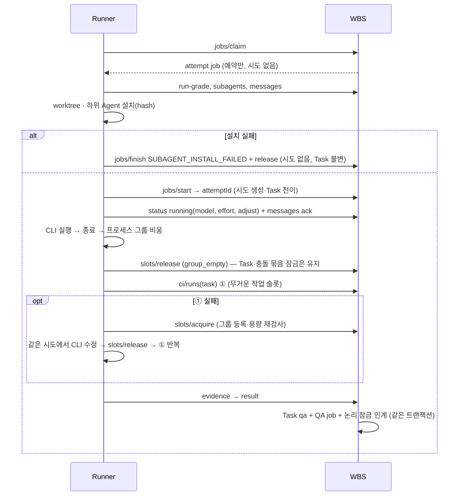

# Agent WBS 구현 기준선 — 계약

> **이 문서가 답하는 질문**
> - 화면(팀장)과 Runner는 서버의 어떤 API를, 어떤 규칙으로 부르나?
> - 오류가 나면 어떤 코드가 오고, 받은 쪽은 무엇을 해야 하나?
> - 시도 1회는 claim부터 병합까지 어떤 순서로 흘러가나?
>
> 처음 읽는다면 [docs/README.md](../README.md)부터 보세요. 낯선 용어는 [용어집](../glossary.md)에 있습니다.

**이 문서의 약속**

- 여기서 「계약」은 두 프로그램이 서로 주고받기로 약속한 API의 경로·요청·응답·오류 규칙이다.
- G§8이 정한 경로·의미는 그대로 두고 빈 곳을 **보강**(★)한다.
  - ★는 가이드에 없는 설계 결정이며 [architecture.md D-03](architecture.md#7-해석-결정-기록)이 근거다.
- 기계 판독 정본은 M1에서 만드는 `agent-wbs/contracts/openapi.json`이다.
  - 그때부터 이 문서와 다르면 drift로 보고 함께 고친다.
  - 왜: 사람이 읽는 문서와 기계가 쓰는 파일이 다르면, 어느 쪽을 믿어야 할지 모르게 된다.

## 1. 공통 규칙

모든 API에 똑같이 적용하는 규칙이다.

- **형식**
  - JSON(중괄호·대괄호로 데이터를 적는 텍스트 형식) UTF-8(한글 등 모든 문자를 담는 문자 인코딩), 시각은 UTC ISO 8601(µs 허용), 날짜 `YYYY-MM-DD`(Asia/Seoul)
    - 용어 풀이: µs = 마이크로초, 100만분의 1초; ISO 8601 = 날짜·시각을 적는 국제 표준 형식.
- **팀장 인증**
  - 세션 쿠키. 변경 요청은 `X-CSRF-Token`.
  - 없으면 401 `LEAD_UNAUTHORIZED`
- **Runner 인증**
  - `Authorization: Bearer`.
  - 없음·폐기 401 `RUNNER_UNAUTHORIZED`.
  - 팀장 API를 Runner로 부르면 403 `FORBIDDEN_PRINCIPAL`
- **epoch** (프로젝트 세대 번호. 초기화할 때마다 1 오른다)
  - **Runner 토큰을 쓰는 모든 요청**(경로 접두어가 아니라 주체 기준. `POST …/design/decisions` 포함)에 `X-Project-Epoch`.
  - 불일치 409 `EPOCH_MISMATCH` `{currentEpoch}`.
  - **예외(D-04)**: heartbeat, `GET /runner/commands`, 명령 결과 — 이전 epoch 허용.
    - heartbeat는 204 + `X-Current-Epoch` 헤더, commands는 본문 `currentEpoch`.
    - 명령 결과 POST는 commands 조회 **응답 본문의** 해당 `commands[].epoch`를 **요청 헤더 `X-Project-Epoch`에** 넣는다. 값은 그 명령 ID의 epoch와 일치해야 한다(다르면 409 EPOCH_MISMATCH).
    - 왜 예외를 두나: 초기화된 Runner가 옛 epoch로도 정리 명령을 받을 수 있어야 교착이 생기지 않는다.
  - 그 외 요청은 트랜잭션 안에서 재확인(data-model §5.1)
  - 왜: 초기화 전에 출발한 요청이 초기화 뒤 새 프로젝트 데이터를 고치는 일을 막는다.
- **epoch 전환**
  - Runner는 409를 받으면 새 일을 멈추고 이전 epoch outbox를 **버린 뒤** commands를 조회한다.
  - 정리 완료 후에만 새 epoch 저장.
- **멱등** (같은 요청을 여러 번 보내도 결과가 한 번 보낸 것과 같게 하는 성질)
  - Runner·Planning POST/PATCH는 `Idempotency-Key` 필수(없으면 400 `IDEMPOTENCY_KEY_REQUIRED`).
  - 같은 키·같은 본문 → 저장된 응답 재생(`Idempotency-Replayed: true`).
  - 다른 본문 → 409 `IDEMPOTENCY_CONFLICT`.
  - 예외: heartbeat(자연 멱등)
  - 왜: 네트워크가 끊겨 Runner가 같은 보고를 다시 보내도, 서버가 두 번 처리하지 않게 한다.
- **키 구성**
  - 시도 이벤트 `att:<attemptId>:<event>:<at>`(§9.1-6), 그 외 `<kind>:<runnerId>:<uuid>`.
  - outbox에 쓸 때 생성해 재전송 때 유지
- **팀장 멱등**
  - 생성·승인·초기화·발송 POST는 선택적 `Idempotency-Key`.
  - 화면은 항상 보낸다(버튼 이중 클릭·재시도)
- **동시 수정**
  - **모든 팀장 수정**에 §1.3의 expected version 필수.
  - 불일치 409 `VERSION_CONFLICT` `{current, changes[{at,actor,field,before,after}]}` (§0.3 충돌 창에 필요)
  - 왜: 낡은 화면을 보고 한 수정이 다른 사람의 최신 수정을 덮어쓰지 않게 한다.
- **페이지**
  - `?limit=&cursor=`, `{items,nextCursor}`.
  - WBS 트리는 전체 요약 1회
- **ID**
  - 서버가 준 불투명 문자열. 클라이언트가 형식을 만들거나 해석하지 않음.
  - Task 참조만 `TASK-` + 숫자 4자리 이상
- **비동기**
  - 작업을 만드는 팀장 요청은 202 `{jobId}`(저장소 확인은 `{id}`, Planning 시작은 `{id,jobId}`)
- **값 철자**
  - openapi.json이 정본.
  - reconcile `none/done/partial`, drift compat `compatible/breaking/unchecked`(화면 「대조 안 함」=unchecked), 입력 변경 `added/modified/deleted`, CI stage `task/int/night/deploy`, 관측 등급 `verified/partial/unverified`.
  - DB 내부 값이 다르면 API 경계에서 변환
  - 지금 변환하는 값(자세한 것은 data-model §2.6·§2.8):
    - drift compat: DB는 화면 문구 호환/깨짐/대조 안 함으로 저장한다.
    - CI stage: DB는 1~4 숫자로 저장한다(task=1, int=2, night=3, deploy=4).
    - 관측 등급: DB는 `ok/partial/unver`로 저장한다(`verified`↔`ok`, `partial`↔`partial`, `unverified`↔`unver`).
  - 왜 경계에서 바꾸나: DB에 이미 저장된 값을 고치지 않고도, 바깥에는 항상 같은 철자를 보여 줄 수 있다.
- **속도**
  - Runner 429 + `Retry-After`(몇 초 뒤 다시 보내라는 응답 헤더) 허용

### 1.1 오류 본문

오류가 나면 서버는 항상 아래 모양으로 답한다.

```json
{"error":{"code":"DEPENDENCY_CYCLE","message":"…","action":"의존성 추가","fix":"…",
  "errors":[{"path":"title","rule":"maxLength","message":"…"}],"details":{"path":["TASK-0005","TASK-0006"]},"requestId":"…"}}
```

- `message`는 무엇을 하려다·왜, `fix`는 조치(§0.3 L72).
- 비밀값·스택·로그 원문 금지.
  - 왜: 오류 메시지는 화면에 그대로 보이므로, 토큰이나 내부 구조가 새어 나가면 안 된다.

아래 표는 HTTP(웹 요청·응답 규약) 상태별 오류 코드와, 받은 쪽(화면/Runner)이 할 일이다. (이 표는 테스트가 그대로 읽으므로 모양을 바꾸지 않는다.)

| HTTP | 코드 | 화면/Runner 처리 |
|---|---|---|
| 400 | `VALIDATION_FAILED` `DEPENDENCY_SELF` `LIMIT_EXCEEDS_CAP` | 수정 안내, 재시도 없음 |
| 401/403 | 위 표 | Runner는 중지·경보 |
| 404 | `TASK_NOT_FOUND` `PROJECT_NOT_FOUND` `WBS_NODE_NOT_FOUND` `DEPENDENCY_NOT_FOUND` `ATTEMPT_NOT_FOUND` `MESSAGE_NOT_FOUND`, 전용 코드가 없는 자원은 `NOT_FOUND`★ `details{resource,id}` | 안내 |
| 409 | `VERSION_CONFLICT` `EPOCH_MISMATCH` `DEPENDENCY_DUPLICATE` `RECIPIENT_DUPLICATE`★(G§8.5 수신자 중복) `DEPENDENCY_CYCLE` `TASK_HAS_SUCCESSORS` `EXTERNAL_WRITE_BLOCKED`★ `PROJECT_EXISTS` `INPUT_UNCHANGED` `ATTEMPT_CLOSED` `SCHEDULE_CYCLE` `INVALID_TRANSITION`★ `SPLIT_JUDGEMENT_REQUIRED`★ `ACTIVE_TASK_BLOCKED`★ `ORDER_NOT_PRESERVED`★ `GATE_NOT_PASSED`★ `MERGE_MISMATCH`★ `CLAIM_REJECTED`★ `LEASE_LOST`★ `CLEANUP_PENDING`★ `IDEMPOTENCY_CONFLICT`★ `DECISIONS_PENDING`★ | 재시도하지 않고 최신 조회 |
| 412 | — 사용 안 함(409로 통일) | |
| 422 | `SUBAGENT_INSTALL_FAILED`(job 결과 코드) | 시도 시작 안 함 |
| 429 | `RATE_LIMITED`★ | `Retry-After` |
| 500/503 | `INTERNAL` `UNAVAILABLE`★ | 다시 시도 / Runner 재시도 |

- 표의 「위 표」는 §1 목록의 팀장 인증·Runner 인증 항목을 가리킨다.
- `MERGE_MISMATCH`(M7-04 조정자 결정 4, 2026-11-27)는 병합 보고의 실제 부모·tree가 저장된 근거와 다를 때 쓴다(§3.6-6). 받은 쪽은 재시도하지 않고 사람 처리를 기다린다.
- 409를 받으면 재시도하지 않는 이유: 409는 「지금 상태와 맞지 않는다」는 뜻이라, 같은 요청을 다시 보내도 또 실패한다. 최신 상태를 다시 읽어야 한다.

**헷갈리기 쉬운 409 코드 구분**

- `INVALID_TRANSITION`은 상태가 맞지 않는 요청에 쓴다: 성공한 저장소 확인 없는 등록, 열린 세션 없는 stop 등.
- 정리 대기 중 등록·초기 분석 재시도는 `CLEANUP_PENDING`.
- 실행 요청·중단·재개·슬롯 재획득·재판단 전 run-grade가 불가하면 `CLAIM_REJECTED`.

### 1.2 Runner 재시도

- 네트워크·408·429·5xx만 지수 백오프(1s→60s, jitter) 무기한 + outbox 영속.
  - 지수 백오프는 실패할 때마다 기다리는 시간을 두 배씩 늘리는 방법이다. jitter는 여러 요청이 동시에 몰리지 않게 대기 시간을 조금씩 흩뜨리는 것이다.
- **시도별 순서 보존**: 앞 보고가 막히면 뒤 보고를 보내지 않는다.
  - 왜: 「완료」 보고가 「시작」 보고보다 먼저 도착하면 서버가 상태를 잘못 판단한다.
- 다른 4xx는 `rejected`로 보존하고 readiness 경고로 올린다.
  - 이 경고는 readiness key **`reports`**로 보낸다(M3 서버 후속에서 계약에 추가, main 023ac8f 확인).
    - 거부 기록이 있으면 `warn`이고 `detail`에 기록을 적는다. 없으면 `ok`(「보고 거부 기록 없음」)다.
    - Runner의 `withRejectionWarnings()`가 다른 준비 항목을 덮지 않고 이 항목만 덧붙인다.
  - 지금 readiness key는 15개다(§3.1).
  - 예전 기록: 2026-11-26에는 key가 없어 계약 작업으로 미뤘다(조정자 결정 A).
- 조회 timeout(정해진 시간 안에 응답이 없으면 포기) 10초, 업로드 120초 [결정].
- 자동 처리 실패는 팀장 오류 막대가 아니라 반복 시 알림으로 올린다(§0.3 L71).

### 1.3 변경 명령별 비교 대상

- G§0.3 L73 「모든 수정 API」를 따른다.
- 본문이 있으면 `updatedAt`, DELETE는 `?updatedAt=`로 보낸다.
- 누락 400, 불일치 409 `VERSION_CONFLICT`.
- 아래 표는 「이 명령을 보낼 때 어느 행의 버전을 비교하나(aggregate)」다.

| 명령 | 비교 대상(aggregate) |
|---|---|
| Task PATCH·DELETE·**착수 승인 요청**·승인·반려·완료·등급·분할·예외 | `tasks.updatedAt` (명세·설계·체크리스트·산출물 변경도 증가시킴) |
| 실행 요청·중단·재개 | Task + 중단은 시도 `updatedAt` |
| 의존성 추가·삭제 | **후속 Task** `updatedAt`. 변경 시 후속 Task도 증가, 순환은 잠금 안에서 별도 판정 |
| CP 제출·승인·반려·반영 | `change_proposals.updatedAt` + 미리보기는 `previewHash` |
| 기술 결정·불일치 처리 | 해당 행. 일괄 확정은 각 결정의 `updatedAt` 목록 |
| 초기 WBS 승인·재분석 | 초안 revision |
| 초기 분석 다시 시도 | 초안이 있으면 `{revision}`, 초안 전이면 `{revision:null, runNo}`(분석 회차) |
| 차이 분석 다시 시도 | `projects.updatedAt` + `version`(실패한 입력 버전) |
| 입력 분석·분석 안 함 | 확인한 커밋 목록 + `projects.updatedAt` |
| 초기화 | `confirmName` + 화면이 본 epoch |
| 설정 PUT·수신자·규칙·불가일·불안정 테스트 | 해당 설정/행 |
| 메시지 초안·전송·취소·재전송 | `messages.updatedAt` |
| 메시지 읽음 | 없음 — 아래 참고 |
| 새 Task·메시지·보고서 생성, 연결 확인·미리보기·테스트 발송 | 기존 행을 수정하지 않음 — 아래 참고 |
| 수동 발송·재발송 | 멱등 키 + 현재 `mail_log` 상태 |

- 메시지 읽음: 내용·전달 상태를 바꾸지 않는 멱등 표시라 예외. `messages.updatedAt`도 올리지 않는다.
- 새 Task·메시지·보고서 생성 등: 기존 행을 수정하지 않음 — 멱등 키만. Task 생성은 잠금 안에서 부모 존재 판정.
- 예외: 자동 전이(Runner 보고·worker·자동 CP)는 사용자 편집이 아니므로 행 잠금 뒤 **현재 상태**와 fence를 판정한다.
  - fence는 Task 편집 버전을 대신하지 않는다.
  - fence는 낡은 Runner의 보고를 막는 번호표다(§3.2 참고).

## 2. 팀장 API

팀장 화면이 부르는 API다. 경로마다 「요청 → 응답」과 대표 오류를 적었다.

### 2.1 WBS (§8.1)

가이드가 정한 API:

- GET(조회 요청) `/api/projects/:projectId/tasks?status&q&includeDeleted`
  - 응답: → `{nodes[],tasks[TaskSummary]}` (`wbsPath`·차단·Gate 수·일정 요약 계산)
  - 오류: PROJECT_NOT_FOUND
- GET `/api/tasks/:taskKey`
  - 응답: → `TaskDetail`
  - 오류: TASK_NOT_FOUND
- POST `/api/projects/:projectId/tasks`
  - 요청 → 응답: P TASK-0005 + 명세·AC·체크리스트(Wizard 3단계) → 201 `{id,taskKey,wbsPath,lifecycleStatus}`
    - 용어 풀이: Wizard = 여러 단계로 나눠 입력하는 화면.
  - 오류: VALIDATION_FAILED, WBS_NODE_NOT_FOUND
- PATCH `/api/tasks/:taskKey`
  - 요청 → 응답: `{updatedAt, …}` → `{task,changes[]}`. **status 필드 없음**(§5.5)
  - 왜 status가 없나: 상태는 사람이 직접 고치는 값이 아니라 전이 규칙으로만 바뀐다.
  - 오류: VERSION_CONFLICT
- DELETE `/api/tasks/:taskKey`
  - 응답: 204
  - 오류: TASK_HAS_SUCCESSORS, INVALID_TRANSITION
  - INVALID_TRANSITION은 종료 상태(완료·취소됨)인 Task, 그리고 이미 시작했거나 실행 기록이 있는 Task를 지우려 할 때다.
    - 왜: 실행 기록이 있는 Task를 지우면 시도·검증 이력이 주인 없이 남는다(M2-02 리뷰 P1-1).
- POST `/api/tasks/:taskKey/dependencies`
  - 요청 → 응답: `{predTaskKey,depType}` → 201 `{dependency:{id,pred,succ,type},blocked}`(`id`는 삭제 API에 사용)
  - 오류: DEPENDENCY_*, ACTIVE_TASK_BLOCKED(D-35), INVALID_TRANSITION(취소된 Task를 선행으로 지정)
- DELETE `/api/dependencies/:id`
  - 응답: 204
  - 오류: DEPENDENCY_NOT_FOUND

★ 화면 동작용 보강:

- PATCH `/api/tasks/:taskKey/{spec,design/:kind,checklist/:itemKey,outputs}` · POST/DELETE checklist
  - 용도: 섹션별 편집(§4.4). §1.3
- POST `/api/tasks/:taskKey/request-approval` `{updatedAt, comment?}`
  - 용도: **착수 승인 요청**(Q-05 2행).
  - `planning`만, 명세 필수 항목 충족 시 → `approval`. 200 `{task,changes[]}`.
  - 오류:
    - 미충족 400 VALIDATION_FAILED(`errors[]`에 항목)
    - 다른 상태 409 INVALID_TRANSITION
    - 낡은 버전 409 VERSION_CONFLICT
    - 없음 404 TASK_NOT_FOUND
  - 자동 전이하지 않음. 상태·이력을 한 트랜잭션에 기록
- POST `/api/tasks/:taskKey/approve` · `/reject` `{updatedAt, comment?}`
  - 용도: 착수 승인 / 반려(Q-05 3행). `approval`만 → `ready`(`planning_approved_at` 기록) / `planning`.
  - 승인은 필수 항목을 다시 검사한다.
  - 규칙 5·7·9 판단이 유효한 충족이 아니면 409 SPLIT_JUDGEMENT_REQUIRED `{items[{rule,reason}]}`(D-33).
  - 응답·오류는 위와 같음(반려는 필수 항목 검사 없음)
- GET `/api/tasks/:taskKey/gate` · POST `/complete`
  - 용도: Gate 조회, 완료 **판정 요청**(미충족 409 GATE_NOT_PASSED + 조건별 사유)
- GET `/api/tasks/:taskKey/{history,attempts,verifications,messages}`
  - 용도: 탭
- PUT `/api/tasks/:taskKey/grade` · DELETE
  - 용도: 등급 고정·해제 → 재추정·재조정
- POST `/api/tasks/:taskKey/split` · `/split-exceptions`
  - 용도: 분할 제안 / 예외 사유
- POST `/api/tasks/:taskKey/runs` `{kind}` · POST `/api/attempts/:id/stop` · `/resume`
  - 용도: 실행 요청 job 생성 / 중단 / 재개. 불가 시 409 CLAIM_REJECTED `{reasons[]}`
- GET/POST `/api/messages`, PATCH 초안, POST `/:id/{send,cancel,resend,read}`
  - 용도: §4.10. 초안 서버 보존
- GET/POST `/api/plannings`, POST `/api/plannings/:id/reviews/:rid/choice` · `/proposals`
  - 용도: §4.5
- GET/POST `/api/proposals`, GET `/:id/preview`, POST `/:id/{submit,approve,reject,request-changes,apply}`
  - 용도: 변경 제안(CP)의 조회·미리보기·제출·승인·반영. 규칙이 많아 아래에 따로 풀어 썼다.
- GET `/api/verifications`, `/api/evidence`, `/api/evidence/:id/content`, `/api/gates`, `/api/history`
  - 용도: §4.7, §4.9. 콘텐츠는 attachment + nosniff(브라우저가 파일 종류를 추측하지 못하게 하는 설정)
  - 왜 attachment + nosniff인가: 업로드된 파일을 브라우저가 웹 페이지로 실행하지 않고 내려받게만 하기 위해서다.
- GET/PUT `/api/settings/{workflow,exec-policy,models,split,schedule,blackouts,concurrency,obs-budget,subagents,ci}`
  - 용도: §4.9 탭.
  - `settings/ci`와 §2.3의 `ci/settings`는 **같은 설정 한 벌**(같은 행·버전).
  - 저장 전 `updatedAt`은 null.
  - Q-07(owner 2026-11-27 아이템 18): `workflow.liveInject`는 `false`만 허용한다.
    - `true` 저장 요청은 HTTP(웹 요청 방식) 400과 `VALIDATION_FAILED`로 거부한다.
    - DB(데이터베이스)의 `exec_policy.live_inject`에 이미 `true`가 있어도 조회와 메시지 처리는 `false`로 취급한다.
    - 실행 중인 Task(작업)의 메시지는 `running`·`qa`·`verifying` 모두 `pendingNext=true`로 보관한다.
    - 설정 화면은 같은 자리에 「준비 중」을 표시하고 켤 수 없게 한다.
    - 왜: 이번 범위는 다음 실행 때 전달하는 동작만 제공한다. 실행 중 전달은 CLI(명령줄 도구) 실측 뒤 다시 판단한다.
  - `models` PUT은 모델마다 `{agent,id,allowed}`만 받는다. 이름·rank·efforts는 읽기 전용이다(§7.1, Q-06).
  - **모델 순서는 설정값이다** (owner 2026-11-26 아이템 8).
    - 같은 `models` PUT에 `rankOrder`·`codexFamilyOrder`·`claudeModels`를 실어 바꾼다. 바꿀 때만 보내고, 빠진 항목은 그대로 둔다.
    - `rankOrder`는 Agent별 모델 ID 목록이다. **아래 등급부터** 적는다. 같은 ID를 두 번 쓸 수 없다.
    - `codexFamilyOrder`는 Codex 같은 세대 안의 계열(luna·terra 같은 이름 끝부분) 순서다. 역시 아래부터 적는다.
    - `claudeModels`는 Runner가 보고할 Claude 모델 목록이다. 비울 수 없다.
    - 조회 응답의 모델별 `rank`는 서버가 `rankOrder`에서 계산한 값이다. 아래부터 1, 2, …이고 클수록 위 등급이다.
    - 왜: owner가 모델 순서를 「팀장이 바꿀 수 있는 설정값」으로 정했다. CLI가 보여 주는 목록 순서는 등급 순서가 아니므로 쓰지 않는다.
    - 초기값과 새 모델의 자리는 [data-model §6.2](data-model.md#62-system-seed-모델-순서와-claude-모델-목록)에 있다.
- GET `/api/alerts`, GET `/api/system/integrity`
  - 용도: 현재 알림 / 정합성 점검
  - `/api/alerts`는 열린 알림(해결 안 된 것)만 최신 먼저 준다. 항목은 `{id,key,severity,taskKey,target,text,at}`이다.
    - `target`은 화면이 다시 읽을 참조 문자열이다(변경 이벤트 ref와 같은 규칙: taskKey → id → key, 없으면 정렬 JSON).
    - `text`는 알림 내용의 `message`, 없으면 `key`다. `taskKey`는 내용에 Task가 있을 때만 채운다.
    - Telegram 외부 발송(M6-04)과는 별개다. 현재 상태를 보여 주는 조회다(M2, 조정자 결정 2026-11-26).
- POST `/api/auth/session` · DELETE, GET `/api/session`
  - 용도: §2.4

아래 두 API는 `|` 기호가 든 값이 있어 표로 둔다.

| API | 용도 |
|---|---|
| GET `/api/dashboard`, `/api/schedule`, `/api/replans`, POST `/api/replans/run` | §4.1, §6. 조회 응답의 필드 구조는 openapi.json이 정본. `schedule.warnings[]`의 `CLOCK_SKEW_CLAMPED`는 시계 오차로 자른 값의 이전·이후를 보존: Task `{code,taskKey,field:"actStart"\|"actEnd",before,after}` 또는 세션 `{code,sessionFrom,field:"lastHeartbeatAt"\|"to",before,after}`. 계산에만 자른 값을 쓰고 저장 기록은 바꾸지 않음(§9.1-3) |
| GET `/api/runner-state` | 연결·준비·PC(개인용 컴퓨터)·동시 실행·관측·제한 요인 묶음 + 최근 중단 구간 `gaps[{from,to\|null,reason}]` 최대 6개·최신순(P L6684), reason `reboot/power_off/error/manual/unknown`, 진행 중이면 `to=null` |

- `/api/replans` 목록의 status는 `applied/pending/discarded`다. `discarded`는 반영하지 않고 닫은 대기 재조정이다(data-model §2.7).

**변경 제안(proposals) API 상세**

- 미리보기와 반영은 같은 함수. apply는 재시뮬레이션.
  - 왜 같은 함수인가: 팀장이 미리보기에서 본 결과와 실제 반영 결과가 다르면 안 된다.
- **보류 사유** `holdReasons[{code,taskKey?,rule?,message}]`: `JUDGEMENT_MISSING` `JUDGEMENT_NOT_MET` `ORDER_NOT_PRESERVED` `ACTIVE_TASK_BLOCKED`(D-33~35).
  - 하나라도 있으면 자동 반영은 `held`.
  - 수동 승인·반영은 409(판단은 `SPLIT_JUDGEMENT_REQUIRED`, 순서는 `ORDER_NOT_PRESERVED`, 차단은 `ACTIVE_TASK_BLOCKED`)이고 강제 우회 없음.
  - **대표 409 코드 고르기**: 사유가 여럿이면 판단(`SPLIT_JUDGEMENT_REQUIRED`) → 순서(`ORDER_NOT_PRESERVED`) → 활성 차단(`ACTIVE_TASK_BLOCKED`) 순으로 먼저 걸린 것 하나를 코드로 쓴다.
    - `details.holdReasons`에는 사유 전체를 보낸다.
    - 왜: HTTP 오류 코드는 하나만 고를 수 있다. 화면은 코드 하나로 대표 안내를 보이고, 전체 사유는 목록으로 보여 준다.
- **그 밖의 반영 불가 사유**
  - D-33~35 외의 반영 불가 사유(완료 Task·순환·없는 대상 등, §5.6)는 `issues[{index,code,taskKey?,message}]`에 담는다.
  - `taskKey`는 특정 Task의 문제일 때만. 새 Task는 `idMap`의 예상 키.
  - 수동 apply에서 이것만 있으면 200으로 `status=held`를 돌려준다.
  - `holdReasons`가 없고 `issues`만 있으면 승인(`review`→`approved`)은 허용한다.
    - 왜: 승인 자체는 WBS를 바꾸지 않는다. 실제로 바꾸는 apply가 그때의 현재 상태로 다시 판정한다.
    - 예: 승인한 뒤 apply 때도 `issues`만 남아 있으면 200 `held`다.
- **CP를 만드는 두 경로**
  - 팀장 `POST /api/plannings/:id/proposals`는 Planning 검토에서 고른 변경으로 팀장 **draft**(초안)를 만든다. 검토에 넣으려면 팀장이 따로 `submit`한다.
  - Runner(Planning Agent) `POST /planning/proposals`는 처음부터 **review**(검토 대기)로 제출한다.
    - 일정 정책 `cp_auto`가 켜져 있으면 보류·반영 불가 사유가 있을 때 `held`, 없을 때 바로 `applied`가 된다.
    - `cp_auto`가 꺼져 있으면 `review`로 남는다.
  - 왜 다르게 두나: 팀장이 만든 초안은 팀장이 다듬은 뒤 보낼 수 있어야 한다. Agent의 제안은 정책에 따라 자동으로 처리된다(G§3 `cp_auto`).
- **응답 모양**
  - preview는 `{previewHash,impact,issues,holdReasons,diff,idMap}`
  - apply는 `{proposal,impact,issues,holdReasons,diff,idMap}`
- **add op(새 Task 추가)의 필드**
  - add op의 `t`에는 `scope`·`files`·`design`·`conflictGroup`을 선택 필드로 둔다(정의와 생략 규칙은 [data-model §2.4-1](data-model.md#24-1-cp-add-task의-선택-필드)).
  - add op의 `t.splitBasis`(분할 근거)는 **일반 CP는 선택, 분할 CP(`source.kind="split"`)의 추가 Task는 필수**이며 팀장·Planning 작성에 같이 적용.
    - 형식은 초안의 `splitBasis`와 같은 공백 아닌 문자열.
    - 분할 CP에서 빠지면 400 VALIDATION_FAILED, 저장된 CP의 시뮬레이션에서는 `issues`의 `SPLIT_BASIS_MISSING`.
  - add op의 `t.design`에 같은 kind가 두 번 있으면 400 VALIDATION_FAILED다(`errors[].rule="uniqueDesignKind"`).
    - 오류 예: `{path:"ops.1.t.design.2.kind", rule:"uniqueDesignKind", message:"…"}`
- **분할 CP의 원래 Task**
  - 분할 CP(`source.kind="split"`)는 `source.id`에 원래 Task 키가 **필수**다. 없으면 400 VALIDATION_FAILED.
  - 팀장 작성(`POST /api/proposals`)과 Planning 작성(`POST /planning/proposals`)에 같이 적용한다.
  - 왜: 충돌 묶음 상속과 분할 순서 판정이 원래 Task를 기준으로 한다(data-model §2.4-1·§2.3-2).
- **입력 규칙(JSON Schema 밖의 검사)**
  - 「kind 기준 중복 금지」처럼 JSON Schema(요청 본문의 모양을 적는 표준 형식)로 쓸 수 없는 규칙은 요청별 입력 규칙으로 둔다.
  - 서버는 형식 검증 뒤 입력 규칙을 실행한다. 어기면 400 VALIDATION_FAILED의 `errors[]`로 돌려준다.
  - OpenAPI에는 `x-input-rules`로 표시한다.
  - 지금 규칙은 `uniqueDesignKind` 하나다. CP 작성 2개(팀장·Planning)와 Planning 검토 제출에 적용한다.
- **판단 처리**
  - 팀장 작성 POST는 판단 필드를 받지 않음(400).
  - 판단이 필요한 CP가 `review`에 들어오면 서버가 `planning` 판단 job을 만든다.
  - 승인·미리보기·반영에서 대상 hash가 달라진 것을 발견하면 다시 만든다(CP와 hash 조합당 열린 job 1개 [결정]).
  - 조회 응답에 `taskJudgements[]`·`splitJudgements`.
  - DB `hold_reasons`에는 `{holdReasons,issues}`를 함께 저장.
- **영향(impact)**
  - `impact`에 `removedDependencies[{pred,succ,type,reason}]`·**`unblockedSuccessors[{taskKey,remainingBlockers[]}]`**.
  - 취소로 관계가 제거된 후속과, 남은 선행이 없어 실제로 풀리는지를 구분(D-27).
  - 예: 취소로 A→B 관계가 지워져도 B에게 다른 선행이 남아 있으면 `remainingBlockers[]`에 보인다. 그러면 B는 아직 풀리지 않은 것이다.

### 2.2 프로젝트 (§8.4)

- POST `/api/project/repo-checks` `{url}`
  - 형식 400 우선(저장소까지만) → 202 `{id}`, GET `/:id`★ 결과
- POST `/api/project`
  - 이름·url·목표일·제약·지시·`repoCheckId`★.
  - 성공한 확인이 없거나 정리 대기면 409.
  - → 201 `{project,jobId}`
- GET `/api/project`★
  - 등록·입력·bootstrap·변경 감지
- POST `/api/project/bootstrap/approve` · `/rerun` · `/retry`★
  - approve·rerun은 초안 revision, retry는 §1.3의 `{revision}` 또는 `{revision:null,runNo}`.
  - approve → WBS+기준 v1을 한 트랜잭션.
  - 켜진 규칙 5·7·9 판단이 유효한 충족이 아닌 Task가 있으면 409 SPLIT_JUDGEMENT_REQUIRED(D-33)
- POST `/api/projects/:projectId/boot/tech/confirm` `{decisions[{id,choice}]}`
  - 미결정이 있으면 409 DECISIONS_PENDING
- POST `/api/project/inputs` `{commit,instr?}` · `/inputs/skip` · `/inputs/retry`★
  - 409 INPUT_UNCHANGED
- POST `/api/project/inputs/recheck` `{updatedAt}`★ — 입력 이력 재작성 「복구 확인·입력 확인 다시 시도」(조정자 결정 2026-11-26)
  - 언제: Runner가 「마지막 입력 커밋이 새 main의 조상이 아님」(이력 재작성)을 보고해 경고 `input_history_rewritten`이 열려 있을 때다.
  - 복구 순서는 넷이다.
    1. owner가 정상 merge·복원 커밋으로 마지막 입력 커밋을 새 main의 조상으로 되돌린다(강제 push 없음).
    2. 팀장이 이 API(화면의 「복구 확인·입력 확인 다시 시도」, 버튼은 M3-04)를 부른다. 서버는 Runner 정책 `inputRecheck`를 1 올리고 202 `{inputRecheck}`를 준다.
    3. Runner가 바뀐 `inputRecheck`를 보고 조상 관계를 다시 관측해 보고한다.
    4. 서버가 유효한 보고를 받아들이는 같은 트랜잭션에서 경고를 해소한다. 아직 연결이 안 됐으면 경고는 그대로이고 Runner는 다시 멈춘다.
  - 왜: 재작성된 이력을 자동으로 받거나 옛 입력 버전을 지우면 입력 원장이 깨진다. 사람이 연결을 되돌리고, 사실 확인은 Runner의 git 관측으로 한다.
  - 열린 재작성 경고가 없으면 409 INVALID_TRANSITION. `updatedAt`은 프로젝트 버전(§1.3)이다.
  - 새 main을 기존 원장과 잇지 않고 기준으로 삼으려면 전체 초기화·재등록이 필요하다(별도 owner 결정).
- POST `/api/project/reset` `{confirmName,keepSettings}` · GET `/reset-preview`★ · GET `/export`★
  - 건수·정리 내용 / 내보내기 **zip(여러 파일을 하나로 묶은 압축 파일)**(데이터 JSON·보고서 PDF·Evidence, P L4702 안내문. 비밀값·수신자 제외).
    - 용어 풀이: PDF = 인쇄용 문서 파일 형식.
  - zip 내부 manifest(묶음 안에 무엇이 들었는지 적은 목록 파일)는 M2-04에서 정함
- GET `/api/system/resets`
  - 초기화 기록
- GET·PUT `/api/settings/github`, POST `/check`★
  - 토큰 값은 돌려주지 않고 `tokenSet`(등록 여부)만 보인다.
  - 조회 응답의 `scopes`는 권한별 3상태(`verified`·`unverified`·`missing`)이고, 확인하지 못했으면 null이다. 뜻은 §3.1 `github/status`와 같다.
  - `warning`은 미확인 권한처럼 팀장이 알아야 할 문구다. 없으면 null이다.

### 2.3 보고서·메일(§8.5) · CI(§8.5-1) · 설계(§8.6) · Telegram(§8.7)

G§8.5, §8.5-1, §8.6, §8.7의 표 전체를 그대로 구현한다(재기술하지 않음 — 단일 출처). 보강만 적는다.

- 왜 다시 적지 않나: 같은 표를 두 곳에 두면 한쪽만 고쳐져 서로 달라지기 쉽다.

- 보고서: 기간 `from ≤ to ≤ 오늘`, 최대 93일 → 400. 수정·삭제 API 없음. PDF 실패 503 `PDF_FAILED`★.
- 메일 큐 키 `reportId+recipientId+tryNo`, 실패 15분 후 1회 자동 재시도.
- `POST /runner/ci/runs`(CI 실행 시작)는 `pipelineSha`·`trigger`가 필수다.
  - 왜: DB에서 두 값이 NOT NULL이라 기본값 없이 저장해야 한다(data-model §2.8 `ci_runs`).
- CI retry/deploy-check → 202 `{jobId}`. 메일 발송·재발송·테스트 → 202 `{ids}`(발송 기록 ID). `GET /ci/pipeline`★(정의 표시), GET·PATCH `/ci/settings`★.
  - `GET /ci/pipeline`이 보여 주는 정의는 Runner가 main 커밋에서 따로 관측해 보고한 것이다(§3.1 입력 변경 보고의 `pipelineObservation`, M7-04 결정 6). 서버는 git을 읽지 않는다.
- 불일치 `resolve{how:"contract"}`는 Runner job을 만들고 **결과 커밋이 보고된 뒤** resolved. 호환 깨짐은 기술 결정 승인 필요(§4.12).
- `POST /api/projects/:projectId/design/decisions`는 **Runner 토큰**(Agent 제안, §8.6)이며 `{jobId,fence,authority:"agent"|"free",…}`.
  - agent는 승인 대기, free는 기록.
  - GET과 approve/reject/change는 팀장.
- **보고서** (M6-01·M6-02·M6-03 구현)
  - 기간 지정 보고서는 상태 이력으로 **기간 끝 시점(T)의 상태**를 되살려 만든다(owner 2026-11-27 아이템 13, G L375). 이력은 data-model §2.7 「보고서 상태 이력」이다.
    - 왜: 지금 상태로 만들면 지난 기간의 보고서가 그 뒤에 바뀐 값으로 채워진다.
  - 첫 주간 보고서는 프로젝트 시작일이 든 주의 월요일부터 일요일까지다(달력 주, owner 2026-11-27 아이템 13).
  - 「다음 예정」 범위는 일간 1일, 주간·기간 지정 7일이다(M6-01 조정자 결정).
  - 메일 제목의 프로젝트 이름은 보고서 스냅샷의 값이다. 보고용(외부용) 본문에는 내부 용어를 넣지 않는다.
  - 받는 사람의 PDF 첨부는 팀장이 내려받는 것과 같은 PDF다. 변환 실패는 보내기 전 실패이고 15분 뒤 1회 다시 시도한다.
  - 외부 수신자에게는 링크 없이 PDF만 보낸다(owner Q-13 A). 수신자의 「외부」 구분은 구현 중이다(open-questions §2.1 Q-13). 지금은 접속 주소가 있으면 모든 수신자에게 링크를 넣는다.
- **설계** (M6-05·M6-06 구현, 조정자 결정 2026-11-27)
  - `GET /api/projects/:projectId/design/refs`★(`listDesignRefs`, M6 통합에서 추가)
    - 설계 캐시가 있는 main·브랜치 목록과 각 최신 커밋이다. 응답 `{ items: [{ ref, commit, at }] }`.
    - 순서는 main 먼저, 나머지는 이름 순이다.
    - 왜: 설계 화면이 「어느 브랜치의 설계를 볼지」 고르려면 목록이 필요하다.
  - **설계 보고의 `ref`** (M6-05 결정 1)
    - 모든 `reportDesignSnapshot`에서 `ref`는 필수이고 형식을 검사한다. 생략하면 main으로 채우던 기본값은 없앴다.
    - 받는 형식은 `main` 또는 Runner 브랜치 형식(`agent/<task-key>`, 권한 세대 접미사 `-hN` 포함)뿐이다. `refs/heads/`나 대소문자 변형은 거부한다.
    - `ref=main` 보고는 main을 직접 읽는 job 종류(설계 동기화·`design_apply` 결과 커밋)만 할 수 있다. `attempt` job은 자기 `agent/` 브랜치만, 그것도 `payload.branch`와 정확히 같아야 한다.
    - 왜: 시도 job이 main 설계를 덮어쓰면, 병합 전 코드가 main의 설계 원장에 들어간다.
  - **결정과 항목의 연결** (M6-05 결정 2)
    - 호환이 깨지는 반영에 쓰는 기술 결정은 같은 `itemKey`와 같은 `driftId`(또는 대상 계약 버전)를 가리키고 승인 상태여야 한다.
    - 다른 항목·다른 불일치의 승인 결정은 통과시키지 않는다.
  - **계약 반영 요청의 외부 쓰기 확인** (M6-05 결정 3)
    - 외부 쓰기가 막혀 있으면 불일치 「계약에 반영」 요청을 요청 시점에 409 `EXTERNAL_WRITE_BLOCKED`로 거부한다. job을 만들지 않는다.
    - 왜: 막힌 동안 job이 대기열에 쌓이면, 풀리는 순간 한꺼번에 GitHub에 쓰게 된다.
  - **`design_apply` 결과 보고** (M6 통합)
    - 최신이 아닌 커밋의 `design_apply` 결과는, 최신 main 캐시의 그 항목이 목표 명세와 같을 때만 완료한다. 다르면 409 `INVALID_TRANSITION`이고 Runner는 최신 커밋 기준으로 다시 보고한다.
    - 같은 커밋을 다시 보고할 때, 파일 전체가 `unchecked`(`file:<path>`)였던 파일에서 새로 대조된 항목은 올려 받는다.
  - **호환 판정 규칙** (M6-06 결정 Q-a~Q-c)
    - enum·const·format 변화는 필드 타입 지문에 넣어 모두 「타입 변경」으로 본다. 보수적으로 사람이 확인하게 하려는 것이다. 해석하지 못하는 키워드가 있으면 그 필드는 `unchecked`다.
    - 같은 커밋 다시 대조: 서버는 같은 커밋의 결과를 `unchecked` → 대조됨으로 올리는 것만 허용한다. 이미 대조된 결과를 다른 결과로 바꾸면 409 `VERSION_CONFLICT`다. 추출기가 잠깐 실패한 뒤 다시 대조할 수 있게 하려는 것이다.
    - 판정 방향은 요청 쪽과 응답 쪽을 나눈다.
      - 요청: 필드 삭제는 호환, 새 필수 필드는 깨짐, 타입 변경은 깨짐.
      - 응답: 필드 삭제는 깨짐, 필수→선택은 깨짐, 새 필드는 호환, 타입 변경은 깨짐.
      - 메시지(AsyncAPI·Kafka)는 생산자→소비자 기준으로 응답 규칙을 쓴다.
      - 예: 요청 본문에서 선택 필드를 지우면 옛 클라이언트가 보내도 서버는 무시하면 되므로 호환이다. 응답에서 지우면 그 필드를 읽던 화면이 깨진다.
    - 공통 원칙: 해석기가 모르는 것은 절대 「any」나 「일치」로 바꾸지 않는다. 모르면 `unchecked`다.
  - **해석 범위** (owner Q-14 A, M6-06)
    - OpenAPI는 직접 쓴 계약과 추출본을 대조한다. Neo4j는 원문 표시만 한다. Kafka는 JSON Schema만 해석하고 레지스트리는 쓰지 않는다.
    - Avro·Protobuf·Neo4j·QuestDB·Redis 같은 미지원 형식은 원문을 보존하고 대조하지 않는다.
    - JSON Schema의 외부·순환 참조, 64단계보다 깊은 스키마, 조합·동적 규칙은 `unchecked`다.
    - SQL에서 해석기가 모르는 문장(함수·동적 SQL·상속 등)은 영향 범위에 따라 다르게 다룬다(`agent-runner/src/design/sql.ts`).
      - 어느 표의 문장인지 알면 **그 표만** `unchecked`다. 다른 표는 계속 대조한다. 예: `ALTER TABLE t INHERIT u`는 `t`만 대조 안 함이다.
      - 어느 표에 미치는지 모르면 그때까지의 모든 표와 그 뒤에 만들어지는 표를 `unchecked`로 둔다.
      - 왜: 모르는 문장이 바꾼 구조를 「일치」로 볼 수 없다. 하지만 영향이 없는 표까지 대조를 멈출 필요는 없다.
    - SQL 파일을 읽거나 해석하다 **실제 오류**가 나면 SQL 묶음 전체의 부분 결과를 보고하지 않는다.
      - 왜: 낡은 일부 구조를 최종 구조로 착각해 대조하는 일을 막는다.
    - 예: 이 저장소의 마이그레이션은 `0006`의 동적 `DROP CONSTRAINT` 한 문장(영향 범위를 모름) 때문에 모든 표의 계약 대조가 `unchecked`다. 파일 읽기 실패는 아니다. 이미 적용한 파일이라 고치지 않는다. 새 마이그레이션에서는 동적 `DROP CONSTRAINT` 대신 고정한 제약 이름을 쓰기를 권한다(작성 규칙으로 넣을지는 검토 중, data-model §6).
- Telegram(메신저. 알림을 봇으로 보낸다) 오류: `token_invalid`(401) `chat_not_found`(400) `forbidden`(403) `rate_limited`(429) `network` `webhook_in_use` `chat_migrated`★(자동 교체 금지). 마스킹 문자열 토큰 400.
  - 마스킹 문자열 토큰: 화면에 `••••1234`처럼 가려 보여 준 값을 그대로 다시 저장하려는 경우다.
- Telegram 전송 이력(`listNotifyLog`)의 `event`에는 G의 6종 외에 **`serviceDown`**(서비스 없음)이 있다(M7-03 결정 11·14, M6 통합). 알림 규칙 칸은 늘리지 않았다. 자세한 것은 data-model §3.7.
- 발송 시점은 즉시 발송이다(owner Q-16 A).

### 2.4 로그인 ★ (owner Q-01)

- POST `/api/auth/session` `{method:"link",token}`
  - loopback 연결만, 토큰 1회 소비 → 204 + 세션 쿠키.
  - 프록시 헤더를 믿지 않고 socket 주소(실제로 연결해 온 상대의 네트워크 주소)로 판정한다.
    - 왜: 프록시 헤더(`X-Forwarded-For` 같은 것)는 요청을 보내는 쪽이 마음대로 꾸밀 수 있다.
  - 실패는 구분 없이 401 `LOGIN_FAILED`.
    - 왜 구분하지 않나: 「토큰이 틀림」과 「만료됨」을 구분해 알려 주면 공격자에게 힌트가 된다.
- `{method:"password",password}`
  - LAN 모드만.
  - 횟수 제한 429, 성공 시 세션 교체.
  - 비밀번호 분실은 이 PC CLI로 재설정.
- GET `/api/session` → `{principal:"lead",method:"link"|"password",expiresAt,csrfToken}`.
  - `csrfToken`을 `X-CSRF-Token`에 쓴다.
  - 세션 쿠키 이름은 `awbs_session`.
- 로그인 화면 1개에 LAN 비밀번호 입력과 「이 PC에서는 새 링크 발급」 안내를 둔다.
- Origin 검사는 로그인에도 적용한다.

### 2.5 착수 승인의 명세 필수 항목

착수 승인을 요청하거나 승인하려면 Task 명세에 아래 항목이 모두 있어야 한다.

- 목적·완료 조건(P Wizard `wizErrs` L6787 필수)
- AC 1개 이상·체크리스트 1개 이상(G§5.2-1 규칙 4, §5.5)
- 필수 산출물 1개 이상(G§5.5)
- 담당·검증 Agent 지정

**이 목록을 정한 이유와 쓰는 법**

- G는 「명세 완료」의 항목을 열거하지 않으므로 이 목록은 Gate를 통과할 수 있는 최소 조합으로 정한 것이다 [결정].
- 판정은 shared 순수 함수 하나로 하고 요청·승인이 함께 쓴다.
  - 왜: 요청할 때와 승인할 때 기준이 다르면 「요청은 되는데 승인은 안 되는」 일이 생긴다.
- Task 착수 승인 요청은 G§4.14 「승인 요청」 이벤트 목록(L515)에 없으므로 Telegram을 보내지 않는다.

## 3. Runner API

Runner만 부르는 API다. Runner 토큰과 epoch 헤더가 필요하다(§1).

### 3.1 가이드 정의 (§8.2, 요청 상세는 P TASK-0012)

가이드가 정한 API와, 우리가 보강·수정한 점이다.

- POST `/runner/heartbeat` `{runnerId,version,epoch}`
  - 204 + `X-Current-Epoch`. 60초
  - heartbeat는 「나 아직 살아 있어요」 하고 주기적으로 보내는 신호다.
- POST `/runner/sessions`
  - stop은 열린 세션만. `reason=unknown`은 서버만
- POST `/runner/host` `/readiness` `/models` `/usage` `/concurrency`
  - readiness key에 `obs`★ `gh`★ `lfs`★ `reports`★ `font`★ `render`★ 추가. 지금 key는 15개다: `claude` `codex` `git` `node` `pnpm` `pg` `repo` `disk` `subs` `obs` `gh` `lfs` `reports` `font` `render`.
    - `reports`: Runner 보고가 4xx로 거부된 기록(§1.2).
    - `font`: 야간 화면 비교의 고정 글꼴 설치 여부. 없으면 warn이고 화면 비교는 「비교 불가」다(M7-03 결정 12).
    - `render`: 화면 비교 기준 렌더러의 네트워크 차단 방식. 네임스페이스면 ok, 실행 인자 차단만이면 warn이다. 실행은 허용한다(M7-03 결정 16).
  - concurrency는 세션별 `{attemptId,observed,reserved,state}`★ 포함.
  - host에 `bootId`★(해제 증거 대조).
  - readiness에 `cli[{agent,version,model,options}]`★ — 관측 등급은 서버가 조합으로 판정.
  - models는 `models[{id,label,efforts}]`로 **모델별** CLI 값(낮은 순, 미확인 null)을 보고하고 P의 Agent 단위 `efforts`는 쓰지 않음(owner Q-06)
  - models 보고에는 **`rank`를 싣지 않는다**. 보내면 400 VALIDATION_FAILED다(owner 2026-11-26 아이템 8).
    - 모델 순서는 서버가 가진 설정값(`rankOrder`, §2.1)이다. Runner는 무엇이 있는지만 알린다.
    - 설정에 없는 새 모델은 「미허용」으로 등록하고, 서버가 순서 안에 자리를 정해 넣는다(data-model §6.2).
    - Claude CLI는 모델 목록을 알려 주지 않는다. 그래서 Runner는 `GET /runner/policy`의 `claudeModels`를 보고 대상으로 쓴다.
    - 왜: 순서를 Runner마다 따로 정하면 등급 상향(rank가 큰 모델로 올림)이 PC마다 달라진다. 순서는 판정의 재료이므로 서버 한 곳에 둔다.
- GET `/runner/tasks/:taskKey/run-grade?role=`
  - 등급 정책 단일 출처. 재작업 상향·재개·하향을 서버가 계산해 `{model,effort,adjust}`★로도 준다.
  - `adjust`는 조정이 없으면 null, 있으면 `{kind:"up"|"down"|"keep"|"regrade",from:{model,effort},to:{model,effort},reason}`(regrade=D-29, 모델 이동 상향 D-30은 up).
  - 재판단 전이면 claim `reasons[]`, claim 뒤 해제됐으면 409 CLAIM_REJECTED
  - 왜 서버가 계산하나: 등급 규칙은 「판정」이므로 Runner가 아니라 서버가 한다(architecture §1).
- GET `/runner/tasks/:taskKey/subagents?role=`
  - 모델·effort 없음. hash 검증 후 설치
- GET `/runner/messages?cursor=` · POST `/:id/ack`
  - G의 `since` 대신 **cursor**를 우선 사용(같은 시각 유실 방지). `since`도 호환
  - 왜: 같은 시각에 메시지 두 개가 생기면 시각 기준으로는 하나를 놓칠 수 있다.
- POST `/runner/messages/:id/response`★
  - Agent 응답 `{text,workState}`. 전달 상태와 분리(§9.4-1)
- POST `/runner/attempts/:id/status`
  - `subagents.used` 제거(D-12). P의 `escalation`은 같은 `adjust` 구조로 대체(호환 입력 없음)
- POST `/runner/attempts/:id/interrupt`
  - 200 `{taskStatus:"paused"}`, 종료된 시도 409
- POST `/runner/attempts/:id/result`
  - dev·rework: summary·changedFiles·evidence·failure·tokens, 그리고 push한 PR의 `pr`·`prHead`(§3.6-1).
  - qa·reverify: **`verification{headSha,specRevision,result,cmd,expected,actual,defects[],checklist[]}`**★ 필수
- POST `/runner/attempts/:id/evidence`★
  - multipart 1파일, sha256·크기 검증. 결과 보고 전 업로드하고 id로 참조
- POST `/runner/attempts/:id/subagent-usage`★
  - 세션 종료 후 사후 확정(`confirmed/partial`)
- POST `/runner/input-changes`, `/runner/repo-checks/:id/result`, `/runner/bootstrap/:jobId/progress`
  - §8.4
- **입력 변경 보고 `POST /runner/input-changes`의 모양** (M2-03 새 계약, 입력 원장)
  - 입력 원장은 팀장 입력(`prototype/`)이 언제 어떻게 바뀌었는지 이어 붙여 기록하는 장부다.
  - 정답은 커밋 목록이 아니라 **base와 head 사이의 `prototype/` 트리 차이**다.
    - 왜: 커밋은 되돌리기·합치기로 여러 번 오갈 수 있다. 실제로 무엇이 바뀌었는지는 두 시점의 파일 전체(트리)를 비교해야 정확하다.
  - 본문 `{base, head, baseIsAncestor, treeHash, changes[], commits[]}` → 200 `{head, recorded, historyRewritten}`.
    - `base`: 서버가 마지막으로 받은 입력 head다(처음에는 등록 커밋). 200·409 응답의 head로 갱신한다.
    - `head`: 이번에 본 원격 main의 끝 커밋이다. 차이가 비어 있어도 서버는 입력 head를 이 값으로 옮긴다.
    - `baseIsAncestor`: `git merge-base --is-ancestor <base> <head>`의 결과다(종료 코드 0=true, 1=false). 그 밖의 종료 코드면 판정할 수 없으므로 보고하지 않는다.
      - false면 이력 재작성이다. 서버는 아무것도 받지 않고 경고 `input_history_rewritten`을 연다(복구는 §2.2 `inputs/recheck`).
    - `treeHash`: `git rev-parse <head>:prototype`, 즉 파일 모드까지 포함한 head의 `prototype/` 트리 SHA다.
    - `changes[]`: `git diff --raw -M --numstat <base> <head> -- prototype/`의 줄마다 하나다. 비어 있지 않을 때만 팀장 확인 항목이 생긴다.
    - `commits[]`: 화면 표시용 참고 정보다(`git rev-list --first-parent --reverse <base>..<head> -- prototype/`). 판정에 쓰지 않는다.
  - **신뢰 전제**: 서버는 git을 직접 보지 않는다. 그래서 `baseIsAncestor`·`changes`·`treeHash`는 Runner의 관측을 믿는다.
  - `changes[]` 한 항목: `{status, path, from?, oldBlob, newBlob, oldMode, newMode, added, deleted}`
    - `status`는 `A`(추가)·`M`(수정)·`D`(삭제)·`R`(이름 변경, `from`=이전 경로)·`T`(종류 변경: 일반 파일 ↔ 심볼릭 링크) 중 하나다.
    - `oldBlob`·`newBlob`은 바뀌기 전후 파일 내용의 git blob SHA다.
    - `oldMode`·`newMode`는 전후 git 파일 모드(`100644`·`100755`·`120000` 같은 6자리 8진수)다.
    - 없는 쪽(추가의 이전, 삭제의 이후)은 blob과 mode가 **둘 다** null이다. raw diff의 `000000`·`0000000…`은 null로 바꿔 보낸다.
    - `added`·`deleted`는 numstat 줄 수다(바이너리는 0).
  - **실행 권한만 바뀐 경우**
    - git은 내용이 그대로여도 실행 권한만 바뀌면 `M`을 낸다. 그래서 `M`인데 `oldBlob`과 `newBlob`이 같을 수 있다.
    - 이런 보고도 정상이다. 서버는 head와 트리만 옮기고, 팀장 확인 항목(`recorded:false`)도 입력 버전도 만들지 않는다.
    - 「이 버전으로 분석」은 마지막 입력 버전과 비교한 **순 변경**으로 판단한다. 마지막 보고 하나만 보지 않는다.
      - 순 변경이 없으면 409 INPUT_UNCHANGED다. 예: 마지막 입력 버전 뒤에 실행 권한만 바뀌었다.
      - 앞서 받고 아직 분석하지 않은 내용 변경이 남아 있으면, 그 뒤에 실행 권한만 바뀐 보고가 왔더라도 그 내용 변경을 분석한다.
    - 이후의 다른 변경(문서 추가 등)은 정상으로 받는다.
    - 왜: 예전에는 「M이면 blob이 달라야 한다」고 거부했다. 거부된 보고는 head를 못 옮기고 같은 보고가 계속 들어와, 뒤의 모든 입력 변경이 막혔다(M2-03 FIX5 리뷰 N3).
  - **서버의 판단 기준은 둘이다.**
    - 보고를 받을지와 head를 옮길지는 모드를 포함한 전체 차이로 판단한다. 이어 붙일 때 이번 보고의 「이전 상태」가 지난 보고의 「이후 상태」와 blob·mode 모두 같은지 본다.
    - 분석용 순 변경은 경로별 존재·내용 blob·파일과 링크 구분만 본다. 실행 권한만 바뀐 것은 내용 변경이 아니고, 같은 내용의 링크로 바뀐 것(`T`)은 내용 변경이다.
    - 화면 값에서 `T`는 `modified`로 보인다.
  - **base가 서버와 다를 때 (409)**
    - 서버의 입력 head와 `base`가 다르면 409 VERSION_CONFLICT이고, `details.current.base`에 서버의 입력 head를 담는다.
    - Runner는 그 값을 base로 삼아 차이를 **다시 계산**해 보낸다.
    - Runner가 서버 head를 모를 때(처음 시작·재시작)는 head 자신을 base로 보내 409로 서버 head를 알아낸다.
    - 다시 계산하는 사이에도 서버 head가 계속 바뀌면 3번까지 하고 다음 주기로 미룬다.
  - **이력 재작성 뒤 Runner**
    - 같은 epoch에서는 같은 base로 다시 보내지 않고 멈춘다.
    - 정책 `inputRecheck`가 바뀌면(팀장의 복구 확인) 서버 head를 base로 다시 관측한다.
    - epoch가 바뀌면(초기화) 이전 base와 멈춤 상태를 모두 버린다.
  - 보고 주기는 정책 `inputCheckMinutes`다(지금 임시값 5분, open-questions §3). Runner에 GitHub 설정 저장소의 로컬 clone이 없으면 보고하지 않는다(clone은 M5 실행 계층이 만든다).
  - 하위 모듈(gitlink `160000`)은 G가 「따라가지 않음」이라 별도 정책이 없다. 모드 형식으로는 받고 파일로 다룬다.
- **입력 변경 보고의 `pipelineObservation`**(선택, M7-04 결정 5)
  - 입력 head와 같은 main 커밋에서 따로 읽은 `.agentwbs/pipeline.yaml` 정의 `{baseSha, pipelineSha, definition}`이다.
  - 서버는 git을 읽지 않으므로, 이 관측을 ② 실행의 `pipelineSha`와 대조하는 기준으로 쓴다(§3.6-4).
- POST `/runner/ci/runs`, PATCH `/:id`
  - §8.5-1. M7에서 정한 필드와 규칙은 §3.6
- POST `/runner/ci/queue`★
  - 병합 상태(PR·병합 커밋) 보고 → 서버가 완료 판정. 규칙은 §3.6-5·6
  - 병합 완료 보고는 `mergeCommits: [{commit, parents}]`도 보낼 수 있다. main의 조상을 제외한 Task 커밋을 자식부터 부모 순서로 보낸다.
  - 서버는 실제 병합의 두 번째 부모에서 이어지는 사슬만 저장한다. 형식 검증을 통과한 목록에 main 부모, 중복, 순환, 끊긴 커밋이 있거나 목록이 비어 있으면 목록만 버린다. `ci:mergeCommitsInvalid|#<pr>` 경고를 남기고 실제 병합 사실은 보존한다.
  - 왜: 보조 목록의 오류로 실제 일어난 병합을 잃으면 완료 판정과 이후 대조가 막힌다. SHA 형식 등 요청 자체의 형식 검증은 유지한다.
  - 실제 병합 부모 자체가 기존 검사 근거와 다르면 기존 `MERGE_MISMATCH`를 우선한다. 이때의 사슬은 Task 연결 근거로 저장하지 않는다.
  - 왜: 실제 병합 불일치 경보와 첫 병합 사실을 새 목록 검사 때문에 잃으면 안 된다.
  - `causeCandidates`에는 커밋만 보낸다. 서버가 확정된 병합 기록에서 Task를 찾는다. Task가 없거나 둘 이상이면 `taskKey`는 `null`이다.
  - 왜: 중간 커밋도 원인 Task에 연결하되 Runner가 Task를 직접 지목하지 않게 한다. 이전 기록에 없는 커밋은 추측하지 않는다.
- GET `/runner/ci/jobs/:id?fence=`★ (M7-06 조정자 결정 2)
  - 예약한 CI job의 검증 근거와 재실행 원본을 읽는다. 응답 `{runnable, taskKey, branch, hold, verification, source}`.
  - 왜: Runner가 실제 `integrate`·`ci_retry`를 처리하려면 그 job의 QA 근거(검사한 head·명세 버전)와 다시 돌릴 원래 실행을 알아야 한다.
- GET `/runner/holds`★ (M5-02 조정자 승인)
  - 현재 Runner·epoch의 아직 풀지 않은 실행 보유 목록 `{holds[]}`이다. 읽기만 한다.
  - 재시작 뒤 로컬 launch 기록과 대조할 때 쓴다(§3.4-3). 각 항목은 정리 명령의 `holds`와 같은 `ExecutionHold` 형식이다(§3.4-12).
- POST `/runner/design/snapshot`
  - §8.6
- POST `/runner/github/status`★
  - 인증 방식·계정·권한·만료를 알린다. 비밀값은 싣지 않는다.
  - **권한은 3상태로 보고한다** (조정자 결정 2026-11-26).
    - `scopes`의 네 권한(`contents`·`pulls`·`statuses`·`metadata`)은 각각 `verified`(확인됨)·`unverified`(미확인)·`missing`(부족) 중 하나다.
    - 저장소조차 읽지 못해 아무것도 확인하지 못했으면 `scopes`는 null이다.
    - `ok`는 인증됐고 `missing`이 하나도 없을 때만 true다. `scopes`가 null이면 false다.
    - `unverified`가 하나라도 있으면 `warning`(화면에 띄울 문구)을 꼭 보낸다.
    - 이 세 규칙은 입력 규칙 `githubStatusConsistent`로 검사한다. 어기면 400 VALIDATION_FAILED다.
  - 왜 3상태인가: fine-grained 토큰은 GitHub 응답만으로 쓰기 권한을 알 수 없다. 「있다」고 추정하면 거짓 보고가 되고, 「실패」로 두면 fine-grained 토큰(Q-09 인증 선택지 (나))으로는 영영 연결되지 않는다.
  - 판단 방법:
    - 저장소를 읽었으면 `metadata`는 `verified`다.
    - classic 토큰·`gh` 로그인은 응답의 `x-oauth-scopes`에 `repo`가 있으면 쓰기 셋이 `verified`, 없으면 `missing`이다.
    - fine-grained 토큰이고 계정이 push할 수 있으면 쓰기 셋은 `unverified`다. `ok`는 true이고 `warning`을 함께 보낸다. 실행은 막지 않는다.
    - 계정이 push할 수 없으면 쓰기 셋은 `missing`이다.
  - **첫 실제 쓰기에서 확정한다.**
    - PR 생성·닫기는 `pulls`, status 게시는 `statuses`, 병합은 `contents`의 증거다.
    - 성공(2xx)하면 그 권한을 `verified`로 바꾼다.
    - 속도 제한이 아닌 403이면 `missing`으로 바꾸고 이 API로 다시 보고한다. 서버는 관리자 개입 알림을 만든다.
    - 속도 제한·409·405 같은 다른 거절은 권한 상태를 바꾸지 않는다.
  - 연결 확인에 몰래 쓰기 시험(예: 시험용 PR 만들기)을 넣지 않는다.
    - 왜: 확인 버튼 한 번에 저장소에 흔적이 남으면 안 된다.
  - **main 보호와 우회 권한 확인** (M4-06 리뷰 반영, 조정자 결정 2026-11-26)
    - 연결 확인은 main 필수 보호 규칙이 활성인지, 관련 ruleset(GitHub 보호 규칙 묶음)을 이 자격 증명이 우회할 수 없는지를 확인한다.
    - 관리자 역할이라는 이유만으로 거부하지 않는다. 관리자가 아닌 역할이라도 우회할 수 있으면 거부한다.
    - 왜: 막아야 하는 것은 역할 이름이 아니라 「필수 검사와 PR을 건너뛰는 우회 권한」이다.
    - 확인 순서:
      1. `GET /repos/{owner}/{repo}/rules/branches/main`으로 main에 실제 적용된 규칙을 모든 쪽까지 읽는다(같은 경로에서 `page`만 올린다).
      2. PR·CODEOWNERS 검토·`agentwbs/int` 필수 검사·strict(PR이 최신 main을 포함해야 함)·강제 push 금지·삭제 금지가 모두 있는지 본다.
      3. 그 규칙에 연결된 ruleset을 저장소 조회 API(`GET /repos/{owner}/{repo}/rulesets/{id}`)로 하나씩 읽는다.
      4. 각 ruleset의 `enforcement`(적용 상태)가 `active`인지 본다.
      5. 각 ruleset의 `current_user_can_bypass`(지금 호출자가 우회할 수 있는지)가 `never`인지 본다.
    - 하나라도 빠지거나, 값이 없거나, 조회가 실패하면 연결을 허용하지 않는다(`ok:false`).
      - 왜: 읽지 못한 값을 「보호됨」으로 추정하면 안 된다. `bypass_actors` 목록은 권한에 따라 비어 올 수 있으므로 판단 근거로 쓰지 않는다.
    - main에 적용되지 않는 다른 브랜치의 ruleset은 조회하지 않는다.
    - 쓰기 권한 3상태(위)는 그대로다. 이 확인은 권한 상태 필드 이름을 바꾸지 않는다.
  - **deploy key 점검** (owner 2026-11-26 아이템 10)
    - deploy key는 저장소 하나에 붙이는 SSH(키로 인증하는 보안 통신 방식) 키다.
    - Runner는 저장소의 deploy key 목록(`GET /repos/{owner}/{repo}/keys`)을 끝까지 읽는다. 목록을 읽으려면 `Administration: read` 권한이 필요하다.
    - 시스템 키(설정의 `AWBS_SYSTEM_DEPLOY_KEY_ID`) 외의 deploy key가 하나라도 있으면, 읽기 전용 키라도 경고하고 GitHub 쓰기를 중단한다.
    - 시스템 키가 쓰기 키가 아니거나, 설정한 시스템 키가 목록에 없어도 중단한다.
    - 이 점검은 시작할 때와 **GitHub 쓰기 직전마다** 한다.
    - 왜: 시스템 커밋만 쓸 수 있어야 하는 우회 통로(deploy key)에 다른 키가 붙어 있으면, 그 키로 보호 규칙을 건너뛸 수 있다.
  - **시작 점검의 일시 장애**
    - deploy key 목록 조회가 통신 실패·5xx·속도 제한이면 최대 3번 조회한다. 대기는 1초, 2초이고 서버가 더 긴 대기(`Retry-After`)를 주면 그 이상 기다린다.
    - 세 번 모두 실패하면 경고를 남기고 Runner의 다른 시작 절차는 계속한다. GitHub 쓰기 직전 점검은 그대로 남아 있어서, 그때 실패하면 쓰기는 계속 막힌다.
    - 다른 키 발견·쓰기 아닌 시스템 키·목록 권한 부족처럼 다시 해도 같은 결과인 오류는 경고 뒤 Runner 시작을 거부한다.
    - Agent WBS 서버의 401·403(Runner 토큰 문제)은 기다리지 않고 앱을 멈춘다(§1 표의 Runner 중지).
    - 왜: GitHub가 잠깐 불안정하다고 다른 Runner 기능까지 시작하지 못하게 할 필요는 없다. 하지만 확인된 위험을 일시 장애처럼 넘기면 안 된다.
- POST `/runner/github/key`★ (M4-04 계약 보완)
  - 본문 `{runnerId,hostId,bootId,publicKeyPem,sealedVersion:1}` → 200 `{keyId}`. Runner 인증과 epoch가 필요하다.
  - `publicKeyPem`은 X25519 공개키의 SubjectPublicKeyInfo PEM이다(§6.1).
  - 서버는 인증된 Runner와 보고된 host·boot에 키를 묶는다.
  - `keyId`는 서버가 공개키의 SHA-256 지문으로 계산한다. 같은 등록을 다시 보내면 같은 `keyId`가 온다.
  - Runner는 프로세스를 시작할 때마다 새 키를 만들어 다시 등록한다.
  - 등록은 서버 메모리에만 둔다 [결정]. 서버가 다시 켜지면 등록이 사라지므로, Runner는 credential 조회에서 404를 받으면 다시 등록한다.
    - 왜: 키는 Runner 프로세스가 살아 있는 동안만 쓰인다. 오래 보관할 이유가 없다.
  - **404 뒤 다시 등록할 때는 새 `Idempotency-Key`를 만든 새 요청으로 보낸다.**
    - 옛 등록 요청(outbox에 남은 것 포함)을 같은 키로 다시 보내면 서버는 저장된 응답만 재생한다(§1 멱등). 등록 처리는 실행되지 않으므로 credential은 계속 404다.
    - 그 새 등록 요청 자체가 네트워크 문제로 응답을 못 받았을 때의 재전송은 같은 키를 유지한다.
    - 공개키는 살아 있는 프로세스의 것을 그대로 써도 된다. 같은 공개키면 같은 `keyId`가 온다.
    - 예: 등록 성공 → 서버 재시작 → credential 404 → 새 키 `github-key:<runnerId>:<새 uuid>`로 등록 → credential 200.
  - 왜 등록 단계를 따로 두나: 아무 공개키나 받아서 바로 봉인해 주면, 그 키를 만든 사람 누구에게나 토큰이 간다. 공개키도 「어느 Runner의 것인지」 인증돼야 한다.
- GET `/runner/github/credential?keyId=`★
  - 토큰 방식일 때만 쓴다. 응답 `{sealed}`는 등록된 공개키로 봉인한 값이며 평문은 없다(형식은 §6.1).
  - 그 Runner에 등록된 `keyId`만 받는다. 모르는 키나 다른 Runner의 키는 404 NOT_FOUND다.
  - 봉인이나 `keyId`가 있다고 해서 외부 쓰기가 허가된 것은 아니다. 쓰기 허가는 §3.4-5의 권한 세대가 정한다.
- GET `/runner/policy`★
  - 상한·예산·주기·ci 설정·입력 확인 주기 묶음(`ETag`)
  - `ci`: `{nightAt, retry, deployUrl, quarantined[]}`. `quarantined`는 격리한 테스트 ID 목록이고 Runner가 야간 점검 판정(UAT-CI-06)에 쓴다(M7-03 결정 1).
  - `inputRecheck`: 입력 확인 다시 시도 번호다. 열린 이력 재작성 경고에서 팀장이 복구 확인을 누를 때마다 1 오르고, 열린 경고가 없으면 0이다.
    - Runner는 이력 재작성으로 입력 보고를 멈춘 뒤 이 값이 바뀌었을 때만 다시 관측한다. epoch가 바뀌면(초기화) 이전 보고 상태를 모두 버린다.
  - `claudeModels`: Runner가 보고할 Claude 모델 목록(설정값, §2.1).
  - `cliGrades[{agent,version,model,options,grade}]`: 서버에 등록된 CLI 조합별 관측 등급이다. `grade`는 `verified`·`partial`·`unverified`다.
    - Runner 준비 점검 `obs`는 실행할 조합(CLI·버전·모델·옵션)이 여기에 `verified`로 있는지 대조한다(G§6.7-8).
    - 없거나 다르면 `obs`는 warn이다. 실행은 계속하고 보수 계산(1 + 하위 Agent 예산)을 쓴다. 구버전으로 내리라고 안내하지 않는다(Q-12).
    - 왜: 「검증된 버전인가」를 Runner가 확인하려면 서버가 가진 등록 목록을 알아야 한다. 판정 근거는 서버에 있으므로 서버가 내려 준다.
  - ★ `closedBranches?[]`(collect-prepare, 2026-11-28): 끝난 Task(`done`·`cancelled`)의 브랜치 중 그 Task에 열린 실행 보유가 없는 것이다. 최근 것부터 최대 500개.
    - 브랜치는 시도 기록과, 시도가 생기기 전에 Runner가 받은 attempt job 둘 다에서 모은다(취소는 시작 전 Task만 되는데, 작업 폴더는 start 전에 준비되기 때문이다).
    - Runner는 이 브랜치의 개발·검증 작업 폴더를 지운다(병합 뒤 정리와 같은 함수).
    - 왜: Runner가 취소를 알 수 있는 다른 길이 없다. 보유가 열려 있으면 아직 그 폴더를 쓰는 실행이 있을 수 있으므로 내려 주지 않는다.

### 3.2 명령과 작업 ★

Runner가 일을 받아 처리하는 API다. 「명령」은 초기화 뒤 정리처럼 가장 먼저 해야 하는 일이고, 「작업(job)」은 그 밖의 모든 일이다.

```
GET  /api/runner/commands                → {currentEpoch, commands:[{id,kind:"reset-cleanup",epoch,payload}]}
POST /api/runner/commands/:id/result {status, items:[{name,ok,detail}], holds[]} → 204
POST /api/runner/jobs/claim {kinds[],capacity} → 200 {job:{id,kind,payload,leaseUntil,fence}} | 204
POST /api/runner/jobs/:id/renew {fence}  → {leaseUntil}         409 LEASE_LOST
POST /api/runner/jobs/:id/return {fence,hostId,bootId,reason:'resources'} → 204
POST /api/runner/jobs/:id/start {fence,hostId,bootId,headSha?,installedSubagents[]} → {attemptId?}
POST /api/runner/jobs/:id/process {fence,processGroup,cgroup}      → 프로세스 생성 직후 기록: slot_state reserved→active
POST /api/runner/jobs/:id/slots/release {fence,hostId,proof,at}      → 물리 슬롯만 반환, 논리 잠금 유지
POST /api/runner/jobs/:id/slots/acquire {fence,hostId}  → CLI·① 실행 전 용량 재획득: slot_state none→reserved(그룹은 생성 뒤 /process)
POST /api/runner/jobs/:id/release {fence,hostId,proof,at}            → 잔여 보유 해제(낡은 fence도 허용, 아래)
POST /api/runner/jobs/:id/reconcile {fence,evidence}                  → 외부 상태 대조 결과
POST /api/runner/jobs/:id/finish {fence,status,result?,error?}
```

**정리 명령 `reset-cleanup`의 payload** (M4 통합 교차 리뷰 P1-1 반영)

- payload는 DB 함수 `reset_project()`가 만든다. Runner는 이 모양을 그대로 받는다.
  - 공용 고정 예시는 `agent-wbs/contracts/fixtures/reset-cleanup-payloads.json`이다. DB 시험이 실제 `reset_project()` 출력과 이 파일을 대조하고, Runner 시험도 같은 파일을 읽는다.
  - 왜 고정 예시를 두나: 만드는 쪽(DB)과 받는 쪽(Runner)이 따로 구현된다. 한 파일로 양쪽을 시험해야 모양이 어긋나지 않는다.
- 항상 있는 필드:
  - `epochPath`: 서버 파일 삭제용 epoch 폴더다(예: `1/`). Runner는 쓰지 않는다.
  - `holds`: 남은 실행 보유 목록이다. `execution_holds` 행을 DB 필드 이름 그대로 담는다(`job`·`host_id`·`boot_id`·`pgid`·`slot_state`…).
  - `generation`: 외부 쓰기 권한 세대 번호다(§3.4-5).
  - `unparsedPrs`: 기록에서 PR 번호를 해석하지 못한 참조 목록이다.
- 기준 커밋이 있을 때만 있는 필드: `repoUrl`, `baseCommit`, `branches`, `prs`.
  - 기준 커밋이 없으면 저장소 정리를 하지 않는다(data-model §5).
- Runner의 처리 규칙:
  - 로컬 저장소는 `repoUrl`을 정규화해 만든 이름(`repositoryIdFor(repoUrl)`, 정규화한 주소의 SHA-256 앞 16자리 앞에 `r-`를 붙인 이름. 예: `r-0ef6f111ef40232e`)으로 찾는다. 등록된 원격 주소가 다르면 중지한다.
  - 물리 슬롯 없이 논리 잠금만 남은 보유(`slot_state='none'`, pgid 없음)는 `no_process`로 본다 [결정]. 슬롯은 CLI·① 실행 때만 잡기 때문이다(§3.4-8).
  - 모든 보유의 종료를 먼저 증명한다. 하나라도 못 하면 결과는 `failed`다.
    - 왜: 하위 git·Agent 프로세스가 살아 있을 때 폴더를 지우면 안 된다.
- **해석하지 못한 PR(`unparsedPrs`)**
  - Runner는 처음 보는 참조를 결과 `items[]`에 `warn:manual-reconcile`(ok:false)로 남긴다. 이것이 「수동 대조 필요」 경고다.
  - 이 경고는 정리 완료를 막지 않는다.
  - 이미 알린 참조는 `AWBS_HOME/state/reset-warned.json`에 지문을 저장해 두고, 다음 초기화에서는 ok:true 「이미 알린 항목」으로만 남긴다.
  - 서버는 ok:false인 `warn:manual-reconcile` 항목을 알림(`alerts`, key `reset:<명령 ID>:manual-reconcile`, `warn`)으로 바꾼다.
  - 왜: 시스템이 자동으로 지울 수 없는 PR이 남았다는 사실을 팀장이 알아야 한다. 하지만 같은 경고를 초기화마다 다시 띄우면 소음이 된다.
- **외부 쓰기 권한이 막혀 있을 때**
  - 외부 쓰기 권한(§3.4-5)이 `blocked`이면, 서버는 `baseCommit`이 있는(원격 쓰기가 필요한) 정리 명령을 `GET /runner/commands`에 내주지 않는다. 명령은 원장에 그대로 남는다.
  - 권한이 `granted`로 돌아오면 그때 내준다.
  - 왜: 막힌 동안 Runner가 원격 정리(PR 닫기·브랜치 삭제·되돌림 push)를 하면 PC 변경의 격리가 깨진다.

**명령 결과의 정리 증거(`holds[]`)**

- `status=done`이면 `holds[]`가 필수이고, `status=failed`이면 선택이다.
- 완료라면 명령 payload의 모든 보유에 대해 항목 하나씩을 보낸다: `{job, hostId, bootId, proof: no_process|group_empty|cgroup_empty|boot_changed, processGroup?, currentBootId?, cgroup?}`.
  - `hostId`·`bootId`는 보유를 만든 원래 값이다. 예약 전 보유면 null이다.
  - `group_empty`는 `processGroup`이 필요하다. 보유에 cgroup이 기록돼 있으면 쓸 수 없다.
  - `cgroup_empty`는 `processGroup`과 `cgroup`이 필요하고, 둘 다 보유에 기록된 값과 같아야 한다(M8 전 연결, 조정자 결정 3).
  - `boot_changed`는 `currentBootId`가 필요하다. `processGroup`은 프로세스를 만들기 전 보유면 null이다.
- 증거가 저장된 보유와 다르면 정리를 완료하지 않는다(data-model §5 정리 완료 기록).
- 왜: 「정리했다」는 문장(`items[].detail`)만으로는 어느 프로세스가 끝났는지 확인할 수 없다.

**job 종류**

| kind | payload | 종료 보고 |
|---|---|---|
| `repo_check` | url | repo-checks result |
| `bootstrap` / `input_diff` | 커밋, 지시, 이전 커밋, 재개 단계 | progress → draft / proposal |
| `planning` / `estimate` / `split` | `tasks[{taskKey,subjectHash,content}]`, 정책. `planning`은 `proposal{id,ops,targets[{target,subjectHash,before,after}],splitSubjectHash,splitTasks[{taskKey,content}]}\|null`도 포함(아래 판단 payload 규칙) | planning API. 재판단 보고에 hash를 그대로 돌려보냄(data-model §2.3-1) |
| `attempt` | taskKey, kind, agent, 브랜치, 기준 커밋, 입력 버전, 작업 지시 묶음 | status → result/interrupt |
| `stop_attempt` | attemptId, 사유 | interrupt |
| `integrate` / `deploy_check` / `ci_retry` | PR·커밋 | ci runs, queue |
| `design_apply` / `merge_followup` | 항목·PR(`design_apply`는 `{itemKey, driftId}`) | design snapshot |

**판단 payload** (Planning에게 판단을 맡길 때 보내는 내용)

- `content`·`before`·`after`는 data-model §2.3-1의 `JudgedContent`(**`doneCond` 포함**)이고 hash 계산 범위와 같다.
- `subjectHash`는 `after`(재판단은 `content`)의 hash.
- 기존 Task는 `before` 필수, 새 Task(`NEW-n`)는 null.
- `targets`는 추가된 Task와 `JudgedContent`가 바뀐 Task만.
- `ops`는 판단 기록을 뺀 값.
- 분할 CP만 `splitSubjectHash`(ops+splitTasks)와 `splitTasks`(대상 Task의 현재 내용, 1개 이상)를 함께 주고 아니면 둘 다 null.
- 내용과 hash는 한 트랜잭션의 같은 시점 값이며, Runner는 이 payload만으로 판단하고 CP·Task 조회 API를 두지 않는다.
  - 왜: 판단하는 도중 조회한 내용이 바뀌면, 판단한 내용과 hash가 서로 다른 시점의 것이 되어 버린다.

규칙:

1. 정리 명령이 남아 있으면 claim은 409 CLEANUP_PENDING.
2. **`attempt` claim과 start**
   - `attempt` claim 시 서버가 한 트랜잭션에서 아래를 모두 확인한다: 선행·Task 상태·상한·Agent 상한·충돌 묶음·readiness·사용량·관측 미확인·등급과 **다른 job의 미해제 보유**.
   - 통과하면 슬롯 `reserved`·잠금 `held`로 예약한다(인계받은 job은 자기 잠금을 그대로 사용).
   - 시도는 아직 만들지 않는다.
   - 설치 성공 뒤 `start`는 [data-model §2.5-1](data-model.md#25-1-실행-보유의-단일-정의)의 **자기 보유**만 예외로 인정하고 다른 job의 보유와 전체 용량을 다시 검사한다. 그 뒤 시도 생성·Task 전이를 한 트랜잭션으로 처리한다(`slot_state`는 `reserved` 유지, `/process`에서 active).
     - 왜 다시 검사하나: 설치하는 동안 다른 job이 자원을 잡았을 수 있다.
   - `headSha`는 attempt와 통합 계열(`integrate`·`deploy_check`·`ci_retry`)만 필수이고 그 외 job은 보내지 않는다(빠짐·불필요한 값 400, 서버가 job kind로 판정).
   - 중복 start는 같은 attemptId를 재생하고 전환은 1회다.
   - claim 실패 시 job은 대기하고 `reasons[]`를 화면에 보인다(§4.6).
3. **lease(임대)**
   - lease 60초, 20초마다 renew [결정].
   - lease 만료는 **자원 해제가 아니다**.
     - 왜: 연락이 끊겼을 뿐 Agent 프로세스는 아직 돌고 있을 수 있다.
   - 조회 전용 job(`repo_check`)만 바로 재할당한다. attempt와 외부 효과 job은 §3.4.
4. **fence(낡은 Runner의 보고를 막는 번호표)**
   - job에서 나온 모든 보고는 `fence`를 포함하고 낡은 fence는 409 LEASE_LOST.
     - 예: 임대가 끝난 뒤 다른 Runner가 같은 job을 새 fence로 받았다면, 옛 Runner가 보낸 늦은 보고는 fence가 달라 거절된다.
   - 경로에 job/시도가 없는 12종은 본문에 `jobId`도 필수다. 12종은 다음과 같다: CI run 시작, 병합 상태, design snapshot, estimates, replans, planning sessions·analyses·reviews·proposals, CP judgements, task plan, 기술 결정 POST.
   - 저장소 확인 결과는 경로 ID로 job을 찾고 fence만 받는다.
   - CI run 갱신은 시작 때 저장한 run→job과 fence를 대조한다.
   - **job 없이 시작한 야간 점검만** jobId 없이 시작하고 갱신 fence는 null(다른 run의 null은 거부).
   - job 밖 telemetry(heartbeat·sessions·host·readiness·models·usage·concurrency·input-changes·github/status)와 메시지 ack·응답은 fence가 없다.
   - `subagent-usage`는 세션 종료 뒤 사후 확정(§6.7-7)이므로 job이 끝났어도 **그 job의 마지막 fence**면 받는다.
   - 예외: `release`는 **원래 job·host·boot·process group이 일치**할 때 낡은 fence도 받되 보유 해제 외 상태는 바꾸지 않는다.
     - 왜: 옛 Runner라도 「내 프로세스가 다 끝났다」는 정리 보고는 받아야 자원이 풀린다.
5. 야간 점검과 입력 변경 확인은 Runner가 `policy` 시각으로 시작한다. 중복은 멱등 키 `night:<date>`로 막는다.
6. 자동 실행과 한도는 §3.5.

### 3.3 Planning API (§8.3, §8.4)

Planning Agent(계획을 세우는 Agent)가 결과를 보고하는 API다.

- POST `/planning/estimates`
  - P TASK-0012. 완료 Task 거부
  - 완료 Task의 추정 등록은 409 INVALID_TRANSITION이다. 묶음 중 하나라도 해당하면 전체를 저장하지 않는다(M2-07 재작업 F7).
    - 왜: 완료된 일의 추정을 바꾸면 이미 끝난 일정 기록이 흔들린다. 일부만 저장하면 어느 것이 반영됐는지 헷갈린다.
- POST `/planning/replans`
  - 서버가 일정을 **다시 계산**. 제출 용량은 참고값. 정책 off → 202(D-10)
  - 왜 서버가 다시 계산하나: 일정 계산도 판정이므로 서버가 기준이다.
- POST `/planning/bootstrap/:jobId/draft`
  - 내용: phases·wps·tasks(분류·담당·추정·명세·AC·체크리스트·등급·하위 Agent·분할 근거·`judgedRules`·충돌 묶음·설계 항목)·deps.
  - 판단 미기록·불충족 초안도 저장해 화면에 보이되 승인에서 보류.
  - 순환·참조·필수 검증, 실패 400
- POST `/planning/bootstrap/:jobId/tech`★
  - 기술 결정 제안(근거·대안)
- POST `/planning/sessions`★ · `/:id/analyses` · `/:id/reviews`
  - §4.5 두 분석·교차 검토
- POST `/planning/proposals`★
  - CP 제출. 서버 정책에 따라 자동 반영/보류/검토.
  - 새 Task의 판단은 add op의 `t.judgedRules`, 내용이 바뀌는 기존 Task는 `taskJudgements[{taskKey,judgedRules}]`, 분할 CP는 `splitJudgements`.
  - 모두 `subjectHash` 없이 보내고 서버가 **변경 적용 후 내용**으로 계산
- POST `/planning/tasks/:taskKey/plan`★
  - 등급·하위 Agent·충돌 묶음 판단과 근거, `judgedRules`(data-model §2.3-1).
  - `subjectHash` 불일치 409 VERSION_CONFLICT

아래 API는 `|` 기호가 든 값이 있어 표로 둔다.

| API | 규칙 |
|---|---|
| POST `/planning/proposals/:id/judgements`★ | 저장된 CP(팀장 작성 포함)에 판단만 덧붙임. `{jobId,fence,judgements[{target:"TASK-n"\|"NEW-n",judgedRules}],splitJudgements?}` → 204. payload hash와 현재 hash가 다르면 409 VERSION_CONFLICT, `applied`·`rejected` CP는 409 INVALID_TRANSITION. ops의 변경 내용은 바꾸지 않고 CP `updatedAt`을 올림(낡은 화면의 승인은 409) |

### 3.4 실행 보유와 복구

「보유」는 job이 실행되는 동안 차지한 PC 자리(물리 슬롯)와 Task 잠금(논리 잠금)이다. 자세한 정의는 [data-model §2.5-1](data-model.md#25-1-실행-보유의-단일-정의)에 있다. 이 절은 「언제, 어떤 증거가 있어야 보유를 풀어도 되나」를 정한다.

1. **시도 종료 ≠ 자원 반환.**
   - heartbeat 3회 누락이면 §6.5대로 시도 `interrupted`, Task `paused`로 기록한다.
   - 하지만 보유는 `slot_state=unconfirmed`, `lock_state=held`로 남는다.
   - 슬롯·충돌 묶음·Task 재개를 계속 막고 사유를 화면에 보인다(§6.7 L804-806).
   - 왜: 연락이 끊긴 것뿐이고 Agent 프로세스는 계속 파일을 고치고 있을 수 있다. 이때 같은 Task를 다시 시작하면 두 Agent가 부딪친다.
2. **해제 증거 `proof`**
   - 형식: `{kind:"no_process",bootId}` · `{kind:"group_empty",bootId,processGroup}` · `{kind:"cgroup_empty",bootId,processGroup,cgroup}` · `{kind:"boot_changed",bootId,processGroup|null,currentBootId}`.
   - `bootId`·`processGroup`은 **보유를 만든 원래 값**이고 저장값과 같아야 한다.
   - `currentBootId`는 host가 보고한 현재 값과 같고 원래 값과 달라야 한다.
   - 뜻:
     - `no_process`: 실행 명령을 시작한 적 없고 남은 래퍼도 없음을 3번 절차로 확인
     - `group_empty`: Runner가 그룹·자손(프로세스가 띄운 자식·손자 프로세스) empty 확인. **cgroup이 기록되지 않은 보유에만** 쓴다.
     - `cgroup_empty`: Runner가 `/process`로 보고한 cgroup의 `cgroup.events`에서 `populated 0`(또는 그 cgroup이 사라짐)을 확인. **cgroup이 기록된 보유는 이것(또는 `boot_changed`)으로만** 닫는다(M8 전 연결, 조정자 결정 3, 마이그레이션 0040).
       - 왜: 프로세스 그룹은 setsid·이중 fork로 빠져나간 자손을 증명하지 못한다. Runner 소유 cgroup은 다른 계정(Agent)의 자손도 빠져나가지 못한다.
     - `boot_changed`: 같은 host의 boot ID 변경 — 이전 프로세스가 존재할 수 없음 (PC를 껐다 켜면 boot ID가 바뀐다)
   - 출력 단절·lease 만료·시간 경과는 증거가 아니다.
3. **생성과 기록 사이의 정리.** 모든 CLI·① 명령·설치 명령은 같은 절차로 띄운다.
   - 왜 이렇게 복잡한가: 「프로세스를 띄웠다」와 「서버에 기록했다」 사이에 Runner가 죽으면, 아무도 모르는 프로세스가 남을 수 있다. 아래 절차는 그런 프로세스가 실제 명령을 실행하지 못하게 막는다.
   - 띄우는 순서:
     - (가) 생성 전: 로컬에 launch 기록(`launchId`, job, hostId, bootId, 예정 cgroup 이름)을 fsync(디스크에 실제로 저장됐는지 확인)로 영속화(프로그램이 꺼져도 남도록 디스크에 저장).
     - (나) **대기 래퍼(실행 허가를 기다리는 작은 감싸기 프로그램)**를 새 프로세스 그룹으로 생성(cgroup을 쓸 수 있으면 예정 cgroup 안에서). 래퍼 환경에 비밀값이 아닌 `launchId`를 둔다.
     - (다) pgid를 로컬에 영속화하고 `/process`를 보낸다.
     - (라) `/process`가 성공한 뒤에만 래퍼에 실행을 허가해 실제 명령을 exec(대기 프로그램을 실제 명령으로 바꿔 실행)한다.
   - Runner가 (라) 전에 죽으면 허가 파이프가 닫혀 래퍼는 **실제 명령을 실행하지 않고 종료**한다.
     - `/process`가 거부되면(LEASE_LOST 등) 허가하지 않고 그룹을 종료한다.
     - 응답 유실은 같은 멱등 키로 재시도하고 확인 전에는 허가하지 않는다.
   - 프로세스가 기록 전에 스스로 죽으면:
     - 그룹·cgroup·`launchId` 프로세스가 없음을 확인한다.
     - 서버에 pgid가 없으면 `no_process`, 이미 기록됐으면 `group_empty`(cgroup이 기록됐으면 `cgroup_empty`)로 슬롯 해제.
     - 시도가 시작됐으면 `failed`로 보고하고 잠금은 §3.4-9를 따른다.
   - Runner 재시작 시 claim 전에 launch 기록과 서버 보유를 대조한다.
     - 예정 cgroup의 프로세스, 기록된 pgid, `/proc`의 같은 사용자·같은 `launchId` 프로세스를 찾아 그룹 단위로 종료하고 **비었음을 다시 확인**한다.
     - pgid는 재사용될 수 있으므로 프로세스 시작 시각 또는 `launchId`가 맞을 때만 종료한다.
       - 왜: 같은 번호를 받은 전혀 다른 프로그램을 실수로 죽이면 안 된다.
   - `no_process`는 서버 보유에 pgid가 없고 위 확인이 끝났을 때만 쓴다(단순히 「기록 없음」은 근거가 아님).
     - 서버 보유에 pgid가 있으면 `no_process` 해제(`slots/release`·`release`)를 409 INVALID_TRANSITION으로 거부하고 보유를 바꾸지 않는다.
     - 로컬 launch 기록을 잃었거나 확인할 수 없으면 `unconfirmed`를 유지하고 알리며, 같은 host에서는 boot 변경만이 남은 해제 근거다.
   - 서버 쪽:
     - `reserved`인 채 연결이 끊기거나 lease가 만료되면 자동 해제하지 않고 `unconfirmed`로 바꾼다.
     - `/process`는 `reserved`에서만 새 pgid를 받고, 같은 pgid 재전송은 성공, 다른 pgid는 409 INVALID_TRANSITION.
4. 같은 PC에서 증거 없이 보유를 푸는 강제 API는 두지 않는다.
   - 왜: 강제로 풀 수 있으면 「아직 돌고 있는 프로세스」가 있는데도 같은 Task가 다시 시작될 수 있다.
5. **PC 변경**
   - §6.6 L749-751이 새 PC에서 새 시도 재개를 확정했다.
   - 그래서 이전 host 보유는 슬롯 `unconfirmed`·잠금 `orphaned`로 남기되 새 host의 슬롯 계산과 재개 차단에서 제외한다.
   - host 식별자 변경 없는 단순 재시작에는 적용하지 않는다.
   - **이전에 쓰던 PC로 돌아와도 새 「PC 변경」이다** (owner 2026-11-26 아이템 7).
     - 서버는 마지막으로 권한을 가진 host와 지금 보고한 host가 다르면 PC 변경으로 본다. 예: A → B → A로 돌아오면 B → A도 PC 변경이다.
     - 그래서 generation+1, 외부 쓰기 차단이 똑같이 일어나고, 이전 PC(B) 정리·대조 뒤에 허용된다(아래 해제 조건).
     - 원래 PC(A)를 영구 차단하지 않는다.
     - 왜: B에서 일하는 동안 A의 옛 상태는 이미 낡았다. 「원래 PC니까 괜찮다」고 보면 B가 남긴 쓰기와 부딪칠 수 있다.
   - **로컬 재개와 공유 외부 쓰기는 분리한다.** `renew`·fence는 GitHub(git 저장소를 호스팅하는 서비스)가 알지 못하므로 외부 쓰기 격리 근거로 쓰지 않는다.
     - 왜: 옛 PC가 아직 살아 있다면 GitHub에 늦게 push할 수 있다. GitHub는 우리 fence 번호를 모르니 그것을 막아 주지 않는다.
   - host가 바뀌면 서버가 `external_write_authority`를 generation+1, `blocked`로 바꾼다.
     - 새 host는 로컬 worktree의 dev·①·QA까지만 한다.
     - push·PR·commit status(GitHub 커밋에 붙이는 검사 결과 표시)·병합·design_apply·초기화 되돌림을 포함한 GitHub 쓰기는 409 `EXTERNAL_WRITE_BLOCKED`로 막는다.
     - 사유는 기존 실행 불가 사유·관리자 개입 알림에 표시한다.
     - 배포 확인은 host별 로컬 compose만 대상으로 하고, 공유 대상이면 같은 차단을 적용한다.
   - 해제 조건은 둘 중 하나다.
     - (a) 이전 host가 재연결해 프로세스·outbox 종료와 이전 호출 결과를 확인한다.
     - (b) 이전 쓰기 자격 증명을 **GitHub에서 폐기**하고 서버가 폐기를 확인(기존 토큰 호출 401)한 뒤 새 자격 증명을 등록한다.
     - 이후 GitHub main·PR·브랜치·status를 조회해 이전 호출을 대조해야 `granted`가 된다.
     - `gh` 로그인처럼 폐기를 확인할 수 없으면 (a)만 가능하다.
   - 새 host 브랜치는 `agent/<TASK>-h<generation>`, PR도 새로 만든다. 이전 generation 브랜치·PR은 대조 뒤 병합 대상에서 제외하고 정리한다.
   - 이전 host가 나중에 연결되면 정리·대조 명령만 받고 generation 없는 쓰기를 하지 않는다.
   - 권한은 job마다 generation을 저장하고 `integrate` 시작·병합 API 직전·완료 판정 때 대조한다. 이것은 협조적 검사이고, 늦은 옛 호출의 최종 차단은 자격 증명 폐기와 대조다.
     - 풀어 쓰면: job마다 저장한 권한 세대 번호(generation)를 세 시점(integrate 시작·병합 API 직전·완료 판정)에 확인한다. 하지만 옛 PC가 이미 보낸 GitHub 요청은 이 확인으로 막을 수 없다(협조적 검사: 상대가 규칙을 지킬 때만 통하는 검사). 그래서 옛 자격 증명을 폐기하고 GitHub의 실제 결과를 조회해 대조하는 것이 최종 차단이다.
6. **외부 효과 job**(`integrate`,`deploy_check`,`design_apply`,`merge_followup`, 초기 분석의 커밋 단계)
   - lease 상실 시 `reconcile`로 두고 재할당하지 않는다.
   - 이전 그룹 종료를 확인하고 GitHub main/PR/status 또는 compose 상태를 실제 조회해 「효과 없음 / 완료됨 / 부분 적용」을 보고한 뒤에만 완료 확정 또는 새 실행을 허용한다.
   - 부분 적용은 실패와 조치 안내로 남긴다.
   - 왜: 이미 병합까지 끝났는데 다시 실행하면 같은 일이 두 번 일어난다.
   - **병합의 「결과 미확정」** (M4-04 계약 보완)
     - 병합 요청의 응답을 잃었는데 조회해 보니 PR이 아직 열려 있거나 병합 없이 닫혀 있으면, 「효과 없음」으로 확정하지 않는다. 「결과 미확정」으로 둔다.
     - 왜: 타임아웃은 GitHub 쪽 처리를 취소하지 않는다. 조회한 뒤에 늦게 병합될 수 있다.
     - 미확정 동안에는 같은 병합 요청을 다시 보내지 않는다. 쓰기 없는 재조회로만 해소한다.
     - 미확정 동안에는 그 PR과 병합 대기열의 다음 통합을 시작하지 않는다.
     - 재조회에서 병합이 보이면 §4.1 코드 근거 고정 3-6대로 부모·tree를 확인한다.
     - 「효과 없음」으로 확정하는 조건(예: 이전 그룹 종료를 확인하고 정한 시간이 지난 뒤 재조회해도 PR이 열려 있고 head가 그대로)은 **아직 정하지 않았다**. M4-01(작업 대기열)에서 정해 이 절에 적는다.
7. 같은 host 안에서는 원격 호출 직전 lease를 renew한다. 호출 뒤 응답 유실은 조회로 대조한다. 다른 host 격리는 5번을 따른다.
8. **논리 잠금과 물리 슬롯**
   - 논리 잠금(Task·충돌 묶음)은 claim부터 dev→①→(같은 시도 수정)→result까지 유지하고 다음 QA job으로 **원자적으로 인계**한다.
   - QA 종료가 확정되면 해제하며 rework job이 함께 생성되면 그 job으로 인계한다.
   - 물리 슬롯은 CLI·① 각각 실행할 때만 잡는다.
   - ① 명령도 그룹·cgroup을 등록하고 무거운 작업 슬롯을 쓴다.
   - 슬롯을 다시 못 잡으면 잠금을 유지한 채 대기하고 사유를 표시한다.
   - claim 직후 로컬 자원이 부족하면 짧게 기다린다. 계속 부족하면 `POST /api/runner/jobs/:id/return`으로 같은 job을 서버 대기열에 돌려준다.
   - 반환은 `start` 전이고 프로세스를 만들지 않은 `attempt` job(dev·qa·rework·reverify)의 예약에만 허용한다. `fence`, `hostId`, `bootId`, `reason: 'resources'`를 보낸다.
   - 서버는 시도를 만들지 않는다. 임대 횟수(`attempts`)는 claim 전 값으로 되돌린다. 자동 재시도와 자동 재작업 횟수에도 세지 않는다.
   - 물리 슬롯은 `no_process`로 반환한다. Task·충돌 묶음의 논리 잠금과 현재 fence(낡은 Runner의 보고를 막는 번호표)는 유지한다.
   - 임대 소유자와 만료 시각은 비운다. 다음 claim은 같은 job에 새 fence를 발급한다. 이전 fence로 보낸 시작·반환은 거부한다.
   - 왜: 자원 경합 때문에 자동 QA·재작업이 팀장 버튼을 기다리지 않게 한다. 새 fence는 반환한 Runner가 뒤늦게 실행하는 일을 막는다.
   - 같은 job의 연속 반환 뒤에는 차례로 1·2·4초를 기다린다. 4번째부터 `runner:resources:<jobId>` 경보를 열고 5분 뒤에 다시 받을 수 있게 한다. 그동안 서버는 다른 실행 가능한 job을 찾는다.
   - 실제 시작에 성공하면 연속 반환 횟수를 0으로 돌리고 경보를 해소한다. 이 횟수와 대기 시각은 서버에 저장하므로 Runner나 PC가 바뀌어도 유지한다.
   - job이 `done`·`failed`·`cancelled`로 끝나도 자원 부족 경보는 해소한다. 왜: 이미 끝난 job을 계속 보류 중인 것처럼 표시하면 안 된다.
   - 왜: 한 Agent의 로컬 자원 문제로 같은 예약만 끝없이 되풀이하거나 뒤의 다른 일이 굶지 않게 한다. 같은 충돌 묶음의 잠금 규칙은 계속 지킨다.
   - 대기 중 PC가 바뀌어 보유가 닫히면 닫힌 행을 다시 열지 않는다. 다음 claim은 새 보유를 만든다. 인계 관계도 해당 보유를 기준으로 확인한다.
   - 왜: 닫힌 보유는 과거 실행의 증거다. 이를 덮어쓰지 않아야 낡은 보고가 새 실행을 건드리지 못한다.
   - 대기 중 담당·검증 Agent가 바뀌면 다음 claim에서 옛 보유를 닫고 새 Agent의 보유를 만든다. 같은 트랜잭션에서 `payload.agent`도 새 Agent로 맞춘다.
   - 왜: 과거 Agent의 보유는 불변으로 남기면서 새 등급과 실제 실행 Agent가 일치해야 한다. 이 교체 동안 Task·충돌 묶음의 잠금에는 빈틈이 생기지 않는다.
9. QA가 사용량 등으로 오래 대기하면 같은 묶음도 대기한다(직렬화 우선, §6.6 L741).
   - 용어 풀이: 직렬화 = 동시에 오는 일을 한 번에 하나씩 차례로 처리.
   - Task가 `paused`·`failed`·BLOCKED로 끝나면 그룹 empty 확인 후 논리 잠금을 해제하고 재개 때 다시 예약한다.
10. **Runner의 임대 마감 여유** (M5·M7 통합)
    - Runner는 서버 임대 끝(`leaseUntil`) **5초 전**을 자기 마감으로 본다(`LEASE_SAFETY_MS`).
    - 임대가 5초 안에 끝나는 job은 시작하지 않는다.
    - 왜: 이 PC처럼 벽시계가 뒤로 갈 수 있다. 여유 없이 끝까지 쓰면, 서버는 이미 임대를 끝냈는데 Runner는 아직 남았다고 보고 일을 시작할 수 있다.
11. **claim 직후 자원 경합** (M5·M7 통합)
    - claim 뒤 PC 자원 확인이 실패하면 같은 임대로 **최대 20초** 기다린다(남은 임대보다 길게 기다리지 않는다).
    - 그래도 자원이 부족하면 8번의 `POST /api/runner/jobs/:id/return`으로 같은 job을 서버 대기열에 돌려준다.
    - 왜: M5·M7 통합 조정자 결정 2의 후속 계약이 구현되었다. 실행 전 자원 부족 때문에 실패 횟수와 팀장 조치를 늘리지 않는다.
12. **보유 목록의 형식**
    - 정리 명령 payload의 `holds[]`와 `GET /runner/holds`의 항목은 같은 `ExecutionHold` 형식이다. DB 필드 이름(`host_id`·`slot_state`…)을 그대로 쓴다.
    - 시각은 UTC `Z` 형식이다(끝이 `Z`인 ISO 8601, §1 「형식」).

### 3.5 자동 진행 (owner Q-04)

팀장이 「시작」 버튼을 한 번 누르면, 그 뒤로는 서버가 정해진 횟수까지 알아서 다음 job을 만든다.

- **시작**
  - 최초 dev는 팀장 `POST /tasks/:key/runs`가 있어야 job을 만든다.
  - 이후 ①→QA→(FAIL) rework→reverify는 서버가 job을 만든다.
- **실행 실패(자동 재시도)**
  - **같은 종류(dev/qa/rework/reverify)의 연속 실패에 자동 재시도 2회, 최초 포함 총 3회**.
  - 그 종류가 완료되면 연속 횟수를 0으로 되돌린다.
  - 중단은 실패로 세지 않고 횟수를 바꾸지 않는다.
  - 시작 전 실패는 항상 「다시 시도」 버튼(G L864, P).
  - 자원 부족으로 서버 대기열에 반환한 예약은 시작 전 실패가 아니다. 같은 job을 자동으로 다시 claim할 수 있다.
    - 왜: 실행을 시작하지 않았으므로 실패 횟수와 팀장 조치를 늘리지 않는다.
  - 예: dev가 2번 연달아 실패하고 3번째에 성공하면 dev 횟수는 0으로 돌아간다. 그 뒤 qa가 실패하면 qa는 새로 1회째부터 센다.
- **①과 결과 수집 실패의 분류** (M5-05 조정자 결정 3)
  - ① 검사가 실제로 돌아 실패한 것(Task 코드 문제)은 시도 실패다. 재작업으로 가고 재작업 횟수에 센다.
  - 기준(main) 쪽 실패(`failScope=baseline`)는 Task 잘못이 아니다. 시도는 `interrupted`이고 같은 시도를 다시 한다. 재작업 횟수에 세지 않는다.
  - Runner·환경 문제로 결과를 모으지 못한 것(결과 수집 실패)도 `interrupted`이고 재작업 횟수에 세지 않는다.
  - 분류는 ① 결과의 `failScope`와 단계 정보로만 한다. 추측하지 않는다.
  - 왜: Agent가 고칠 수 없는 실패로 재작업 한도를 깎으면, 정작 고칠 수 있는 실패를 처리할 기회가 줄어든다.
  - 재작업 중의 ① Task 실패는 재작업 원인 횟수와 자동 재시도(같은 종류 연속 실패) 횟수에 **모두** 센다(M5·M7 통합, owner Q-04 보충).
- **재작업**
  - QA FAIL과 통합 실패를 합쳐 Task당 **자동 재작업 최대 3회**.
  - 재작업 안의 실행 실패는 재작업 횟수로 세지 않는다.
  - BLOCKED·중단은 세지 않고 자동 반복하지 않는다.
- **한도를 넘으면**
  - 추가 job을 만들지 않고 팀장 알림.
  - 팀장 버튼은 한도 카운터를 되돌리지 않고 1회만 허용한다.
  - 왜: 같은 실패를 끝없이 자동 반복하면 사용량만 쓰고 진전이 없다. 사람이 원인을 보게 한다.
- **알림**
  - Telegram 「Task 실패」: QA FAIL 확정, 실행 실패의 자동 한도 초과(§4.14).
  - 자동 재시도 중 실패는 보내지 않는다.
- **중복 방지**
  - 서버 재시작·중복 보고에도 원인 시도와 회차로 job 고유키를 둔다.
- **기준(main) 실패 뒤 재통합** (M7-04 결정 11)
  - ②의 기준 실패는 Task 잘못이 아니므로 Task는 gate에 머물되 막히지 않는다.
  - 통합 job의 고유키에 기준 SHA와 회차를 넣는다: `integrate:<verificationId>:<baseSha>:<n>`.
  - main이 새 커밋으로 움직이면 서버가 자동으로 재통합한다. 팀장의 「다시 시도」로도 재통합한다.
  - 횟수 상한은 두지 않는다. 대신 기준 실패마다 알린다.
  - 왜: main이 고쳐지기만 하면 같은 Task가 다시 통합될 수 있다. Task 잘못이 아닌 실패로 한도를 소진시키지 않는다.

### 3.6 CI 보고 계약 (M7) ★

①②③④ 실행과 병합을 서버에 보고하는 규칙이다. 경로는 §3.1과 G§8.5-1이다. Runner 쪽 자세한 동작은 `agent-runner/src/ci/README.md`, `night/README.md`, `deploy/README.md`에 있다.

1. **PR 번호 공급** (M5·M7 통합 조정자 결정 1)
   - Runner가 PR을 연다. 개발 단계가 끝나 agent 브랜치를 push할 때, 같은 head 브랜치의 열린 PR이 있으면 그것을 쓰고 없으면 새로 연다.
   - 멱등이다: 브랜치로 먼저 조회한 뒤 만든다.
   - 생성 응답을 잃으면 바로 다시 만들지 않고 먼저 다시 조회한다. 있으면 그 PR을 쓰고, 없으면 쓰기 관문을 다시 지나 한 번 더 만든다. 조회도 실패하거나 두 번째 생성의 응답도 잃으면 「결과 모름」으로 멈춘다(`agent-runner/src/jobs/task-check.ts`).
   - PR 번호 `pr`과 그 PR의 head 브랜치 이름 `prHead`를 시도 결과(`reportAttemptResult`)와 ① 보고(`startCiRun`)에 함께 보낸다.
   - 서버는 `prHead`가 그 시도의 브랜치와 같을 때만 받는다. 한쪽만 오거나 다르면 400 `VALIDATION_FAILED`다.
     - 왜: 서버는 GitHub를 읽지 않는다. 다른 Task의 PR 번호로 통합 job이 만들어지면 엉뚱한 PR을 병합한다.
   - GitHub 권한이 없으면 「외부 쓰기 막힘」으로 보류한다(M4 권한 3상태, §3.1 `github/status`).
2. **실행 갱신 `PATCH /runner/ci/runs/:id`의 M7 필드**
   - `failScope`(선택, `baseline`·`task`): 실패한 ①의 원인 쪽이다. `baseline`이면 `baseSha`가 있어야 한다(없으면 400 `VALIDATION_FAILED`). 성공 결과에는 넣지 않는다.
   - Runner가 붙인 단계 이름은 `runner:`로 시작한다. 정의(`pipeline.yaml`)의 단계 이름은 영소문자·숫자·`-`만 쓰므로 섞이지 않는다.
   - `causeCandidates[{commit}]`(선택, M7-03 결정 5): 야간 점검 실패의 원인 후보 커밋이다. 서버가 병합 기록으로 commit → Task를 잇는다.
     - 아직 PR 안의 중간 커밋은 잇지 못한다. Runner가 PR 커밋 목록을 보고하는 새 계약이 필요하다(다음 작업).
   - `deployRestore{commit, status}`(선택, M7-03 결정 7·11): ④ 실패 뒤 마지막 정상 커밋으로 되돌린 결과다. `status`는 `pass`·`fail`·`none`이고, `none`(되돌릴 직전 통과 배포 없음)일 때만 `commit`이 null이다.
     - `fail`·`none`이면 서버가 높은 우선순위 경보와 `serviceDown` 알림을 만든다.
   - 그 밖: `note`, `finishedAt`, `e2e`, `githubStatus`, `flakyTests[{testKey, rate, lastFailedAt}]`. 단계(`steps[]`)마다 `durationMs`가 있고 이름이 겹치면 안 된다.
3. **단계 결과 보고서와 기준** (M7-03 결정 3·4)
   - ③④ 단계 명령은 결과를 JSON 파일(`AWBS_REPORT`)로 남길 수 있다. 환경 변수는 `AWBS_REPORT`·`AWBS_REPORT_NONCE`·`AWBS_EVIDENCE_DIR`이고 ③에는 `AWBS_SCREEN_WIDTH`·`AWBS_SCREEN_HEIGHT`가 더 있다.
   - 보고서의 `nonce`가 이번 시도의 값과 다르면 형식 오류이고 그 단계는 실패다.
     - 왜: 중단된 야간 점검은 같은 실행 ID로 재개한다. 예전 보고서를 읽으면 이번에 재지 않았는데도 통과할 수 있다.
   - 응답 시간 기준은 보고서가 아니라 main에 고정된 `pipeline.yaml`의 `night` 단계 선택 필드 `budgetsMs`(API 이름 → p95 기준 ms)에서 읽는다.
     - 왜: Agent 코드가 만든 출력으로 기준을 바꾸지 못하게 한다.
4. **pipeline 출처** (M7-04 결정 5·13·14)
   - 서버는 git을 읽지 않는다는 원칙을 지킨다.
   - Runner가 main A의 pipeline SHA를 입력 변경 보고의 `pipelineObservation`으로 따로 보고한다. 서버는 (project, A)별 **첫 관측**을 저장하고 ② 실행의 `pipelineSha`와 대조한다. H′에서 다시 돈 ①도 같은 관측과 대조한다.
   - 관측이 error면 기록하지 않는다(성공한 관측만 기준). error는 다시 시도한다.
   - 대조 조회는 같은 프로젝트, job이 있는 실행, `status`가 `run`·`pass`인 실행으로 좁힌다.
   - 한계: 관측도 같은 Runner가 한다. 그래서 Runner 자체가 거짓으로 보고하는 경우까지 막지는 못한다.
5. **병합 보고 `POST /runner/ci/queue`** (M7-04 결정 15, M7-02 결정)
   - `status=merged`(또는 `actualMergeSha`가 있음)이면 `actualMergeSha`·`actualTreeSha`와 **`mergeParents`(정확히 2개)가 모두 필수**다. 빠지면 400 `VALIDATION_FAILED`다.
   - 같은 병합 SHA의 첫 기록(tree·부모)은 바꿀 수 없다(`ci_merge_facts`). 다른 부모로 다시 보내면 409 `MERGE_MISMATCH`이고 보류가 풀리지 않는다.
   - H→H′ 동기화 근거는 `headSync`로 보낸다. 여러 번 동기화했으면 `headSync.chain`(2개 이상)으로 보낸다. 규칙은 §4.1 코드 근거 고정 3-2.
6. **병합 대조 실패와 병합 뒤 Gate 미충족** (M7-04 결정 4, M7-06 결정 1)
   - 실제 병합의 부모·tree가 근거와 다르면 서버는 실제 병합 SHA와 경고 이벤트(알림 포함)를 **먼저 커밋해 남기고** 409 `MERGE_MISMATCH`로 답한다. Task는 `done`으로 가지 않고 사람이 처리할 때까지 보류된다.
     - 왜: 오류로 트랜잭션을 되돌리면 「실제로 병합됐다」는 사실까지 사라진다.
   - 병합은 맞는데 그 순간 Gate 조건이 깨졌으면 다른 사건이다. 서버는 `GATE_UNMET_AFTER_MERGE` 이력과 「Gate 조건 미충족」 알림을 남기고 409 `GATE_NOT_PASSED`(`details.event=GATE_UNMET_AFTER_MERGE`)로 답한다.
     - Task는 gate에 머문다. 조건이 다시 충족되면 서버가 Gate를 다시 평가해 자동 완료한다. 팀장의 수동 완료도 Gate 재평가가 통과하면 허용한다.
     - Runner는 이 응답을 받으면 병합을 다시 시도하지 않고 서버의 재평가를 기다린다.
7. **통합 실패의 전이** (M7-04 결정 1)
   - ② 실패·병합 충돌은 도메인 전이표대로 gate → rework다. 재작업 job에 `integrationFailed`를 기록한다.
   - 기준(main) 실패는 예외다. §3.5 「기준(main) 실패 뒤 재통합」을 따른다.
8. **목록 정렬** (M7-04 결정 7·8)
   - CI 실행 목록은 시간 + 단조 순번(`run_no`)으로 정렬하고 커서도 그 기준이다. 「Task의 최신 ① 결과」도 `run_no`로 고른다.
   - 왜: 벽시계(`created_at`)는 뒤로 갈 수 있다. 실제로 Gate가 간헐적으로 옛 ① 기록을 고르던 원인이었다.

## 4. 대표 흐름

### 4.1 시도 1회

시도(attempt)는 Agent가 Task를 한 번 실행하는 단위다. 아래 그림은 개발 시도 1회가 예약(claim)부터 QA 넘김까지 흘러가는 순서다. 원본 Mermaid(글로 그림을 그리는 문법) 그림은 그대로 두었고, 병합까지 이어지는 전체 흐름은 [시도 1회 흐름 그림](diagrams/attempt-flow.svg)으로도 그렸다.



**그림을 말로 풀면**

1. Runner가 `jobs/claim`으로 일을 예약한다. 이때는 예약만 하고 시도는 아직 없다.
2. Runner가 등급(`run-grade`)·하위 Agent·메시지를 받아 오고, worktree를 만들고 하위 Agent를 설치한다.
3. 설치에 실패하면 job을 끝내고 보유를 푼다. 시도는 만들어지지 않고 Task 상태도 그대로다.
4. 설치에 성공하면 `jobs/start`로 시도를 만들고 Task 상태를 바꾼다.
5. CLI(Agent)를 실행하고, 끝나면 프로세스 그룹이 비었는지 확인해 PC 자리(슬롯)만 돌려준다. Task 잠금은 유지한다.
6. ①(Task 검사)을 실행한다. 실패하면 슬롯을 다시 잡고 같은 시도 안에서 Agent가 고친 뒤 ①을 반복한다.
   - ① 전에 Runner는 개발 결과 커밋을 agent 브랜치에 push하고 PR을 열거나 기존 PR을 쓴다. ①은 PR에 올린 바로 그 커밋을 검사한다(M5·M7 통합 조정자 결정 1, §3.6-1). 그림에는 이 단계가 빠져 있다.
7. Evidence(검증 증거 파일)와 결과를 보고하면, 서버가 한 트랜잭션에서 Task를 `qa`로 바꾸고 QA job을 만들고 잠금을 QA job에 넘긴다.

**QA 이후 병합까지**

- QA PASS → `gate` → `integrate` → ② 통과 → PR 병합 → `ci/queue merged` → 서버 Gate 재판정 → `done`.
- PR은 개발 결과를 push할 때 Runner가 이미 열어 두었다(§3.6-1). `integrate` job은 그 PR 번호를 쓴다.
- ② 실패·병합 충돌은 gate → rework, 기준(main) 실패는 gate에 머물며 재통합을 기다린다(§3.5, §3.6-7).
- 병합 뒤 Gate가 깨졌으면 gate에 머물고 재평가로 완료한다(§3.6-6).
- 별도 완료 승인 없이 서버가 `integrate` job을 만들고 병합 확인 뒤 자동 완료한다(owner Q-02).
- 사전 조건은 ②를 제외한 Gate 5조건(승인=착수 승인)이다.
- 「완료 처리」 버튼(P L5389)은 같은 판정을 다시 요청할 뿐 우회하지 않는다.

#### 코드 근거 고정

「검증한 코드」와 「병합되는 코드」가 정확히 같아야 한다. 아래 규칙은 그 사이에 코드가 몰래 바뀌는 틈을 막는다.

1. 개발 종료 시 변경을 commit(변경을 저장소 기록에 남기는 것)하고 ①·QA는 같은 `headSha`와 `specRevision`을 검사한다.
   - QA는 읽기 전용 상태에서 시작하고 종료 시 SHA·worktree 청결을 다시 확인해 보고한다.
   - headSha는 브랜치 맨 끝 커밋의 고유 번호(SHA)다.
2. 사람이 만든 변경·Agent 변경으로 head가 바뀌거나 명세·AC·명세가 참조하는 입력 버전이 바뀌면 이전 QA를 무효화하고 재검증한다.
   - 낡은 SHA의 PASS는 거부한다.
3. **병합 경로는 하나다: strict up-to-date 보호 + 예상 head를 받는 PR 병합 API.**
   - main 직접 fast-forward(합치지 않고 main을 앞으로 옮기기만 하는 것) push로 일반 PR을 병합하지 않는다.
   - 기호 뜻: A = 병합 직전의 main 커밋, H = QA가 검사한 PR head, H' = H에 A를 합친 커밋(H가 이미 A를 포함하면 H와 같음).
   1. 병합 대기열 차례에 main A, QA한 head H를 고정한다.
      - H가 A를 포함하지 않으면 Runner가 A를 PR 브랜치에 충돌 없이 병합해 H'를 만든다(부모 정확히 H,A, 자동 병합 결과 tree와 일치, 추가 변경 없음).
        - 용어 풀이: tree = 커밋 시점의 파일 전체 내용.
      - 포함하면 H'=H.
      - 충돌하면 `rework`.
   2. H→H'는 위 조건을 기계로 확인한 경우에만 QA H의 근거를 잇고(§4.13의 「검증 PASS 후 main+PR 병합본 통합 확인」), ①과 ②를 **H'에서** 다시 실행한다.
      - `pipelineSha`는 A의 정의다.
      - 조건이 깨지면 QA 무효.
      - **동기화 뒤 QA 이어받기** (M7-02 조정자 결정)
        - H′ push 뒤 병합이 main 이동·405·기준 실패로 끝나도, 결과에는 항상 `headSync`(H→H′ 증거)를 넣는다.
        - 다음 시도는 지금 PR head가 H′이고 `headSync`가 「H′ = QA한 H + main 커밋의 충돌 없는 병합」(추가 변경 없음, tree 일치)을 증명하면 QA H 결과를 이어받는다. QA를 다시 하지 않는다. ①·②는 새 main 기준으로 다시 돈다.
        - 여러 번 동기화되면 H→H′→H″ 사슬 전체를 `headSync.chain`으로 증명한다. 서버는 단계마다 잇는다: 첫 `qaHeadSha`는 QA한 H, 각 단계의 `headSha`는 다음 단계의 `qaHeadSha`, 각 단계의 `parents[1]`은 그 시점에 관측된 main, `preserved`·`autoMergeTreeSha` 일치, `additionalChanges=false`(M7-04 결정 16).
        - 증거가 끊기거나(중간에 다른 커밋, 충돌 해결 커밋, tree 불일치) 확인할 수 없으면 QA를 다시 한다.
        - Runner는 사슬을 거슬러 걷다가 main에 이미 있는 커밋에 닿으면 멈추고 재QA로 본다. 사슬 단계 상한은 50이다(M5·M7 통합).
        - 왜: 순수한 동기화 병합 때문에 QA를 다시 하게 하면 main이 바쁠 때 Task가 끝나지 않는다. 대신 Agent가 몰래 바꾼 내용은 증거 사슬로 막는다.
   3. H'는 A를 포함하므로 검사 tree가 병합 결과 tree다.
      - 대기열이 H'를 갱신한 이후 다른 push를 막을 수 없으므로 head가 바뀌면 결과를 버린다.
   4. ② 통과 후 `agentwbs/int`를 **PR head H'**에 게시한다.
      - 같은 context를 test merge commit에 게시하지 않는다(GitHub는 test merge commit에 status가 있으면 그것을, 없으면 head를 요구).
   5. `PUT /repos/{owner}/{repo}/pulls/{n}/merge`를 `sha=H'`, `merge_method=merge`로 호출한다.
      - head 변경은 409, main 이동·검사 미충족은 strict 보호가 405로 거부한다.
      - 거부되면 main/head를 다시 조회하고 1부터 재시작하며, 같은 실패 반복은 알린다.
   6. 응답 유실이면 PR 상태를 대조한다.
      - 성공이면 병합 커밋의 부모가 A와 H', tree가 H'의 tree인지 확인하고 actual SHA를 기록한다.
      - 다르면 `done`으로 만들지 않고 알린다. 서버는 409 `MERGE_MISMATCH`로 답하고 보류한다(§3.6-6).
      - main을 자동으로 되돌리지 않는다(§9.6-2-3).
      - 대조에서 병합이 보이지 않으면 「결과 미확정」이다. 「병합 안 됨」으로 확정하지 않는다.
        - 왜: 타임아웃은 GitHub 처리를 취소하지 않는다.
        - 같은 병합을 다시 호출하지 않고, 쓰기 없는 재대조로만 해소한다.
        - 미확정 동안 그 PR·대기열의 다음 통합을 시작하지 않는다.
        - 해소 조건은 §3.4-6 「병합의 결과 미확정」과 같다.
   7. main 보호: int 필수, strict up-to-date, 강제 push·삭제 금지, CODEOWNERS 검토(`prototype/`, `.agentwbs/`).
      - **일반 병합용 Runner 자격 증명에는 우회 권한을 주지 않는다.**
      - 일반 병합에는 **우회할 수 없는 자격 증명**을 쓴다. 관리자 역할인지가 아니라, main 보호의 모든 관련 ruleset에서 `current_user_can_bypass`가 `never`인지로 판단한다(§3.1 `github/status`의 「main 보호와 우회 권한 확인」, M4-06 리뷰 반영).
        - 왜: 관리자도 우회가 막혀 있을 수 있고, 관리자가 아니어도 우회 권한을 받을 수 있다. 실제 우회 가능 여부만이 근거다.
      - 연결 확인에서 실효 규칙을 조회한다.
      - 시스템 커밋(최초 생성·초기화 되돌림)은 이와 별개로 별도 시스템 deploy key 인증을 쓴다(§6, owner 2026-11-26 아이템 10).
   8. 실증은 M7-02 확정 전에 시험 저장소에서 한다(M4-06). 실패하면 M7-02를 닫지 않는다.
   - 근거: [병합 API](https://docs.github.com/en/rest/pulls/pulls?apiVersion=2022-11-28#merge-a-pull-request)의 `sha` 불일치 409, [보호 브랜치](https://docs.github.com/en/repositories/configuring-branches-and-merges-in-your-repository/managing-protected-branches/about-protected-branches)의 strict, [필수 검사 문제 해결](https://docs.github.com/en/pull-requests/how-tos/merge-and-close-pull-requests/troubleshooting-required-status-checks)의 검사 대상 커밋(2026-11-25 확인).
   - 문서는 비동기 병합도 권장하지만 `PUT /merge`에 폐기 표시가 없고 결과를 한 번에 확정하므로 동기 API를 쓴다.
   - stacked PR(여러 PR을 줄줄이 쌓아 차례로 병합하는 방식)·GitHub merge queue는 쓰지 않는다.
4. 묶음 확인(§4.13)은 **원인 탐색·예비 검사로만** 쓴다. 병합은 각 PR이 자기 H'에서 ②를 통과한 뒤 하나씩 위 경로로 한다.

### 4.2 전이 트랜잭션

상태를 바꿀 때는 아래 일을 한 트랜잭션에서 순서대로 한다.

- 상태 변경 = 행 잠금 → 전이 검사 → 변경 + 이력 + `alerts` + `notify_events/outbox` + `change_events` + 일정 재계산 표시.
- 커밋 후 worker가 발송한다(§9.6-3-5).
  - 왜 커밋 후인가: 상태 저장이 실패했는데 알림만 나가는 일을 막는다.
- 일정은 프로젝트당 합쳐 계산하고 결과에 `calcVersion`을 둔다.
  - `calcVersion`은 그 프로젝트의 변경 이벤트(`change_events`, §7) 수다. 무엇이든 바뀌면 커지므로 화면이 낡은 계산을 알아챌 수 있다(M2-07 재작업).
  - `GET /api/schedule`의 `project.start`(프로젝트 시작일)는 프로젝트 등록일(Asia/Seoul 날짜)이다.
  - Task 목록·상세의 일정 요약(`schedule`)은 조회 응답(GET)에서만 계산한다. 쓰기 응답(예: Task 변경 결과)의 `schedule`은 null이다(계약상 null 가능).
    - 왜: 일정 계산은 Task 수가 많으면 느리다. 쓰기마다 계산하면 쓰기 요청이 크게 느려진다.

### 4.3 Runner 끊김

- 3회 누락 → 서버 세션 종료(unknown), 열린 시도 `interrupted`, Task `paused`.
- 이후 도착한 이전 시도 결과는 409 ATTEMPT_CLOSED로 거부하되 **요약만** 진단용으로 이력에 남긴다 [결정].
- 자원 해제와 재개 가능 여부는 §3.4.

### 4.4 외부 전송의 불확정 구간

메일·Telegram은 「보냈는데 응답을 못 받은」 경우 실제로 도착했는지 알 수 없다. 이 절은 그때 어떻게 하는지 정한다.

- SMTP·Telegram에는 이 설계가 의존할 수 있는 멱등 키가 없으므로 **정확히 1회 도착을 보장하지 않는다.**
  - 논리 발송 ID는 DB 중복만 막는다.
- `sending`은 호출 전에 커밋하고, 명시적 수락 응답만 `accepted`다.
  - 연결 전 실패나 명시적 거부처럼 수락되지 않은 것이 확실하면 실패/재시도 규칙을 적용한다.
- **메일**(G§9.6-6 「두 번 나가지 않게」)
  - 전송 본문을 보낸 뒤 응답 유실·timeout·프로세스 crash(프로세스가 갑자기 비정상 종료되는 것)는 `unknown`.
  - 15분 자동 재시도에서 제외하고 실패 알림에 포함, 팀장이 중복 가능 안내를 보고 다시 보낸다.
  - 왜: 가이드가 메일은 두 번 나가면 안 된다고 했으므로, 모를 때는 자동으로 다시 보내지 않는다.
- **Telegram**
  - 같은 이벤트 키의 새 outbox는 해소 전 1개(§4.14).
  - 통신 실패 재시도는 G§9.6-3-2가 확정했으므로 응답 유실·crash도 횟수 제한 안에서 재시도한다.
  - 이때 중복 도착 가능성을 이력 오류 요약에 남긴다.
  - 마지막까지 불명이면 `unknown`.
- 두 채널의 unknown은 Task·Agent 상태에 영향을 주지 않는다.

## 5. Agent 출력 계약 (Runner 내부) ★

Agent(Claude/Codex)가 일을 마치고 Runner에게 돌려주는 결과의 모양이다.

- 모든 Agent 종료 메시지는 JSON Schema로 검증한다. 형식 불일치는 1회 수정 요청, 이후 실패.
- dev: `{summary, selfCheck[], followups[], designItems[]}` — 변경 파일은 자기보고가 아니라 **git diff**.
  - 왜: Agent가 「이 파일만 고쳤다」고 잘못 말해도, 실제 변경은 git이 정확히 안다.
- qa: `{verdict, criteria[{acId,result,cmd,expected,actual,evidence}], defects[]}` — 종료 코드·로그는 Runner 관측을 우선(§4.13).
  - ★ `acId`는 체크리스트 항목 키(`itemKey`)다. 서버는 qa·reverify job의 `instructions`에 `checklist[{itemKey,content}]`를 넣는다(collect-prepare, 2026-11-28).
  - 왜: 결과 보고의 `checklist.itemKey`는 서버가 만든 키여야 한다. Runner가 키를 추측하면 다른 항목을 체크할 수 있다.
- 지시문 포함: Task 명세·제외 범위·AC·관련 설계 항목과 직접 연결 항목만(§4.12), 하위 Agent 예산(§6.7-5), 보호 경로, 입력 버전.
- 입력 문서는 데이터로 취급하고, 안의 지시가 정책을 바꾸지 못한다고 명시한다.
  - 왜: 입력 문서에 「보호 경로도 고쳐라」 같은 문장이 있어도 Agent가 따르면 안 된다.

## 6. GitHub 계약 (Runner)

- 브랜치 `agent/<TASK>`(P 표기), PR 1개/Task(host generation별 새 PR).
- main 직접 push는 최초 생성·초기화 되돌림 두 종류만 허용(별도 시스템 커밋 자격 증명 — Q-09). 시스템 커밋 자격 증명은 시스템 deploy key다(owner 2026-11-26 아이템 10).
- status context `agentwbs/task|int|night|deploy`.
- 서버 보고와 GitHub 보고는 독립 outbox(§9.6-2-6).
  - 왜: 서버가 잠깐 멈춰도 GitHub 보고가 막히지 않고, 그 반대도 마찬가지다.
- 초기화:
  1. PR 닫기
  2. `agent/*` 중 **이 시스템이 기록한 브랜치만** 삭제
  3. 기준 커밋 상태의 `src/ contracts/ .agentwbs/`로 되돌림 커밋(강제 push 없음)
  - 등록 전 파일은 기준 커밋 내용으로 복원된다.
  - 정리 명령의 모양과 Runner 처리 규칙은 §3.2 「정리 명령 `reset-cleanup`의 payload」에 있다.
  - 정리 순서는 PR 닫기 → 브랜치 삭제 → 되돌림 push다(위 1~3).
  - PR 닫기는 열린 PR만 닫는다. 닫힌 PR·없는 PR(404)은 건너뛴다.
  - 원격 브랜치 삭제는 `agent/…` 브랜치만 받는다. 삭제 응답이 204가 아니면 그 브랜치를 다시 조회하고, 조회가 404일 때만 「이미 없음」으로 확정한다.
    - 왜: 422 같은 거절 응답만 보고 「없다」고 추정하면, 실제로 남아 있는 브랜치를 놓칠 수 있다.
  - 되돌림 push 직전에 GitHub main이 되돌림 커밋의 부모인지 확인한다. 다르면 push하지 않는다.
  - 되돌림 push는 **시스템 커밋 자격 증명**(별도 시스템 deploy key의 SSH 인증, owner 2026-11-26 아이템 10)으로만 한다. push 직전에도 deploy key 점검(§3.1)을 다시 한다.
    - 시스템 키 설정이 없으면 되돌림이 필요한 초기화는 `failed`로 보고하고 완료하지 않는다. 되돌림이 필요 없는 초기화는 `done`이다.
    - 로컬 저장소가 없으면 원격 main과 기준 커밋의 `src`·`contracts`·`.agentwbs` 객체 SHA를 쓰기 없이 비교한다. 같으면 되돌림이 필요 없고, 다르면 `failed`다(clone에도 시스템 커밋 자격 증명이 필요하다).
  - 왜: 되돌림은 main에 직접 쓰는 두 가지 예외 중 하나다. 그래서 정해진 시스템 키로만, main이 예상한 커밋일 때만 한다.
- **재시도와 목록 읽기** (M4-04 계약 보완)
  - 재시도하는 것은 429와 「속도 제한 403」뿐이다.
    - 속도 제한 403은 `Retry-After` 헤더가 있거나, `x-ratelimit-remaining: 0`이거나, 본문이 rate limit(속도 제한)을 말하는 403이다.
    - `Retry-After`가 있으면 그만큼, 없으면 `x-ratelimit-reset`(제한이 풀리는 시각)까지 기다린다.
  - 권한 부족 403은 재시도하지 않는다.
    - 왜: 권한이 없으면 기다려도 결과가 같다. 같은 요청을 반복하면 GitHub가 보조 속도 제한(짧은 시간 동안 너무 많은 요청을 막는 제한)을 걸 수 있다.
  - 목록 API(예: commit status 목록)는 같은 경로에 `page=1,2,…`를 올려 가며 끝까지 읽는다. `Link` 응답 헤더에 다음 쪽이 없을 때 멈춘다.
  - `Link` 헤더에 적힌 주소를 그대로 따라가지 않는다.
    - 왜: 그 주소가 다른 서버를 가리키면 토큰이 그쪽으로 새어 나갈 수 있다.
  - 너무 많으면(50쪽, 5000개 초과) 잘라서 쓰지 않고 오류로 본다.
    - 왜: 일부만 읽고 「검사 결과가 없다」고 판단하면 틀린 결론이 난다.

### 6.1 봉인 형식 v1

`GET /runner/github/credential`의 `sealed`는 GitHub 토큰을 Runner 공개키로 잠근 값이다. 이 형식은 이 프로젝트 전용 버전 1이다(M4-04 계약 보완).

- 왜 형식을 바이트 단위로 정하나: 서버(WBS)와 Runner는 따로 구현한다. 한 바이트라도 해석이 다르면 토큰을 열 수 없다.
- 용어: X25519는 두 키로 같은 비밀을 만드는 키 교환 방식, HKDF-SHA256은 그 비밀에서 암호 키를 뽑는 방식, AES-256-GCM은 암호화와 위조 검사를 함께 하는 방식, AAD는 암호화하지 않지만 위조 검사에 넣는 추가 데이터다.

**바이트 배치**

`sealed`는 padding(`=`) 없는 base64url 문자열이다. 풀면 아래 순서의 바이트가 나온다. offset은 0부터 센다.

| offset | 길이 | 값 |
|---:|---:|---|
| 0 | 1 | 버전. 반드시 `0x01` |
| 1 | 32 | 봉인할 때마다 새로 만든 임시 X25519 공개키(raw 32바이트) |
| 33 | 12 | AES-GCM nonce(암호학적 난수) |
| 45 | 16 | AES-GCM 인증 tag |
| 61 | 1 이상 | GitHub 토큰(UTF-8)의 암호문 |

**계산 방법**

- Runner 공개키는 등록(`POST /runner/github/key`) 때 X25519 SubjectPublicKeyInfo PEM으로 보낸다. 봉인 안에 들어가는 공개키는 PEM이 아니라 raw 32바이트다.
- 공유 비밀 `Z = X25519(임시 개인키, Runner 공개키)`.
- 암호 키 `K = HKDF-SHA256(IKM=Z, salt=임시 공개키 raw ‖ Runner 공개키 raw, info="agentwbs/github-credential/v1", 길이 32)`.
- 암호화는 AES-256-GCM, nonce 12바이트, tag 16바이트, `AAD = 0x01 ‖ 임시 공개키 raw`다.
- 평문은 토큰 자체의 UTF-8 바이트다. JSON·끝 줄바꿈·길이 머리말을 붙이지 않는다. 빈 토큰은 거부한다.

**지킬 것**

- 임시 개인키는 봉인 한 번에만 쓴다. 같은 키와 nonce 쌍을 다시 쓰지 않는다.
- 받는 쪽은 문법·최소 길이·버전·공개키·GCM tag를 검사하고, 하나라도 실패하면 쓰지 않는다. 공유 비밀이 모두 0이거나 키 종류가 틀려도 거부한다.
- 모르는 버전은 오류다. 다른 버전이나 평문으로 다시 시도하지 않는다.
- 오류 메시지에 토큰·키·봉인 원문을 넣지 않는다.
- 이 형식이 RFC 9180 HPKE(공개키 암호화 표준)의 직렬화와 같다고 말하지 않는다. 바이트·AAD·파생식을 바꾸면 새 버전이다.
- 서버와 Runner는 공용 고정 벡터 `agent-wbs/contracts/fixtures/sealed-v1-vector.json`을 열 수 있어야 한다. 이 벡터는 시험용 값이며 실제 키·토큰이 아니다.
- 길이 상한, canonical base64url 검사, 잘못된 UTF-8 거부는 **아직 정하지 않았다**. 정하기 전에는 어느 한쪽 구현에만 몰래 넣지 않는다.
  - 왜: 한쪽만 엄격하면 다른 쪽이 만든 정상 값을 거부할 수 있다.

### 6.2 봉인 키의 수명

- Runner 개인키는 프로세스 메모리에만 둔다. 파일로 저장하지 않는다.
- Runner가 다시 시작하면 새 키를 만들어 등록하고, 서버에서 새 봉인을 받는다. 예전 `sealed`가 새 키로 열리지 않는 것이 정상이다.
- 서버의 토큰 저장 암호화 키 `AWBS_SECRET_KEY`와 Runner 봉인 키는 서로 다른 키다.
- 봉인은 서버가 보냈다는 것이나 토큰이 최신이라는 것을 증명하지 않는다. 그것은 Runner 인증·TLS 같은 연결 보호가 맡는다.
- 평문 토큰과 개인키는 디스크·로그·Agent 환경·명령 인자에 넣지 않는다.
- 자격 증명 교체·폐기·host 변경 때는 캐시를 비운다. 비우는 중에 도착한 옛 응답이 새 캐시에 들어가면 안 된다.
- 이전 자격 증명이 GitHub에서 401인지 확인하는 최종 경계는 §3.4-5 그대로다.

## 7. 변경 이벤트

화면이 「무엇이 바뀌었는지」를 알아내는 API다(architecture §2.1).

- `GET /api/changes?after=<seq>&limit=500` (팀장) → `{events:[{seq,topic,ref,at}],next,reset}`.
- 보존 범위를 벗어나거나 epoch가 바뀌면 `reset:true` → 전체 재조회.
- topic: `task` `dependency` `attempt` `verification` `message` `proposal` `planning` `schedule` `runner` `ci` `design` `report` `mail` `notify` `alert` `project` `settings`.
- 본문을 싣지 않고 참조만 보낸다(권한·일관성은 조회 API가 담당).
  - 왜: 이벤트에 내용까지 실으면, 조회 API의 권한 검사와 최신값 보장을 우회하게 된다.
- 순서는 커밋 순서를 보장하도록 프로젝트 잠금 안에서 seq를 발급한다.

## 8. 계약 검증

계약을 지키는지 자동으로 확인하는 방법이다.

- `openapi.json` 재생성 diff 0, Runner client 재생성 diff 0.
- 같은 요청·응답 fixture를 WBS(inject)와 Runner(client)가 함께 통과.
- Runner API 전체에 대해 무토큰·팀장 세션·낡은 epoch·멱등 재전송·키 충돌 5종 표 기반 테스트.
- 초기화 경합: middleware(모든 요청이 처리 전에 거치는 공통 코드) 통과 뒤 정지한 host 보고, 생성 중 PDF, 발송 시작 직전/직후를 초기화와 교차.
- 보유: 네트워크 단절+자손 생존+재개 요청은 거부, 그룹 종료 확인 뒤 허용. ① 실패 직전 같은 묶음 Task claim 거부. 자기 예약 start 성공, 타 job 예약 침범 거부.
- host 전환: `renew 성공→정지→host 전환→옛 호출 재개`에서 새 쓰기는 대조 전 차단되고 옛 결과가 대조에 나타남.
- P에 있는 Endpoint(API 경로 하나)와 G§8 표의 모든 경로가 라우트 목록에 있는지 자동 비교.
