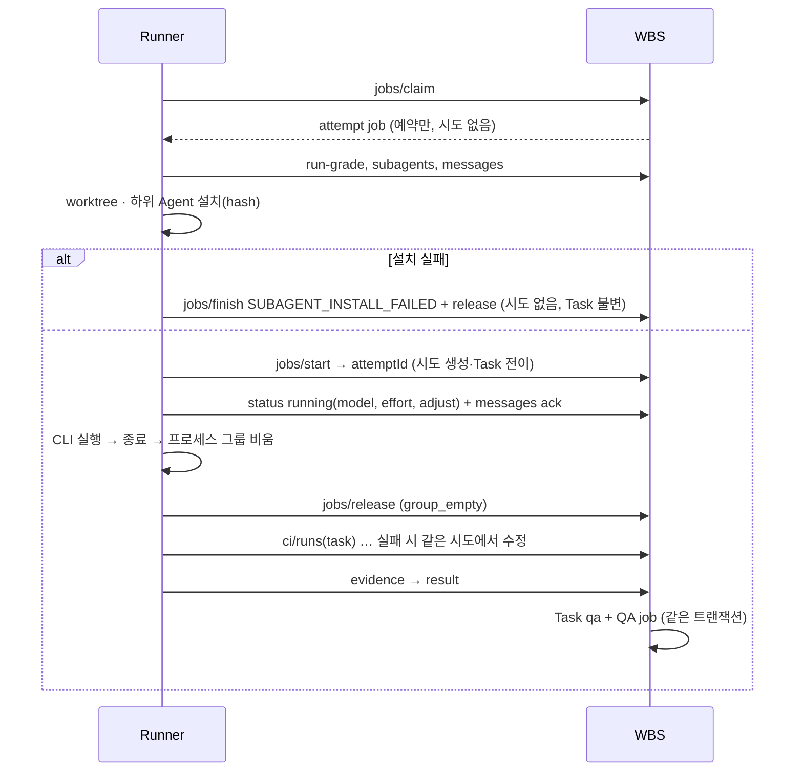

# Agent WBS 구현 기준선 — 계약

G§8이 정한 경로·의미는 그대로 두고 빈 곳을 **보강**(★)한다. ★는 가이드에 없는 설계 결정이며 [architecture.md D-03](architecture.md#7-해석-결정-기록)이 근거다. 기계 판독 정본은 M1에서 만드는 `agent-wbs/contracts/openapi.json`이고, 그때부터 이 문서와 다르면 drift로 보고 함께 고친다.

## 1. 공통 규칙

| 항목 | 규칙 |
|---|---|
| 형식 | JSON UTF-8, 시각은 UTC ISO 8601(µs 허용), 날짜 `YYYY-MM-DD`(Asia/Seoul) |
| 팀장 인증 | 세션 쿠키. 변경 요청은 `X-CSRF-Token`. 없으면 401 `LEAD_UNAUTHORIZED` |
| Runner 인증 | `Authorization: Bearer`. 없음·폐기 401 `RUNNER_UNAUTHORIZED`. 팀장 API를 Runner로 부르면 403 `FORBIDDEN_PRINCIPAL` |
| epoch | 모든 `/api/runner/*`, `/api/planning/*`에 `X-Project-Epoch`. 불일치 409 `EPOCH_MISMATCH` `{currentEpoch}`. **예외(D-04)**: heartbeat, `GET /runner/commands`, 명령 결과 — 이전 epoch 허용, heartbeat는 204 + `X-Current-Epoch` 헤더, commands는 본문 `currentEpoch`. 명령 결과는 명령 ID·명령 epoch 일치 필수. 그 외 요청은 트랜잭션 안에서 재확인(data-model §5.1) |
| epoch 전환 | Runner는 409를 받으면 새 일을 멈추고 이전 epoch outbox를 **버린 뒤** commands를 조회, 정리 완료 후에만 새 epoch 저장 |
| 멱등 | Runner·Planning POST/PATCH는 `Idempotency-Key` 필수(없으면 400 `IDEMPOTENCY_KEY_REQUIRED`). 같은 키·같은 본문 → 저장된 응답 재생(`Idempotency-Replayed: true`), 다른 본문 → 409 `IDEMPOTENCY_CONFLICT`. 예외: heartbeat(자연 멱등) |
| 키 구성 | 시도 이벤트 `att:<attemptId>:<event>:<at>`(§9.1-6), 그 외 `<kind>:<runnerId>:<uuid>`. outbox에 쓸 때 생성해 재전송 때 유지 |
| 팀장 멱등 | 생성·승인·초기화·발송 POST는 선택적 `Idempotency-Key`. 화면은 항상 보낸다(버튼 이중 클릭·재시도) |
| 동시 수정 | **모든 팀장 수정**에 §1.3의 expected version 필수. 불일치 409 `VERSION_CONFLICT` `{current, changes[{at,actor,field,before,after}]}` (§0.3 충돌 창에 필요) |
| 페이지 | `?limit=&cursor=`, `{items,nextCursor}`. WBS 트리는 전체 요약 1회 |
| 속도 | Runner 429 + `Retry-After` 허용 |

### 1.1 오류 본문

```json
{"error":{"code":"DEPENDENCY_CYCLE","message":"…","action":"의존성 추가","fix":"…",
  "errors":[{"path":"title","rule":"maxLength","message":"…"}],"details":{"path":["TASK-0005","TASK-0006"]},"requestId":"…"}}
```

`message`는 무엇을 하려다·왜, `fix`는 조치(§0.3 L72). 비밀값·스택·로그 원문 금지.

| HTTP | 코드 | 화면/Runner 처리 |
|---|---|---|
| 400 | `VALIDATION_FAILED` `DEPENDENCY_SELF` `LIMIT_EXCEEDS_CAP` | 수정 안내, 재시도 없음 |
| 401/403 | 위 표 | Runner는 중지·경보 |
| 404 | `TASK_NOT_FOUND` `PROJECT_NOT_FOUND` `WBS_NODE_NOT_FOUND` `DEPENDENCY_NOT_FOUND` `ATTEMPT_NOT_FOUND` `MESSAGE_NOT_FOUND` | 안내 |
| 409 | `VERSION_CONFLICT` `EPOCH_MISMATCH` `DEPENDENCY_DUPLICATE` `DEPENDENCY_CYCLE` `TASK_HAS_SUCCESSORS` `PROJECT_EXISTS` `INPUT_UNCHANGED` `ATTEMPT_CLOSED` `SCHEDULE_CYCLE` `INVALID_TRANSITION`★ `GATE_NOT_PASSED`★ `CLAIM_REJECTED`★ `LEASE_LOST`★ `CLEANUP_PENDING`★ `IDEMPOTENCY_CONFLICT`★ `DECISIONS_PENDING`★ | 재시도하지 않고 최신 조회 |
| 412 | — 사용 안 함(409로 통일) | |
| 422 | `SUBAGENT_INSTALL_FAILED`(job 결과 코드) | 시도 시작 안 함 |
| 429 | `RATE_LIMITED`★ | `Retry-After` |
| 500/503 | `INTERNAL` `UNAVAILABLE`★ | 다시 시도 / Runner 재시도 |

### 1.2 Runner 재시도

네트워크·408·429·5xx만 지수 백오프(1s→60s, jitter) 무기한 + outbox 영속. **시도별 순서 보존**: 앞 보고가 막히면 뒤 보고를 보내지 않는다. 다른 4xx는 `rejected`로 보존하고 readiness 경고로 올린다. 조회 timeout 10초, 업로드 120초 [결정]. 자동 처리 실패는 팀장 오류 막대가 아니라 반복 시 알림으로 올린다(§0.3 L71).

### 1.3 변경 명령별 비교 대상

G§0.3 L73 「모든 수정 API」를 따른다. 본문이 있으면 `updatedAt`, DELETE는 `?updatedAt=`로 보낸다. 누락 400, 불일치 409 `VERSION_CONFLICT`.

| 명령 | 비교 대상(aggregate) |
|---|---|
| Task PATCH·DELETE·승인·반려·완료·등급·분할·예외 | `tasks.updatedAt` (명세·설계·체크리스트·산출물 변경도 증가시킴) |
| 실행 요청·중단·재개 | Task + 중단은 시도 `updatedAt` |
| 의존성 추가·삭제 | **후속 Task** `updatedAt`. 변경 시 후속 Task도 증가, 순환은 잠금 안에서 별도 판정 |
| CP 제출·승인·반려·반영 | `change_proposals.updatedAt` + 미리보기는 `previewHash` |
| 기술 결정·불일치 처리 | 해당 행. 일괄 확정은 각 결정의 `updatedAt` 목록 |
| 초기 WBS 승인·재분석 | 초안 revision |
| 입력 분석·분석 안 함 | 확인한 커밋 목록 + `projects.updatedAt` |
| 초기화 | `confirmName` + 화면이 본 epoch |
| 설정 PUT·수신자·규칙·불가일·불안정 테스트 | 해당 설정/행 |
| 메시지 초안·전송·취소·재전송 | `messages.updatedAt` |
| 새 Task·메시지·보고서 생성, 연결 확인·미리보기·테스트 발송 | 기존 행을 수정하지 않음 — 멱등 키만. Task 생성은 잠금 안에서 부모 존재 판정 |
| 수동 발송·재발송 | 멱등 키 + 현재 `mail_log` 상태 |

예외: 자동 전이(Runner 보고·worker·자동 CP)는 사용자 편집이 아니므로 행 잠금 뒤 **현재 상태**와 fence를 판정한다. fence는 Task 편집 버전을 대신하지 않는다.

## 2. 팀장 API

### 2.1 WBS (§8.1)

| API | 요청 → 응답 | 오류 |
|---|---|---|
| GET `/api/projects/:projectId/tasks?status&q&includeDeleted` | → `{nodes[],tasks[TaskSummary]}` (`wbsPath`·차단·Gate 수·일정 요약 계산) | PROJECT_NOT_FOUND |
| GET `/api/tasks/:taskKey` | → `TaskDetail` | TASK_NOT_FOUND |
| POST `/api/projects/:projectId/tasks` | P TASK-0005 + 명세·AC·체크리스트(Wizard 3단계) → 201 `{id,taskKey,wbsPath,lifecycleStatus}` | VALIDATION_FAILED, WBS_NODE_NOT_FOUND |
| PATCH `/api/tasks/:taskKey` | `{updatedAt, …}` → `{task,changes[]}`. **status 필드 없음**(§5.5) | VERSION_CONFLICT |
| DELETE `/api/tasks/:taskKey` | 204 | TASK_HAS_SUCCESSORS |
| POST `/api/tasks/:taskKey/dependencies` | `{predTaskKey,depType}` → 201 `{dependency,blocked}` | DEPENDENCY_* |
| DELETE `/api/dependencies/:id` | 204 | DEPENDENCY_NOT_FOUND |

★ 화면 동작용 보강:

| API | 용도 |
|---|---|
| PATCH `/api/tasks/:taskKey/{spec,design/:kind,checklist/:itemKey,outputs}` · POST/DELETE checklist | 섹션별 편집(§4.4). §1.3 |
| POST `/api/tasks/:taskKey/approve` · `/reject` | 계획 승인 |
| GET `/api/tasks/:taskKey/gate` · POST `/complete` | Gate 조회, 완료 **판정 요청**(미충족 409 GATE_NOT_PASSED + 조건별 사유) |
| GET `/api/tasks/:taskKey/{history,attempts,verifications,messages}` | 탭 |
| PUT `/api/tasks/:taskKey/grade` · DELETE | 등급 고정·해제 → 재추정·재조정 |
| POST `/api/tasks/:taskKey/split` · `/split-exceptions` | 분할 제안 / 예외 사유 |
| POST `/api/tasks/:taskKey/runs` `{kind}` · POST `/api/attempts/:id/stop` · `/resume` | 실행 요청 job 생성 / 중단 / 재개. 불가 시 409 CLAIM_REJECTED `{reasons[]}` |
| GET/POST `/api/messages`, PATCH 초안, POST `/:id/{send,cancel,resend,read}` | §4.10. 초안 서버 보존 |
| GET/POST `/api/plannings`, POST `/api/plannings/:id/reviews/:rid/choice` · `/proposals` | §4.5 |
| GET/POST `/api/proposals`, GET `/:id/preview`, POST `/:id/{submit,approve,reject,request-changes,apply}` | 미리보기와 반영은 같은 함수. apply는 재시뮬레이션 |
| GET `/api/dashboard`, `/api/schedule`, `/api/replans`, POST `/api/replans/run` | §4.1, §6 |
| GET `/api/verifications`, `/api/evidence`, `/api/evidence/:id/content`, `/api/gates`, `/api/history` | §4.7, §4.9. 콘텐츠는 attachment + nosniff |
| GET/PUT `/api/settings/{workflow,exec-policy,models,split,schedule,blackouts,concurrency,obs-budget,subagents,ci}` | §4.9 탭 |
| GET `/api/runner-state` | 연결·준비·PC·동시 실행·관측·제한 요인 묶음 |
| GET `/api/alerts`, GET `/api/system/integrity` | 현재 알림 / 정합성 점검 |
| POST `/api/auth/session` · DELETE, GET `/api/session` | §2.4 |

### 2.2 프로젝트 (§8.4)

| API | 핵심 |
|---|---|
| POST `/api/project/repo-checks` `{url}` | 형식 400 우선(저장소까지만) → 202 `{id}`, GET `/:id`★ 결과 |
| POST `/api/project` | 이름·url·목표일·제약·지시·`repoCheckId`★. 성공한 확인이 없거나 정리 대기면 409. → 201 `{project,jobId}` |
| GET `/api/project`★ | 등록·입력·bootstrap·변경 감지 |
| POST `/api/project/bootstrap/approve` · `/rerun` · `/retry`★ | 초안 revision 지정. approve → WBS+기준 v1을 한 트랜잭션 |
| POST `/api/projects/:projectId/boot/tech/confirm` `{decisions[{id,choice}]}` | 미결정이 있으면 409 DECISIONS_PENDING |
| POST `/api/project/inputs` `{commit,instr?}` · `/inputs/skip` · `/inputs/retry`★ | 409 INPUT_UNCHANGED |
| POST `/api/project/reset` `{confirmName,keepSettings}` · GET `/reset-preview`★ · GET `/export`★ | 건수·정리 내용 / 내보내기(비밀값·수신자 제외) |
| GET `/api/system/resets` | 초기화 기록 |
| GET·PUT `/api/settings/github`, POST `/check`★ | `tokenSet`만 |

### 2.3 보고서·메일(§8.5) · CI(§8.5-1) · 설계(§8.6) · Telegram(§8.7)

G§8.5, §8.5-1, §8.6, §8.7의 표 전체를 그대로 구현한다(재기술하지 않음 — 단일 출처). 보강만 적는다.

- 보고서: 기간 `from ≤ to ≤ 오늘`, 최대 93일 → 400. 수정·삭제 API 없음. PDF 실패 503 `PDF_FAILED`★.
- 메일 큐 키 `reportId+recipientId+tryNo`, 실패 15분 후 1회 자동 재시도.
- CI retry/deploy-check → 202 + job. `GET /ci/pipeline`★(정의 표시), GET·PATCH `/ci/settings`★.
- 불일치 `resolve{how:"contract"}`는 Runner job을 만들고 **결과 커밋이 보고된 뒤** resolved. 호환 깨짐은 기술 결정 승인 필요(§4.12).
- Telegram 오류: `token_invalid`(401) `chat_not_found`(400) `forbidden`(403) `rate_limited`(429) `network` `webhook_in_use` `chat_migrated`★(자동 교체 금지). 마스킹 문자열 토큰 400.

### 2.4 로그인 ★ (owner Q-01)

- POST `/api/auth/session` `{method:"link",token}`: loopback 연결만, 토큰 1회 소비 → 204 + 세션 쿠키. 프록시 헤더를 믿지 않고 socket 주소로 판정한다. 실패는 구분 없이 401 `LOGIN_FAILED`.
- `{method:"password",password}`: LAN 모드만. 횟수 제한 429, 성공 시 세션 교체. 비밀번호 분실은 이 PC CLI로 재설정.
- 로그인 화면 1개에 LAN 비밀번호 입력과 「이 PC에서는 새 링크 발급」 안내를 둔다. Origin 검사는 로그인에도 적용한다.

## 3. Runner API

### 3.1 가이드 정의 (§8.2, 요청 상세는 P TASK-0012)

| API | 보강·수정 |
|---|---|
| POST `/runner/heartbeat` `{runnerId,version,epoch}` | 204 + `X-Current-Epoch`. 60초 |
| POST `/runner/sessions` | stop은 열린 세션만. `reason=unknown`은 서버만 |
| POST `/runner/host` `/readiness` `/models` `/usage` `/concurrency` | readiness key에 `obs`★ `gh`★ `lfs`★ 추가. concurrency는 세션별 `{attemptId,observed,reserved,state}`★ 포함 |
| GET `/runner/tasks/:taskKey/run-grade?role=` | 등급 정책 단일 출처. 재작업 상향·재개·하향을 서버가 계산해 `{model,effort,adjust}`★로도 준다 |
| GET `/runner/tasks/:taskKey/subagents?role=` | 모델·effort 없음. hash 검증 후 설치 |
| GET `/runner/messages?cursor=` · POST `/:id/ack` | G의 `since` 대신 **cursor**를 우선 사용(같은 시각 유실 방지). `since`도 호환 |
| POST `/runner/messages/:id/response`★ | Agent 응답 `{text,workState}`. 전달 상태와 분리(§9.4-1) |
| POST `/runner/attempts/:id/status` | `subagents.used` 제거(D-12) |
| POST `/runner/attempts/:id/interrupt` | 200 `{taskStatus:"paused"}`, 종료된 시도 409 |
| POST `/runner/attempts/:id/result` | dev·rework: summary·changedFiles·evidence·failure·tokens. qa·reverify: **`verification{headSha,specRevision,result,cmd,expected,actual,defects[],checklist[]}`**★ 필수 |
| POST `/runner/attempts/:id/evidence`★ | multipart 1파일, sha256·크기 검증. 결과 보고 전 업로드하고 id로 참조 |
| POST `/runner/attempts/:id/subagent-usage`★ | 세션 종료 후 사후 확정(`confirmed/partial`) |
| POST `/runner/input-changes`, `/runner/repo-checks/:id/result`, `/runner/bootstrap/:jobId/progress` | §8.4 |
| POST `/runner/ci/runs`, PATCH `/:id` | §8.5-1 |
| POST `/runner/ci/queue`★ | 병합 상태(PR·병합 커밋) 보고 → 서버가 완료 판정 |
| POST `/runner/design/snapshot` | §8.6 |
| POST `/runner/github/status`★ | 인증 방식·계정·권한·만료(비밀값 없음) |
| GET `/runner/github/credential`★ | 토큰 방식일 때만. Runner 공개키로 봉인한 값(평문 없음) |
| GET `/runner/policy`★ | 상한·예산·주기·ci 설정·입력 확인 주기 묶음(`ETag`) |

### 3.2 명령과 작업 ★

```
GET  /api/runner/commands                → {currentEpoch, commands:[{id,kind:"reset-cleanup",epoch,payload}]}
POST /api/runner/commands/:id/result     → {status, items:[{name,ok,detail}]}
POST /api/runner/jobs/claim {kinds[],capacity} → 200 {job:{id,kind,payload,leaseUntil,fence}} | 204
POST /api/runner/jobs/:id/renew {fence}  → {leaseUntil}         409 LEASE_LOST
POST /api/runner/jobs/:id/start {fence,hostId,bootId,processGroup?,headSha,installedSubagents[]} → {attemptId?}
POST /api/runner/jobs/:id/process {fence,processGroup,cgroup}      → 프로세스 생성 직후 보유에 기록
POST /api/runner/jobs/:id/release {fence,hostId,proof,at}            → 보유 해제(낡은 fence도 허용, 아래)
POST /api/runner/jobs/:id/reconcile {fence,evidence}                  → 외부 상태 대조 결과
POST /api/runner/jobs/:id/finish {fence,status,result?,error?}
```

| kind | payload | 종료 보고 |
|---|---|---|
| `repo_check` | url | repo-checks result |
| `bootstrap` / `input_diff` | 커밋, 지시, 이전 커밋, 재개 단계 | progress → draft / proposal |
| `planning` / `estimate` / `split` | 대상 Task, 정책 | planning API |
| `attempt` | taskKey, kind, agent, 브랜치, 기준 커밋, 입력 버전, 작업 지시 묶음 | status → result/interrupt |
| `stop_attempt` | attemptId, 사유 | interrupt |
| `integrate` / `deploy_check` / `ci_retry` | PR·커밋 | ci runs, queue |
| `design_apply` / `merge_followup` | 항목·PR | design snapshot |

규칙:

1. 정리 명령이 남아 있으면 claim은 409 CLEANUP_PENDING.
2. `attempt` claim 시 서버가 한 트랜잭션에서 선행·Task 상태·상한·Agent 상한·충돌 묶음·readiness·사용량·관측 미확인·등급과 **미해제 보유**를 확인하고 슬롯·충돌 묶음을 `reserved`로 예약한다. 시도는 아직 만들지 않는다. 설치 성공 뒤 `start`가 같은 조건을 재확인하고 시도 생성·Task 전이를 한 트랜잭션으로 처리한다. claim 실패 시 job은 대기하고 `reasons[]`를 화면에 보인다(§4.6).
3. lease 60초, 20초마다 renew [결정]. lease 만료는 **자원 해제가 아니다**. 조회 전용 job(`repo_check`)만 바로 재할당한다. attempt와 외부 효과 job은 §3.4.
4. 모든 보고는 `fence`를 포함하고 낡은 fence는 409 LEASE_LOST. 예외: `release`는 **원래 job·host·boot·process group이 일치**할 때 낡은 fence도 받되 보유 해제 외 상태는 바꾸지 않는다.
5. 야간 점검과 입력 변경 확인은 Runner가 `policy` 시각으로 시작한다. 중복은 멱등 키 `night:<date>`로 막는다.
6. 자동 실행과 한도는 §3.5.

### 3.3 Planning API (§8.3, §8.4)

| API | 규칙 |
|---|---|
| POST `/planning/estimates` | P TASK-0012. 완료 Task 거부 |
| POST `/planning/replans` | 서버가 일정을 **다시 계산**. 제출 용량은 참고값. 정책 off → 202(D-10) |
| POST `/planning/bootstrap/:jobId/draft` | phases·wps·tasks(분류·담당·추정·명세·AC·체크리스트·등급·하위 Agent·분할 근거·충돌 묶음·설계 항목)·deps. 순환·참조·필수 검증, 실패 400 |
| POST `/planning/bootstrap/:jobId/tech`★ | 기술 결정 제안(근거·대안) |
| POST `/planning/sessions`★ · `/:id/analyses` · `/:id/reviews` | §4.5 두 분석·교차 검토 |
| POST `/planning/proposals`★ | CP 제출. 서버 정책에 따라 자동 반영/보류/검토 |
| POST `/planning/tasks/:taskKey/plan`★ | 등급·하위 Agent·충돌 묶음 판단과 근거 |

### 3.4 실행 보유와 복구

1. **시도 종료 ≠ 자원 반환.** heartbeat 3회 누락이면 §6.5대로 시도 `interrupted`, Task `paused`로 기록하지만 보유는 `unconfirmed`로 남는다. 슬롯·충돌 묶음·Task 재개를 계속 막고 사유를 화면에 보인다(§6.7 L804-806).
2. 해제 증거: `no_process`(프로세스를 만든 적 없음), `group_empty`(Runner가 그룹·자손 empty 확인), `boot_changed`(같은 host의 boot ID 변경 — 이전 프로세스가 존재할 수 없음). 출력 단절·lease 만료·시간 경과는 증거가 아니다.
3. Runner는 프로세스 생성 **전에** 예정된 그룹/cgroup 이름을 로컬에 영속화한다. 재시작 시 로컬 기록과 서버 보유를 대조해 정리하고 release한다. 기록이 없거나 확인할 수 없으면 `unconfirmed`를 유지하고 알린다.
4. 같은 PC에서 증거 없이 보유를 푸는 강제 API는 두지 않는다.
5. **PC 변경**: §6.6 L749-751이 새 PC에서 새 시도 재개를 확정했으므로, 이전 host 보유는 `unconfirmed`로 남기되 새 host의 슬롯 계산과 재개 차단에서 제외한다. 대신 이전 fence를 폐기하고 Runner는 push·PR·병합 직전에 `renew`로 fence를 확인한다. 이전 시도와 다른 head/worktree를 쓰고, 실패 시 외부 효과를 내지 않는다. host 식별자 변경 없는 단순 재시작에는 적용하지 않는다.
6. 외부 효과 job(`integrate`,`deploy_check`,`design_apply`,`merge_followup`, 초기 분석의 커밋 단계): lease 상실 시 `reconcile`로 두고 재할당하지 않는다. 이전 그룹 종료를 확인하고 GitHub main/PR/status 또는 compose 상태를 실제 조회해 「효과 없음 / 완료됨 / 부분 적용」을 보고한 뒤에만 완료 확정 또는 새 실행을 허용한다. 부분 적용은 실패와 조치 안내로 남긴다.
7. 원격 호출 직전 lease를 renew하고, 조건부 요청(비강제 push의 부모 커밋, PR head 확인)으로 fence 확인과 호출 사이의 짧은 경합을 막는다.

### 3.5 자동 진행 (owner Q-04)

- 최초 dev는 팀장 `POST /tasks/:key/runs`가 있어야 job을 만든다. 이후 ①→QA→(FAIL) rework→reverify는 서버가 job을 만든다.
- 실행 실패: 같은 종류의 **연속 실패에 대해 자동 재시도 최대 2회**. 설치 실패 등 시작 전 실패는 자동 재시도하지 않고 「다시 시도」 버튼(G L864, P).
- QA FAIL과 통합 실패를 합쳐 Task당 **자동 재작업 최대 3회**. 재작업 안의 실행 실패는 위 실패 한도로 따로 센다. BLOCKED·중단은 세지 않고 자동 반복하지 않는다.
- 초과하면 추가 job을 만들지 않고 팀장 알림. 팀장 버튼은 한도 카운터를 되돌리지 않고 1회만 허용한다.
- Telegram 「Task 실패」: QA FAIL 확정, 실행 실패의 자동 한도 초과(§4.14). 자동 재시도 중 실패는 보내지 않는다.
- 서버 재시작·중복 보고에도 원인 시도와 회차로 job 고유키를 둔다.

## 4. 대표 흐름

### 4.1 시도 1회



QA PASS → `gate` → `integrate` → ② 통과 → PR 병합 → `ci/queue merged` → 서버 Gate 재판정 → `done`. 별도 완료 승인 없이 서버가 `integrate` job을 만들고 병합 확인 뒤 자동 완료한다(owner Q-02). 사전 조건은 ②를 제외한 Gate 5조건(승인=착수 승인)이다. 「완료 처리」 버튼(P L5389)은 같은 판정을 다시 요청할 뿐 우회하지 않는다.

#### 코드 근거 고정

1. 개발 종료 시 변경을 commit하고 ①·QA는 같은 `headSha`와 `specRevision`을 검사한다. QA는 읽기 전용 상태에서 시작하고 종료 시 SHA·worktree 청결을 다시 확인해 보고한다.
2. head·명세·AC·명세가 참조하는 입력 버전이 바뀌면 이전 QA를 무효화하고 재검증한다. 낡은 SHA의 PASS는 거부한다.
3. ②는 `baseSha=A`, `headSha=H`, 로컬 병합본 `mergeSha=M`, `treeSha`, `pipelineSha`(main A의 정의)를 고정해 **M을 검사**한다. A나 H가 바뀌면 결과를 무효화하고 다시 실행한다.
4. 병합: GitHub에 PR head가 여전히 H인지 확인 → M에 int status를 기록 → 검사한 **M 자체를 main에 비강제 fast-forward push**. main이 A가 아니면 거부되므로 미검사 B+H가 병합되지 않는다. 원격 H가 push 직전에 바뀌어도 main에 들어가는 것은 검증된 M뿐이며 이후 H 변경은 새 작업으로 처리한다.
5. push 뒤 main에 M이 포함되고 PR이 병합됨으로 표시됐는지 조회한다. 실제 병합 SHA·parent·tree를 기록하며 불일치는 완료하지 않고 알린다. GitHub가 이 push를 받아 PR을 병합됨으로 처리하는지는 보호 규칙에서 실증한다(M8-05, [추정]). 안 되면 **strict up-to-date 보호 + head 조건부 병합 + 실제 tree 대조**로 바꾸되 같은 불변식을 만족해야 한다.
6. 묶음 확인(§4.13)도 각 PR의 QA SHA와 최종 병합본을 연결하고, 검사한 최종 병합본만 push한다.

### 4.2 전이 트랜잭션

상태 변경 = 행 잠금 → 전이 검사 → 변경 + 이력 + `alerts` + `notify_events/outbox` + `change_events` + 일정 재계산 표시. 커밋 후 worker가 발송한다(§9.6-3-5). 일정은 프로젝트당 합쳐 계산하고 결과에 `calcVersion`을 둔다.

### 4.3 Runner 끊김

3회 누락 → 서버 세션 종료(unknown), 열린 시도 `interrupted`, Task `paused`. 이후 도착한 이전 시도 결과는 409 ATTEMPT_CLOSED로 거부하되 **요약만** 진단용으로 이력에 남긴다 [결정]. 자원 해제와 재개 가능 여부는 §3.4.

### 4.4 외부 전송의 불확정 구간

- SMTP·Telegram에는 이 설계가 의존할 수 있는 멱등 키가 없으므로 **정확히 1회 도착을 보장하지 않는다.** 논리 발송 ID는 DB 중복만 막는다.
- `sending`은 호출 전에 커밋하고, 명시적 수락 응답만 `accepted`다. 연결 전 실패나 명시적 거부처럼 수락되지 않은 것이 확실하면 실패/재시도 규칙을 적용한다.
- **메일**(G§9.6-6 「두 번 나가지 않게」): 전송 본문을 보낸 뒤 응답 유실·timeout·프로세스 crash는 `unknown`. 15분 자동 재시도에서 제외하고 실패 알림에 포함, 팀장이 중복 가능 안내를 보고 다시 보낸다.
- **Telegram**: 같은 이벤트 키의 새 outbox는 해소 전 1개(§4.14). 통신 실패 재시도는 G§9.6-3-2가 확정했으므로 응답 유실·crash도 횟수 제한 안에서 재시도한다. 이때 중복 도착 가능성을 이력 오류 요약에 남긴다. 마지막까지 불명이면 `unknown`.
- 두 채널의 unknown은 Task·Agent 상태에 영향을 주지 않는다.

## 5. Agent 출력 계약 (Runner 내부) ★

- 모든 Agent 종료 메시지는 JSON Schema로 검증한다. 형식 불일치는 1회 수정 요청, 이후 실패.
- dev: `{summary, selfCheck[], followups[], designItems[]}` — 변경 파일은 자기보고가 아니라 **git diff**.
- qa: `{verdict, criteria[{acId,result,cmd,expected,actual,evidence}], defects[]}` — 종료 코드·로그는 Runner 관측을 우선(§4.13).
- 지시문 포함: Task 명세·제외 범위·AC·관련 설계 항목과 직접 연결 항목만(§4.12), 하위 Agent 예산(§6.7-5), 보호 경로, 입력 버전.
- 입력 문서는 데이터로 취급하고, 안의 지시가 정책을 바꾸지 못한다고 명시한다.

## 6. GitHub 계약 (Runner)

브랜치 `agent/<TASK>`(P 표기), PR 1개/Task, main 직접 push는 최초 생성·초기화 되돌림·검사한 병합본 M 세 종류만 허용, status context `agentwbs/task|int|night|deploy`. 서버 보고와 GitHub 보고는 독립 outbox(§9.6-2-6). 초기화: PR 닫기 → `agent/*` 중 **이 시스템이 기록한 브랜치만** 삭제 → 기준 커밋 상태의 `src/ contracts/ .agentwbs/`로 되돌림 커밋(강제 push 없음). 등록 전 파일은 기준 커밋 내용으로 복원된다.

## 7. 변경 이벤트

`GET /api/changes?after=<seq>&limit=500` (팀장) → `{events:[{seq,topic,ref,at}],next,reset}`. 보존 범위를 벗어나거나 epoch가 바뀌면 `reset:true` → 전체 재조회.

topic: `task` `dependency` `attempt` `verification` `message` `proposal` `planning` `schedule` `runner` `ci` `design` `report` `mail` `notify` `alert` `project` `settings`. 본문을 싣지 않고 참조만 보낸다(권한·일관성은 조회 API가 담당). 순서는 커밋 순서를 보장하도록 프로젝트 잠금 안에서 seq를 발급한다.

## 8. 계약 검증

- `openapi.json` 재생성 diff 0, Runner client 재생성 diff 0.
- 같은 요청·응답 fixture를 WBS(inject)와 Runner(client)가 함께 통과.
- Runner API 전체에 대해 무토큰·팀장 세션·낡은 epoch·멱등 재전송·키 충돌 5종 표 기반 테스트.
- 초기화 경합: middleware 통과 뒤 정지한 host 보고, 생성 중 PDF, 발송 시작 직전/직후를 초기화와 교차.
- 보유: 네트워크 단절+자손 생존+재개 요청은 거부, 그룹 종료 확인 뒤 허용.
- P에 있는 Endpoint와 G§8 표의 모든 경로가 라우트 목록에 있는지 자동 비교.
