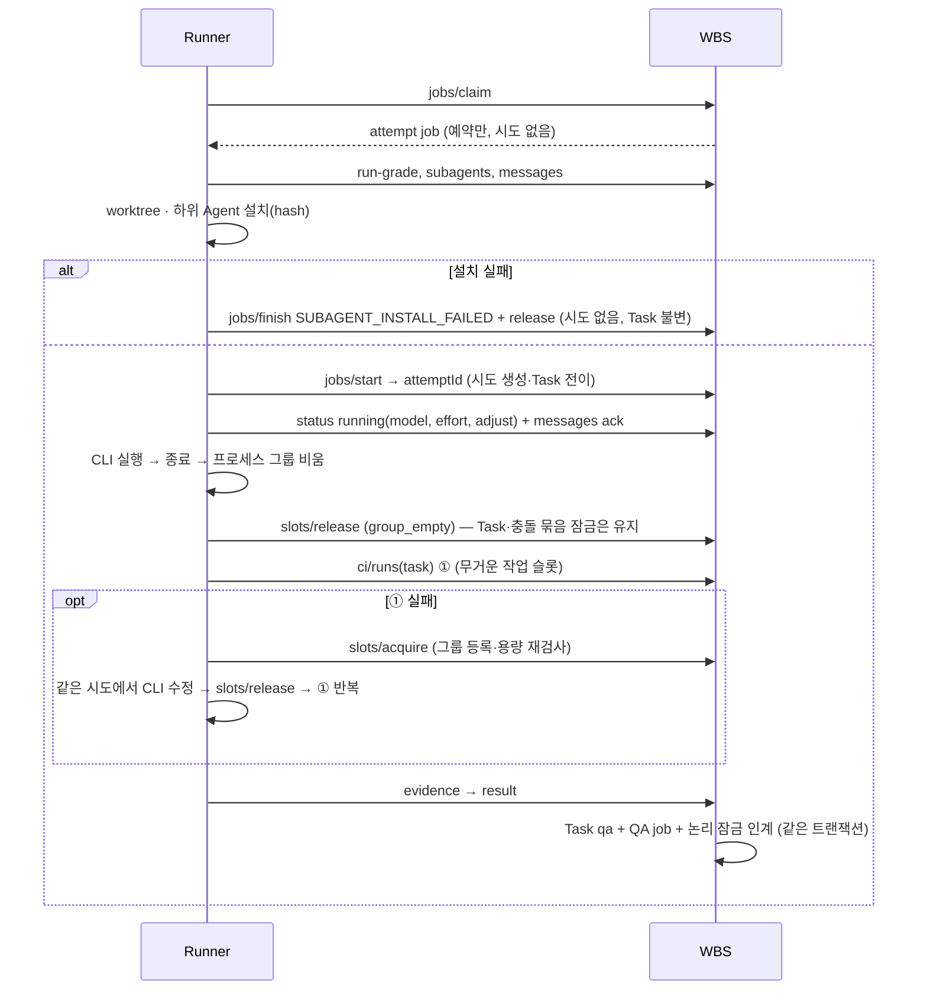

# Agent WBS 구현 기준선 — 계약

> **이 문서가 답하는 질문**
> - 화면(팀장)과 Runner는 서버의 어떤 API를, 어떤 규칙으로 부르나?
> - 오류가 나면 어떤 코드가 오고, 받은 쪽은 무엇을 해야 하나?
> - 시도 1회는 claim부터 병합까지 어떤 순서로 흘러가나?
>
> 처음 읽는다면 [docs/README.md](../README.md)부터 보세요. 낯선 용어는 [용어집](../glossary.md)에 있습니다.

**이 문서의 약속**

- 여기서 「계약」은 두 프로그램이 서로 주고받기로 약속한 API의 경로·요청·응답·오류 규칙이다.
- G§8이 정한 경로·의미는 그대로 두고 빈 곳을 **보강**(★)한다.
  - ★는 가이드에 없는 설계 결정이며 [architecture.md D-03](architecture.md#7-해석-결정-기록)이 근거다.
- 기계 판독 정본은 M1에서 만드는 `agent-wbs/contracts/openapi.json`이다.
  - 그때부터 이 문서와 다르면 drift로 보고 함께 고친다.
  - 왜: 사람이 읽는 문서와 기계가 쓰는 파일이 다르면, 어느 쪽을 믿어야 할지 모르게 된다.

## 1. 공통 규칙

모든 API에 똑같이 적용하는 규칙이다.

- **형식**
  - JSON UTF-8, 시각은 UTC ISO 8601(µs 허용), 날짜 `YYYY-MM-DD`(Asia/Seoul)
- **팀장 인증**
  - 세션 쿠키. 변경 요청은 `X-CSRF-Token`.
  - 없으면 401 `LEAD_UNAUTHORIZED`
- **Runner 인증**
  - `Authorization: Bearer`.
  - 없음·폐기 401 `RUNNER_UNAUTHORIZED`.
  - 팀장 API를 Runner로 부르면 403 `FORBIDDEN_PRINCIPAL`
- **epoch** (프로젝트 세대 번호. 초기화할 때마다 1 오른다)
  - **Runner 토큰을 쓰는 모든 요청**(경로 접두어가 아니라 주체 기준. `POST …/design/decisions` 포함)에 `X-Project-Epoch`.
  - 불일치 409 `EPOCH_MISMATCH` `{currentEpoch}`.
  - **예외(D-04)**: heartbeat, `GET /runner/commands`, 명령 결과 — 이전 epoch 허용.
    - heartbeat는 204 + `X-Current-Epoch` 헤더, commands는 본문 `currentEpoch`.
    - 명령 결과 POST는 commands 조회 **응답 본문의** 해당 `commands[].epoch`를 **요청 헤더 `X-Project-Epoch`에** 넣는다. 값은 그 명령 ID의 epoch와 일치해야 한다(다르면 409 EPOCH_MISMATCH).
    - 왜 예외를 두나: 초기화된 Runner가 옛 epoch로도 정리 명령을 받을 수 있어야 교착이 생기지 않는다.
  - 그 외 요청은 트랜잭션 안에서 재확인(data-model §5.1)
  - 왜: 초기화 전에 출발한 요청이 초기화 뒤 새 프로젝트 데이터를 고치는 일을 막는다.
- **epoch 전환**
  - Runner는 409를 받으면 새 일을 멈추고 이전 epoch outbox를 **버린 뒤** commands를 조회한다.
  - 정리 완료 후에만 새 epoch 저장.
- **멱등** (같은 요청을 여러 번 보내도 결과가 한 번 보낸 것과 같게 하는 성질)
  - Runner·Planning POST/PATCH는 `Idempotency-Key` 필수(없으면 400 `IDEMPOTENCY_KEY_REQUIRED`).
  - 같은 키·같은 본문 → 저장된 응답 재생(`Idempotency-Replayed: true`).
  - 다른 본문 → 409 `IDEMPOTENCY_CONFLICT`.
  - 예외: heartbeat(자연 멱등)
  - 왜: 네트워크가 끊겨 Runner가 같은 보고를 다시 보내도, 서버가 두 번 처리하지 않게 한다.
- **키 구성**
  - 시도 이벤트 `att:<attemptId>:<event>:<at>`(§9.1-6), 그 외 `<kind>:<runnerId>:<uuid>`.
  - outbox에 쓸 때 생성해 재전송 때 유지
- **팀장 멱등**
  - 생성·승인·초기화·발송 POST는 선택적 `Idempotency-Key`.
  - 화면은 항상 보낸다(버튼 이중 클릭·재시도)
- **동시 수정**
  - **모든 팀장 수정**에 §1.3의 expected version 필수.
  - 불일치 409 `VERSION_CONFLICT` `{current, changes[{at,actor,field,before,after}]}` (§0.3 충돌 창에 필요)
  - 왜: 낡은 화면을 보고 한 수정이 다른 사람의 최신 수정을 덮어쓰지 않게 한다.
- **페이지**
  - `?limit=&cursor=`, `{items,nextCursor}`.
  - WBS 트리는 전체 요약 1회
- **ID**
  - 서버가 준 불투명 문자열. 클라이언트가 형식을 만들거나 해석하지 않음.
  - Task 참조만 `TASK-` + 숫자 4자리 이상
- **비동기**
  - 작업을 만드는 팀장 요청은 202 `{jobId}`(저장소 확인은 `{id}`, Planning 시작은 `{id,jobId}`)
- **값 철자**
  - openapi.json이 정본.
  - reconcile `none/done/partial`, drift compat `compatible/breaking/unchecked`(화면 「대조 안 함」=unchecked), 입력 변경 `added/modified/deleted`, CI stage `task/int/night/deploy`.
  - DB 내부 값이 다르면 API 경계에서 변환
- **속도**
  - Runner 429 + `Retry-After` 허용

### 1.1 오류 본문

오류가 나면 서버는 항상 아래 모양으로 답한다.

```json
{"error":{"code":"DEPENDENCY_CYCLE","message":"…","action":"의존성 추가","fix":"…",
  "errors":[{"path":"title","rule":"maxLength","message":"…"}],"details":{"path":["TASK-0005","TASK-0006"]},"requestId":"…"}}
```

- `message`는 무엇을 하려다·왜, `fix`는 조치(§0.3 L72).
- 비밀값·스택·로그 원문 금지.
  - 왜: 오류 메시지는 화면에 그대로 보이므로, 토큰이나 내부 구조가 새어 나가면 안 된다.

아래 표는 HTTP 상태별 오류 코드와, 받은 쪽(화면/Runner)이 할 일이다. (이 표는 테스트가 그대로 읽으므로 모양을 바꾸지 않는다.)

| HTTP | 코드 | 화면/Runner 처리 |
|---|---|---|
| 400 | `VALIDATION_FAILED` `DEPENDENCY_SELF` `LIMIT_EXCEEDS_CAP` | 수정 안내, 재시도 없음 |
| 401/403 | 위 표 | Runner는 중지·경보 |
| 404 | `TASK_NOT_FOUND` `PROJECT_NOT_FOUND` `WBS_NODE_NOT_FOUND` `DEPENDENCY_NOT_FOUND` `ATTEMPT_NOT_FOUND` `MESSAGE_NOT_FOUND`, 전용 코드가 없는 자원은 `NOT_FOUND`★ `details{resource,id}` | 안내 |
| 409 | `VERSION_CONFLICT` `EPOCH_MISMATCH` `DEPENDENCY_DUPLICATE` `RECIPIENT_DUPLICATE`★(G§8.5 수신자 중복) `DEPENDENCY_CYCLE` `TASK_HAS_SUCCESSORS` `EXTERNAL_WRITE_BLOCKED`★ `PROJECT_EXISTS` `INPUT_UNCHANGED` `ATTEMPT_CLOSED` `SCHEDULE_CYCLE` `INVALID_TRANSITION`★ `SPLIT_JUDGEMENT_REQUIRED`★ `ACTIVE_TASK_BLOCKED`★ `ORDER_NOT_PRESERVED`★ `GATE_NOT_PASSED`★ `CLAIM_REJECTED`★ `LEASE_LOST`★ `CLEANUP_PENDING`★ `IDEMPOTENCY_CONFLICT`★ `DECISIONS_PENDING`★ | 재시도하지 않고 최신 조회 |
| 412 | — 사용 안 함(409로 통일) | |
| 422 | `SUBAGENT_INSTALL_FAILED`(job 결과 코드) | 시도 시작 안 함 |
| 429 | `RATE_LIMITED`★ | `Retry-After` |
| 500/503 | `INTERNAL` `UNAVAILABLE`★ | 다시 시도 / Runner 재시도 |

- 표의 「위 표」는 §1 목록의 팀장 인증·Runner 인증 항목을 가리킨다.
- 409를 받으면 재시도하지 않는 이유: 409는 「지금 상태와 맞지 않는다」는 뜻이라, 같은 요청을 다시 보내도 또 실패한다. 최신 상태를 다시 읽어야 한다.

**헷갈리기 쉬운 409 코드 구분**

- `INVALID_TRANSITION`은 상태가 맞지 않는 요청에 쓴다: 성공한 저장소 확인 없는 등록, 열린 세션 없는 stop 등.
- 정리 대기 중 등록·초기 분석 재시도는 `CLEANUP_PENDING`.
- 실행 요청·중단·재개·슬롯 재획득·재판단 전 run-grade가 불가하면 `CLAIM_REJECTED`.

### 1.2 Runner 재시도

- 네트워크·408·429·5xx만 지수 백오프(1s→60s, jitter) 무기한 + outbox 영속.
  - 지수 백오프는 실패할 때마다 기다리는 시간을 두 배씩 늘리는 방법이다. jitter는 여러 요청이 동시에 몰리지 않게 대기 시간을 조금씩 흩뜨리는 것이다.
- **시도별 순서 보존**: 앞 보고가 막히면 뒤 보고를 보내지 않는다.
  - 왜: 「완료」 보고가 「시작」 보고보다 먼저 도착하면 서버가 상태를 잘못 판단한다.
- 다른 4xx는 `rejected`로 보존하고 readiness 경고로 올린다.
- 조회 timeout 10초, 업로드 120초 [결정].
- 자동 처리 실패는 팀장 오류 막대가 아니라 반복 시 알림으로 올린다(§0.3 L71).

### 1.3 변경 명령별 비교 대상

- G§0.3 L73 「모든 수정 API」를 따른다.
- 본문이 있으면 `updatedAt`, DELETE는 `?updatedAt=`로 보낸다.
- 누락 400, 불일치 409 `VERSION_CONFLICT`.
- 아래 표는 「이 명령을 보낼 때 어느 행의 버전을 비교하나(aggregate)」다.

| 명령 | 비교 대상(aggregate) |
|---|---|
| Task PATCH·DELETE·**착수 승인 요청**·승인·반려·완료·등급·분할·예외 | `tasks.updatedAt` (명세·설계·체크리스트·산출물 변경도 증가시킴) |
| 실행 요청·중단·재개 | Task + 중단은 시도 `updatedAt` |
| 의존성 추가·삭제 | **후속 Task** `updatedAt`. 변경 시 후속 Task도 증가, 순환은 잠금 안에서 별도 판정 |
| CP 제출·승인·반려·반영 | `change_proposals.updatedAt` + 미리보기는 `previewHash` |
| 기술 결정·불일치 처리 | 해당 행. 일괄 확정은 각 결정의 `updatedAt` 목록 |
| 초기 WBS 승인·재분석 | 초안 revision |
| 초기 분석 다시 시도 | 초안이 있으면 `{revision}`, 초안 전이면 `{revision:null, runNo}`(분석 회차) |
| 차이 분석 다시 시도 | `projects.updatedAt` + `version`(실패한 입력 버전) |
| 입력 분석·분석 안 함 | 확인한 커밋 목록 + `projects.updatedAt` |
| 초기화 | `confirmName` + 화면이 본 epoch |
| 설정 PUT·수신자·규칙·불가일·불안정 테스트 | 해당 설정/행 |
| 메시지 초안·전송·취소·재전송 | `messages.updatedAt` |
| 메시지 읽음 | 없음 — 아래 참고 |
| 새 Task·메시지·보고서 생성, 연결 확인·미리보기·테스트 발송 | 기존 행을 수정하지 않음 — 아래 참고 |
| 수동 발송·재발송 | 멱등 키 + 현재 `mail_log` 상태 |

- 메시지 읽음: 내용·전달 상태를 바꾸지 않는 멱등 표시라 예외. `messages.updatedAt`도 올리지 않는다.
- 새 Task·메시지·보고서 생성 등: 기존 행을 수정하지 않음 — 멱등 키만. Task 생성은 잠금 안에서 부모 존재 판정.
- 예외: 자동 전이(Runner 보고·worker·자동 CP)는 사용자 편집이 아니므로 행 잠금 뒤 **현재 상태**와 fence를 판정한다.
  - fence는 Task 편집 버전을 대신하지 않는다.
  - fence는 낡은 Runner의 보고를 막는 번호표다(§3.2 참고).

## 2. 팀장 API

팀장 화면이 부르는 API다. 경로마다 「요청 → 응답」과 대표 오류를 적었다.

### 2.1 WBS (§8.1)

가이드가 정한 API:

- GET `/api/projects/:projectId/tasks?status&q&includeDeleted`
  - 응답: → `{nodes[],tasks[TaskSummary]}` (`wbsPath`·차단·Gate 수·일정 요약 계산)
  - 오류: PROJECT_NOT_FOUND
- GET `/api/tasks/:taskKey`
  - 응답: → `TaskDetail`
  - 오류: TASK_NOT_FOUND
- POST `/api/projects/:projectId/tasks`
  - 요청 → 응답: P TASK-0005 + 명세·AC·체크리스트(Wizard 3단계) → 201 `{id,taskKey,wbsPath,lifecycleStatus}`
  - 오류: VALIDATION_FAILED, WBS_NODE_NOT_FOUND
- PATCH `/api/tasks/:taskKey`
  - 요청 → 응답: `{updatedAt, …}` → `{task,changes[]}`. **status 필드 없음**(§5.5)
  - 왜 status가 없나: 상태는 사람이 직접 고치는 값이 아니라 전이 규칙으로만 바뀐다.
  - 오류: VERSION_CONFLICT
- DELETE `/api/tasks/:taskKey`
  - 응답: 204
  - 오류: TASK_HAS_SUCCESSORS
- POST `/api/tasks/:taskKey/dependencies`
  - 요청 → 응답: `{predTaskKey,depType}` → 201 `{dependency:{id,pred,succ,type},blocked}`(`id`는 삭제 API에 사용)
  - 오류: DEPENDENCY_*, ACTIVE_TASK_BLOCKED(D-35), INVALID_TRANSITION(취소된 Task를 선행으로 지정)
- DELETE `/api/dependencies/:id`
  - 응답: 204
  - 오류: DEPENDENCY_NOT_FOUND

★ 화면 동작용 보강:

- PATCH `/api/tasks/:taskKey/{spec,design/:kind,checklist/:itemKey,outputs}` · POST/DELETE checklist
  - 용도: 섹션별 편집(§4.4). §1.3
- POST `/api/tasks/:taskKey/request-approval` `{updatedAt, comment?}`
  - 용도: **착수 승인 요청**(Q-05 2행).
  - `planning`만, 명세 필수 항목 충족 시 → `approval`. 200 `{task,changes[]}`.
  - 오류:
    - 미충족 400 VALIDATION_FAILED(`errors[]`에 항목)
    - 다른 상태 409 INVALID_TRANSITION
    - 낡은 버전 409 VERSION_CONFLICT
    - 없음 404 TASK_NOT_FOUND
  - 자동 전이하지 않음. 상태·이력을 한 트랜잭션에 기록
- POST `/api/tasks/:taskKey/approve` · `/reject` `{updatedAt, comment?}`
  - 용도: 착수 승인 / 반려(Q-05 3행). `approval`만 → `ready`(`planning_approved_at` 기록) / `planning`.
  - 승인은 필수 항목을 다시 검사한다.
  - 규칙 5·7·9 판단이 유효한 충족이 아니면 409 SPLIT_JUDGEMENT_REQUIRED `{items[{rule,reason}]}`(D-33).
  - 응답·오류는 위와 같음(반려는 필수 항목 검사 없음)
- GET `/api/tasks/:taskKey/gate` · POST `/complete`
  - 용도: Gate 조회, 완료 **판정 요청**(미충족 409 GATE_NOT_PASSED + 조건별 사유)
- GET `/api/tasks/:taskKey/{history,attempts,verifications,messages}`
  - 용도: 탭
- PUT `/api/tasks/:taskKey/grade` · DELETE
  - 용도: 등급 고정·해제 → 재추정·재조정
- POST `/api/tasks/:taskKey/split` · `/split-exceptions`
  - 용도: 분할 제안 / 예외 사유
- POST `/api/tasks/:taskKey/runs` `{kind}` · POST `/api/attempts/:id/stop` · `/resume`
  - 용도: 실행 요청 job 생성 / 중단 / 재개. 불가 시 409 CLAIM_REJECTED `{reasons[]}`
- GET/POST `/api/messages`, PATCH 초안, POST `/:id/{send,cancel,resend,read}`
  - 용도: §4.10. 초안 서버 보존
- GET/POST `/api/plannings`, POST `/api/plannings/:id/reviews/:rid/choice` · `/proposals`
  - 용도: §4.5
- GET/POST `/api/proposals`, GET `/:id/preview`, POST `/:id/{submit,approve,reject,request-changes,apply}`
  - 용도: 변경 제안(CP)의 조회·미리보기·제출·승인·반영. 규칙이 많아 아래에 따로 풀어 썼다.
- GET `/api/verifications`, `/api/evidence`, `/api/evidence/:id/content`, `/api/gates`, `/api/history`
  - 용도: §4.7, §4.9. 콘텐츠는 attachment + nosniff
  - 왜 attachment + nosniff인가: 업로드된 파일을 브라우저가 웹 페이지로 실행하지 않고 내려받게만 하기 위해서다.
- GET/PUT `/api/settings/{workflow,exec-policy,models,split,schedule,blackouts,concurrency,obs-budget,subagents,ci}`
  - 용도: §4.9 탭.
  - `settings/ci`와 §2.3의 `ci/settings`는 **같은 설정 한 벌**(같은 행·버전).
  - 저장 전 `updatedAt`은 null.
  - `models` PUT은 `{agent,id,allowed}`만 받고 이름·rank·efforts는 읽기 전용(§7.1, Q-06)
- GET `/api/alerts`, GET `/api/system/integrity`
  - 용도: 현재 알림 / 정합성 점검
- POST `/api/auth/session` · DELETE, GET `/api/session`
  - 용도: §2.4

아래 두 API는 `|` 기호가 든 값이 있어 표로 둔다.

| API | 용도 |
|---|---|
| GET `/api/dashboard`, `/api/schedule`, `/api/replans`, POST `/api/replans/run` | §4.1, §6. 조회 응답의 필드 구조는 openapi.json이 정본. `schedule.warnings[]`의 `CLOCK_SKEW_CLAMPED`는 시계 오차로 자른 값의 이전·이후를 보존: Task `{code,taskKey,field:"actStart"\|"actEnd",before,after}` 또는 세션 `{code,sessionFrom,field:"lastHeartbeatAt"\|"to",before,after}`. 계산에만 자른 값을 쓰고 저장 기록은 바꾸지 않음(§9.1-3) |
| GET `/api/runner-state` | 연결·준비·PC·동시 실행·관측·제한 요인 묶음 + 최근 중단 구간 `gaps[{from,to\|null,reason}]` 최대 6개·최신순(P L6684), reason `reboot/power_off/error/manual/unknown`, 진행 중이면 `to=null` |

**변경 제안(proposals) API 상세**

- 미리보기와 반영은 같은 함수. apply는 재시뮬레이션.
  - 왜 같은 함수인가: 팀장이 미리보기에서 본 결과와 실제 반영 결과가 다르면 안 된다.
- **보류 사유** `holdReasons[{code,taskKey?,rule?,message}]`: `JUDGEMENT_MISSING` `JUDGEMENT_NOT_MET` `ORDER_NOT_PRESERVED` `ACTIVE_TASK_BLOCKED`(D-33~35).
  - 하나라도 있으면 자동 반영은 `held`.
  - 수동 승인·반영은 409(판단은 `SPLIT_JUDGEMENT_REQUIRED`, 순서는 `ORDER_NOT_PRESERVED`, 차단은 `ACTIVE_TASK_BLOCKED`)이고 강제 우회 없음.
- **그 밖의 반영 불가 사유**
  - D-33~35 외의 반영 불가 사유(완료 Task·순환·없는 대상 등, §5.6)는 `issues[{index,code,taskKey?,message}]`에 담는다.
  - `taskKey`는 특정 Task의 문제일 때만. 새 Task는 `idMap`의 예상 키.
  - 수동 apply에서 이것만 있으면 200으로 `status=held`를 돌려준다.
- **응답 모양**
  - preview는 `{previewHash,impact,issues,holdReasons,diff,idMap}`
  - apply는 `{proposal,impact,issues,holdReasons,diff,idMap}`
- **add op(새 Task 추가)의 필드**
  - add op의 `t`에는 `scope`·`files`·`design`·`conflictGroup`을 선택 필드로 둔다(정의와 생략 규칙은 [data-model §2.4-1](data-model.md#24-1-cp-add-task의-선택-필드)).
  - add op의 `t.splitBasis`(분할 근거)는 **일반 CP는 선택, 분할 CP(`source.kind="split"`)의 추가 Task는 필수**이며 팀장·Planning 작성에 같이 적용.
    - 형식은 초안의 `splitBasis`와 같은 공백 아닌 문자열.
    - 분할 CP에서 빠지면 400 VALIDATION_FAILED, 저장된 CP의 시뮬레이션에서는 `issues`의 `SPLIT_BASIS_MISSING`.
- **판단 처리**
  - 팀장 작성 POST는 판단 필드를 받지 않음(400).
  - 판단이 필요한 CP가 `review`에 들어오면 서버가 `planning` 판단 job을 만든다.
  - 승인·미리보기·반영에서 대상 hash가 달라진 것을 발견하면 다시 만든다(CP와 hash 조합당 열린 job 1개 [결정]).
  - 조회 응답에 `taskJudgements[]`·`splitJudgements`.
  - DB `hold_reasons`에는 `{holdReasons,issues}`를 함께 저장.
- **영향(impact)**
  - `impact`에 `removedDependencies[{pred,succ,type,reason}]`·**`unblockedSuccessors[{taskKey,remainingBlockers[]}]`**.
  - 취소로 관계가 제거된 후속과, 남은 선행이 없어 실제로 풀리는지를 구분(D-27).
  - 예: 취소로 A→B 관계가 지워져도 B에게 다른 선행이 남아 있으면 `remainingBlockers[]`에 보인다. 그러면 B는 아직 풀리지 않은 것이다.

### 2.2 프로젝트 (§8.4)

- POST `/api/project/repo-checks` `{url}`
  - 형식 400 우선(저장소까지만) → 202 `{id}`, GET `/:id`★ 결과
- POST `/api/project`
  - 이름·url·목표일·제약·지시·`repoCheckId`★.
  - 성공한 확인이 없거나 정리 대기면 409.
  - → 201 `{project,jobId}`
- GET `/api/project`★
  - 등록·입력·bootstrap·변경 감지
- POST `/api/project/bootstrap/approve` · `/rerun` · `/retry`★
  - approve·rerun은 초안 revision, retry는 §1.3의 `{revision}` 또는 `{revision:null,runNo}`.
  - approve → WBS+기준 v1을 한 트랜잭션.
  - 켜진 규칙 5·7·9 판단이 유효한 충족이 아닌 Task가 있으면 409 SPLIT_JUDGEMENT_REQUIRED(D-33)
- POST `/api/projects/:projectId/boot/tech/confirm` `{decisions[{id,choice}]}`
  - 미결정이 있으면 409 DECISIONS_PENDING
- POST `/api/project/inputs` `{commit,instr?}` · `/inputs/skip` · `/inputs/retry`★
  - 409 INPUT_UNCHANGED
- POST `/api/project/reset` `{confirmName,keepSettings}` · GET `/reset-preview`★ · GET `/export`★
  - 건수·정리 내용 / 내보내기 **zip**(데이터 JSON·보고서 PDF·Evidence, P L4702 안내문. 비밀값·수신자 제외).
  - zip 내부 manifest는 M2-04에서 정함
- GET `/api/system/resets`
  - 초기화 기록
- GET·PUT `/api/settings/github`, POST `/check`★
  - `tokenSet`만

### 2.3 보고서·메일(§8.5) · CI(§8.5-1) · 설계(§8.6) · Telegram(§8.7)

G§8.5, §8.5-1, §8.6, §8.7의 표 전체를 그대로 구현한다(재기술하지 않음 — 단일 출처). 보강만 적는다.

- 왜 다시 적지 않나: 같은 표를 두 곳에 두면 한쪽만 고쳐져 서로 달라지기 쉽다.

- 보고서: 기간 `from ≤ to ≤ 오늘`, 최대 93일 → 400. 수정·삭제 API 없음. PDF 실패 503 `PDF_FAILED`★.
- 메일 큐 키 `reportId+recipientId+tryNo`, 실패 15분 후 1회 자동 재시도.
- CI retry/deploy-check → 202 `{jobId}`. 메일 발송·재발송·테스트 → 202 `{ids}`(발송 기록 ID). `GET /ci/pipeline`★(정의 표시), GET·PATCH `/ci/settings`★.
- 불일치 `resolve{how:"contract"}`는 Runner job을 만들고 **결과 커밋이 보고된 뒤** resolved. 호환 깨짐은 기술 결정 승인 필요(§4.12).
- `POST /api/projects/:projectId/design/decisions`는 **Runner 토큰**(Agent 제안, §8.6)이며 `{jobId,fence,authority:"agent"|"free",…}`.
  - agent는 승인 대기, free는 기록.
  - GET과 approve/reject/change는 팀장.
- Telegram 오류: `token_invalid`(401) `chat_not_found`(400) `forbidden`(403) `rate_limited`(429) `network` `webhook_in_use` `chat_migrated`★(자동 교체 금지). 마스킹 문자열 토큰 400.
  - 마스킹 문자열 토큰: 화면에 `••••1234`처럼 가려 보여 준 값을 그대로 다시 저장하려는 경우다.

### 2.4 로그인 ★ (owner Q-01)

- POST `/api/auth/session` `{method:"link",token}`
  - loopback 연결만, 토큰 1회 소비 → 204 + 세션 쿠키.
  - 프록시 헤더를 믿지 않고 socket 주소로 판정한다.
    - 왜: 프록시 헤더(`X-Forwarded-For` 같은 것)는 요청을 보내는 쪽이 마음대로 꾸밀 수 있다.
  - 실패는 구분 없이 401 `LOGIN_FAILED`.
    - 왜 구분하지 않나: 「토큰이 틀림」과 「만료됨」을 구분해 알려 주면 공격자에게 힌트가 된다.
- `{method:"password",password}`
  - LAN 모드만.
  - 횟수 제한 429, 성공 시 세션 교체.
  - 비밀번호 분실은 이 PC CLI로 재설정.
- GET `/api/session` → `{principal:"lead",method:"link"|"password",expiresAt,csrfToken}`.
  - `csrfToken`을 `X-CSRF-Token`에 쓴다.
  - 세션 쿠키 이름은 `awbs_session`.
- 로그인 화면 1개에 LAN 비밀번호 입력과 「이 PC에서는 새 링크 발급」 안내를 둔다.
- Origin 검사는 로그인에도 적용한다.

### 2.5 착수 승인의 명세 필수 항목

착수 승인을 요청하거나 승인하려면 Task 명세에 아래 항목이 모두 있어야 한다.

- 목적·완료 조건(P Wizard `wizErrs` L6787 필수)
- AC 1개 이상·체크리스트 1개 이상(G§5.2-1 규칙 4, §5.5)
- 필수 산출물 1개 이상(G§5.5)
- 담당·검증 Agent 지정

**이 목록을 정한 이유와 쓰는 법**

- G는 「명세 완료」의 항목을 열거하지 않으므로 이 목록은 Gate를 통과할 수 있는 최소 조합으로 정한 것이다 [결정].
- 판정은 shared 순수 함수 하나로 하고 요청·승인이 함께 쓴다.
  - 왜: 요청할 때와 승인할 때 기준이 다르면 「요청은 되는데 승인은 안 되는」 일이 생긴다.
- Task 착수 승인 요청은 G§4.14 「승인 요청」 이벤트 목록(L515)에 없으므로 Telegram을 보내지 않는다.

## 3. Runner API

Runner만 부르는 API다. Runner 토큰과 epoch 헤더가 필요하다(§1).

### 3.1 가이드 정의 (§8.2, 요청 상세는 P TASK-0012)

가이드가 정한 API와, 우리가 보강·수정한 점이다.

- POST `/runner/heartbeat` `{runnerId,version,epoch}`
  - 204 + `X-Current-Epoch`. 60초
  - heartbeat는 「나 아직 살아 있어요」 하고 주기적으로 보내는 신호다.
- POST `/runner/sessions`
  - stop은 열린 세션만. `reason=unknown`은 서버만
- POST `/runner/host` `/readiness` `/models` `/usage` `/concurrency`
  - readiness key에 `obs`★ `gh`★ `lfs`★ 추가.
  - concurrency는 세션별 `{attemptId,observed,reserved,state}`★ 포함.
  - host에 `bootId`★(해제 증거 대조).
  - readiness에 `cli[{agent,version,model,options}]`★ — 관측 등급은 서버가 조합으로 판정.
  - models는 `models[{id,label,rank,efforts}]`로 **모델별** CLI 값(낮은 순, 미확인 null)을 보고하고 P의 Agent 단위 `efforts`는 쓰지 않음(owner Q-06)
- GET `/runner/tasks/:taskKey/run-grade?role=`
  - 등급 정책 단일 출처. 재작업 상향·재개·하향을 서버가 계산해 `{model,effort,adjust}`★로도 준다.
  - `adjust`는 조정이 없으면 null, 있으면 `{kind:"up"|"down"|"keep"|"regrade",from:{model,effort},to:{model,effort},reason}`(regrade=D-29, 모델 이동 상향 D-30은 up).
  - 재판단 전이면 claim `reasons[]`, claim 뒤 해제됐으면 409 CLAIM_REJECTED
  - 왜 서버가 계산하나: 등급 규칙은 「판정」이므로 Runner가 아니라 서버가 한다(architecture §1).
- GET `/runner/tasks/:taskKey/subagents?role=`
  - 모델·effort 없음. hash 검증 후 설치
- GET `/runner/messages?cursor=` · POST `/:id/ack`
  - G의 `since` 대신 **cursor**를 우선 사용(같은 시각 유실 방지). `since`도 호환
  - 왜: 같은 시각에 메시지 두 개가 생기면 시각 기준으로는 하나를 놓칠 수 있다.
- POST `/runner/messages/:id/response`★
  - Agent 응답 `{text,workState}`. 전달 상태와 분리(§9.4-1)
- POST `/runner/attempts/:id/status`
  - `subagents.used` 제거(D-12). P의 `escalation`은 같은 `adjust` 구조로 대체(호환 입력 없음)
- POST `/runner/attempts/:id/interrupt`
  - 200 `{taskStatus:"paused"}`, 종료된 시도 409
- POST `/runner/attempts/:id/result`
  - dev·rework: summary·changedFiles·evidence·failure·tokens.
  - qa·reverify: **`verification{headSha,specRevision,result,cmd,expected,actual,defects[],checklist[]}`**★ 필수
- POST `/runner/attempts/:id/evidence`★
  - multipart 1파일, sha256·크기 검증. 결과 보고 전 업로드하고 id로 참조
- POST `/runner/attempts/:id/subagent-usage`★
  - 세션 종료 후 사후 확정(`confirmed/partial`)
- POST `/runner/input-changes`, `/runner/repo-checks/:id/result`, `/runner/bootstrap/:jobId/progress`
  - §8.4
- POST `/runner/ci/runs`, PATCH `/:id`
  - §8.5-1
- POST `/runner/ci/queue`★
  - 병합 상태(PR·병합 커밋) 보고 → 서버가 완료 판정
- POST `/runner/design/snapshot`
  - §8.6
- POST `/runner/github/status`★
  - 인증 방식·계정·권한·만료(비밀값 없음)
- GET `/runner/github/credential`★
  - 토큰 방식일 때만. Runner 공개키로 봉인한 값(평문 없음)
- GET `/runner/policy`★
  - 상한·예산·주기·ci 설정·입력 확인 주기 묶음(`ETag`)

### 3.2 명령과 작업 ★

Runner가 일을 받아 처리하는 API다. 「명령」은 초기화 뒤 정리처럼 가장 먼저 해야 하는 일이고, 「작업(job)」은 그 밖의 모든 일이다.

```
GET  /api/runner/commands                → {currentEpoch, commands:[{id,kind:"reset-cleanup",epoch,payload}]}
POST /api/runner/commands/:id/result     → {status, items:[{name,ok,detail}]}
POST /api/runner/jobs/claim {kinds[],capacity} → 200 {job:{id,kind,payload,leaseUntil,fence}} | 204
POST /api/runner/jobs/:id/renew {fence}  → {leaseUntil}         409 LEASE_LOST
POST /api/runner/jobs/:id/start {fence,hostId,bootId,headSha?,installedSubagents[]} → {attemptId?}
POST /api/runner/jobs/:id/process {fence,processGroup,cgroup}      → 프로세스 생성 직후 기록: slot_state reserved→active
POST /api/runner/jobs/:id/slots/release {fence,hostId,proof,at}      → 물리 슬롯만 반환, 논리 잠금 유지
POST /api/runner/jobs/:id/slots/acquire {fence,hostId}  → CLI·① 실행 전 용량 재획득: slot_state none→reserved(그룹은 생성 뒤 /process)
POST /api/runner/jobs/:id/release {fence,hostId,proof,at}            → 잔여 보유 해제(낡은 fence도 허용, 아래)
POST /api/runner/jobs/:id/reconcile {fence,evidence}                  → 외부 상태 대조 결과
POST /api/runner/jobs/:id/finish {fence,status,result?,error?}
```

**job 종류**

| kind | payload | 종료 보고 |
|---|---|---|
| `repo_check` | url | repo-checks result |
| `bootstrap` / `input_diff` | 커밋, 지시, 이전 커밋, 재개 단계 | progress → draft / proposal |
| `planning` / `estimate` / `split` | `tasks[{taskKey,subjectHash,content}]`, 정책. `planning`은 `proposal{id,ops,targets[{target,subjectHash,before,after}],splitSubjectHash,splitTasks[{taskKey,content}]}\|null`도 포함(아래 판단 payload 규칙) | planning API. 재판단 보고에 hash를 그대로 돌려보냄(data-model §2.3-1) |
| `attempt` | taskKey, kind, agent, 브랜치, 기준 커밋, 입력 버전, 작업 지시 묶음 | status → result/interrupt |
| `stop_attempt` | attemptId, 사유 | interrupt |
| `integrate` / `deploy_check` / `ci_retry` | PR·커밋 | ci runs, queue |
| `design_apply` / `merge_followup` | 항목·PR | design snapshot |

**판단 payload** (Planning에게 판단을 맡길 때 보내는 내용)

- `content`·`before`·`after`는 data-model §2.3-1의 `JudgedContent`(**`doneCond` 포함**)이고 hash 계산 범위와 같다.
- `subjectHash`는 `after`(재판단은 `content`)의 hash.
- 기존 Task는 `before` 필수, 새 Task(`NEW-n`)는 null.
- `targets`는 추가된 Task와 `JudgedContent`가 바뀐 Task만.
- `ops`는 판단 기록을 뺀 값.
- 분할 CP만 `splitSubjectHash`(ops+splitTasks)와 `splitTasks`(대상 Task의 현재 내용, 1개 이상)를 함께 주고 아니면 둘 다 null.
- 내용과 hash는 한 트랜잭션의 같은 시점 값이며, Runner는 이 payload만으로 판단하고 CP·Task 조회 API를 두지 않는다.
  - 왜: 판단하는 도중 조회한 내용이 바뀌면, 판단한 내용과 hash가 서로 다른 시점의 것이 되어 버린다.

규칙:

1. 정리 명령이 남아 있으면 claim은 409 CLEANUP_PENDING.
2. **`attempt` claim과 start**
   - `attempt` claim 시 서버가 한 트랜잭션에서 아래를 모두 확인한다: 선행·Task 상태·상한·Agent 상한·충돌 묶음·readiness·사용량·관측 미확인·등급과 **다른 job의 미해제 보유**.
   - 통과하면 슬롯 `reserved`·잠금 `held`로 예약한다(인계받은 job은 자기 잠금을 그대로 사용).
   - 시도는 아직 만들지 않는다.
   - 설치 성공 뒤 `start`는 [data-model §2.5-1](data-model.md#25-1-실행-보유의-단일-정의)의 **자기 보유**만 예외로 인정하고 다른 job의 보유와 전체 용량을 다시 검사한다. 그 뒤 시도 생성·Task 전이를 한 트랜잭션으로 처리한다(`slot_state`는 `reserved` 유지, `/process`에서 active).
     - 왜 다시 검사하나: 설치하는 동안 다른 job이 자원을 잡았을 수 있다.
   - `headSha`는 attempt와 통합 계열(`integrate`·`deploy_check`·`ci_retry`)만 필수이고 그 외 job은 보내지 않는다(빠짐·불필요한 값 400, 서버가 job kind로 판정).
   - 중복 start는 같은 attemptId를 재생하고 전환은 1회다.
   - claim 실패 시 job은 대기하고 `reasons[]`를 화면에 보인다(§4.6).
3. **lease(임대)**
   - lease 60초, 20초마다 renew [결정].
   - lease 만료는 **자원 해제가 아니다**.
     - 왜: 연락이 끊겼을 뿐 Agent 프로세스는 아직 돌고 있을 수 있다.
   - 조회 전용 job(`repo_check`)만 바로 재할당한다. attempt와 외부 효과 job은 §3.4.
4. **fence(낡은 Runner의 보고를 막는 번호표)**
   - job에서 나온 모든 보고는 `fence`를 포함하고 낡은 fence는 409 LEASE_LOST.
     - 예: 임대가 끝난 뒤 다른 Runner가 같은 job을 새 fence로 받았다면, 옛 Runner가 보낸 늦은 보고는 fence가 달라 거절된다.
   - 경로에 job/시도가 없는 12종은 본문에 `jobId`도 필수다. 12종은 다음과 같다: CI run 시작, 병합 상태, design snapshot, estimates, replans, planning sessions·analyses·reviews·proposals, CP judgements, task plan, 기술 결정 POST.
   - 저장소 확인 결과는 경로 ID로 job을 찾고 fence만 받는다.
   - CI run 갱신은 시작 때 저장한 run→job과 fence를 대조한다.
   - **job 없이 시작한 야간 점검만** jobId 없이 시작하고 갱신 fence는 null(다른 run의 null은 거부).
   - job 밖 telemetry(heartbeat·sessions·host·readiness·models·usage·concurrency·input-changes·github/status)와 메시지 ack·응답은 fence가 없다.
   - `subagent-usage`는 세션 종료 뒤 사후 확정(§6.7-7)이므로 job이 끝났어도 **그 job의 마지막 fence**면 받는다.
   - 예외: `release`는 **원래 job·host·boot·process group이 일치**할 때 낡은 fence도 받되 보유 해제 외 상태는 바꾸지 않는다.
     - 왜: 옛 Runner라도 「내 프로세스가 다 끝났다」는 정리 보고는 받아야 자원이 풀린다.
5. 야간 점검과 입력 변경 확인은 Runner가 `policy` 시각으로 시작한다. 중복은 멱등 키 `night:<date>`로 막는다.
6. 자동 실행과 한도는 §3.5.

### 3.3 Planning API (§8.3, §8.4)

Planning Agent(계획을 세우는 Agent)가 결과를 보고하는 API다.

- POST `/planning/estimates`
  - P TASK-0012. 완료 Task 거부
- POST `/planning/replans`
  - 서버가 일정을 **다시 계산**. 제출 용량은 참고값. 정책 off → 202(D-10)
  - 왜 서버가 다시 계산하나: 일정 계산도 판정이므로 서버가 기준이다.
- POST `/planning/bootstrap/:jobId/draft`
  - 내용: phases·wps·tasks(분류·담당·추정·명세·AC·체크리스트·등급·하위 Agent·분할 근거·`judgedRules`·충돌 묶음·설계 항목)·deps.
  - 판단 미기록·불충족 초안도 저장해 화면에 보이되 승인에서 보류.
  - 순환·참조·필수 검증, 실패 400
- POST `/planning/bootstrap/:jobId/tech`★
  - 기술 결정 제안(근거·대안)
- POST `/planning/sessions`★ · `/:id/analyses` · `/:id/reviews`
  - §4.5 두 분석·교차 검토
- POST `/planning/proposals`★
  - CP 제출. 서버 정책에 따라 자동 반영/보류/검토.
  - 새 Task의 판단은 add op의 `t.judgedRules`, 내용이 바뀌는 기존 Task는 `taskJudgements[{taskKey,judgedRules}]`, 분할 CP는 `splitJudgements`.
  - 모두 `subjectHash` 없이 보내고 서버가 **변경 적용 후 내용**으로 계산
- POST `/planning/tasks/:taskKey/plan`★
  - 등급·하위 Agent·충돌 묶음 판단과 근거, `judgedRules`(data-model §2.3-1).
  - `subjectHash` 불일치 409 VERSION_CONFLICT

아래 API는 `|` 기호가 든 값이 있어 표로 둔다.

| API | 규칙 |
|---|---|
| POST `/planning/proposals/:id/judgements`★ | 저장된 CP(팀장 작성 포함)에 판단만 덧붙임. `{jobId,fence,judgements[{target:"TASK-n"\|"NEW-n",judgedRules}],splitJudgements?}` → 204. payload hash와 현재 hash가 다르면 409 VERSION_CONFLICT, `applied`·`rejected` CP는 409 INVALID_TRANSITION. ops의 변경 내용은 바꾸지 않고 CP `updatedAt`을 올림(낡은 화면의 승인은 409) |

### 3.4 실행 보유와 복구

「보유」는 job이 실행되는 동안 차지한 PC 자리(물리 슬롯)와 Task 잠금(논리 잠금)이다. 자세한 정의는 [data-model §2.5-1](data-model.md#25-1-실행-보유의-단일-정의)에 있다. 이 절은 「언제, 어떤 증거가 있어야 보유를 풀어도 되나」를 정한다.

1. **시도 종료 ≠ 자원 반환.**
   - heartbeat 3회 누락이면 §6.5대로 시도 `interrupted`, Task `paused`로 기록한다.
   - 하지만 보유는 `slot_state=unconfirmed`, `lock_state=held`로 남는다.
   - 슬롯·충돌 묶음·Task 재개를 계속 막고 사유를 화면에 보인다(§6.7 L804-806).
   - 왜: 연락이 끊긴 것뿐이고 Agent 프로세스는 계속 파일을 고치고 있을 수 있다. 이때 같은 Task를 다시 시작하면 두 Agent가 부딪친다.
2. **해제 증거 `proof`**
   - 형식: `{kind:"no_process",bootId}` · `{kind:"group_empty",bootId,processGroup}` · `{kind:"boot_changed",bootId,processGroup|null,currentBootId}`.
   - `bootId`·`processGroup`은 **보유를 만든 원래 값**이고 저장값과 같아야 한다.
   - `currentBootId`는 host가 보고한 현재 값과 같고 원래 값과 달라야 한다.
   - 뜻:
     - `no_process`: 실행 명령을 시작한 적 없고 남은 래퍼도 없음을 3번 절차로 확인
     - `group_empty`: Runner가 그룹·자손 empty 확인
     - `boot_changed`: 같은 host의 boot ID 변경 — 이전 프로세스가 존재할 수 없음 (PC를 껐다 켜면 boot ID가 바뀐다)
   - 출력 단절·lease 만료·시간 경과는 증거가 아니다.
3. **생성과 기록 사이의 정리.** 모든 CLI·① 명령·설치 명령은 같은 절차로 띄운다.
   - 왜 이렇게 복잡한가: 「프로세스를 띄웠다」와 「서버에 기록했다」 사이에 Runner가 죽으면, 아무도 모르는 프로세스가 남을 수 있다. 아래 절차는 그런 프로세스가 실제 명령을 실행하지 못하게 막는다.
   - 띄우는 순서:
     - (가) 생성 전: 로컬에 launch 기록(`launchId`, job, hostId, bootId, 예정 cgroup 이름)을 fsync로 영속화.
     - (나) **대기 래퍼**를 새 프로세스 그룹으로 생성(cgroup을 쓸 수 있으면 예정 cgroup 안에서). 래퍼 환경에 비밀값이 아닌 `launchId`를 둔다.
     - (다) pgid를 로컬에 영속화하고 `/process`를 보낸다.
     - (라) `/process`가 성공한 뒤에만 래퍼에 실행을 허가해 실제 명령을 exec한다.
   - Runner가 (라) 전에 죽으면 허가 파이프가 닫혀 래퍼는 **실제 명령을 실행하지 않고 종료**한다.
     - `/process`가 거부되면(LEASE_LOST 등) 허가하지 않고 그룹을 종료한다.
     - 응답 유실은 같은 멱등 키로 재시도하고 확인 전에는 허가하지 않는다.
   - 프로세스가 기록 전에 스스로 죽으면:
     - 그룹·cgroup·`launchId` 프로세스가 없음을 확인한다.
     - 서버에 pgid가 없으면 `no_process`, 이미 기록됐으면 `group_empty`로 슬롯 해제.
     - 시도가 시작됐으면 `failed`로 보고하고 잠금은 §3.4-9를 따른다.
   - Runner 재시작 시 claim 전에 launch 기록과 서버 보유를 대조한다.
     - 예정 cgroup의 프로세스, 기록된 pgid, `/proc`의 같은 사용자·같은 `launchId` 프로세스를 찾아 그룹 단위로 종료하고 **비었음을 다시 확인**한다.
     - pgid는 재사용될 수 있으므로 프로세스 시작 시각 또는 `launchId`가 맞을 때만 종료한다.
       - 왜: 같은 번호를 받은 전혀 다른 프로그램을 실수로 죽이면 안 된다.
   - `no_process`는 서버 보유에 pgid가 없고 위 확인이 끝났을 때만 쓴다(단순히 「기록 없음」은 근거가 아님).
     - 서버 보유에 pgid가 있으면 `no_process` 해제(`slots/release`·`release`)를 409 INVALID_TRANSITION으로 거부하고 보유를 바꾸지 않는다.
     - 로컬 launch 기록을 잃었거나 확인할 수 없으면 `unconfirmed`를 유지하고 알리며, 같은 host에서는 boot 변경만이 남은 해제 근거다.
   - 서버 쪽:
     - `reserved`인 채 연결이 끊기거나 lease가 만료되면 자동 해제하지 않고 `unconfirmed`로 바꾼다.
     - `/process`는 `reserved`에서만 새 pgid를 받고, 같은 pgid 재전송은 성공, 다른 pgid는 409 INVALID_TRANSITION.
4. 같은 PC에서 증거 없이 보유를 푸는 강제 API는 두지 않는다.
   - 왜: 강제로 풀 수 있으면 「아직 돌고 있는 프로세스」가 있는데도 같은 Task가 다시 시작될 수 있다.
5. **PC 변경**
   - §6.6 L749-751이 새 PC에서 새 시도 재개를 확정했다.
   - 그래서 이전 host 보유는 슬롯 `unconfirmed`·잠금 `orphaned`로 남기되 새 host의 슬롯 계산과 재개 차단에서 제외한다.
   - host 식별자 변경 없는 단순 재시작에는 적용하지 않는다.
   - **로컬 재개와 공유 외부 쓰기는 분리한다.** `renew`·fence는 GitHub가 알지 못하므로 외부 쓰기 격리 근거로 쓰지 않는다.
     - 왜: 옛 PC가 아직 살아 있다면 GitHub에 늦게 push할 수 있다. GitHub는 우리 fence 번호를 모르니 그것을 막아 주지 않는다.
   - host가 바뀌면 서버가 `external_write_authority`를 generation+1, `blocked`로 바꾼다.
     - 새 host는 로컬 worktree의 dev·①·QA까지만 한다.
     - push·PR·commit status·병합·design_apply·초기화 되돌림을 포함한 GitHub 쓰기는 409 `EXTERNAL_WRITE_BLOCKED`로 막는다.
     - 사유는 기존 실행 불가 사유·관리자 개입 알림에 표시한다.
     - 배포 확인은 host별 로컬 compose만 대상으로 하고, 공유 대상이면 같은 차단을 적용한다.
   - 해제 조건은 둘 중 하나다.
     - (a) 이전 host가 재연결해 프로세스·outbox 종료와 이전 호출 결과를 확인한다.
     - (b) 이전 쓰기 자격 증명을 **GitHub에서 폐기**하고 서버가 폐기를 확인(기존 토큰 호출 401)한 뒤 새 자격 증명을 등록한다.
     - 이후 GitHub main·PR·브랜치·status를 조회해 이전 호출을 대조해야 `granted`가 된다.
     - `gh` 로그인처럼 폐기를 확인할 수 없으면 (a)만 가능하다.
   - 새 host 브랜치는 `agent/<TASK>-h<generation>`, PR도 새로 만든다. 이전 generation 브랜치·PR은 대조 뒤 병합 대상에서 제외하고 정리한다.
   - 이전 host가 나중에 연결되면 정리·대조 명령만 받고 generation 없는 쓰기를 하지 않는다.
   - 권한은 job마다 generation을 저장하고 `integrate` 시작·병합 API 직전·완료 판정 때 대조한다. 이것은 협조적 검사이고, 늦은 옛 호출의 최종 차단은 자격 증명 폐기와 대조다.
6. **외부 효과 job**(`integrate`,`deploy_check`,`design_apply`,`merge_followup`, 초기 분석의 커밋 단계)
   - lease 상실 시 `reconcile`로 두고 재할당하지 않는다.
   - 이전 그룹 종료를 확인하고 GitHub main/PR/status 또는 compose 상태를 실제 조회해 「효과 없음 / 완료됨 / 부분 적용」을 보고한 뒤에만 완료 확정 또는 새 실행을 허용한다.
   - 부분 적용은 실패와 조치 안내로 남긴다.
   - 왜: 이미 병합까지 끝났는데 다시 실행하면 같은 일이 두 번 일어난다.
7. 같은 host 안에서는 원격 호출 직전 lease를 renew한다. 호출 뒤 응답 유실은 조회로 대조한다. 다른 host 격리는 5번을 따른다.
8. **논리 잠금과 물리 슬롯**
   - 논리 잠금(Task·충돌 묶음)은 claim부터 dev→①→(같은 시도 수정)→result까지 유지하고 다음 QA job으로 **원자적으로 인계**한다.
   - QA 종료가 확정되면 해제하며 rework job이 함께 생성되면 그 job으로 인계한다.
   - 물리 슬롯은 CLI·① 각각 실행할 때만 잡는다.
   - ① 명령도 그룹·cgroup을 등록하고 무거운 작업 슬롯을 쓴다.
   - 슬롯을 다시 못 잡으면 잠금을 유지한 채 대기하고 사유를 표시한다.
9. QA가 사용량 등으로 오래 대기하면 같은 묶음도 대기한다(직렬화 우선, §6.6 L741).
   - Task가 `paused`·`failed`·BLOCKED로 끝나면 그룹 empty 확인 후 논리 잠금을 해제하고 재개 때 다시 예약한다.

### 3.5 자동 진행 (owner Q-04)

팀장이 「시작」 버튼을 한 번 누르면, 그 뒤로는 서버가 정해진 횟수까지 알아서 다음 job을 만든다.

- **시작**
  - 최초 dev는 팀장 `POST /tasks/:key/runs`가 있어야 job을 만든다.
  - 이후 ①→QA→(FAIL) rework→reverify는 서버가 job을 만든다.
- **실행 실패(자동 재시도)**
  - **같은 종류(dev/qa/rework/reverify)의 연속 실패에 자동 재시도 2회, 최초 포함 총 3회**.
  - 그 종류가 완료되면 연속 횟수를 0으로 되돌린다.
  - 중단은 실패로 세지 않고 횟수를 바꾸지 않는다.
  - 시작 전 실패는 항상 「다시 시도」 버튼(G L864, P).
  - 예: dev가 2번 연달아 실패하고 3번째에 성공하면 dev 횟수는 0으로 돌아간다. 그 뒤 qa가 실패하면 qa는 새로 1회째부터 센다.
- **재작업**
  - QA FAIL과 통합 실패를 합쳐 Task당 **자동 재작업 최대 3회**.
  - 재작업 안의 실행 실패는 재작업 횟수로 세지 않는다.
  - BLOCKED·중단은 세지 않고 자동 반복하지 않는다.
- **한도를 넘으면**
  - 추가 job을 만들지 않고 팀장 알림.
  - 팀장 버튼은 한도 카운터를 되돌리지 않고 1회만 허용한다.
  - 왜: 같은 실패를 끝없이 자동 반복하면 사용량만 쓰고 진전이 없다. 사람이 원인을 보게 한다.
- **알림**
  - Telegram 「Task 실패」: QA FAIL 확정, 실행 실패의 자동 한도 초과(§4.14).
  - 자동 재시도 중 실패는 보내지 않는다.
- **중복 방지**
  - 서버 재시작·중복 보고에도 원인 시도와 회차로 job 고유키를 둔다.

## 4. 대표 흐름

### 4.1 시도 1회

시도(attempt)는 Agent가 Task를 한 번 실행하는 단위다. 아래 그림은 개발 시도 1회가 예약(claim)부터 QA 넘김까지 흘러가는 순서다. 원본 Mermaid 그림은 그대로 두었고, 병합까지 이어지는 전체 흐름은 [시도 1회 흐름 그림](diagrams/attempt-flow.svg)으로도 그렸다.



**그림을 말로 풀면**

1. Runner가 `jobs/claim`으로 일을 예약한다. 이때는 예약만 하고 시도는 아직 없다.
2. Runner가 등급(`run-grade`)·하위 Agent·메시지를 받아 오고, worktree를 만들고 하위 Agent를 설치한다.
3. 설치에 실패하면 job을 끝내고 보유를 푼다. 시도는 만들어지지 않고 Task 상태도 그대로다.
4. 설치에 성공하면 `jobs/start`로 시도를 만들고 Task 상태를 바꾼다.
5. CLI(Agent)를 실행하고, 끝나면 프로세스 그룹이 비었는지 확인해 PC 자리(슬롯)만 돌려준다. Task 잠금은 유지한다.
6. ①(Task 검사)을 실행한다. 실패하면 슬롯을 다시 잡고 같은 시도 안에서 Agent가 고친 뒤 ①을 반복한다.
7. Evidence(검증 증거 파일)와 결과를 보고하면, 서버가 한 트랜잭션에서 Task를 `qa`로 바꾸고 QA job을 만들고 잠금을 QA job에 넘긴다.

**QA 이후 병합까지**

- QA PASS → `gate` → `integrate` → ② 통과 → PR 병합 → `ci/queue merged` → 서버 Gate 재판정 → `done`.
- 별도 완료 승인 없이 서버가 `integrate` job을 만들고 병합 확인 뒤 자동 완료한다(owner Q-02).
- 사전 조건은 ②를 제외한 Gate 5조건(승인=착수 승인)이다.
- 「완료 처리」 버튼(P L5389)은 같은 판정을 다시 요청할 뿐 우회하지 않는다.

#### 코드 근거 고정

「검증한 코드」와 「병합되는 코드」가 정확히 같아야 한다. 아래 규칙은 그 사이에 코드가 몰래 바뀌는 틈을 막는다.

1. 개발 종료 시 변경을 commit하고 ①·QA는 같은 `headSha`와 `specRevision`을 검사한다.
   - QA는 읽기 전용 상태에서 시작하고 종료 시 SHA·worktree 청결을 다시 확인해 보고한다.
   - headSha는 브랜치 맨 끝 커밋의 고유 번호(SHA)다.
2. 사람이 만든 변경·Agent 변경으로 head가 바뀌거나 명세·AC·명세가 참조하는 입력 버전이 바뀌면 이전 QA를 무효화하고 재검증한다.
   - 낡은 SHA의 PASS는 거부한다.
3. **병합 경로는 하나다: strict up-to-date 보호 + 예상 head를 받는 PR 병합 API.**
   - main 직접 fast-forward push로 일반 PR을 병합하지 않는다.
   - 기호 뜻: A = 병합 직전의 main 커밋, H = QA가 검사한 PR head, H' = H에 A를 합친 커밋(H가 이미 A를 포함하면 H와 같음).
   1. 병합 대기열 차례에 main A, QA한 head H를 고정한다.
      - H가 A를 포함하지 않으면 Runner가 A를 PR 브랜치에 충돌 없이 병합해 H'를 만든다(부모 정확히 H,A, 자동 병합 결과 tree와 일치, 추가 변경 없음).
      - 포함하면 H'=H.
      - 충돌하면 `rework`.
   2. H→H'는 위 조건을 기계로 확인한 경우에만 QA H의 근거를 잇고(§4.13의 「검증 PASS 후 main+PR 병합본 통합 확인」), ①과 ②를 **H'에서** 다시 실행한다.
      - `pipelineSha`는 A의 정의다.
      - 조건이 깨지면 QA 무효.
   3. H'는 A를 포함하므로 검사 tree가 병합 결과 tree다.
      - 대기열이 H'를 갱신한 이후 다른 push를 막을 수 없으므로 head가 바뀌면 결과를 버린다.
   4. ② 통과 후 `agentwbs/int`를 **PR head H'**에 게시한다.
      - 같은 context를 test merge commit에 게시하지 않는다(GitHub는 test merge commit에 status가 있으면 그것을, 없으면 head를 요구).
   5. `PUT /repos/{owner}/{repo}/pulls/{n}/merge`를 `sha=H'`, `merge_method=merge`로 호출한다.
      - head 변경은 409, main 이동·검사 미충족은 strict 보호가 405로 거부한다.
      - 거부되면 main/head를 다시 조회하고 1부터 재시작하며, 같은 실패 반복은 알린다.
   6. 응답 유실이면 PR 상태를 대조한다.
      - 성공이면 병합 커밋의 부모가 A와 H', tree가 H'의 tree인지 확인하고 actual SHA를 기록한다.
      - 다르면 `done`으로 만들지 않고 알린다.
      - main을 자동으로 되돌리지 않는다(§9.6-2-3).
   7. main 보호: int 필수, strict up-to-date, 강제 push·삭제 금지, CODEOWNERS 검토(`prototype/`, `.agentwbs/`).
      - **일반 병합용 Runner 자격 증명에는 우회 권한을 주지 않는다.**
      - 관리자 우회 기본값에 기대지 않도록 관리자가 아닌 별도 계정/앱을 쓰고 준비 점검에서 실효 규칙을 조회한다.
   8. 실증은 M7-02 확정 전에 시험 저장소에서 한다(M4-06). 실패하면 M7-02를 닫지 않는다.
   - 근거: [병합 API](https://docs.github.com/en/rest/pulls/pulls?apiVersion=2022-11-28#merge-a-pull-request)의 `sha` 불일치 409, [보호 브랜치](https://docs.github.com/en/repositories/configuring-branches-and-merges-in-your-repository/managing-protected-branches/about-protected-branches)의 strict, [필수 검사 문제 해결](https://docs.github.com/en/pull-requests/how-tos/merge-and-close-pull-requests/troubleshooting-required-status-checks)의 검사 대상 커밋(2026-11-25 확인).
   - 문서는 비동기 병합도 권장하지만 `PUT /merge`에 폐기 표시가 없고 결과를 한 번에 확정하므로 동기 API를 쓴다.
   - stacked PR·GitHub merge queue는 쓰지 않는다.
4. 묶음 확인(§4.13)은 **원인 탐색·예비 검사로만** 쓴다. 병합은 각 PR이 자기 H'에서 ②를 통과한 뒤 하나씩 위 경로로 한다.

### 4.2 전이 트랜잭션

상태를 바꿀 때는 아래 일을 한 트랜잭션에서 순서대로 한다.

- 상태 변경 = 행 잠금 → 전이 검사 → 변경 + 이력 + `alerts` + `notify_events/outbox` + `change_events` + 일정 재계산 표시.
- 커밋 후 worker가 발송한다(§9.6-3-5).
  - 왜 커밋 후인가: 상태 저장이 실패했는데 알림만 나가는 일을 막는다.
- 일정은 프로젝트당 합쳐 계산하고 결과에 `calcVersion`을 둔다.

### 4.3 Runner 끊김

- 3회 누락 → 서버 세션 종료(unknown), 열린 시도 `interrupted`, Task `paused`.
- 이후 도착한 이전 시도 결과는 409 ATTEMPT_CLOSED로 거부하되 **요약만** 진단용으로 이력에 남긴다 [결정].
- 자원 해제와 재개 가능 여부는 §3.4.

### 4.4 외부 전송의 불확정 구간

메일·Telegram은 「보냈는데 응답을 못 받은」 경우 실제로 도착했는지 알 수 없다. 이 절은 그때 어떻게 하는지 정한다.

- SMTP·Telegram에는 이 설계가 의존할 수 있는 멱등 키가 없으므로 **정확히 1회 도착을 보장하지 않는다.**
  - 논리 발송 ID는 DB 중복만 막는다.
- `sending`은 호출 전에 커밋하고, 명시적 수락 응답만 `accepted`다.
  - 연결 전 실패나 명시적 거부처럼 수락되지 않은 것이 확실하면 실패/재시도 규칙을 적용한다.
- **메일**(G§9.6-6 「두 번 나가지 않게」)
  - 전송 본문을 보낸 뒤 응답 유실·timeout·프로세스 crash는 `unknown`.
  - 15분 자동 재시도에서 제외하고 실패 알림에 포함, 팀장이 중복 가능 안내를 보고 다시 보낸다.
  - 왜: 가이드가 메일은 두 번 나가면 안 된다고 했으므로, 모를 때는 자동으로 다시 보내지 않는다.
- **Telegram**
  - 같은 이벤트 키의 새 outbox는 해소 전 1개(§4.14).
  - 통신 실패 재시도는 G§9.6-3-2가 확정했으므로 응답 유실·crash도 횟수 제한 안에서 재시도한다.
  - 이때 중복 도착 가능성을 이력 오류 요약에 남긴다.
  - 마지막까지 불명이면 `unknown`.
- 두 채널의 unknown은 Task·Agent 상태에 영향을 주지 않는다.

## 5. Agent 출력 계약 (Runner 내부) ★

Agent(Claude/Codex)가 일을 마치고 Runner에게 돌려주는 결과의 모양이다.

- 모든 Agent 종료 메시지는 JSON Schema로 검증한다. 형식 불일치는 1회 수정 요청, 이후 실패.
- dev: `{summary, selfCheck[], followups[], designItems[]}` — 변경 파일은 자기보고가 아니라 **git diff**.
  - 왜: Agent가 「이 파일만 고쳤다」고 잘못 말해도, 실제 변경은 git이 정확히 안다.
- qa: `{verdict, criteria[{acId,result,cmd,expected,actual,evidence}], defects[]}` — 종료 코드·로그는 Runner 관측을 우선(§4.13).
- 지시문 포함: Task 명세·제외 범위·AC·관련 설계 항목과 직접 연결 항목만(§4.12), 하위 Agent 예산(§6.7-5), 보호 경로, 입력 버전.
- 입력 문서는 데이터로 취급하고, 안의 지시가 정책을 바꾸지 못한다고 명시한다.
  - 왜: 입력 문서에 「보호 경로도 고쳐라」 같은 문장이 있어도 Agent가 따르면 안 된다.

## 6. GitHub 계약 (Runner)

- 브랜치 `agent/<TASK>`(P 표기), PR 1개/Task(host generation별 새 PR).
- main 직접 push는 최초 생성·초기화 되돌림 두 종류만 허용(별도 시스템 커밋 자격 증명 — Q-09).
- status context `agentwbs/task|int|night|deploy`.
- 서버 보고와 GitHub 보고는 독립 outbox(§9.6-2-6).
  - 왜: 서버가 잠깐 멈춰도 GitHub 보고가 막히지 않고, 그 반대도 마찬가지다.
- 초기화:
  1. PR 닫기
  2. `agent/*` 중 **이 시스템이 기록한 브랜치만** 삭제
  3. 기준 커밋 상태의 `src/ contracts/ .agentwbs/`로 되돌림 커밋(강제 push 없음)
  - 등록 전 파일은 기준 커밋 내용으로 복원된다.

## 7. 변경 이벤트

화면이 「무엇이 바뀌었는지」를 알아내는 API다(architecture §2.1).

- `GET /api/changes?after=<seq>&limit=500` (팀장) → `{events:[{seq,topic,ref,at}],next,reset}`.
- 보존 범위를 벗어나거나 epoch가 바뀌면 `reset:true` → 전체 재조회.
- topic: `task` `dependency` `attempt` `verification` `message` `proposal` `planning` `schedule` `runner` `ci` `design` `report` `mail` `notify` `alert` `project` `settings`.
- 본문을 싣지 않고 참조만 보낸다(권한·일관성은 조회 API가 담당).
  - 왜: 이벤트에 내용까지 실으면, 조회 API의 권한 검사와 최신값 보장을 우회하게 된다.
- 순서는 커밋 순서를 보장하도록 프로젝트 잠금 안에서 seq를 발급한다.

## 8. 계약 검증

계약을 지키는지 자동으로 확인하는 방법이다.

- `openapi.json` 재생성 diff 0, Runner client 재생성 diff 0.
- 같은 요청·응답 fixture를 WBS(inject)와 Runner(client)가 함께 통과.
- Runner API 전체에 대해 무토큰·팀장 세션·낡은 epoch·멱등 재전송·키 충돌 5종 표 기반 테스트.
- 초기화 경합: middleware 통과 뒤 정지한 host 보고, 생성 중 PDF, 발송 시작 직전/직후를 초기화와 교차.
- 보유: 네트워크 단절+자손 생존+재개 요청은 거부, 그룹 종료 확인 뒤 허용. ① 실패 직전 같은 묶음 Task claim 거부. 자기 예약 start 성공, 타 job 예약 침범 거부.
- host 전환: `renew 성공→정지→host 전환→옛 호출 재개`에서 새 쓰기는 대조 전 차단되고 옛 결과가 대조에 나타남.
- P에 있는 Endpoint와 G§8 표의 모든 경로가 라우트 목록에 있는지 자동 비교.
