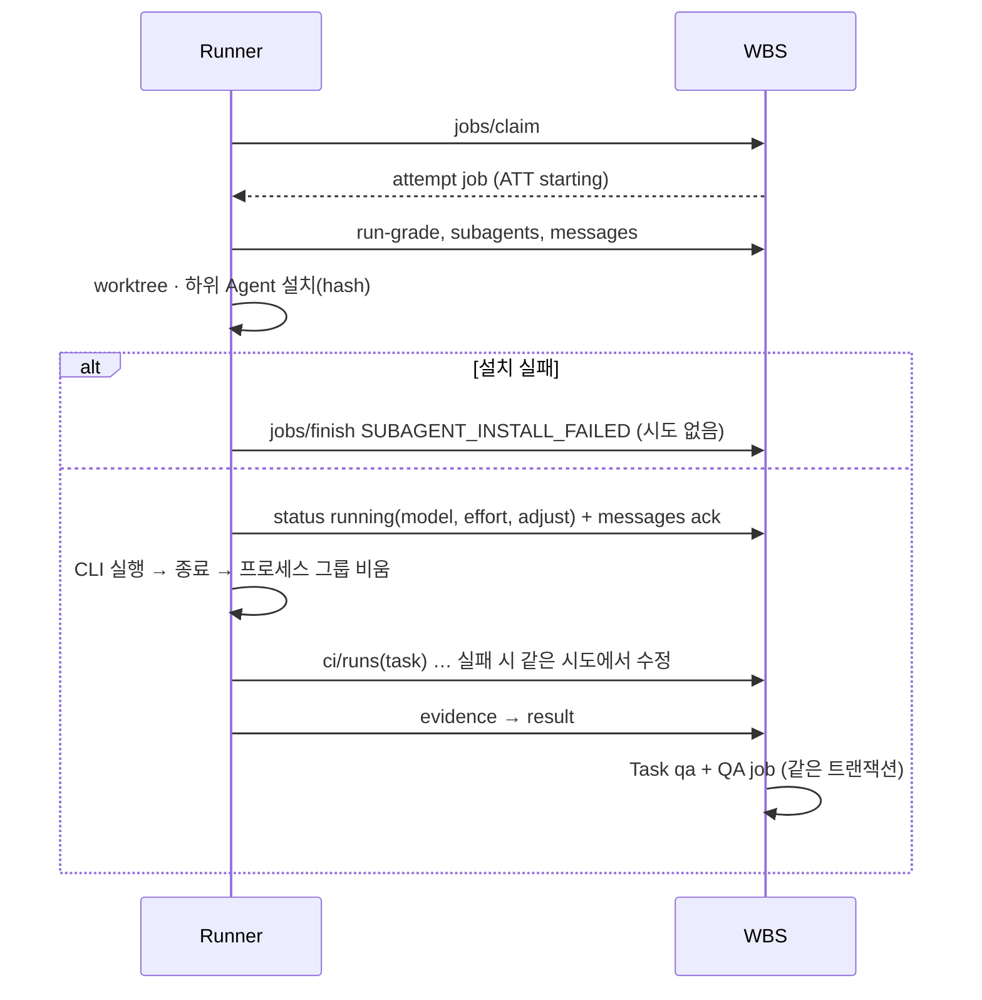

# Agent WBS 구현 기준선 — 계약

G§8이 정한 경로·의미는 그대로 두고 빈 곳을 **보강**(★)한다. ★는 가이드에 없는 설계 결정이며 [architecture.md D-03](architecture.md#7-해석-결정-기록)이 근거다. 기계 판독 정본은 M1에서 만드는 `agent-wbs/contracts/openapi.json`이고, 그때부터 이 문서와 다르면 drift로 보고 함께 고친다.

## 1. 공통 규칙

| 항목 | 규칙 |
|---|---|
| 형식 | JSON UTF-8, 시각은 UTC ISO 8601(µs 허용), 날짜 `YYYY-MM-DD`(Asia/Seoul) |
| 팀장 인증 | 세션 쿠키. 변경 요청은 `X-CSRF-Token`. 없으면 401 `LEAD_UNAUTHORIZED` |
| Runner 인증 | `Authorization: Bearer`. 없음·폐기 401 `RUNNER_UNAUTHORIZED`. 팀장 API를 Runner로 부르면 403 `FORBIDDEN_PRINCIPAL` |
| epoch | 모든 `/api/runner/*`, `/api/planning/*`에 `X-Project-Epoch`. 불일치 409 `EPOCH_MISMATCH` `{currentEpoch}`. **예외(D-04)**: heartbeat, `GET /runner/commands`, 명령 결과 — 이전 epoch 허용, 응답에 `currentEpoch` |
| epoch 전환 | Runner는 409를 받으면 새 일을 멈추고 이전 epoch outbox를 **버린 뒤** commands를 조회, 정리 완료 후에만 새 epoch 저장 |
| 멱등 | Runner·Planning POST/PATCH는 `Idempotency-Key` 필수(없으면 400 `IDEMPOTENCY_KEY_REQUIRED`). 같은 키·같은 본문 → 저장된 응답 재생(`Idempotency-Replayed: true`), 다른 본문 → 409 `IDEMPOTENCY_CONFLICT`. 예외: heartbeat(자연 멱등) |
| 키 구성 | 시도 이벤트 `att:<attemptId>:<event>:<at>`(§9.1-6), 그 외 `<kind>:<runnerId>:<uuid>`. outbox에 쓸 때 생성해 재전송 때 유지 |
| 팀장 멱등 | 생성·승인·초기화·발송 POST는 선택적 `Idempotency-Key`. 화면은 항상 보낸다(버튼 이중 클릭·재시도) |
| 동시 수정 | 팀장 PATCH/PUT 본문 `updatedAt` 필수. 불일치 409 `VERSION_CONFLICT` `{current, changes[{at,actor,field,before,after}]}` (§0.3 충돌 창에 필요) |
| 페이지 | `?limit=&cursor=`, `{items,nextCursor}`. WBS 트리는 전체 요약 1회 |
| 속도 | Runner 429 + `Retry-After` 허용 |

### 1.1 오류 본문

```json
{"error":{"code":"DEPENDENCY_CYCLE","message":"…","action":"의존성 추가","fix":"…",
  "errors":[{"path":"title","rule":"maxLength","message":"…"}],"details":{"path":["TASK-0005","TASK-0006"]},"requestId":"…"}}
```

`message`는 무엇을 하려다·왜, `fix`는 조치(§0.3 L72). 비밀값·스택·로그 원문 금지.

| HTTP | 코드 | 화면/Runner 처리 |
|---|---|---|
| 400 | `VALIDATION_FAILED` `DEPENDENCY_SELF` `LIMIT_EXCEEDS_CAP` | 수정 안내, 재시도 없음 |
| 401/403 | 위 표 | Runner는 중지·경보 |
| 404 | `TASK_NOT_FOUND` `PROJECT_NOT_FOUND` `WBS_NODE_NOT_FOUND` `DEPENDENCY_NOT_FOUND` `ATTEMPT_NOT_FOUND` `MESSAGE_NOT_FOUND` | 안내 |
| 409 | `VERSION_CONFLICT` `EPOCH_MISMATCH` `DEPENDENCY_DUPLICATE` `DEPENDENCY_CYCLE` `TASK_HAS_SUCCESSORS` `PROJECT_EXISTS` `INPUT_UNCHANGED` `ATTEMPT_CLOSED` `SCHEDULE_CYCLE` `INVALID_TRANSITION`★ `GATE_NOT_PASSED`★ `CLAIM_REJECTED`★ `LEASE_LOST`★ `CLEANUP_PENDING`★ `IDEMPOTENCY_CONFLICT`★ `DECISIONS_PENDING`★ | 재시도하지 않고 최신 조회 |
| 412 | — 사용 안 함(409로 통일) | |
| 422 | `SUBAGENT_INSTALL_FAILED`(job 결과 코드) | 시도 시작 안 함 |
| 429 | `RATE_LIMITED`★ | `Retry-After` |
| 500/503 | `INTERNAL` `UNAVAILABLE`★ | 다시 시도 / Runner 재시도 |

### 1.2 Runner 재시도

네트워크·408·429·5xx만 지수 백오프(1s→60s, jitter) 무기한 + outbox 영속. **시도별 순서 보존**: 앞 보고가 막히면 뒤 보고를 보내지 않는다. 다른 4xx는 `rejected`로 보존하고 readiness 경고로 올린다. 조회 timeout 10초, 업로드 120초 [결정]. 자동 처리 실패는 팀장 오류 막대가 아니라 반복 시 알림으로 올린다(§0.3 L71).

## 2. 팀장 API

### 2.1 WBS (§8.1)

| API | 요청 → 응답 | 오류 |
|---|---|---|
| GET `/api/projects/:projectId/tasks?status&q&includeDeleted` | → `{nodes[],tasks[TaskSummary]}` (`wbsPath`·차단·Gate 수·일정 요약 계산) | PROJECT_NOT_FOUND |
| GET `/api/tasks/:taskKey` | → `TaskDetail` | TASK_NOT_FOUND |
| POST `/api/projects/:projectId/tasks` | P TASK-0005 + 명세·AC·체크리스트(Wizard 3단계) → 201 `{id,taskKey,wbsPath,lifecycleStatus}` | VALIDATION_FAILED, WBS_NODE_NOT_FOUND |
| PATCH `/api/tasks/:taskKey` | `{updatedAt, …}` → `{task,changes[]}`. **status 필드 없음**(§5.5) | VERSION_CONFLICT |
| DELETE `/api/tasks/:taskKey` | 204 | TASK_HAS_SUCCESSORS |
| POST `/api/tasks/:taskKey/dependencies` | `{predTaskKey,depType}` → 201 `{dependency,blocked}` | DEPENDENCY_* |
| DELETE `/api/dependencies/:id` | 204 | DEPENDENCY_NOT_FOUND |

★ 화면 동작용 보강:

| API | 용도 |
|---|---|
| PATCH `/api/tasks/:taskKey/{spec,design/:kind,checklist/:itemKey,outputs}` · POST/DELETE checklist | 섹션별 편집(§4.4). 각 `updatedAt` |
| POST `/api/tasks/:taskKey/approve` · `/reject` | 계획 승인 |
| GET `/api/tasks/:taskKey/gate` · POST `/complete` | Gate 조회, 완료 **판정 요청**(미충족 409 GATE_NOT_PASSED + 조건별 사유) |
| GET `/api/tasks/:taskKey/{history,attempts,verifications,messages}` | 탭 |
| PUT `/api/tasks/:taskKey/grade` · DELETE | 등급 고정·해제 → 재추정·재조정 |
| POST `/api/tasks/:taskKey/split` · `/split-exceptions` | 분할 제안 / 예외 사유 |
| POST `/api/tasks/:taskKey/runs` `{kind}` · POST `/api/attempts/:id/stop` · `/resume` | 실행 요청 job 생성 / 중단 / 재개. 불가 시 409 CLAIM_REJECTED `{reasons[]}` |
| GET/POST `/api/messages`, PATCH 초안, POST `/:id/{send,cancel,resend,read}` | §4.10. 초안 서버 보존 |
| GET/POST `/api/plannings`, POST `/api/plannings/:id/reviews/:rid/choice` · `/proposals` | §4.5 |
| GET/POST `/api/proposals`, GET `/:id/preview`, POST `/:id/{submit,approve,reject,request-changes,apply}` | 미리보기와 반영은 같은 함수. apply는 재시뮬레이션 |
| GET `/api/dashboard`, `/api/schedule`, `/api/replans`, POST `/api/replans/run` | §4.1, §6 |
| GET `/api/verifications`, `/api/evidence`, `/api/evidence/:id/content`, `/api/gates`, `/api/history` | §4.7, §4.9. 콘텐츠는 attachment + nosniff |
| GET/PUT `/api/settings/{workflow,exec-policy,models,split,schedule,blackouts,concurrency,obs-budget,subagents,ci}` | §4.9 탭 |
| GET `/api/runner-state` | 연결·준비·PC·동시 실행·관측·제한 요인 묶음 |
| GET `/api/alerts`, GET `/api/system/integrity` | 현재 알림 / 정합성 점검 |
| POST `/api/auth/session` · DELETE, GET `/api/session` | Q-01 |

### 2.2 프로젝트 (§8.4)

| API | 핵심 |
|---|---|
| POST `/api/project/repo-checks` `{url}` | 형식 400 우선(저장소까지만) → 202 `{id}`, GET `/:id`★ 결과 |
| POST `/api/project` | 이름·url·목표일·제약·지시·`repoCheckId`★. 성공한 확인이 없거나 정리 대기면 409. → 201 `{project,jobId}` |
| GET `/api/project`★ | 등록·입력·bootstrap·변경 감지 |
| POST `/api/project/bootstrap/approve` · `/rerun` · `/retry`★ | 초안 revision 지정. approve → WBS+기준 v1을 한 트랜잭션 |
| POST `/api/projects/:projectId/boot/tech/confirm` `{decisions[{id,choice}]}` | 미결정이 있으면 409 DECISIONS_PENDING |
| POST `/api/project/inputs` `{commit,instr?}` · `/inputs/skip` · `/inputs/retry`★ | 409 INPUT_UNCHANGED |
| POST `/api/project/reset` `{confirmName,keepSettings}` · GET `/reset-preview`★ · GET `/export`★ | 건수·정리 내용 / 내보내기(비밀값·수신자 제외) |
| GET `/api/system/resets` | 초기화 기록 |
| GET·PUT `/api/settings/github`, POST `/check`★ | `tokenSet`만 |

### 2.3 보고서·메일(§8.5) · CI(§8.5-1) · 설계(§8.6) · Telegram(§8.7)

G§8.5, §8.5-1, §8.6, §8.7의 표 전체를 그대로 구현한다(재기술하지 않음 — 단일 출처). 보강만 적는다.

- 보고서: 기간 `from ≤ to ≤ 오늘`, 최대 93일 → 400. 수정·삭제 API 없음. PDF 실패 503 `PDF_FAILED`★.
- 메일 큐 키 `reportId+recipientId+tryNo`, 실패 15분 후 1회 자동 재시도.
- CI retry/deploy-check → 202 + job. `GET /ci/pipeline`★(정의 표시), GET·PATCH `/ci/settings`★.
- 불일치 `resolve{how:"contract"}`는 Runner job을 만들고 **결과 커밋이 보고된 뒤** resolved. 호환 깨짐은 기술 결정 승인 필요(§4.12).
- Telegram 오류: `token_invalid`(401) `chat_not_found`(400) `forbidden`(403) `rate_limited`(429) `network` `webhook_in_use` `chat_migrated`★(자동 교체 금지). 마스킹 문자열 토큰 400.

## 3. Runner API

### 3.1 가이드 정의 (§8.2, 요청 상세는 P TASK-0012)

| API | 보강·수정 |
|---|---|
| POST `/runner/heartbeat` `{runnerId,version,epoch}` | 204. 60초 |
| POST `/runner/sessions` | stop은 열린 세션만. `reason=unknown`은 서버만 |
| POST `/runner/host` `/readiness` `/models` `/usage` `/concurrency` | readiness key에 `obs`★ `gh`★ `lfs`★ 추가. concurrency는 세션별 `{attemptId,observed,reserved,state}`★ 포함 |
| GET `/runner/tasks/:taskKey/run-grade?role=` | 등급 정책 단일 출처. 재작업 상향·재개·하향을 서버가 계산해 `{model,effort,adjust}`★로도 준다 |
| GET `/runner/tasks/:taskKey/subagents?role=` | 모델·effort 없음. hash 검증 후 설치 |
| GET `/runner/messages?cursor=` · POST `/:id/ack` | G의 `since` 대신 **cursor**를 우선 사용(같은 시각 유실 방지). `since`도 호환 |
| POST `/runner/messages/:id/response`★ | Agent 응답 `{text,workState}`. 전달 상태와 분리(§9.4-1) |
| POST `/runner/attempts/:id/status` | `subagents.used` 제거(D-12) |
| POST `/runner/attempts/:id/interrupt` | 200 `{taskStatus:"paused"}`, 종료된 시도 409 |
| POST `/runner/attempts/:id/result` | dev·rework: summary·changedFiles·evidence·failure·tokens. qa·reverify: **`verification{result,cmd,expected,actual,defects[],checklist[]}`**★ 필수 |
| POST `/runner/attempts/:id/evidence`★ | multipart 1파일, sha256·크기 검증. 결과 보고 전 업로드하고 id로 참조 |
| POST `/runner/attempts/:id/subagent-usage`★ | 세션 종료 후 사후 확정(`confirmed/partial`) |
| POST `/runner/input-changes`, `/runner/repo-checks/:id/result`, `/runner/bootstrap/:jobId/progress` | §8.4 |
| POST `/runner/ci/runs`, PATCH `/:id` | §8.5-1 |
| POST `/runner/ci/queue`★ | 병합 상태(PR·병합 커밋) 보고 → 서버가 완료 판정 |
| POST `/runner/design/snapshot` | §8.6 |
| POST `/runner/github/status`★ | 인증 방식·계정·권한·만료(비밀값 없음) |
| GET `/runner/github/credential`★ | 토큰 방식일 때만. Runner 공개키로 봉인한 값(평문 없음) |
| GET `/runner/policy`★ | 상한·예산·주기·ci 설정·입력 확인 주기 묶음(`ETag`) |

### 3.2 명령과 작업 ★

```
GET  /api/runner/commands                → {currentEpoch, commands:[{id,kind:"reset-cleanup",epoch,payload}]}
POST /api/runner/commands/:id/result     → {status, items:[{name,ok,detail}]}
POST /api/runner/jobs/claim {kinds[],capacity} → 200 {job:{id,kind,payload,leaseUntil,fence}} | 204
POST /api/runner/jobs/:id/renew {fence}  → {leaseUntil}         409 LEASE_LOST
POST /api/runner/jobs/:id/finish {fence,status,result?,error?}
```

| kind | payload | 종료 보고 |
|---|---|---|
| `repo_check` | url | repo-checks result |
| `bootstrap` / `input_diff` | 커밋, 지시, 이전 커밋, 재개 단계 | progress → draft / proposal |
| `planning` / `estimate` / `split` | 대상 Task, 정책 | planning API |
| `attempt` | taskKey, kind, agent, attemptId, 브랜치, 기준 커밋, 입력 버전, 작업 지시 묶음 | status → result/interrupt |
| `stop_attempt` | attemptId, 사유 | interrupt |
| `integrate` / `deploy_check` / `ci_retry` | PR·커밋 | ci runs, queue |
| `design_apply` / `merge_followup` | 항목·PR | design snapshot |

규칙:

1. 정리 명령이 남아 있으면 claim은 409 CLEANUP_PENDING.
2. `attempt` claim 시 서버가 한 트랜잭션에서 선행·Task 상태·상한·Agent 상한·충돌 묶음·readiness·사용량·관측 미확인·등급을 확인하고 시도(`starting`)를 만든다. 실패하면 job은 대기하고 `reasons[]`를 화면에 보인다(§4.6).
3. lease 60초, 20초마다 renew [결정]. 만료 시 다른 claim이 가능하나 **attempt는 자동 재할당하지 않고** 중단 처리한다(프로세스가 살아 있을 수 있음). 재연결한 Runner는 프로세스 그룹을 정리한 뒤 중단을 확정한다.
4. 모든 보고는 `fence`를 포함하고 낡은 fence는 409 LEASE_LOST.
5. 야간 점검과 입력 변경 확인은 Runner가 `policy` 시각으로 시작한다. 중복은 멱등 키 `night:<date>`로 막는다.
6. 자동 실행 여부와 재시도 한도는 Q-04.

### 3.3 Planning API (§8.3, §8.4)

| API | 규칙 |
|---|---|
| POST `/planning/estimates` | P TASK-0012. 완료 Task 거부 |
| POST `/planning/replans` | 서버가 일정을 **다시 계산**. 제출 용량은 참고값. 정책 off → 202(D-10) |
| POST `/planning/bootstrap/:jobId/draft` | phases·wps·tasks(분류·담당·추정·명세·AC·체크리스트·등급·하위 Agent·분할 근거·충돌 묶음·설계 항목)·deps. 순환·참조·필수 검증, 실패 400 |
| POST `/planning/bootstrap/:jobId/tech`★ | 기술 결정 제안(근거·대안) |
| POST `/planning/sessions`★ · `/:id/analyses` · `/:id/reviews` | §4.5 두 분석·교차 검토 |
| POST `/planning/proposals`★ | CP 제출. 서버 정책에 따라 자동 반영/보류/검토 |
| POST `/planning/tasks/:taskKey/plan`★ | 등급·하위 Agent·충돌 묶음 판단과 근거 |

## 4. 대표 흐름

### 4.1 시도 1회



QA PASS → `gate` → 승인 조건(Q-02) → `integrate` → ② 통과 → PR 병합 → `ci/queue merged` → 서버 Gate 재판정 → `done`.
②는 **현재 main + PR head**를 검사하고, 병합 API에 확인한 head SHA를 넘겨 바뀌었으면 다시 검사한다 [결정].

### 4.2 전이 트랜잭션

상태 변경 = 행 잠금 → 전이 검사 → 변경 + 이력 + `alerts` + `notify_events/outbox` + `change_events` + 일정 재계산 표시. 커밋 후 worker가 발송한다(§9.6-3-5). 일정은 프로젝트당 합쳐 계산하고 결과에 `calcVersion`을 둔다.

### 4.3 Runner 끊김

3회 누락 → 서버 세션 종료(unknown), 열린 시도 `interrupted`, Task `paused`. 이후 도착한 이전 시도 결과는 409 ATTEMPT_CLOSED로 거부하되 본문을 진단용으로 이력에 남긴다 [결정]. PC 변경도 같다(§6.6).

## 5. Agent 출력 계약 (Runner 내부) ★

- 모든 Agent 종료 메시지는 JSON Schema로 검증한다. 형식 불일치는 1회 수정 요청, 이후 실패.
- dev: `{summary, selfCheck[], followups[], designItems[]}` — 변경 파일은 자기보고가 아니라 **git diff**.
- qa: `{verdict, criteria[{acId,result,cmd,expected,actual,evidence}], defects[]}` — 종료 코드·로그는 Runner 관측을 우선(§4.13).
- 지시문 포함: Task 명세·제외 범위·AC·관련 설계 항목과 직접 연결 항목만(§4.12), 하위 Agent 예산(§6.7-5), 보호 경로, 입력 버전.
- 입력 문서는 데이터로 취급하고, 안의 지시가 정책을 바꾸지 못한다고 명시한다.

## 6. GitHub 계약 (Runner)

브랜치 `agent/<TASK>`(P 표기), PR 1개/Task, status context `agentwbs/task|int|night|deploy`. 서버 보고와 GitHub 보고는 독립 outbox(§9.6-2-6). 초기화: PR 닫기 → `agent/*` 중 **이 시스템이 기록한 브랜치만** 삭제 → 기준 커밋 상태의 `src/ contracts/ .agentwbs/`로 되돌림 커밋(강제 push 없음). 등록 전 파일은 기준 커밋 내용으로 복원된다.

## 7. 변경 이벤트

`GET /api/changes?after=<seq>&limit=500` (팀장) → `{events:[{seq,topic,ref,at}],next,reset}`. 보존 범위를 벗어나거나 epoch가 바뀌면 `reset:true` → 전체 재조회.

topic: `task` `dependency` `attempt` `verification` `message` `proposal` `planning` `schedule` `runner` `ci` `design` `report` `mail` `notify` `alert` `project` `settings`. 본문을 싣지 않고 참조만 보낸다(권한·일관성은 조회 API가 담당). 순서는 커밋 순서를 보장하도록 프로젝트 잠금 안에서 seq를 발급한다.

## 8. 계약 검증

- `openapi.json` 재생성 diff 0, Runner client 재생성 diff 0.
- 같은 요청·응답 fixture를 WBS(inject)와 Runner(client)가 함께 통과.
- Runner API 전체에 대해 무토큰·팀장 세션·낡은 epoch·멱등 재전송·키 충돌 5종 표 기반 테스트.
- P에 있는 Endpoint와 G§8 표의 모든 경로가 라우트 목록에 있는지 자동 비교.
