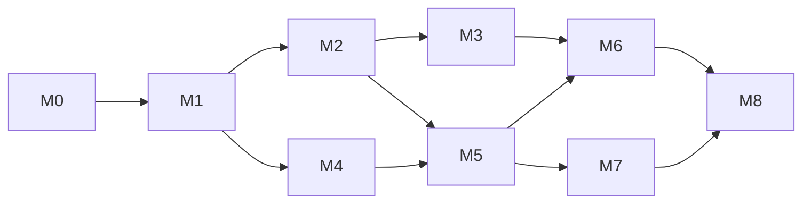

# Agent WBS 구현 기준선 — 마일스톤

## 1. 운영 규칙

- 작업 ID `M<단계>-<번호>`. 각 작업은 브랜치 1개, 담당이 아닌 쪽 Agent가 교차 리뷰한다.
- 표의 검증은 **명령이 종료 코드 0**이어야 한다. 스크립트는 해당 작업이 만든다(아직 없음). 외부 자격 증명이 필요한 것은 「실환경」 표시.
- 축약: `W` = `pnpm -C agent-wbs`, `R` = `pnpm -C agent-runner`. 모든 작업에 공통으로 `W check`(typecheck+lint+unit) 또는 `R check`.
- 병렬: `∥` 같은 마일스톤 안 동시 가능(디렉토리 비중첩), `—` 선행 대기. **`packages/db/migrations`와 `packages/shared/src/api`는 한 번에 한 작업만 병합**한다.
- 담당 기준: UI·일반 서버 구현은 Claude, 상태·동시성·보안·프로세스 제어의 구현/적대적 검증은 Codex를 우선한다 [결정, G§4.6의 「Claude 개발 → Codex QA」를 기본으로 함].
- 화면 작업의 세부 기준은 병행 작성 중인 화면 전수 목록을 따르고, 이 문서는 중복하지 않는다.
- 실제 Claude/Codex 호출 없이 검증하도록 fake CLI·fake GitHub를 먼저 둔다. 실호출은 M8에서 한정된 횟수로 한다.

## 2. 의존성

M0 기반 → M1 데이터·계약·순수 판정 → M2 서버 핵심 → {M3 핵심 화면, M4 Runner 기반} → M5 실행·Planning → {M6 보고서·알림·설계, M7 CI·GitHub} → M8 통합·실환경 인수. M4는 M1의 OpenAPI와 fake 서버만으로 M2와 병행한다.

## 3. 작업

### M0 — 기반

| ID | 범위 | 완료 조건(검증) | 디렉토리 | 병렬 | 담당 / 리뷰 |
|---|---|---|---|---|---|
| M0-01 | WBS workspace 4패키지, TS·lint·test, 버전 고정 | `W install --frozen-lockfile && W check && W build` | `agent-wbs/` | ∥ | Claude / Codex |
| M0-02 | compose(`awbs`, 25442), env, `/health`·`/health/db`, 테스트 DB 안전장치 | `docker compose -p awbs config` + `W test:db`(비-`awbs_test_` DB 거부 포함). 컨테이너 기동은 owner가 구현 단계를 시작할 때 | `agent-wbs/{compose.yaml,apps/api,packages/db}` | M0-01 후 | Codex / Claude |
| M0-03 | Runner 패키지 골격, 설정·로그·redact, fake CLI/GitHub 틀 | `R install --frozen-lockfile && R check` | `agent-runner/` | ∥ | Codex / Claude |
| M0-04 | Web shell: 180/56px 메뉴 12개, Header 64, 글꼴, 토큰, 라우팅, 접근성 기본 | `W --filter web test:e2e -- shell` (1280·1920 가로 스크롤 없음) | `agent-wbs/apps/web` | M0-01 후 | Claude / Codex |

### M1 — 데이터 · 계약 · 순수 판정

| ID | 범위 | 완료 조건(검증) | 디렉토리 | 병렬 | 담당 / 리뷰 |
|---|---|---|---|---|---|
| M1-01 | 전체 schema·제약·추가 전용·초기화 함수·system/demo seed | `W test:db -- schema`(빈 DB up, 제약 위반, 앱 역할 UPDATE 거부) | `packages/db` | — | Codex / Claude |
| M1-02 | TypeBox API 스키마 → OpenAPI, 오류 코드, Runner client 생성 | `W openapi:check && R client:check`, G§8 경로 대조 테스트 | `packages/shared/src/api`, `contracts/`, `agent-runner/src/api` | ∥ | Claude / Codex |
| M1-03 | 상태 전이·번호·차단·순환·Gate·체크리스트·SS/FS | `W --filter shared test -- domain` (모든 전이 쌍 표) | `packages/shared/src/domain` | ∥ | Codex / Claude |
| M1-04 | 일정: 3시나리오·가동률·슬롯·충돌 묶음·리셋·불가일·재조정 diff·driftCheck | `W --filter shared test -- schedule` (P `Sel.schedule`과 demo 결과 대조, 200 Task 시간 기록) | `packages/shared/src/schedule` | ∥ | Codex / Claude |
| M1-05 | CP 시뮬레이션·영향·분할 점검 10규칙·분할 제안 검증 | `W --filter shared test -- proposal split` | `packages/shared/src/{proposal,split}` | M1-03 후 | Claude / Codex |
| M1-06 | 등급 상향·하향·재개·최저선, 상한 공식, 보유 계산, 제한 요인 | `W --filter shared test -- grade capacity` (§6.6 예시 3개 값 일치) | `packages/shared/src/{grade,capacity}` | ∥ | Claude / Codex |

### M2 — 서버 핵심

| ID | 범위 | 완료 조건(검증) | 디렉토리 | 병렬 | 담당 / 리뷰 |
|---|---|---|---|---|---|
| M2-01 | 인증 2종·CSRF·epoch·멱등·오류 형식·마스킹 | `W --filter api test -- security` (contracts §8 5종 표) | `apps/api/src/platform` | — | Codex / Claude |
| M2-02 | Task·의존성·명세·설계·체크리스트 CRUD, 동시 수정 | `W --filter api test -- tasks` (동시 순환 추가·409·이력) | `apps/api/src/tasks` | M2-01 후 ∥ | Claude / Codex |
| M2-03 | 프로젝트 등록·기술 결정·bootstrap·승인·입력 변경·분석 안 함 | `W --filter api test -- project` | `apps/api/src/project` | ∥ | Claude / Codex |
| M2-04 | 초기화·명령·정리 대기·내보내기·파일 삭제 큐 | `W --filter api test -- reset` (중간 실패 주입, 낡은 epoch, 설정 유지/삭제 표) | `apps/api/src/reset` | M2-03 후 | Codex / Claude |
| M2-05 | Runner 보고·jobs lease·시도 claim·heartbeat 감시·PC 변경·상한 | `W --filter api test -- runner` (동시 claim 100회, lease 상실, 중복 보고) | `apps/api/src/runner` | ∥ | Codex / Claude |
| M2-06 | 시도 결과·검증·결함·Evidence·Gate 판정·완료 | `W --filter api test -- execution` | `apps/api/src/execution` | M2-05 후 | Codex / Claude |
| M2-07 | Planning·CP(미리보기=반영·자동/보류)·추정·재조정·분할 | `W --filter api test -- planning` | `apps/api/src/planning` | ∥ | Claude / Codex |
| M2-08 | 정책·모델·하위 Agent·메시지·이력·변경 이벤트·무결성 점검 | `W --filter api test -- policy messages changes` | `apps/api/src/{policy,messages,changes}` | ∥ | Claude / Codex |
| M2-09 | fake Runner 시나리오 드라이버 | `W test:scenario -- runner-basic` (시나리오 6·8·9·10) | `agent-wbs/e2e/fakes` | M2-05 후 | Codex / Claude |

### M3 — 핵심 화면 (M2 API 사용)

| ID | 범위 | 완료 조건(검증) | 디렉토리 | 병렬 | 담당 / 리뷰 |
|---|---|---|---|---|---|
| M3-01 | 로딩 5종·오류 막대·충돌 창·빈 상태·잠금·편집 보호 공통 | `W e2e -- states` (§0.3 오류·로딩) | `apps/web/src/shared` | — | Claude / Codex |
| M3-02 | WBS 표·필터 9·레일·Gantt·Wizard·가상 스크롤 | `W e2e -- wbs` (시나리오 1·27, 1000px·200/1,000행 측정 기록) | `features/wbs` | M3-01 후 ∥ | Claude / Codex |
| M3-03 | Task 상세 9탭 | `W e2e -- task-detail` (1·2·3·4·13·23 일부) | `features/task` | ∥ | Claude / Codex |
| M3-04 | 프로젝트 3흐름·기술 결정 확정·초기화 | `W e2e -- project` (19·29·30·31) | `features/project` | ∥ | Claude / Codex |
| M3-05 | Planning·변경 제안 | `W e2e -- planning` (5) | `features/{planning,change}` | ∥ | Claude / Codex |
| M3-06 | 작업 실행 3분할·메시지 | `W e2e -- exec` (6·7·8) | `features/exec` | ∥ | Claude / Codex |
| M3-07 | 검증·이력·대시보드 | `W e2e -- verify history dashboard` (15) | `features/{verify,history,dashboard}` | ∥ | Claude / Codex |
| M3-08 | 설정: Runner·Agent·일정 탭, 점검 | `W e2e -- settings-core` (9~14·22·24·26) | `features/settings` | ∥ | Claude / Codex |

### M4 — Runner 기반

| ID | 범위 | 완료 조건(검증) | 디렉토리 | 병렬 | 담당 / 리뷰 |
|---|---|---|---|---|---|
| M4-01 | client·outbox·epoch 전환·polling·heartbeat/세션 | `R test -- client outbox` (kill -9 후 중복 0) | `src/{api,state}` | — | Codex / Claude |
| M4-02 | host·readiness·usage·models·concurrency 조절 | `R test -- resources` | `src/{resources,readiness}` | ∥ | Claude / Codex |
| M4-03 | git 안전 계층: clone·worktree·입력 읽기 전용·보호 경로·초기화 정리 | `R test -- git` (로컬 bare 저장소, symlink·submodule·rename 공격) | `src/git` | ∥ | Codex / Claude |
| M4-04 | GitHub 어댑터(확인·PR·status·병합·봉인 자격 증명) + fake | `R test -- github` | `src/github` | ∥ | Claude / Codex |

### M5 — 실행 · Planning

| ID | 범위 | 완료 조건(검증) | 디렉토리 | 병렬 | 담당 / 리뷰 |
|---|---|---|---|---|---|
| M5-01 | Claude/Codex CLI 어댑터, 출력 파싱, env allowlist | `R test -- cli` (기록 fixture·모르는 이벤트) | `src/cli` | ∥ | Claude / Codex |
| M5-02 | 세션 실행·하위 Agent 설치·예산·resume·중단 | `R test -- exec` (자손 남김·강제 종료·스트림 단절) | `src/exec` | — | Codex / Claude |
| M5-03 | 프로세스 그룹/cgroup 실증과 관측 등급 기록 | `R test:host -- cgroup` 결과를 `docs/plan/` 검증 기록에 남김 | `src/exec` | M5-02 후 | Codex / Claude |
| M5-04 | 초기 분석·차이 분석·추정·분할 orchestration | `R test -- planning` (단계 실패 후 재개, 초안 스키마) | `src/planning` | ∥ | Claude / Codex |
| M5-05 | 시도 흐름 결합: claim→①(자리표시)→QA→재작업→Gate, 메시지 | `W test:scenario -- attempt-flow` (fake CLI, 시나리오 6·7·9) | `src/jobs`, e2e | — | Codex / Claude |

### M6 — 보고서 · 알림 · 설계

| ID | 범위 | 완료 조건(검증) | 디렉토리 | 병렬 | 담당 / 리뷰 |
|---|---|---|---|---|---|
| M6-01 | 스냅샷·스케줄·누락 보충·기간 지정·화면 | `W test:scenario -- reports` (16, 자정 KST 경계, 중복 0) | `apps/api/src/reports`, `features/report` | ∥ | Claude / Codex |
| M6-02 | Playwright PDF·폰트·캐시 | `W test:scenario -- pdf` (텍스트 추출·폰트 embed 검사) | `apps/api/src/pdf` | M6-01 후 | Claude / Codex |
| M6-03 | 메일 큐·HTML·SMTP 설정·화면 | `W test:scenario -- mail` (로컬 fake SMTP, 25) | `apps/api/src/mail`, `features/settings/report` | M6-01 후 | Claude / Codex |
| M6-04 | Telegram 설정·outbox·전이 알림·화면 | `W test:scenario -- telegram` (fake Bot API, 33~36, 토큰 grep 0건) | `apps/api/src/notify`, `features/settings/notify` | ∥ | Codex / Claude |
| M6-05 | 설계 원장 서버(해석 결과 저장·호환 판정·결정·버전) | `W --filter api test -- design` | `apps/api/src/design` | ∥ | Codex / Claude |
| M6-06 | Runner 계약 해석·추출·대조 | `R test -- design` (추출 불가는 「대조 안 함」) | `agent-runner/src/design` | ∥ | Codex / Claude |
| M6-07 | 설계 화면 6탭·Task 연결 | `W e2e -- design` (28·29) | `features/design` | M6-05 후 | Claude / Codex |

### M7 — 빌드 · 통합

| ID | 범위 | 완료 조건(검증) | 디렉토리 | 병렬 | 담당 / 리뷰 |
|---|---|---|---|---|---|
| M7-01 | pipeline.yaml 스키마·main 고정·①Task 검사 | `R test -- ci-task` (정의 변조·보호 경로·테스트 삭제) | `agent-runner/src/ci` | — | Codex / Claude |
| M7-02 | ②통합 확인·병합 대기열·묶음 확인 | `R test -- ci-int` (main 이동·head 변경·실패 시 미병합) | `src/ci` | M7-01 후 | Codex / Claude |
| M7-03 | ③야간(화면 비교·응답 시간·불안정)·④배포 확인·보존 정책 | `R test -- ci-night ci-deploy` | `src/ci` | M7-01 후 | Claude / Codex |
| M7-04 | 서버 CI API·완료 판정 연결·알림 | `W --filter api test -- ci` | `apps/api/src/ci` | ∥ | Codex / Claude |
| M7-05 | 빌드·통합 화면 5탭 | `W e2e -- ci` (32) | `features/ci` | M7-04 후 | Claude / Codex |

### M8 — 통합 · 실환경 인수

| ID | 범위 | 완료 조건(검증) | 디렉토리 | 병렬 | 담당 / 리뷰 |
|---|---|---|---|---|---|
| M8-01 | G§12 시나리오 전체 자동화(D-05 대체 반영)와 프로토타입 화면 대조 | `W e2e -- acceptance` | `agent-wbs/e2e` | ∥ | Codex / Claude |
| M8-02 | 장애·부하: DB 재시작·Runner kill·PC 변경·200 Task·수십 세션(fake) | `W test:resilience` | 양쪽 | ∥ | Codex / Claude |
| M8-03 | 보안 검토·비밀값 유출 검사 | `W test:secrets && R test:secrets` + 리뷰 지적 0건 미해결 | 양쪽 | ∥ | Codex / Claude |
| M8-04 | CLI 실측: Codex·Claude 하위 Agent 관측 항목(§6.7, §11-6·8) | 실환경 기록 + 등급 등록 | `agent-runner` | Q-12 후 | Codex / Claude |
| M8-05 | 실 GitHub 저장소로 등록→분석→Task 1건→병합→초기화 | 실환경 증거(커밋·PR·CI·스크린샷) | 양쪽 | Q-09·Q-10 후 | Claude / Codex |
| M8-06 | 운영 이미지·systemd·백업/복원·실 SMTP/Telegram | `docker compose … config`, 복원 리허설, 실환경 기록 | 양쪽 | Q-13·Q-15·Q-16 후 | Claude / Codex |

## 4. 추적표 — 가이드 절 → 마일스톤

가이드 1~1,210줄 전체를 읽었고 모든 `##`/`###` 절(총 73개)을 아래에 둔다. 설명 전용 절은 적용 방식으로 연결한다.

| 절 | 내용 | 마일스톤 | 비고 |
|---|---|---|---|
| 0 | 읽는 방법 | 전체 | 하위 절 참조 |
| 0.1 | 전달물 | M8-01 | D-09 |
| 0.2 | 표기 | 전체 | [미결] → open-questions |
| 0.3 | 화면 상태·오류·로딩·잠금 | M3-01, M3-02~08, M6-01/03/04/07, M7-05, M8-01 | D-06·D-07 |
| 0.4 | Mock 주의 | M2-08, M2-09 | D-17·D-23 |
| 1 | 목적·원칙 | 전체 | |
| 1.1 | 품질 기준 | M3-03, M5-04 | 명세 완전성 검증 |
| 1.2 | 운영 원칙 | M1-04, M2-05~08, M3-02, M8-02 | 이력·자동화·200건 |
| 2 | 경계·아키텍처 | M0 | |
| 2.1 | 2계층 | M0-03, M1-02, M2-05, M4-01 | D-01·D-03 |
| 2.2 | 스택 | M0-01, M0-02 | D-02 |
| 2.3 | 이식 대응 | M1-03~06 | |
| 3 | 변경된 결정 표 | 각 해당 절 | 행별 요구는 4~9절에 포함 |
| 4 | 화면 공통 원칙(Task 이동) | M3-01, M3-07 | |
| 4.1 | 대시보드 | M3-07 | |
| 4.2 | 프로젝트 3흐름 | M2-03, M2-04, M3-04, M4-03, M4-04, M5-04, M8-05 | Q-09·Q-11 |
| 4.3 | WBS | M3-02 | |
| 4.4 | Task 상세 | M2-02, M3-03 | |
| 4.5 | Planning | M2-07, M3-05, M5-04 | |
| 4.6 | 작업 실행 | M2-06, M3-06, M5-05 | Q-04 |
| 4.7 | 검증 | M2-06, M3-07 | |
| 4.8 | 변경 제안 | M1-05, M2-07, M3-05 | |
| 4.9 | 이력·설정 | M2-08, M3-07, M3-08, M6-03, M6-04 | |
| 4.10 | 메시지 | M2-08, M3-06, M5-05 | Q-07 |
| 4.11 | 보고서·메일·PDF | M6-01, M6-02, M6-03 | Q-13 |
| 4.12 | 설계 | M2-03, M6-05~07 | Q-14 |
| 4.13 | 빌드·통합 | M7-01~05, M2-06, M8-06 | Q-02·Q-09·Q-15 |
| 4.14 | Telegram | M6-04 | Q-16 |
| 5 | 도메인 모델 | M1 | |
| 5.1 | 논리 객체 | M1-01 | |
| 5.2 | 분류 | M1-01, M1-03 | |
| 5.2-1 | 분할 기준 | M1-05, M2-07, M3-03, M3-08, M5-04 | |
| 5.3 | 상태 모델 | M1-03 | Q-05 |
| 5.4 | 의존성 | M1-03, M2-02 | D-08 |
| 5.5 | Gate | M1-03, M2-06, M7-04 | Q-02 |
| 5.6 | CP 유형 | M1-05, M2-07 | D-16·D-20 |
| 6 | 일정 모델 | M1-04 | |
| 6.1 | 이유 | M1-04 | |
| 6.2 | 입력 | M1-04, M2-05, M2-07 | |
| 6.3 | 계산 | M1-04 | Q-03 |
| 6.4 | 기준·재조정 | M1-04, M2-07, M3-05 | D-10 |
| 6.5 | 중단 | M2-05, M5-02, M5-05 | |
| 6.6 | 동시 실행 | M1-06, M2-05, M3-08, M4-02, M4-03 | D-22 |
| 6.7 | 관측 | M1-06, M3-08, M5-01~03, M8-04 | Q-12 |
| 7 | 실행 정책 | M1-06 | |
| 7.1 | 분담 | M2-08, M5-04 | |
| 7.2 | 등급 | M1-06, M2-08, M4-02 | Q-06 |
| 7.3 | 정책 | M1-06, M2-08, M3-08 | |
| 7.4 | 하위 Agent·준비 상태 | M2-08, M3-08, M4-02, M5-02 | D-24 |
| 8 | API 계약 | M1-02 | |
| 8.1 | WBS | M2-02 | |
| 8.2 | Runner | M2-05, M2-06, M4-01, M4-02 | |
| 8.3 | Planning | M2-07, M5-04 | |
| 8.4 | 등록·입력·초기화 | M2-03, M2-04, M4-03 | |
| 8.5 | 보고서 | M6-01~03 | |
| 8.5-1 | 빌드·통합 | M7-04 | |
| 8.6 | 설계 | M6-05, M6-06 | |
| 8.7 | Telegram | M6-04 | |
| 9 | 주의점 | 하위 절 | |
| 9.1 | 정합성 | M1-01, M1-03, M2-01, M2-02, M2-05, M4-01, M8-02 | |
| 9.2 | 일정 | M1-04, M2-05, M3-02 | |
| 9.3 | 실행 정책 | M2-08, M4-02 | |
| 9.4 | 메시지 | M2-08, M5-05 | |
| 9.5 | 등록·초기화·보호 경로·인증 | M2-04, M4-03, M4-04, M7-01, M8-03 | |
| 9.6 | 보고서 | M6-01~03 | |
| 9.6-1 | 설계 | M6-05~07 | |
| 9.6-2 | 빌드·GitHub | M4-04, M7-01~04 | |
| 9.6-3 | Telegram | M6-04 | |
| 9.7 | UI | M0-04, M3-01, M3-02, M3-07 | |
| 10 | Mock 교체 목록 | 아래 4.1 | |
| 11 | 범위 밖·미결 | open-questions | 범위 밖은 구현하지 않음 |
| 12 | 시나리오 36+ | 아래 4.2 | |
| 13 | 디자인 기준 | M0-04, M3 전체, M8-01 | |

### 4.1 §10 Mock 교체

| 항목 묶음 | 작업 |
|---|---|
| Task·실행·검증·메시지·저장 → DB | M1-01, M2 |
| 등급·재추정·분할·하위 Agent 지정·충돌 묶음 → Planning | M5-04, M2-07 |
| 모델·Effort·사용량·host·readiness·concurrency·Runner 이벤트·하위 비율 → 보고 | M2-05, M4-02 |
| 가중치·가정 가동률·임계값·상한 상수·관측 창 → 설정값 | M1-04, M1-06, M3-08 (Q-03) |
| 결과·메시지 응답 → API | M2-06, M2-08, M5-05 |
| 보고서·PDF·메일 | M6-01~03 |
| Telegram·접속 주소 | M6-04 |
| GitHub 연결·입력 | M4-03, M4-04 |
| CI / 설계 / 관측 | M7 / M6-05~07 / M5-03, M8-04 |

### 4.2 §12 시나리오

| 시나리오 | 검증 작업 |
|---|---|
| 1~4 | M3-02, M3-03 |
| 5 | M3-05 |
| 6~8 | M3-06, M5-05 |
| 9, 10, 11, 11-1, 11-2, 12~14 | M3-08, M2-09 |
| 15 | M3-07 |
| 16 | M6-01, M6-02 |
| 17, 18 | 30·31로 대체(D-05) — M3-04 |
| 19 | M3-04, M2-04 |
| 20, 21 | M3-01, M8-01 (D-06·D-07) |
| 22~24 | M3-03, M3-08 |
| 25 | M6-03 |
| 26 | M3-08, M5-03 |
| 27 | M3-02, M3-07 |
| 28, 29 | M6-07, M3-04 |
| 30, 31 | M3-04, M4-04 |
| 32 | M7-05 |
| 33~36 | M6-04 |

## 5. owner 결정이 막는 시점

| 시점 전 | 질문 |
|---|---|
| M1-03 | Q-02, Q-05 |
| M1-04 | Q-03 |
| M2-01 | Q-01 |
| M2-05/M5-05 | Q-04, Q-08 |
| M2-04/M4-03 | Q-11 |
| M4-02 | Q-06 |
| M6-06 | Q-14 |
| M8 | Q-07, Q-09, Q-10, Q-12, Q-13, Q-15, Q-16 |

추천안은 모두 설정값·데이터 표·어댑터 경계에 두므로 답이 늦어도 추천안으로 시작할 수 있다. 예외는 **Q-09·Q-10(실 저장소)** 으로, 없으면 M8-05를 완료할 수 없다.
