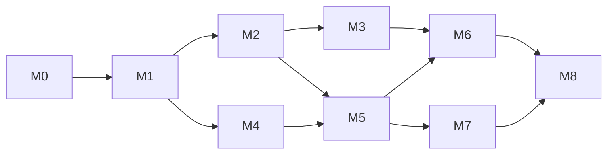

# Agent WBS 구현 기준선 — 마일스톤

> **이 문서가 답하는 질문**
> - 무엇을 어떤 순서로 만드나? (M0~M8)
> - 작업 하나가 「끝났다」는 것은 어떤 명령으로 확인하나?
> - 가이드의 어느 절을 어느 작업이 맡나?
>
> 처음 읽는다면 [docs/README.md](../README.md)부터 보세요. 낯선 용어는 [용어집](../glossary.md)에 있습니다.

## 1. 운영 규칙

- **작업 ID와 브랜치**
  - 작업 ID `M<단계>-<번호>`. 예: `M2-05`는 2단계(서버 핵심)의 5번째 작업이다.
  - 각 작업은 브랜치 1개, 담당이 아닌 쪽 Agent가 교차 리뷰한다.
  - 왜 교차 리뷰인가: 만든 쪽은 자기 실수를 놓치기 쉽다. 다른 Agent가 보면 다른 관점으로 잡아낸다.
- **완료 확인**
  - 표의 검증은 **명령이 종료 코드 0**이어야 한다. 종료 코드 0은 명령이 성공했다는 뜻이다.
  - 스크립트는 해당 작업이 만든다(아직 없음).
  - 외부 자격 증명이 필요한 것은 「실환경」 표시.
  - 왜 명령으로 확인하나: 「다 했다」는 말 대신 누구나 다시 돌려 볼 수 있는 증거로 완료를 판단하기 위해서다.
- **축약**
  - `W` = `pnpm -C agent-wbs`, `R` = `pnpm -C agent-runner`.
  - 모든 작업에 공통으로 `W check`(typecheck+lint+unit) 또는 `R check`.
    - 용어 풀이: lint = 코드 규칙 위반을 자동으로 찾는 검사.
- **병렬 표시**
  - `∥` 같은 마일스톤 안 동시 가능(디렉토리 비중첩), `—` 선행 대기.
  - 「M0-01 후」처럼 적힌 것은 그 작업이 끝나야 시작할 수 있다는 뜻이다.
  - **`packages/db/migrations`와 `packages/shared/src/api`는 한 번에 한 작업만 병합**한다.
    - 왜: 두 작업이 동시에 DB 구조나 API 스키마를 바꾸면 서로 충돌하고, 순서가 꼬인 마이그레이션(DB 구조를 바꾸는 SQL 파일)은 되돌리기 어렵다.
      - 용어 풀이: SQL = DB에 묻고 고치는 언어.
- **담당 기준**
  - UI(사용자가 보고 조작하는 화면)·일반 서버 구현은 Claude, 상태·동시성·보안·프로세스 제어의 구현/적대적 검증은 Codex를 우선한다 [결정, G§4.6의 「Claude 개발 → Codex QA」를 기본으로 함].
  - 적대적 검증: 일부러 깨뜨리려는 입장에서 시험하는 것.
- **화면 작업의 세부 기준**
  - 화면 작업의 세부 기준은 별도 화면 전수 목록이 검토·병합된 뒤 그 버전을 따른다.
  - 아직 이 문서의 검증 증거가 아니다.
  - 절 추적표(§4)는 **배정 확인**이며 내용 충족은 각 작업의 완료 조건으로 확인한다.
- **compose 명령 축약**
  - `docker compose -p awbs`는 `docker compose -p awbs -f agent-wbs/compose.yaml`의 축약이고 저장소 루트에서 실행한다.
- **가짜 먼저**
  - 실제 Claude/Codex 호출 없이 검증하도록 fake CLI·fake GitHub(git 저장소를 호스팅하는 서비스)를 먼저 둔다.
  - 실호출은 M8에서 owner가 승인한 한도 안에서 한다.
  - 왜: 실제 호출은 돈이 들고 결과가 매번 달라 테스트로 쓰기 어렵다.

## 2. 의존성

마일스톤 사이의 순서다. 화살표는 「앞이 끝나야 뒤를 시작한다」는 뜻이다.

말로 풀면:

- M0 기반 → M1 데이터·계약·순수 판정 → M2 서버 핵심 → {M3 핵심 화면, M4 Runner 기반} → M5 실행·Planning → {M6 보고서·알림·설계, M7 CI·GitHub} → M8 통합·실환경 인수.
- M4는 M1의 OpenAPI와 fake 서버만으로 M2와 병행한다.
  - 왜 가능한가: Runner는 서버 코드가 아니라 OpenAPI 계약만 보고 만들 수 있다(architecture §1 불변 규칙 4).

## 3. 작업

작업마다 다음 순서로 적었다.

- **ID — 범위**: 이 작업이 만드는 것
- 완료 조건(검증): 이 명령이 성공하면 끝난 것이다. 괄호 안은 그 명령이 꼭 시험해야 하는 내용이다.
- 디렉토리 · 병렬 · 담당 / 리뷰

### M0 — 기반

- **M0-01** — WBS workspace 4패키지, TS·lint·test, 버전 고정
  - 완료 조건(검증): `W install --frozen-lockfile && W check && W build`
  - 디렉토리: `agent-wbs/` · 병렬: ∥ · 담당 / 리뷰: Claude / Codex
- **M0-02** — compose(`awbs`, 25442), env(프로그램에 넘기는 설정 값), `/health`·`/health/db`, 테스트 DB 안전장치
  - 완료 조건(검증): `docker compose -p awbs -f agent-wbs/compose.yaml config` + `W test:db`(비-`awbs_test_` DB 거부 포함). 컨테이너 기동은 owner가 구현 단계를 시작할 때
  - 디렉토리: `agent-wbs/{compose.yaml,apps/api,packages/db}` · 병렬: M0-01 후 · 담당 / 리뷰: Codex / Claude
- **M0-03** — Runner 패키지 골격, 설정·로그·redact, fake CLI/GitHub 틀
  - 완료 조건(검증): `R install --frozen-lockfile && R check`
  - 디렉토리: `agent-runner/` · 병렬: ∥ · 담당 / 리뷰: Codex / Claude
- **M0-04** — Web shell(명령어를 해석해 실행하는 프로그램): 180/56px 메뉴 12개, Header 64, 글꼴, 토큰, 라우팅, 접근성 기본
  - 완료 조건(검증): `W --filter web test:e2e -- shell` (1280·1920 가로 스크롤 없음)
  - 디렉토리: `agent-wbs/apps/web` · 병렬: M0-01 후 · 담당 / 리뷰: Claude / Codex

### M1 — 데이터 · 계약 · 순수 판정

- **M1-01** — 전체 schema(데이터 모양(필드·타입·제약)의 정의)·제약·추가 전용·초기화 함수·system/demo seed(owner 승인값 포함, SUB_MOCK과 미승인 값은 demo만)
  - 완료 조건(검증): `W test:db -- schema`
    - 빈 DB up, 제약 위반, 앱 역할 UPDATE 거부
    - system seed에 Mock 정의·미승인 값 0건, owner 승인 Q-03·04·06 값 일치
    - `judged_rules`·`split_judgements` 스키마, `task_judgements` 기본값·배열 CHECK(값이 조건을 만족하는지 DB가 검사하는 제약)
  - 디렉토리: `packages/db` · 병렬: — · 담당 / 리뷰: Codex / Claude
- **M1-02** — TypeBox API 스키마 → OpenAPI, 오류 코드, Runner client 생성
  - 완료 조건(검증): `W openapi:check && R client:check`
    - G§8 경로 대조 테스트
    - **착수 승인 요청 API(contracts §2.1) 포함**
    - **D-33~35 스키마·오류 코드**
    - CP add `splitBasis`, CP add `scope·files·design·conflictGroup`·issues `taskKey`
  - 디렉토리: `packages/shared/src/api`, `contracts/`, `agent-runner/src/api` · 병렬: ∥ · 담당 / 리뷰: Claude / Codex
- **M1-03** — 상태 전이·번호·차단·순환·Gate·체크리스트·SS/FS
  - 완료 조건(검증): `W --filter shared test -- domain`
    - **owner 승인 Q-05 표와 일치**, 모든 전이 쌍·상태×시도 종류 표
    - QA 프로세스 실패→같은 종류 재시도, BLOCKED→새 검증→PASS, SHA 변경→재검증
    - **시작 전 취소 선행의 SS 제거→후속 해제, 다른 선행이 남으면 계속 차단, `cancelled`≠시작됨**
  - 디렉토리: `packages/shared/src/domain` · 병렬: ∥ · 담당 / 리뷰: Codex / Claude
- **M1-04** — 일정: 3시나리오·가동률·슬롯·충돌 묶음·리셋·불가일·재조정 diff·driftCheck
  - 완료 조건(검증): `W --filter shared test -- schedule`
    - P `Sel.schedule`과 demo 결과 대조, 200 Task 시간 기록
    - **SS 선행 취소 후 그 관계 없이 후속 재배치**
    - **용량 0인 날→다음 가용일 시작(D-31), rLo≤rate(D-32)**
    - CLOCK_SKEW_CLAMPED 두 형식
  - 디렉토리: `packages/shared/src/schedule` · 병렬: ∥ · 담당 / 리뷰: Codex / Claude
- **M1-05** — CP 시뮬레이션·영향·분할 점검 10규칙·분할 제안 검증
  - 완료 조건(검증): `W --filter shared test -- proposal split`
    - **취소 CP 영향 목록에 풀리는 후속·남은 차단 표시**
    - **규칙 5·7·9 충족/불충족/미기록/합의 1인/낡은 hash, 순서 보장 4종·간접 경로, running/qa/verifying 새 차단 보류(D-33~35)**
    - **기존 Task의 CP 판단(taskJudgements) 우선·변경 후 hash 대조**
    - **분할 묶음 상속·명시 변경 diff·조사 Task 제외, 설계/파일 미기재 주의(data-model §2.4-1)**
  - 디렉토리: `packages/shared/src/{proposal,split}` · 병렬: M1-03 후 · 담당 / 리뷰: Claude / Codex
- **M1-06** — 등급 상향·하향·재개·최저선, 상한 공식, 보유 계산, 제한 요인
  - 완료 조건(검증): `W --filter shared test -- grade capacity`
    - §6.6 예시 3개 값 일치
    - **owner 승인 Q-06 매핑 일치**·ultra/미확인 거부
    - **허용 해제 재개(D-29), 없는 단계의 모델 이동 상향·대상 없음(D-30)**
  - 디렉토리: `packages/shared/src/{grade,capacity}` · 병렬: ∥ · 담당 / 리뷰: Claude / Codex

### M2 — 서버 핵심

- **M2-01** — 인증 2종·CSRF·epoch·멱등·오류 형식·마스킹
  - 완료 조건(검증): `W --filter api test -- security`
    - contracts §8 5종 표
    - 링크 재사용·비loopback 거부
    - LAN 비밀번호 미설정 기동 거부·횟수 제한
  - 디렉토리: `apps/api/src/platform` · 병렬: — · 담당 / 리뷰: Codex / Claude
- **M2-02** — Task·의존성·명세·설계·체크리스트 CRUD(만들기·읽기·고치기·지우기), 동시 수정
  - 완료 조건(검증): `W --filter api test -- tasks`
    - 동시 순환 추가·이력
    - 삭제/의존성/**승인 요청**/승인 낡은 버전 409
    - **승인 요청→승인/반려: 필수 항목 미충족 400·다른 상태 409·중복 요청**
    - **활성 Task를 새로 차단하는 의존성 추가 409(D-35)**
    - **착수 승인 판단 보류(D-33)**
  - 디렉토리: `apps/api/src/tasks` · 병렬: M2-01 후 ∥ · 담당 / 리뷰: Claude / Codex
- **M2-03** — 프로젝트 등록·기술 결정·bootstrap·승인·입력 변경·분석 안 함
  - 완료 조건(검증): `W --filter api test -- project` (초기 WBS 승인의 판단 보류(D-33))
  - 디렉토리: `apps/api/src/project` · 병렬: ∥ · 담당 / 리뷰: Claude / Codex
- **M2-04** — 초기화·명령·정리 대기·내보내기·파일 삭제 큐
  - 완료 조건(검증): `W --filter api test -- reset`
    - 중간 실패 주입, 설정 유지/삭제 표
    - middleware(모든 요청이 처리 전에 거치는 공통 코드) 통과 후 정지한 host 보고·worker와 초기화 경합
    - 명령 epoch 불일치
  - 디렉토리: `apps/api/src/reset` · 병렬: M2-03 후 · 담당 / 리뷰: Codex / Claude
- **M2-05** — Runner 보고·jobs lease·시도 claim·heartbeat 감시·PC(개인용 컴퓨터) 변경·상한
  - 완료 조건(검증): `W --filter api test -- runner`
    - 동시 claim 100회, 중복 보고
    - **네트워크 단절+자손(프로세스가 띄운 자식·손자 프로세스) 생존+재개 거부→해제 후 허용**
    - 설치 실패 후 Task/예약/이력/재시도, 외부 효과 job reconcile
    - **renew 성공→정지→host 전환→옛 호출 재개 시 새 외부 쓰기 차단·대조**
    - ① 실패 직전 같은 묶음 claim 거부, 잠금 인계 원자성
    - 자기 예약 start·중복 start, 인계받은 QA job의 claim·start 성공과 타 job 거부, 부분 unique 경합
    - 시작 버튼 필수·자동 재시도 2(총 3회, 같은 종류 연속)·재작업 3 경계
    - **D-29·D-30 run-grade·claim**
    - **start 뒤 /process 전 끊김→unconfirmed 유지, pgid 있는 보유의 no_process 거부, job 종류별 headSha**
  - 디렉토리: `apps/api/src/runner` · 병렬: ∥ · 담당 / 리뷰: Codex / Claude
- **M2-06** — 시도 결과·검증·결함·Evidence·Gate 판정·완료
  - 완료 조건(검증): `W --filter api test -- execution` (QA 오류·BLOCKED 새 시도, 낡은 head/명세 PASS 거부)
  - 디렉토리: `apps/api/src/execution` · 병렬: M2-05 후 · 담당 / 리뷰: Codex / Claude
- **M2-07** — Planning·CP(미리보기=반영·자동/보류)·추정·재조정·분할
  - 완료 조건(검증): `W --filter api test -- planning`
    - **취소 반영과 SS 제거·이력·재조정이 한 트랜잭션, 미리보기 영향=반영 결과**
    - **D-33~35 보류: 자동·수동 승인·반영 동일, 재시뮬레이션 때 다시 판정**
    - **팀장 CP 판단 job 생성·재요청, 판단 저장 위치 이전과 hash 재대조**
    - CP `splitBasis` 선택/필수와 반영 저장, CP add 선택 필드 저장·상속 재계산
  - 디렉토리: `apps/api/src/planning` · 병렬: ∥ · 담당 / 리뷰: Claude / Codex
- **M2-08** — 정책·모델·하위 Agent·메시지·이력·변경 이벤트·무결성 점검(저장된 데이터끼리 모순이 없는지 검사)
  - 완료 조건(검증): `W --filter api test -- policy messages changes` (**허용 해제→재판단→재개 이력(D-29)**)
  - 디렉토리: `apps/api/src/{policy,messages,changes}` · 병렬: ∥ · 담당 / 리뷰: Claude / Codex
- **M2-09** — fake Runner 시나리오 드라이버
  - 완료 조건(검증): `W test:scenario -- runner-basic` (8·9·10, 6은 QA FAIL→재작업→재검증 PASS **까지만**)
  - 디렉토리: `agent-wbs/e2e/fakes` · 병렬: M2-05 후 · 담당 / 리뷰: Codex / Claude

### M3 — 핵심 화면 (M2 API 사용)

완료 조건 괄호 안의 숫자(예: 1·27)는 가이드 §12의 시나리오 번호다.

- **M3-01** — **로그인 화면 1개(Q-01)**, 로딩 5종·오류 막대·충돌 창·빈 상태·잠금·편집 보호 공통
  - 완료 조건(검증): `W e2e -- states` (§0.3 오류·로딩, **1280·1920 전체·1280 미만 표 컨테이너만 가로 스크롤**)
  - 디렉토리: `apps/web/src/shared` · 병렬: — · 담당 / 리뷰: Claude / Codex
- **M3-02** — WBS 표·필터 9·레일·Gantt(막대로 일정을 보여 주는 차트)·Wizard(여러 단계로 나눠 입력하는 화면)·가상 스크롤(화면에 보이는 행만 그려 긴 목록을 빠르게 보여 주는 기법)
  - 완료 조건(검증): `W e2e -- wbs`
    - 시나리오 1·27
    - 화면 1280·1920 가로 스크롤 없음(목록 영역 약 1,000px), 1280 미만 표 가로 스크롤
    - 200/1,000행 측정 기록
  - 디렉토리: `features/wbs` · 병렬: M3-01 후 ∥ · 담당 / 리뷰: Claude / Codex
- **M3-03** — Task 상세 9탭
  - 완료 조건(검증): `W e2e -- task-detail` (1·2·3·4·13·23 일부, **390px 알림 링크 Task 상세 열람**, **착수 승인 요청→승인·반려**)
  - 디렉토리: `features/task` · 병렬: ∥ · 담당 / 리뷰: Claude / Codex
- **M3-04** — 프로젝트 3흐름·기술 결정 확정·초기화
  - 완료 조건(검증): `W e2e -- project` (19·29·30·31)
  - 디렉토리: `features/project` · 병렬: ∥ · 담당 / 리뷰: Claude / Codex
- **M3-05** — Planning·변경 제안
  - 완료 조건(검증): `W e2e -- planning` (5, **취소 CP 영향 목록의 풀리는 후속**, **390px 알림 링크 변경 제안 상세 열람**, 보류 사유·판단 결과 표시)
  - 디렉토리: `features/{planning,change}` · 병렬: ∥ · 담당 / 리뷰: Claude / Codex
- **M3-06** — 작업 실행 3분할·메시지
  - 완료 조건(검증): `W e2e -- exec` (7·8, 6은 Gate 대기까지 fake)
  - 디렉토리: `features/exec` · 병렬: ∥ · 담당 / 리뷰: Claude / Codex
- **M3-07** — 검증·이력·대시보드
  - 완료 조건(검증): `W e2e -- verify history dashboard` (15)
  - 디렉토리: `features/{verify,history,dashboard}` · 병렬: ∥ · 담당 / 리뷰: Claude / Codex
- **M3-08** — 설정: Runner·Agent·일정 탭, 점검
  - 완료 조건(검증): `W e2e -- settings-core` (9~14·22·24·26)
  - 디렉토리: `features/settings` · 병렬: ∥ · 담당 / 리뷰: Claude / Codex

**M3 공통 완료 조건(D-28)**: 모든 M3 화면은 1280·1920에서 전체 기능이 동작하고 페이지 가로 스크롤이 없으며, 1280 미만에서 표를 컨테이너 가로 스크롤로 열람할 수 있다.

### M4 — Runner 기반

- **M4-01** — client·outbox·epoch 전환·polling·heartbeat/세션
  - 완료 조건(검증): `R test -- client outbox` (kill -9 후 중복 0)
    - 용어 풀이: kill -9 = 프로세스를 즉시 강제 종료.
  - 디렉토리: `src/{api,state}` · 병렬: — · 담당 / 리뷰: Codex / Claude
- **M4-02** — host·readiness·usage·models·concurrency 조절
  - 완료 조건(검증): `R test -- resources`
  - 디렉토리: `src/{resources,readiness}` · 병렬: ∥ · 담당 / 리뷰: Claude / Codex
- **M4-03** — git 안전 계층: clone(원격 저장소를 통째로 복사해 오는 것)·worktree·입력 읽기 전용·보호 경로·초기화 정리
  - 완료 조건(검증): `R test -- git` (로컬 bare 저장소, symlink·submodule·rename 공격)
    - 용어 풀이: bare 저장소 = 작업 폴더 없이 git 기록만 가진 저장소; submodule = 저장소 안에 다른 저장소를 끼워 넣은 것.
  - 디렉토리: `src/git` · 병렬: ∥ · 담당 / 리뷰: Codex / Claude
- **M4-04** — GitHub 어댑터(확인·PR·status·병합·봉인 자격 증명) + fake
  - 완료 조건(검증): `R test -- github`
  - 디렉토리: `src/github` · 병렬: ∥ · 담당 / 리뷰: Claude / Codex
- **M4-05** — Codex·Claude 최신 확인·유휴 적용·실패 보존·미검증 전환(architecture §5.1)
  - 완료 조건(검증): `R test -- cli-update`
    - fake registry(패키지를 내려받는 저장소 서버): 세션/보유 있으면 보류, 확인↔claim 경합
    - 다운로드·점검 실패·교체 중 crash(프로세스가 갑자기 비정상 종료되는 것), 전역 설치 불변, 하향 0
    - **과거 host 보유 존재+현재 host 유휴면 적용**
  - 디렉토리: `src/cli-update` · 병렬: M4-01·02 후 · 담당 / 리뷰: Codex / Claude
- **M4-06** — 시험 저장소에서 보호 규칙·병합 API·시스템 커밋·자격 증명 폐기 실증(Agent 호출 없음)
  - 완료 조건(검증): 실환경 기록: head 변경 409, main 이동 거부, int 없는 병합 거부, Runner 우회 불가, CODEOWNERS, 병합 tree(커밋 시점의 파일 전체 내용)=H' tree, 폐기 토큰 401
  - 디렉토리: `agent-runner/src/github` 검증 스크립트 · 병렬: M4-04·Q-09 후 · 담당 / 리뷰: Codex / Claude

### M5 — 실행 · Planning

- **M5-01** — Claude/Codex CLI 어댑터, 출력 파싱, env allowlist
  - 완료 조건(검증): `R test -- cli` (기록 fixture·모르는 이벤트)
  - 디렉토리: `src/cli` · 병렬: ∥ · 담당 / 리뷰: Claude / Codex
- **M5-02** — 세션 실행·하위 Agent 설치·예산·resume·중단
  - 완료 조건(검증): `R test -- exec`
    - 자손 남김·강제 종료·스트림 단절·Runner 재시작 대조·설치 실패·정의 hash/버전 불일치
    - **생성→로컬 기록→/process→exec(대기 프로그램을 실제 명령으로 바꿔 실행) 각 경계의 Runner kill: 실제 명령 미실행·잔여 0·재시작 정리, pgid 재사용 프로세스 미종료, launch 기록 유실→unconfirmed**
  - 디렉토리: `src/exec` · 병렬: — · 담당 / 리뷰: Codex / Claude
- **M5-03** — 프로세스 그룹/cgroup 실증과 관측 등급 기록
  - 완료 조건(검증): `R test:host -- cgroup` 결과를 `docs/plan/` 검증 기록에 남김
  - 디렉토리: `src/exec` · 병렬: M5-02 후 · 담당 / 리뷰: Codex / Claude
- **M5-04** — 초기 분석·차이 분석·추정·분할 orchestration(여러 단계를 차례로 엮어 실행)
  - 완료 조건(검증): `R test -- planning` (단계 실패 후 재개, 초안 스키마, `judgedRules`·`splitJudgements` 두 Agent 합의 출력)
  - 디렉토리: `src/planning` · 병렬: ∥ · 담당 / 리뷰: Claude / Codex
- **M5-05** — 시도 흐름 결합: claim→①(자리표시)→QA→재작업→Gate **대기까지**, 메시지
  - 완료 조건(검증): `W test:scenario -- attempt-flow` (fake CLI, 시나리오 7·9, 6의 Gate 대기까지; 완료는 M7-06)
  - 디렉토리: `src/jobs`, e2e · 병렬: — · 담당 / 리뷰: Codex / Claude
  - 자리표시: 진짜 ① 대신 임시로 통과시키는 가짜 단계다. 진짜 ①은 M7-06에서 붙인다.
- **M5-06** — 실제 하위 Agent v1 정의 작성·교차 검토(Mock 미사용)
  - 완료 조건(검증): `W subagents:check` (hash·버전·model/effort 부재·허용 도구·SUB_MOCK 문안과 충돌 지시 0건) + 리뷰 기록
  - 디렉토리: `packages/db/seed/subagents` · 병렬: ∥ · 담당 / 리뷰: Claude / Codex

### M6 — 보고서 · 알림 · 설계

- **M6-01** — 스냅샷(어느 순간의 데이터를 그대로 찍어 둔 것)·스케줄·누락 보충·기간 지정·화면
  - 완료 조건(검증): `W test:scenario -- reports`
    - 16, 자정 KST 경계, 중복 0
    - **§4.0 보고서 fixture 12섹션 필드**
    - int/ext 숫자 동일, ext 내부 용어 0건
  - 디렉토리: `apps/api/src/reports`, `features/report` · 병렬: ∥ · 담당 / 리뷰: Claude / Codex
- **M6-02** — Playwright(브라우저를 자동 조작하는 테스트 도구) PDF(인쇄용 문서 파일 형식)·폰트·캐시
  - 완료 조건(검증): `W test:scenario -- pdf` (12섹션 필수 값 텍스트 추출, 부록 새 페이지, A4, 폰트 embed, 생성 중 초기화)
    - 용어 풀이: A4 = 국제 표준 종이 크기; 폰트 embed = PDF 안에 글꼴을 함께 넣는 것.
  - 디렉토리: `apps/api/src/pdf` · 병렬: M6-01 후 · 담당 / 리뷰: Claude / Codex
- **M6-03** — 메일 큐·HTML(웹 페이지를 만드는 문서 형식)·SMTP 설정·화면
  - 완료 조건(검증): `W test:scenario -- mail`
    - 로컬 fake SMTP, 25
    - 요약 본문·table/inline/640px·text/plain(서식 없는 글자만 있는 메일 본문 형식)·보고용 용어 0건
    - **수락 직후 crash→unknown·자동 재발송 0**, 초기화 경합
  - 디렉토리: `apps/api/src/mail`, `features/settings/report` · 병렬: M6-01 후 · 담당 / 리뷰: Claude / Codex
- **M6-04** — Telegram(메신저. 알림을 봇으로 보낸다) 설정·outbox·전이 알림·화면
  - 완료 조건(검증): `W test:scenario -- telegram` (fake Bot API, 33~36, 토큰 grep 0건, 수락 직후 crash의 중복 가능 이력, Task 상태 불변)
    - 용어 풀이: grep = 파일에서 문자열을 찾는 명령.
  - 디렉토리: `apps/api/src/notify`, `features/settings/notify` · 병렬: ∥ · 담당 / 리뷰: Codex / Claude
- **M6-05** — 설계 원장 서버(해석 결과 저장·호환 판정·결정·버전)
  - 완료 조건(검증): `W --filter api test -- design`
  - 디렉토리: `apps/api/src/design` · 병렬: ∥ · 담당 / 리뷰: Codex / Claude
- **M6-06** — Runner 계약 해석·추출·대조
  - 완료 조건(검증): `R test -- design` (추출 불가는 「대조 안 함」)
  - 디렉토리: `agent-runner/src/design` · 병렬: ∥ · 담당 / 리뷰: Codex / Claude
- **M6-07** — 설계 화면 6탭·Task 연결
  - 완료 조건(검증): `W e2e -- design` (28·29)
  - 디렉토리: `features/design` · 병렬: M6-05 후 · 담당 / 리뷰: Claude / Codex

### M7 — 빌드 · 통합

①②③④는 CI 4단계다: ① Task 검사, ② 통합 확인, ③ 야간 점검, ④ 배포 확인.

- **M7-01** — pipeline.yaml 스키마·main 고정·①Task 검사
  - 완료 조건(검증): `R test -- ci-task` (정의 변조·보호 경로·테스트 삭제)
  - 디렉토리: `agent-runner/src/ci` · 병렬: — · 담당 / 리뷰: Codex / Claude
- **M7-02** — ②통합 확인·병합 대기열·묶음 확인
  - 완료 조건(검증): `R test -- ci-int`
    - 검사 후 main A→B, QA 후 H 변경, 병합 호출 직전 이동 각각 미병합·재검사
    - H→H' 추가 변경·충돌 거부
    - 병합 tree=H' tree
    - pipeline SHA
    - 병합 직후 crash 대조
  - 디렉토리: `src/ci/integration` · 병렬: M7-01·**M4-06** 후 · 담당 / 리뷰: Codex / Claude
- **M7-03** — ③야간(화면 비교·응답 시간·불안정)·④배포 확인·보존 정책
  - 완료 조건(검증): `R test -- ci-night ci-deploy`
  - 디렉토리: `src/ci/{night,deploy}` · 병렬: M7-02 후 · 담당 / 리뷰: Claude / Codex
- **M7-04** — 서버 CI API·완료 판정 연결·알림
  - 완료 조건(검증): `W --filter api test -- ci`
  - 디렉토리: `apps/api/src/ci` · 병렬: ∥ · 담당 / 리뷰: Codex / Claude
- **M7-05** — 빌드·통합 화면 5탭
  - 완료 조건(검증): `W e2e -- ci` (32, **390px 알림 링크 CI 상세 열람**)
  - 디렉토리: `features/ci` · 병렬: M7-04 후 · 담당 / 리뷰: Claude / Codex
- **M7-06** — **실제 ①→QA→②→병합→done 결합**(fake CLI·로컬 git·fake GitHub, 자리표시 제거)
  - 완료 조건(검증): `W test:scenario -- attempt-complete` (6 전체, SHA 연결·Gate·알림)
  - 디렉토리: e2e · 병렬: M7-02·M7-04 후 · 담당 / 리뷰: Codex / Claude

### M8 — 통합 · 실환경 인수

인수(acceptance)는 「owner가 받아들일 수 있는 상태인지」 실제 환경에서 확인하는 단계다.

- **M8-01** — G§12 시나리오 전체 자동화(D-05 대체 반영)와 프로토타입 화면 대조
  - 완료 조건(검증): `W e2e -- acceptance` (D-27·D-28 포함)
  - 디렉토리: `agent-wbs/e2e` · 병렬: ∥ · 담당 / 리뷰: Codex / Claude
- **M8-02** — 장애·부하: DB 재시작·Runner kill·PC 변경·200 Task·수십 세션(fake)
  - 완료 조건(검증): `W test:resilience`
  - 디렉토리: 양쪽 · 병렬: ∥ · 담당 / 리뷰: Codex / Claude
- **M8-03** — 보안 검토·비밀값 유출 검사
  - 완료 조건(검증): `W test:secrets && R test:secrets` + 리뷰 지적 0건 미해결
  - 디렉토리: 양쪽 · 병렬: ∥ · 담당 / 리뷰: Codex / Claude
- **M8-04** — CLI 실측: Codex·Claude 하위 Agent 관측 항목(§6.7, §11-6·8)
  - 완료 조건(검증): 실환경 기록 + 등급 등록(승인된 모델·호출 한도 안에서만)
  - 디렉토리: `agent-runner` · 병렬: Q-08·Q-12-잔여 gate 후 · 담당 / 리뷰: Codex / Claude
- **M8-05** — 실 GitHub 저장소로 등록→분석→Task 1건→병합→초기화
  - 완료 조건(검증): 실환경 증거. **보호 규칙 적용 확인**(미검증 직접 병합 거부, 우회 커밋 종류 제한, CODEOWNERS) — M4-06 결과 재확인
  - 디렉토리: 양쪽 · 병렬: Q-08·Q-09 gate 후(시험 저장소, owner Q-10) · 담당 / 리뷰: Claude / Codex
- **M8-06** — 운영 이미지·systemd(리눅스에서 서비스를 띄우고 관리하는 프로그램)·백업/복원·실 SMTP/Telegram
  - 완료 조건(검증): `docker compose … config`, 복원 리허설, 실환경 기록
  - 디렉토리: 양쪽 · 병렬: Q-13·Q-15·Q-16 gate 후 · 담당 / 리뷰: Claude / Codex

## 4. 추적표 — 가이드 절 → 마일스톤

- 이 표는 절의 담당 작업을 확인한다(구현 충족 증거가 아님).
- 가이드 1~1,210줄 전체를 읽었고 모든 `##`/`###` 절(총 73개)을 아래에 둔다.
- 설명 전용 절은 적용 방식으로 연결한다.
- 왜 이 표가 있나: 가이드의 어떤 절도 담당 작업 없이 빠지지 않았음을 한눈에 확인하기 위해서다.

| 절 | 내용 | 마일스톤 | 비고 |
|---|---|---|---|
| 0 | 읽는 방법 | 전체 | 하위 절 참조 |
| 0.1 | 전달물 | M8-01 | D-09 |
| 0.2 | 표기 | 전체 | [미결] → open-questions |
| 0.3 | 화면 상태·오류·로딩·잠금 | M3-01, M3-02~08, M6-01/03/04/07, M7-05, M8-01 | D-06·D-07 |
| 0.4 | Mock 주의 | M2-08, M2-09 | D-17·D-23 |
| 1 | 목적·원칙 | 전체 | |
| 1.1 | 품질 기준 | M3-03, M5-04 | 명세 완전성 검증 |
| 1.2 | 운영 원칙 | M1-04, M2-05~08, M3-02, M8-02 | 이력·자동화·200건 |
| 2 | 경계·아키텍처 | M0 | |
| 2.1 | 2계층 | M0-03, M1-02, M2-05, M4-01 | D-01·D-03 |
| 2.2 | 스택 | M0-01, M0-02 | D-02 |
| 2.3 | 이식 대응 | M1-03~06 | |
| 3 | 변경된 결정 표 | 각 해당 절 | 행별 요구는 4~9절에 포함 |
| 4 | 화면 공통 원칙(Task 이동) | M3-01, M3-07 | |
| 4.1 | 대시보드 | M3-07 | |
| 4.2 | 프로젝트 3흐름 | M2-03, M2-04, M3-04, M4-03, M4-04, M4-06, M5-04, M8-05 | Q-09 |
| 4.3 | WBS | M3-02 | |
| 4.4 | Task 상세 | M2-02, M3-03 | |
| 4.5 | Planning | M2-07, M3-05, M5-04 | |
| 4.6 | 작업 실행 | M2-06, M3-06, M5-05 | contracts §3.5 |
| 4.7 | 검증 | M2-06, M3-07 | |
| 4.8 | 변경 제안 | M1-05, M2-07, M3-05 | |
| 4.9 | 이력·설정 | M2-08, M3-07, M3-08, M6-03, M6-04 | |
| 4.10 | 메시지 | M2-08, M3-06, M5-05 | Q-07 |
| 4.11 | 보고서·메일·PDF | M6-01, M6-02, M6-03 | Q-13 |
| 4.12 | 설계 | M2-03, M6-05~07 | Q-14 |
| 4.13 | 빌드·통합 | M7-01~06, M2-06, M8-06 | Q-09·Q-15 |
| 4.14 | Telegram | M6-04 | Q-16 |
| 5 | 도메인 모델 | M1 | |
| 5.1 | 논리 객체 | M1-01 | |
| 5.2 | 분류 | M1-01, M1-03 | |
| 5.2-1 | 분할 기준 | M1-05, M2-07, M3-03, M3-08, M5-04 | |
| 5.3 | 상태 모델 | M1-03 | owner Q-05 |
| 5.4 | 의존성 | M1-03, M2-02 | D-08 |
| 5.5 | Gate | M1-03, M2-06, M7-04, M7-06 | owner Q-02 |
| 5.6 | CP 유형 | M1-05, M2-07 | D-16·D-20 |
| 6 | 일정 모델 | M1-04 | |
| 6.1 | 이유 | M1-04 | |
| 6.2 | 입력 | M1-04, M2-05, M2-07 | |
| 6.3 | 계산 | M1-04 | owner Q-03 |
| 6.4 | 기준·재조정 | M1-04, M2-07, M3-05 | D-10 |
| 6.5 | 중단 | M2-05, M5-02, M5-05 | |
| 6.6 | 동시 실행 | M1-06, M2-05, M3-08, M4-02, M4-03 | D-22 |
| 6.7 | 관측 | M1-06, M3-08, M4-05, M5-01~03, M8-04 | D-26, Q-12-잔여 |
| 7 | 실행 정책 | M1-06 | |
| 7.1 | 분담 | M2-08, M5-04 | |
| 7.2 | 등급 | M1-06, M2-08, M4-02 | owner Q-06 |
| 7.3 | 정책 | M1-06, M2-08, M3-08 | |
| 7.4 | 하위 Agent·준비 상태 | M2-08, M3-08, M4-02, M5-02, M5-06 | D-24 |
| 8 | API 계약 | M1-02 | |
| 8.1 | WBS | M2-02 | |
| 8.2 | Runner | M2-05, M2-06, M4-01, M4-02 | |
| 8.3 | Planning | M2-07, M5-04 | |
| 8.4 | 등록·입력·초기화 | M2-03, M2-04, M4-03 | |
| 8.5 | 보고서 | M6-01~03 | |
| 8.5-1 | 빌드·통합 | M7-04 | |
| 8.6 | 설계 | M6-05, M6-06 | |
| 8.7 | Telegram | M6-04 | |
| 9 | 주의점 | 하위 절 | |
| 9.1 | 정합성 | M1-01, M1-03, M2-01, M2-02, M2-05, M4-01, M8-02 | |
| 9.2 | 일정 | M1-04, M2-05, M3-02 | |
| 9.3 | 실행 정책 | M2-08, M4-02 | |
| 9.4 | 메시지 | M2-08, M5-05 | |
| 9.5 | 등록·초기화·보호 경로·인증 | M2-04, M4-03, M4-04, M7-01, M8-03 | |
| 9.6 | 보고서 | M6-01~03 | |
| 9.6-1 | 설계 | M6-05~07 | |
| 9.6-2 | 빌드·GitHub | M4-04, M4-06, M7-01~04 | |
| 9.6-3 | Telegram | M6-04 | |
| 9.7 | UI | M0-04, M3-01, M3-02, M3-07 | |
| 10 | Mock 교체 목록 | 아래 4.1 | |
| 11 | 범위 밖·미결 | open-questions | 범위 밖은 구현하지 않음 |
| 12 | 시나리오 36+ | 아래 4.2 | |
| 13 | 디자인 기준 | M0-04, M3 전체, M8-01 | |

### 4.0 보고서 내용 AC (M6-01~03 공통 fixture)

G§4.11 L381-392의 각 번호가 값과 빈 상태를 모두 가진다. (빈 상태: 데이터가 하나도 없을 때 보여 줄 문구. 데이터가 있을 때와 없을 때를 모두 시험한다는 뜻이다.)

섹션별 필수 확인 항목:

1. 완료·작업량 완료율·예상과 범위·가동률, 상태 분포
2. 알림·보류 CP·전달 실패·재작업
3. 일별 5지표(주간·기간)
4. 분류·담당·기간·추정/실제/시도·기준 대비·명령→결과·체크리스트·산출물·완료 조건
5. 상태·진행률·실제 시작·예상/범위·기준 대비·남은 작업량·최근 실행/등급·검증·체크리스트·Gate 수와 **미충족 조건**·이슈·**다음 작업**
6. 명령·기대/실제·결함·Evidence·후속 조치
7. 시도·Agent·모델/Effort·시간·결과·요약·조정 사유·파일 수/토큰
8. 계기·예상 변화/범위·이동 Task 전후 날짜/일수
9. 중단 기간·시간·사유
10. 시각·Task·방향·유형·전달 상태·첫 줄
11. 상태·예상 기간·담당/등급·선행·충돌 묶음
12. 전체 Task 표의 모든 열, PDF 새 페이지

**보고용(외부용) 보고서**

- 보고용은 G L396 구성만 포함하고 Task ID·시도·모델/Effort·토큰·RP(재조정 기록 ID)를 제외하며, 숫자는 같은 스냅샷에서 온다.
- 왜 같은 스냅샷인가: 내부용과 보고용의 숫자가 다르면 어느 쪽을 믿어야 할지 모른다.

### 4.1 §10 Mock 교체

가이드 §10은 프로토타입에서 가짜(Mock)로 채운 것들의 목록이다. 아래는 그 묶음을 실제로 바꾸는 작업이다.

| 항목 묶음 | 작업 |
|---|---|
| Task·실행·검증·메시지·저장 → DB | M1-01, M2 |
| 등급·재추정·분할·하위 Agent 지정·충돌 묶음 → Planning | M5-04, M2-07 |
| 모델·Effort·사용량·host·readiness·concurrency·Runner 이벤트·하위 비율 → 보고 | M2-05, M4-02 |
| 가중치·가정 가동률·임계값·상한 상수·관측 창 → 설정값 | M1-04, M1-06, M3-08 (가중치는 owner Q-03) |
| 결과·메시지 응답 → API | M2-06, M2-08, M5-05 |
| 보고서·PDF·메일 | M6-01~03 |
| Telegram·접속 주소 | M6-04 |
| GitHub 연결·입력 | M4-03, M4-04 |
| CI / 설계 / 관측 | M7 / M6-05~07 / M5-03, M8-04 |

### 4.2 §12 시나리오

가이드 §12의 인수 시나리오 번호별로, 그것을 검증하는 작업이다.

| 시나리오 | 검증 작업 |
|---|---|
| 1~4 | M3-02, M3-03 |
| 5 | M3-05 |
| 6 | 부분: M2-09, M3-06, M5-05 / **전체: M7-06** |
| 7, 8 | M3-06, M5-05, M2-09 |
| 9, 10, 11, 11-1, 11-2, 12~14 | M3-08, M2-09 |
| 15 | M3-07 |
| 16 | M6-01, M6-02 |
| 17, 18 | 30·31로 대체(D-05) — M3-04 |
| 19 | M3-04, M2-04 |
| 20, 21 | M3-01, M8-01 (D-06·D-07) |
| 22~24 | M3-03, M3-08 |
| 25 | M6-03 |
| 26 | M3-08, M5-03, M4-05(복귀 단계는 D-26) |
| 27 | M3-02, M3-07 |
| 28, 29 | M6-07, M3-04 |
| 30, 31 | M3-04, M4-04 |
| 32 | M7-05 |
| 33~36 | M6-04 |

## 5. owner 결정 gate

- 질문별 먼저 할 수 있는 범위와 답이 필요한 시점은 **[open-questions.md §1 gate 표](open-questions.md#1-질문별-gate-표) 하나만** 따른다. 여기서는 중복하지 않는다.
  - 왜: 같은 기준을 두 곳에 적으면 한쪽만 고쳐지는 일이 생긴다.
- 답이 없으면 잠정 fixture·fake 검증까지만 할 수 있다.
- gate 작업을 완료로 닫거나 운영 seed에 추천값을 넣지 않는다.
- M0는 어떤 질문도 막지 않는다.

## 6. 리뷰 지적 처리표

- 2026-11-25 Codex 독립 리뷰(대상 f39cd42).
- 반려 전체는 없고, 부분 이견은 근거를 적는다.
- 지적 번호 옆 P1·P2·P3는 심각도다(P1이 가장 무겁다).

각 지적마다 「처리」와 「반영 위치」를 적었다.

- **1 P1**
  - 처리: 반영. 단 PC 변경은 이전 host 확인 없이 새 PC **로컬 재개** 허용 — G§6.6 L749-751. 외부 쓰기 격리는 아래 R1로 대체
  - 위치: contracts §3.2, §3.4, §4.3; data-model §2.5; M2-05·M5-02
- **2 P1**
  - 처리: 반영. head 조건부 병합만으로는 main 이동을 막지 못한다는 지적이 맞아 검사 커밋을 병합과 묶음. 병합 방식은 아래 R3으로 대체
  - 위치: contracts §4.1; data-model §2.5·2.8·3.1; M7-02
- **3 P1**
  - 처리: 반영
  - 위치: data-model §3.1 전이·claim 표; M1-03·M2-06
- **4 P1**
  - 처리: 반영. 이미 외부 전송을 시작한 요청은 회수 불가임을 명시
  - 위치: data-model §5·5.1; contracts §1·8; M2-04·M6-02·M6-03
- **5 P2**
  - 처리: 반영. 보호 규칙 없는 인수는 추천에서 제거하고 범위 변경 승인이 필요함을 명시
  - 위치: open-questions Q-09; M8-05
- **6 P2**
  - 처리: 반영. 생성·미리보기 등 기존 행을 수정하지 않는 호출만 제외
  - 위치: contracts §1.3; D-15; M2-02
- **7 P2**
  - 처리: 반영. claim은 예약, 설치 후 start가 시도 생성
  - 위치: contracts §3.2·4.1; data-model §3.2; M2-05·M5-02
- **8 P2**
  - 처리: 반영. 부분 이견: down migration 문구 차이 자체는 직접 모순이 아니다(data-model §6은 WBS 자체 DB, P L3479는 관리 대상 Task 지시). 다만 G L857·L1104가 Mock이라 했으므로 seed 승격은 부적합
  - 위치: D-24; data-model §6; M1-01·M5-06
- **9 P2**
  - 처리: 반영. 부분 이견: 두 채널에 같은 무재시도 정책을 쓰지 않는다 — 메일은 G L1050, Telegram은 통신 실패 재시도를 확정한 G L1071
  - 위치: contracts §4.4; data-model §3.7; M6-03·M6-04
- **10 P2**
  - 처리: 반영
  - 위치: open-questions 머리말·§1; 이 문서 §5
- **11 P2**
  - 처리: 반영
  - 위치: open-questions §1; M2-09·M3-06·M5-05·M7-02/03·M7-06
- **12 P2**
  - 처리: 반영
  - 위치: M6-01~03; §1·§4 머리말
- **13 P3**
  - 처리: 반영. 204 유지 + 헤더
  - 위치: contracts §1·3.1; D-04

### 6.1 재리뷰 R1~R6 처리 (대상 9d57829, 2026-11-25)

- **R1 P1**
  - 처리: 반영. 로컬 재개와 외부 쓰기를 분리하고 자격 증명 폐기 또는 옛 host 확인 + 대조 전 차단
  - 위치: contracts §3.4-5·8; data-model `external_write_authority`; M2-05·M4-06
- **R2 P1**
  - 처리: 반영. 물리 슬롯/논리 잠금 분리, ① 동안 잠금 유지·재기동 재획득·QA 인계
  - 위치: contracts §3.2·3.4-8/9·4.1; data-model `execution_holds`; M2-05
- **R3 P2**
  - 처리: 반영. FF push 폐기, strict + 예상 head PR 병합 API 단일 경로, 선행 실증
  - 위치: contracts §4.1·6; Q-09; M4-06·M7-02
- **R4 P2**
  - 처리: 반영 후 owner 답으로 확정: 자동 재시도 2회(총 3회), 같은 종류 연속. 잠정 표시 해제
  - 위치: open-questions §0; contracts §3.5; data-model §2.6·3.1
- **R5 P2**
  - 처리: 반영
  - 위치: contracts §3.2 규칙 2; M2-05
- **R6 P2**
  - 처리: 반영
  - 위치: architecture §5.1; M4-05
- **P3 메모 2건**
  - 처리: 반영. 보유 `state` 제거, 두 축·부분 unique·인계 자기 보유를 한 정의로 고정
  - 위치: data-model §2.5-1; contracts §3.2·3.4; M2-05
